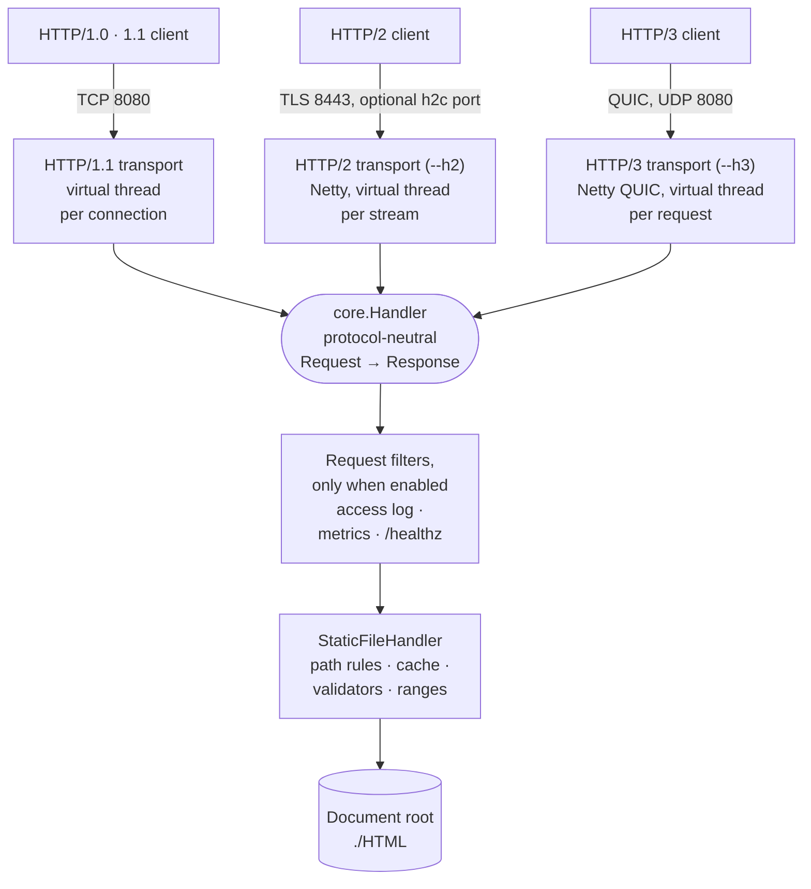

# sjws_nettask
Simple Java Web Server

A static file server on virtual threads: HTTP/1.0 and 1.1 over TCP, with opt-in HTTP/2 and HTTP/3
(QUIC) served by the same protocol-neutral core.

**Vision (roadmap, not shipped):** the end goal is a reliable, fast, low-latency message-oriented
middleware that is also a web server. Messaging, high availability and routing are being designed now
(see [docs/](docs/index.md)); they are not shipped features.

## Requirements

Java 25+ and Maven.

## Build

    mvn -B verify                 # build, all tests, coverage gate
    mvn -B -DskipTests package    # jar only: target/sjws_nettask-0.2-SNAPSHOT.jar + target/lib/

Copy `target/lib/` (Netty, QUIC natives) together with the jar.

## Run

    java -jar target/sjws_nettask-0.2-SNAPSHOT.jar 8080 ./HTML
    curl -i http://127.0.0.1:8080/

`--help` lists every option. Minimal config file (`--config=sjws.yaml`):

```yaml
server:
  port: 8080
  root: ./HTML
```

## Overview

Each transport parses its own wire format into the same protocol-neutral `Request`, calls one
`Handler`, and writes the `Response` back through its own writer, so all three protocols serve the
same files with the same status decisions. HTTP/2 and HTTP/3 are off by default; the ports shown are
the defaults.



The layers, the request flow and the design notes are in
[docs/design/architecture.md](docs/design/architecture.md).

## Documentation

Start at **[docs/index.md](docs/index.md)**: installation, command line and config file, HTTP/1.x,
HTTP/2, HTTP/3, access rules, caching, observability, daemon mode, admin console, architecture and
design notes, testing. See also [CONTRIBUTING.md](CONTRIBUTING.md) and [LICENSE](LICENSE).
