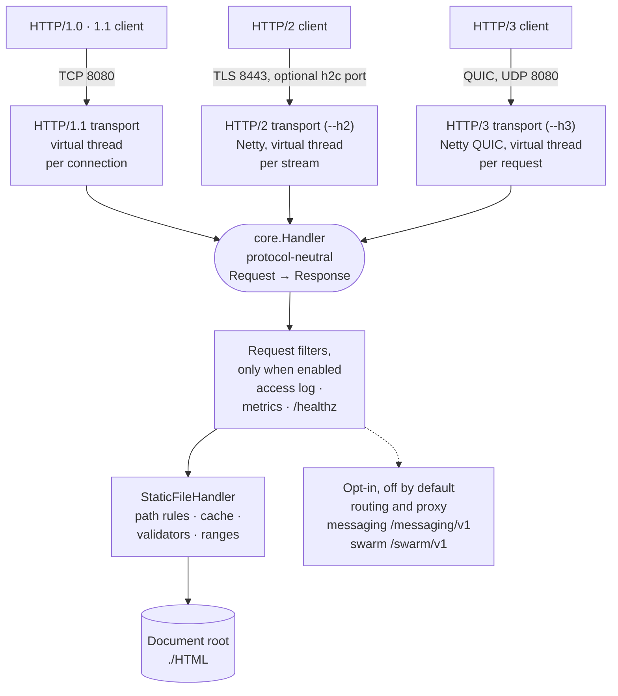

# sjws_nettask
SJWS — Swarm Java Web Services

SJWS is a reliable, fast, low-latency message-oriented middleware that is also a web server:
HTTP/1.x, HTTP/2 and HTTP/3, reverse proxy and gateway filters, a control plane, cluster HA
(per-group Raft), a messaging core (partitions, durable ledger, produce/fetch at `/messaging/v1`),
and an optional agent swarm. The repo name `sjws_nettask` and the acronym stay the same; packages
and artifacts are not renamed.

Full messaging replication across the cluster (`ReplicatedLedger`) and the later swarm phases
(S2/S3) are still planned — see the Status table.

## Status

Shipped = on `master`, with tests. Planned = from the design docs (drafts, subject to change).

| Area | Shipped | Planned |
|---|---|---|
| [HTTP/1.x](docs/user/http1.md) | HTTP/1.0/1.1, keep-alive, pipelining, chunked request bodies, OPTIONS (`http1`) | — |
| [HTTP/2](docs/user/http2.md) | opt-in h2 (TLS) and h2c on their own ports (`h2`) | — |
| [HTTP/3](docs/user/http3.md) | opt-in QUIC via Netty/quiche, opt-in `Alt-Svc` (`h3`, `tls`, `acme`) | browser upgrade needs `Alt-Svc` on a TLS-over-TCP listener (`--h2` serves one but does not send it yet) |
| [Static files](docs/user/caching-and-ranges.md) | no-follow opens, small-file cache, ETag/conditionals, byte ranges, [access rules](docs/user/access-rules.md) (`core`) | — |
| [Proxy / routing](docs/design/proxy-routing.md) | host-indexed `Router`, redirects, Netty-based streaming `ProxyHandler`, upstream discovery and balancing with passive health (`routing`) | — |
| [Gateway](docs/development/gateway.md) | JWT, API key, CORS, rate limit, quota, header rewrite, request-size filters (`gateway`) | — |
| [Control plane](docs/operations/control-plane.md) ([design](docs/design/control-plane.md)) | RBAC and audit (`controlplane`), signed config store, mTLS-only admin server, join tokens (`cp`), node roles and bootstrap (`service`), CONTROL-role hosting (Raft voters over mTLS TCP, watch and admin listeners), data-node watch client (`cp`) | voter-certificate-to-id binding, key ceremony CLI, membership changes ([hosting](docs/design/control-plane-hosting.md)) |
| [HA / cluster](docs/ha/design.md) | per-group Raft, membership and heartbeats, majority/witness quorum (`cluster`); drain, VIP hook, rolling restart (`ha`) | N-node gossip (SWIM), multi-site quorum, GSLB/anycast steering (§13) |
| [Messaging](docs/messaging/design.md) | segmented ledger with group commit, partitions with at-least-once delivery, lease fencing and extend, redelivery, DLQ, retention, stats (`messaging.*`), produce/fetch on plain log topics at `/messaging/v1`, off by default (`messaging.http`) | `Broker` API and admin endpoint, `ReplicatedLedger` on the cluster layer, client wire protocol |
| [Agent swarm](docs/design/agent-swarm.md) | S0 guard tests; S1: submit, claim with lease, fenced ack/nack/reject, DLQ, request/reply, `swarm.wire` codec, Python SDK unary (`swarm`, `sdk/python`); off by default | S2: token streaming, cancellation, W3C trace, agent CA/policy, GCRA quotas, budget cap; S3: per-node budgets, agent directory |

## Measured numbers

All measured on shared 8-vCPU boxes over loopback; see each report for method and caveats.

- [Footprint report](docs/benchmarks/footprint-report.md) (master `b8055fe`): startup median 168.1 ms; idle RSS 66,268 KB at 0 connections, 278,568 KB at 10,000.
- [Implementation and performance](docs/design/implementation-and-performance.md): HTTP/1.1, 1 KB file, 1000 connections: 218k req/s (S4 column of the throughput table).
- [Control-plane benchmarks](bench/controlplane/README.md): config compile, routing lookup, p99 under pushes, idle data-node footprint.
- [Proxy/routing phase 1 results](docs/design/proxy-routing.md#phase-1-results-2026-10-12-shared-8-vcpu-box-server-on-cpus-0-3-wrk-on-4-7).
- Harnesses: [bench/](bench/README.md), [footprint](bench/footprint/README.md), [perf gate](docs/development/perf-gate.md).

## Requirements

Java 25+ and Maven.

## Build

    mvn -B verify                 # build, all tests, coverage gate
    mvn -B -DskipTests package    # jar only: target/sjws_nettask-0.2-SNAPSHOT.jar + target/lib/

Copy `target/lib/` (Netty, QUIC natives) together with the jar.

## Run

    java -jar target/sjws_nettask-0.2-SNAPSHOT.jar 8080 ./HTML
    curl -i http://127.0.0.1:8080/

`--help` lists every option. Minimal config file (`--config=sjws.yaml`):

```yaml
server:
  port: 8080
  root: ./HTML
```

## Overview

Each transport parses its own wire format into the same protocol-neutral `Request`, calls one
`Handler`, and writes the `Response` back through its own writer, so all three protocols serve the
same files with the same status decisions. HTTP/2 and HTTP/3 are off by default; the ports shown are
the defaults.



The layers, the request flow and the design notes are in
[docs/design/architecture.md](docs/design/architecture.md).

## Documentation

Start at **[docs/index.md](docs/index.md)**: installation, command line and config file, HTTP/1.x,
HTTP/2, HTTP/3, access rules, caching, observability, daemon mode, admin console, architecture and
design notes, testing. See also [CONTRIBUTING.md](CONTRIBUTING.md) and [LICENSE](LICENSE).

## Security

Report vulnerabilities privately, never in a public issue: see [SECURITY.md](SECURITY.md).
