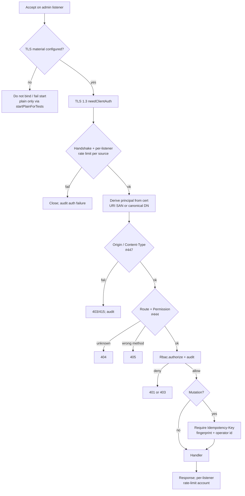

# Admin-channel authentication (#388)

Status: design for [#388](https://github.com/BlivionIaG/sjws_nettask/issues/388). Docs only; no code in
this change. Written against `origin/master` @ `2462f42`. Security input: sjws Security's #388 threat model and constraints (handoff to Architecture,
public-safe; assets, MUST/SHOULD, tests T1–T16, merge gates). Locked
decisions: [control-plane.md](control-plane.md) Decision 13 (mTLS-only admin auth; no admin bearer);
[#89](https://github.com/BlivionIaG/sjws_nettask/pull/89); peer TLS reload / revalidate
([#321](https://github.com/BlivionIaG/sjws_nettask/pull/321)); peer-registry epoch / replace ordering
([#442](https://github.com/BlivionIaG/sjws_nettask/pull/442)); `KeyRing.load` / `SecureKeyFile` /
stateDir floors; SIGHUP `reloadTls`.

Security design review: [APPROVED — Security at 017df3b](https://github.com/BlivionIaG/sjws_nettask/pull/445#pullrequestreview-5726063685).

This page is the network admin auth design for Architecture. It extends the existing `/cp/v1`
`AdminServer` rather than adding a second auth stack. It supersedes the bearer-token half of the
uncommitted Admin TUI cluster-admin draft v0.1 §9 (never committed; bearer section now out) and the
"mTLS and/or token" wording still present in
[#388](https://github.com/BlivionIaG/sjws_nettask/issues/388)'s acceptance criteria — Decision 13
wins.

Related docs: [control-plane.md](control-plane.md) §12.7–§12.8 and §14,
[control-plane-security.md](control-plane-security.md), [control-plane-hosting.md](control-plane-hosting.md),
[cp-console.md](../operations/cp-console.md).

### Prerequisites (Security hardening)

Three Security hardening PRs on the current admin path are **prerequisites** of the Architecture
implementing work. This design does **not** re-specify them:

1. **[#444](https://github.com/BlivionIaG/sjws_nettask/pull/444) admin route dispatch fails closed**
   (§3.3) — unmatched routes return 404/405 and cannot fall through to a grant. Covers
   threat-model dispatch fail-closed and wrong-method **405** (HTTP authz cases are T2b, not wrong-CA).
2. **[#447](https://github.com/BlivionIaG/sjws_nettask/pull/447) admin request validation** (§3.4) —
   if `Origin` is present it must be on an allowlist that is empty by default; the body must be
   `application/json` or the request gets **415**. TUI and curl docs stay compatible. Covers
   **T11** and the Content-Type rule.
3. **[#451](https://github.com/BlivionIaG/sjws_nettask/pull/451) admin connection handling on
   credential reload** (§3.6) — drop admin connections that fail policy after a CRL, denylist, or
   revoke reload, same bar as peer links after #321. Covers **T8** (drop half) and **T9**. Drop /
   replace ordering **MUST** follow #321 and [#442](https://github.com/BlivionIaG/sjws_nettask/pull/442)
   (see §3.6).

Architecture still fully specifies: rate limits per identity and per source (**T16**), with a
**separate rate table per listener**; CONTROL-host admin mTLS even on loopback (plain only via the
explicit test factory); `Idempotency-Key` on mutations (**T10**), fingerprint extended with the
operator id (#259); isolation/executor caps (**T12**/**T13**); RBAC remove/disable → live drop
(**MUST**, **T17**); and Raft-anchored audit as a **later** phase with **no** cross-voter integrity
claim until then.

---

## 1. Goal

Keep every network admin surface used by the CP console and any future node-local admin API:

1. Authenticated with mutual TLS 1.3 only (Decision 13).
2. Authorized per route through `Rbac` (deny by default).
3. Isolated from the content hot path (own listener, executor, and caps).
4. Off until explicitly enabled with listen address **and** TLS material; zero cost in `standalone`.
5. Fail closed on key / trust / audit errors. Live admin drop after CRL / denylist / revoke reload
   is delivered by [#451](https://github.com/BlivionIaG/sjws_nettask/pull/451) (same bar as #321 /
   #442 for peers). Removing or disabling an RBAC operator **MUST** also drop that principal's live
   admin connections (fail closed).

The embedded Admin TUI stays on in-process `ServerControl` and does not open a network admin port.
Node-local `/admin/v1` stays **out of #388** (see §7 Resolved).

---

## 2. As built (master `2462f42`)

Every claim in this section was checked against the source.

### 2.1 Network admin is `/cp/v1` on `AdminServer`

| Piece | Where | Behaviour |
|---|---|---|
| Hosted listener | `CpHost` | After store + watch, opens admin via `AdminServer.startMtls` when `serverTls("cp-admin")` returns material, else `AdminServer.startPlainForTests` after a loopback check (`CpHost.java:123–132`, `163–167`). |
| mTLS start | `AdminServer.start` / `startMtls` | TLS 1.3, `needClientAuth`; `start` refuses missing cert/key/CA (`AdminServer.java:62–94`, `127–140`). |
| Plain start | `AdminServer.startPlainForTests` | Loopback `HttpServer`; documented as tests only (`AdminServer.java:143–149`). Hosted path still calls it when admin TLS is null (`CpHost.java:126–128`). |
| Principal | `AdminServer.credential` | Verified peer cert → URI SAN starting with `urn:` preferred, else RFC 2253 canonical subject DN (`AdminServer.java:168–194`). `Authorization` is ignored (class javadoc `AdminServer.java:42–47`). |
| Routes | `CpAdmin.handle` / `permission` | Unknown method+path → `permission == null` → **404** (`CpAdmin.java:47–49`, `116–139`). No **405** / fall-through guard as of `2462f42` — [#444](https://github.com/BlivionIaG/sjws_nettask/pull/444) (prerequisite 1). |
| Authorize | `CpStore.authorize` → `Rbac.authorize` | Reached only after a successful mTLS handshake. Unknown / disabled (but CA-trusted) cert → 401; mapped but lacking permission → 403 (`CpAdmin.java:51–54`; `Rbac.java:118–136`). A wrong-CA client never gets here — the handshake fails. |
| Propose rbac/trust | `CpStore.propose` / `forbidden` | Bodies carrying `rbac` or `trust` rejected (`CpCoverageTest` and `CpStore`; control-plane.md §12.7). |
| Idempotency | `CpStore.replayed` | Blank / null `Idempotency-Key` skips the table and applies (`CpStore.java:1345–1348`). Console always sends a key (`HttpCpClient` javadoc). Fingerprint is method+path+body only — **no principal** (`CpStore.java:1365–1367`; `IdempotencyTable.java:44`). Target: extend fingerprint with operator id (§3.4, Resolved Q1). |
| Origin / Content-Type | `AdminServer.handle` | Not checked as of `2462f42`. Response `Content-Type` is set to `application/json` (`AdminServer.java:156–165`). Mutation `Origin` allowlist + require `application/json` (else 415) — [#447](https://github.com/BlivionIaG/sjws_nettask/pull/447) (prerequisite 2). |
| Rate limits | admin path | Not implemented on `AdminServer` / `CpAdmin`. control-plane.md §12.8 already lists per-identity and per-source token buckets for admin mutations (no numeric defaults there; see §3.5). |
| Reload | `CpHost.reload` / `CpServerTls.reloadTls` | Load new `KeyRing` with no side effects first; each listener `reloadTls()` keeps old material on failure; ring swaps only if all succeed (`CpHost.java:204–230`; `CpServerTls.java:122–134`). |
| Drop on reload | peers vs admin | `CpPeerSockets` registers `tls.afterReload(this::dropPeersFailingPolicy)` and closes live peers that fail revalidate (`CpPeerSockets.java:102`, `358–387`), with #442 epoch / replace rules. Admin `startMtls` has no equivalent hook as of `2462f42` (`AdminServer.java:127–140`) — [#451](https://github.com/BlivionIaG/sjws_nettask/pull/451) (prerequisite 3). |
| Audit | `Rbac.authorize` + `AuditLog` | Every decision appended before return; audit I/O failure → denied (`Rbac.java:129–134`). Per-voter hash-chained `<stateDir>/audit.jsonl`; **not Raft-replicated** (control-plane.md §4 / §12; `AuditLog.java:31–41`). |
| Last admin | `Rbac.change` | Refuse a change that would leave no enabled admin (`Rbac.java:169–177`). |
| Secure keys | `SecureKeyFile` / `CpServerTls.checkKey` | Owner/mode, NOFOLLOW leaf, secure parents on secret key read (`SecureKeyFile.java:71+`; `CpServerTls.java:146–154`). |
| Standalone cost | `ClassLoadTest` | Standalone bench server must not load `sjws_nettask.cp.*` (`tests/.../cp/ClassLoadTest.java:32–74`). Console package never referenced from server sources (`CpConsoleTest.serverNeverReferencesTheConsole`). |
| Embedded TUI | `AdminTui` / `ServerControl` | In-process only (`AdminTui.java:44–52`; `ServerControl.java`). CP console is a separate entry (`admin.cp.HttpCpClient` → `/cp/v1` over mTLS). |

### 2.2 What Decision 13 already closed

control-plane.md Decision 13: admin authentication is mTLS only; `Rbac.Token` is not an admin
credential; join tokens stay enrollment-only. `Rbac.Credential` is a sealed interface that permits
only `ClientCert` (`Rbac.java:45–51`). The old draft's bearer-token section is out of scope for
implementation and for this design.

---

## 3. Target design

### 3.1 Single network admin channel: extend `/cp/v1`

- **MUST** treat hosted `AdminServer` + `CpAdmin` as the network admin channel for cluster control.
- **MUST NOT** ship a second parallel auth scheme for the same mutations (no `/admin/v1` auth stack
  that reimplements RBAC/TLS).
- Node-local `/admin/v1` stays **out of #388**. Bringing it in later **MUST** meet every Security
  threat-model §4 MUST (same operator CA + `Rbac` or a documented stricter subset, mTLS even on
  loopback for production, Origin allowlist + JSON-or-415, principal-bound `Idempotency-Key` on
  mutations, per-identity/per-source rate limits, audit fail→deny, reload/revoke/RBAC live drop,
  fail-closed dispatch, zero-cost when off) **and** a separate Security sign-off. #396 data-node
  status HTTP stays separate.

### 3.2 Authentication (mTLS only)

| Requirement | Design |
|---|---|
| TLS 1.3, `needClientAuth`, admin-CA trust, no protocol fallback, no 0-RTT | Keep `CpServerTls.parameters()` / `AdminServer` configurator (`AdminServer.java:88–92`, `CpServerTls.java:72–74`). |
| Principal from verified client cert only | Keep `AdminServer.credential`; never read `Authorization`, cookies, or join tokens as admin credentials. **T3 (gate).** |
| Refuse non-loopback admin without TLS | Already: `CpHost.loopback` when TLS null (`CpHost.java:163–167`). **T6 (gate).** |
| Refuse missing/unreadable TLS material | Keep `AdminServer.start` / `CpServerTls` + `SecureKeyFile`. **T1, T7 (gate).** |
| Production control: mTLS even on loopback | **Architecture change:** hosted control **MUST NOT** call `startPlainForTests`. Plain transport only through that explicit test factory (or a renamed test-only entry). Missing admin TLS on the control role → fail start (fail closed), same as missing peer/watch material. Not in Security's three hardening PRs. |
| Embedded TUI | Unchanged: `ServerControl` in-process; no network port by default. |

### 3.3 Authorization

| Requirement | Design |
|---|---|
| Every route authorized; deny by default | Keep `CpAdmin.permission` → `store.authorize`. A client cert from an **untrusted CA** fails the **TLS handshake** (no HTTP status). A trusted but unmapped / disabled cert → **401**; mapped but lacking permission → **403**. **T2a** / **T2b** / viewer-mutate **403**. |
| Roles `viewer` < `operator` < `admin` | Keep control-plane.md §12.7 / `Role.allows`. `MANAGE_OPERATORS` admin-only. **T5 (gate)** last enabled admin. |
| Propose must not carry `rbac` / `trust` | Keep. **T4 (gate).** |
| Unmatched routes fail closed | **Prerequisite:** [#444](https://github.com/BlivionIaG/sjws_nettask/pull/444) — unmatched routes return 404/405 and cannot fall through to a grant. As of `2462f42`, wrong method is 404 (`CpAdmin.java:47–49`); grant tail at `CpAdmin.java:108–113`. |
| Coordinator forwarding | Any future hop **MUST** preserve the original principal (signed on-behalf-of or equivalent). Out of scope for the first implementing PRs; record as non-goal until HA defines forwarding. |
| Optional auditor for payload-bearing ledger | Deferred until that surface exists (#384); until then payloads stay redacted for viewer/operator. |

### 3.4 HTTP / replay / CSRF

| Requirement | Design |
|---|---|
| `Idempotency-Key` on every state-changing POST | **Architecture change:** refuse mutations with missing/blank key (400), **including** `POST /cp/v1/config:validate`. Reuse `IdempotencyTable` (#259). **T10.** Not in Security's three hardening PRs. |
| Bind idempotency to principal fingerprint | **MUST** for new writes: extend the request fingerprint with the authenticated operator id (canonical SAN/DN), so one operator cannot replay another's key outcome. Document the finite-window break for keys issued before the change (#259 window). **Do not** bump `IdempotencyTable.Entry` or the snapshot encoding unless fingerprint extension cannot stay deterministic across voters (Resolved Q1). Today the table carries no principal (`IdempotencyTable.java:44`; fingerprint `CpStore.java:1365–1367`). |
| Non-browser API | **Prerequisite:** [#447](https://github.com/BlivionIaG/sjws_nettask/pull/447) — mutations require `Content-Type: application/json` or **415**. TUI/curl docs stay compatible. |
| Reject unexpected `Origin` | **Prerequisite:** [#447](https://github.com/BlivionIaG/sjws_nettask/pull/447) — if `Origin` is present and not on an allowlist (default **empty**), refuse. **T11 (gate).** |
| No cookies for admin auth | Already true; keep. |

### 3.5 Isolation and DoS

| Requirement | Design |
|---|---|
| Own bind / accept / executor / caps | **Change:** give `AdminServer` a bounded low-priority executor (small platform-thread pool or capped virtual-thread semaphore), separate connection and queue caps from content `ClientManager`. Admin queue full → refuse new admin work (503), never block content accept. **T12 (gate for #388 AC), T13.** |
| Rate limit handshakes and mutations | **Architecture change:** token buckets **local to each admin listener** (a separate rate table per `AdminServer` / listen address — **MUST NOT** share a process-wide static limiter). Per source address and per authenticated principal; failed auth counts toward the source bucket and, when a principal is known, the identity bucket; audited. A **503** rate-limit (or queue-full) response **MUST NOT** stall reading request content (return without draining a large body on the content path). **T16**, **T16b**. Not in Security's three hardening PRs. |
| Starting defaults (Security; §12.8 names buckets but gives no numbers) | Handshakes: **5/s** per source, burst **10**. Mutations: **30/s** per source (burst **60**) and **20/s** per principal (burst **40**). Handshake timeout **10 s**, idle timeout **60 s** (aligned with control-plane.md §12.8). Tune only with evidence. |
| Cap body, headers, idle/handshake | Align with the timeouts above; body/header caps per §12.8. Admin listener today has no explicit body/header cap in `AdminServer.handle` (reads all bytes). |

### 3.6 Reload, revocation, fail-closed

| Requirement | Design |
|---|---|
| SecureKeyFile for keys; public variant for CA | Keep. **T7 (gate).** |
| Fail closed on key/CA/trust errors | Keep `CpHost.reload` / `CpServerTls.reloadTls` behaviour. **T8** (keep-old half). |
| Revocation at handshake | Keep `AdminTls` revocation path where configured; hosted path uses `CpServerTls`. |
| Drop live admin connections after successful reload / revoke apply | **Prerequisite:** [#451](https://github.com/BlivionIaG/sjws_nettask/pull/451) — after CRL / denylist / revoke reload, drop admin connections that fail policy. **T8 (drop half), T9 (gate).** Architecture does not re-implement the TLS-reload drop path. |
| #451 drop / replace ordering (#321 + #442) | **MUST** match peer `dropPeersFailingPolicy` / `registerLive` ordering: (1) bump the TLS epoch **at the start** of the drop sweep so a concurrent register cannot escape the reload; (2) copy the live map and walk the snapshot; (3) already-closed sockets: `live.remove(socket)` **by key** (not by value) so a concurrent Live replace cannot leave a closed socket in the map; (4) on policy fail: if `live.get(socket)` is no longer the snapshotted Live, **skip** — do not abort the newer entry; otherwise abort, then remove **by key**; (5) `registerLive` reads the epoch, enforces policy, puts, and retries if the epoch moved, with a hard retry budget (`REGISTER_LIVE_MAX_ATTEMPTS = 32` on peers after #442) that **fails closed** when exceeded. Admin #451 **MUST** keep this epoch-bump-before-sweep and by-key / stale-skip replace discipline. |
| RBAC remove / disable → live drop | **MUST** (fail closed): when `removeOperator` / disable commits and is visible on this voter, drop every live admin connection whose principal no longer passes policy (same bar as CRL / denylist / revoke). **T17.** Architecture owns this trigger if #451 covers only TLS/credential reload. |
| KeyRing anti-rollback floors | Keep `KeyRing.load` floors; SIGHUP order unchanged (`CpHost.java:204–230`). |
| No secrets in responses / audit detail | Keep; redaction scan in **T15**. |

### 3.7 Audit

| Requirement | Design |
|---|---|
| Audit every authz decision before return; audit failure → deny | Keep `Rbac.authorize`. **T15.** |
| Fields | actor SAN/id, role, action, target, version/raftIndex when applicable, result, source address, timestamp. Source address is weak today on the JDK `HttpServer` adapter — capture remote address in `AdminServer.handle` when auditing. |
| Cross-voter integrity | **Non-goal for #388 implementing PRs.** As built, audit is per-voter hash-chained and not Raft-replicated (control-plane.md §4). This design **MUST** keep documenting that limitation and **MUST NOT** claim multi-voter audit integrity until audit entries go through Raft (or an equivalent replicated anchor of `AuditLog.head()`). Track as a later CP item. |

### 3.8 Secure defaults / zero cost when off

| Requirement | Design |
|---|---|
| Off until enabled | `standalone` constructs no `CpHost` / `AdminServer`. Control role requires `cp.admin.listen` and TLS material (after §3.2 change). Never bind `0.0.0.0` without explicit operator config (document + validate). |
| Default bind | Loopback or a named management address only when set. |
| Zero cost when off | **Prove with a class-load guard** in the style of `tests/sjws_nettask/cp/ClassLoadTest.java`: `standalone` loads no `sjws_nettask.cp.AdminServer` / admin network stack; console package stays out of the server classpath use path (existing `CpConsoleTest.serverNeverReferencesTheConsole`). **T14 (gate).** |
| #396 | Out of scope; separate Security sign-off. |

---

## 4. Request flow (target)

---

## 5. Alternatives considered

| Alternative | Why rejected |
|---|---|
| Bearer / API tokens alongside mTLS (old draft §9) | Decision 13; threat model §4.1 / §5. Tokens become a second secret channel, cookie-adjacent for browsers, and duplicate RBAC. Join tokens stay enrollment-only. |
| Separate `/admin/v1` auth stack | Duplicates TLS, RBAC, audit, reload. Threat model §4.8: extend `/cp/v1`. Out of #388; later needs every §4 MUST + separate Security sign-off. |
| Trust loopback without mTLS in production | Other local users share the OS (threat model §2). Production control uses mTLS even on loopback; plain only via explicit test factory. |
| Cookie / browser session admin UI | Non-goal (§5 of threat model); CSRF surface without benefit. |
| Rely on TLS material swap alone without closing established sockets | Rejected; admin matches the #321 / #442 peer bar. Delivered by [#451](https://github.com/BlivionIaG/sjws_nettask/pull/451). |
| Bump `IdempotencyTable.Entry` / snapshot format for principal bind | Rejected unless fingerprint extension cannot stay deterministic across voters. Prefer fingerprint + operator id; document finite-window break (#259). |
| Process-wide static rate-limit table | Rejected; buckets **MUST** be per-listener (Security review). |
| Replicated audit in the first #388 PR | Large CP change; document the gap instead and schedule Raft-anchored audit separately. |
| Unauthenticated loopback `/healthz` on the admin port | Old draft §4. Out: unauthenticated callers get nothing on the admin channel (threat model §4.1 / issue AC). Content `/healthz` stays separate if it exists. |

---

## 6. Tests and merge gates

### 6.1 Tests (from Security threat model §6, plus Architecture additions)

Each row maps to a design section. Kind:

- **preserve** — already true on master (existing tests keep passing; do **not** require a red→green flip).
- **red→green** — new or incomplete protection; the implementing PR's test **MUST** fail on master at runtime and pass on the PR.

| # | Test | Design section | Kind | Notes |
|---|---|---|---|---|
| T1 | Missing cert/key/CA → admin listener does not bind | §3.2 | preserve | e.g. `AdminTlsTest.missingMaterialRefusesToStart` |
| T2a | Client cert from an untrusted CA → **TLS handshake failure** (no HTTP 401) | §3.3 | preserve | mTLS `needClientAuth` + admin-CA trust; never reaches `CpAdmin` |
| T2b | Trusted but unmapped / disabled cert → **401**; mapped viewer on mutate → **403** | §3.3 | preserve | e.g. `ConsoleApiTest` / role mapping tests |
| T3 | `Authorization: Bearer …` ignored; mTLS principal wins | §3.2 | preserve | e.g. `AdminTlsTest.mtlsMapsRolesAndIgnoresBearerTokens` |
| T4 | Propose with embedded rbac/trust → rejected | §3.3 | preserve | |
| T5 | Last enabled admin cannot be removed | §3.3 | preserve | |
| T6 | Non-loopback admin without TLS refused at start | §3.2 | preserve | `CpHost.loopback` |
| T7 | SecureKeyFile refuses bad mode/symlink/parent for admin key | §3.6 | preserve | |
| T8 | reloadTls failure keeps old material; success drops admin clients failing new policy | §3.6 | red→green (drop half) | Keep-old may already hold; drop half: [#451](https://github.com/BlivionIaG/sjws_nettask/pull/451); ordering per #321/#442 |
| T9 | Revoked operator cert fails new handshake; live connection closed after reload/revoke | §3.6 | red→green | [#451](https://github.com/BlivionIaG/sjws_nettask/pull/451) |
| T10 | Mutation without Idempotency-Key refused (including `config:validate`) | §3.4 | red→green | Architecture; fingerprint includes operator id |
| T11 | Cross-origin mutation with `Origin` not on allowlist refused | §3.4 | red→green | [#447](https://github.com/BlivionIaG/sjws_nettask/pull/447) (+ 415 on bad Content-Type) |
| T12 | Content overload does not starve drain/admin (unit/fake) | §3.5 | red→green | #388 AC |
| T13 | Admin flood hits admin caps only; content accept still progresses | §3.5 | red→green | |
| T14 | Class-load: `standalone` loads no cp admin stack | §3.8 | preserve | `ClassLoadTest` |
| T15 | Audit failure → action denied; audit line redaction scan | §3.7 | preserve (deny) / extend (redaction) | Deny-on-audit-fail already in `Rbac.authorize` |
| T16 | Rate limit: burst of failed handshakes / mutations from one IP is throttled; tables are per-listener | §3.5 | red→green | Architecture |
| T16b | A 503 rate-limit (or admin-queue-full) response does **not** stall on request content | §3.5 | red→green | Architecture; next to T13/T16 |
| T17 | After `removeOperator` / disable commits and is visible on this voter, that principal's live admin connections are dropped (fail closed) | §3.6 | red→green | Architecture MUST |

### 6.2 Merge gates (threat model §7)

1. This design cites the threat model and Decision 13; Security **APPROVED** review on the design before code that widens the admin surface ([review on 017df3b](https://github.com/BlivionIaG/sjws_nettask/pull/445#pullrequestreview-5726063685)).
2. One PR per issue; CI green; no push to master / no force-push.
3. **Preserve** tests in §6.1 stay green on master and on the PR (do not invent a red→green flip for them). **red→green** tests in §6.1 fail on master at runtime and pass on the implementing PR.
4. Feature off → class-load proof (T14, preserve); no new listener in `standalone`.
5. Hot-path / request-path untouched; if any shared code changes, wrk before/after under bench rule #263 (≥9 valid blocks + A/A; FAIL only if p < 0.05 and geomean > 1.10).
6. Public PR text stays neutral (no exploit narrative); hold line: "Do not merge until inceptor approves".
7. Owner reviews when Arch/MC/HTTP code is touched; Security reviews auth/TLS/RBAC/audit pieces.
8. Private findings (if any) cleared or explicitly deferred with inceptor before merge.

This PR is **docs only** (design). It does not close #388. Implementing PRs follow §8.

---

## 7. Resolved and open questions

### Resolved (Security review on 017df3b)

1. **Idempotency wire format (#259).** Extend the fingerprint with the authenticated operator id (canonical SAN/DN). Document the break for keys issued before the change (window is finite). Do **not** bump `Entry` or the snapshot format unless fingerprint extension cannot stay deterministic across voters.
2. **`config:validate` and the key.** Require `Idempotency-Key` for uniformity. Origin + Content-Type rules from #447 still apply.
3. **Hardening PR numbers.** [#444](https://github.com/BlivionIaG/sjws_nettask/pull/444) fail-closed dispatch; [#447](https://github.com/BlivionIaG/sjws_nettask/pull/447) Origin + JSON-or-415; [#451](https://github.com/BlivionIaG/sjws_nettask/pull/451) credential-reload drop.
4. **RBAC remove / disable → live drop.** **MUST**, fail closed: when the change is visible on this voter, drop that principal's live admin connections (same bar as CRL / denylist / revoke). **T17.**
5. **Node-local `/admin/v1`.** Out of #388. Later: every threat-model §4 MUST + separate Security sign-off (#396 stays separate).
6. **Rate-limit defaults.** Security starting defaults (per-listener, not Raft): handshakes **5/s** per source (burst **10**); mutations **30/s** per source (burst **60**) and **20/s** per principal (burst **40**); failed auth counts; handshake **10 s**, idle **60 s** (§12.8). See §3.5.

### Still open

1. **Admin live-drop owner split.** #451 covers CRL / denylist / revoke reload. Confirm whether RBAC remove/disable drop (**T17**) lands in an Architecture follow-up on top of #451's registry, or in a Security follow-up — either way the MUST in §3.6 stands.
2. *(none else for design)* Tune rate-limit numbers only with evidence after T16 lands.

---

## 8. Phased implementation (small PRs)

One PR per issue / slice. Docs and tests do not need benches unless a shared hot-path type changes (gate 5).

| Phase | PR scope | Primary tests | Notes |
|---|---|---|---|
| 0 | **This doc** | n/a | Security design approval ([review](https://github.com/BlivionIaG/sjws_nettask/pull/445#pullrequestreview-5726063685)) |
| P | [#444](https://github.com/BlivionIaG/sjws_nettask/pull/444), [#447](https://github.com/BlivionIaG/sjws_nettask/pull/447), [#451](https://github.com/BlivionIaG/sjws_nettask/pull/451) | T8 drop, T9, T11, 404/405, 415 | Prerequisites; #451 ordering per #321/#442 |
| A | Fail closed: no hosted plain admin; mTLS required for CONTROL admin even on loopback | T1, T6, T14 | Architecture |
| B | Require `Idempotency-Key` on all mutations including `config:validate`; fingerprint + operator id | T10 | Architecture; #259 finite-window break; no Entry/snapshot bump unless required |
| C | Bounded admin executor + connection/body caps; isolation from content | T12, T13 | Core #388 AC |
| D | Per-listener rate tables; defaults in §3.5; 503 does not stall on body | T16, T16b, T15 | Architecture |
| E | RBAC remove/disable → live drop (if not already in #451) | T17 | Architecture MUST; fail closed |
| F | Audit remote address field (if not already present after Security PRs) | T15 | Small follow-up |
| Later | Raft-replicated / anchored audit | — | Explicit later phase; no cross-voter claim until then |
| Later | Node-local `/admin/v1` if still wanted | every threat-model §4 MUST | Separate issue + Security sign-off |

Do not open Architecture PRs that re-implement #444 / #447 / #451.

---

## 9. Non-goals (v1 / this design)

Copied and tightened from the threat model §5:

- Admin bearer tokens or API keys as a production auth factor.
- Web UI / cookie session auth for admin.
- Editing or returning secret plaintext through the admin API.
- Automatic membership gossip discovery (HA owns membership).
- Using join tokens or node certificates as admin credentials.
- Replacing in-process `ServerControl` for the embedded TUI.
- Making #396 data-node status part of this design.
- Shipping node-local `/admin/v1` under #388.
- Perfect wipe of secrets from the JVM heap (operational controls: no heap dump, `ulimit -c 0`).
- Claiming audit integrity across voters before audit is Raft-anchored.

---

## 10. Handoff

- **Security:** design APPROVED at 017df3b; this follow-up fills N1–N4 and Resolved §7. Land #444 / #447 / #451; keep #451 drop ordering aligned with #321 / #442.
- **inceptor:** merge this docs PR when the hold clears; do not close #388.
- **Architecture:** implement phases A–F after the Security prerequisites; do not re-specify #444 / #447 / #451. Ping Security on auth/TLS/RBAC/audit code review.
- **Observability / Admin TUI:** keep using `/cp/v1` + mTLS console; no bearer path; embedded TUI stays on `ServerControl`. Stay compatible with #447 Origin/Content-Type rules (curl/TUI docs).
