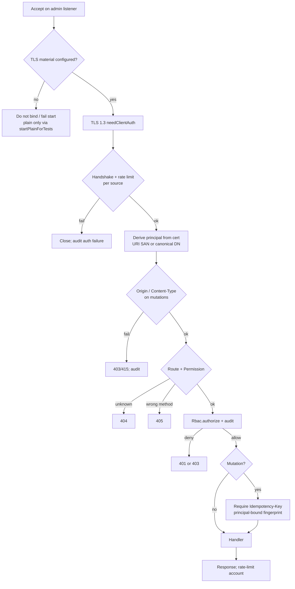

# Admin-channel authentication (#388)

Status: design for [#388](https://github.com/BlivionIaG/sjws_nettask/issues/388). Docs only; no code in
this change. Written against `origin/master` @ `2462f42`. Security input: sjws Security's #388 threat model and constraints (handoff to Architecture,
public-safe; assets, MUST/SHOULD, tests T1–T16, merge gates). Locked
decisions: [control-plane.md](control-plane.md) Decision 13 (mTLS-only admin auth; no admin bearer);
[#89](https://github.com/BlivionIaG/sjws_nettask/pull/89); peer TLS reload / revalidate
([#321](https://github.com/BlivionIaG/sjws_nettask/pull/321)); `KeyRing.load` / `SecureKeyFile` /
stateDir floors; SIGHUP `reloadTls`.

This page is the network admin auth design for Architecture. It extends the existing `/cp/v1`
`AdminServer` rather than adding a second auth stack. It supersedes the bearer-token half of the
uncommitted Admin TUI cluster-admin draft v0.1 §9 (never committed; bearer section now out) and the
"mTLS and/or token" wording still present in
[#388](https://github.com/BlivionIaG/sjws_nettask/issues/388)'s acceptance criteria — Decision 13
wins.

Related docs: [control-plane.md](control-plane.md) §12.7–§12.8 and §14,
[control-plane-security.md](control-plane-security.md), [control-plane-hosting.md](control-plane-hosting.md),
[cp-console.md](../operations/cp-console.md).

Security will land separate hardening PRs on the current admin path for some of the gaps below.
Items that may overlap are marked **may be covered by Security hardening PR — confirm** so this
design does not duplicate them.

---

## 1. Goal

Keep every network admin surface used by the CP console and any future node-local admin API:

1. Authenticated with mutual TLS 1.3 only (Decision 13).
2. Authorized per route through `Rbac` (deny by default).
3. Isolated from the content hot path (own listener, executor, and caps).
4. Off until explicitly enabled with listen address **and** TLS material; zero cost in `standalone`.
5. Fail closed on key / trust / audit errors; drop live admin connections that fail policy after
   reload or revoke, at the same bar as peer links after #321.

The embedded Admin TUI stays on in-process `ServerControl` and does not open a network admin port.

---

## 2. As built (master `2462f42`)

Every claim in this section was checked against the source.

### 2.1 Network admin is `/cp/v1` on `AdminServer`

| Piece | Where | Behaviour |
|---|---|---|
| Hosted listener | `CpHost` | After store + watch, opens admin via `AdminServer.startMtls` when `serverTls("cp-admin")` returns material, else `AdminServer.startPlainForTests` after a loopback check (`CpHost.java:123–132`, `163–167`). |
| mTLS start | `AdminServer.start` / `startMtls` | TLS 1.3, `needClientAuth`; `start` refuses missing cert/key/CA (`AdminServer.java:62–94`, `127–140`). |
| Plain start | `AdminServer.startPlainForTests` | Loopback `HttpServer`; documented as tests only (`AdminServer.java:143–149`). Hosted path still calls it when admin TLS is null (`CpHost.java:126–128`). |
| Principal | `AdminServer.credential` | Verified peer cert → URI SAN starting with `urn:` preferred, else RFC 2253 canonical subject DN (`AdminServer.java:168–194`). `Authorization` is ignored (class javadoc `AdminServer.java:42–47`). |
| Routes | `CpAdmin.handle` / `permission` | Unknown method+path → `permission == null` → **404** (`CpAdmin.java:47–49`, `116–139`). No **405** today. |
| Authorize | `CpStore.authorize` → `Rbac.authorize` | Unknown / disabled cert → 401; mapped but lacking permission → 403 (`CpAdmin.java:51–54`; `Rbac.java:118–136`). |
| Propose rbac/trust | `CpStore.propose` / `forbidden` | Bodies carrying `rbac` or `trust` rejected (`CpCoverageTest` and `CpStore`; control-plane.md §12.7). |
| Idempotency | `CpStore.replayed` | Blank / null `Idempotency-Key` skips the table and applies (`CpStore.java:1345–1348`). Console always sends a key (`HttpCpClient` javadoc). Fingerprint is method+path+body only — **no principal** (`CpStore.java:1365–1367`; `IdempotencyTable.java:44`). |
| Origin / Content-Type | `AdminServer.handle` | Not checked. Response `Content-Type` is set to `application/json` (`AdminServer.java:156–165`). |
| Rate limits | admin path | Not implemented on `AdminServer` / `CpAdmin`. control-plane.md §12.8 already lists per-identity and per-source token buckets for admin mutations. |
| Reload | `CpHost.reload` / `CpServerTls.reloadTls` | Load new `KeyRing` with no side effects first; each listener `reloadTls()` keeps old material on failure; ring swaps only if all succeed (`CpHost.java:204–230`; `CpServerTls.java:122–134`). |
| Drop on reload | peers vs admin | `CpPeerSockets` registers `tls.afterReload(this::dropPeersFailingPolicy)` and closes live peers that fail revalidate (`CpPeerSockets.java:102`, `358–387`). **Admin `startMtls` does not register an equivalent hook** (`AdminServer.java:127–140`). |
| Audit | `Rbac.authorize` + `AuditLog` | Every decision appended before return; audit I/O failure → denied (`Rbac.java:129–134`). Per-voter hash-chained `<stateDir>/audit.jsonl`; **not Raft-replicated** (control-plane.md §4 / §12; `AuditLog.java:31–41`). |
| Last admin | `Rbac.change` | Refuse a change that would leave no enabled admin (`Rbac.java:169–177`). |
| Secure keys | `SecureKeyFile` / `CpServerTls.checkKey` | Owner/mode, NOFOLLOW leaf, secure parents on secret key read (`SecureKeyFile.java:71+`; `CpServerTls.java:146–154`). |
| Standalone cost | `ClassLoadTest` | Standalone bench server must not load `sjws_nettask.cp.*` (`tests/.../cp/ClassLoadTest.java:32–74`). Console package never referenced from server sources (`CpConsoleTest.serverNeverReferencesTheConsole`). |
| Embedded TUI | `AdminTui` / `ServerControl` | In-process only (`AdminTui.java:44–52`; `ServerControl.java`). CP console is a separate entry (`admin.cp.HttpCpClient` → `/cp/v1` over mTLS). |

### 2.2 What Decision 13 already closed

control-plane.md Decision 13: admin authentication is mTLS only; `Rbac.Token` is not an admin
credential; join tokens stay enrollment-only. `Rbac.Credential` is a sealed interface that permits
only `ClientCert` (`Rbac.java:45–51`). The old draft's bearer-token section is out of scope for
implementation and for this design.

---

## 3. Target design

### 3.1 Single network admin channel: extend `/cp/v1`

- **MUST** treat hosted `AdminServer` + `CpAdmin` as the network admin channel for cluster control.
- **MUST NOT** ship a second parallel auth scheme for the same mutations (no `/admin/v1` auth stack
  that reimplements RBAC/TLS).
- If a later issue adds node-local `/admin/v1` for drain/metrics, it **MUST** meet every MUST in
  Security's threat model §4 and **MUST** reuse the same operator CA + `Rbac` mapping (or a
  documented stricter subset). That surface is **not** part of the #388 implementing PRs; #396
  data-node status HTTP needs a separate Security sign-off and stays out of this design.

### 3.2 Authentication (mTLS only)

| Requirement | Design |
|---|---|
| TLS 1.3, `needClientAuth`, admin-CA trust, no protocol fallback, no 0-RTT | Keep `CpServerTls.parameters()` / `AdminServer` configurator (`AdminServer.java:88–92`, `CpServerTls.java:72–74`). |
| Principal from verified client cert only | Keep `AdminServer.credential`; never read `Authorization`, cookies, or join tokens as admin credentials. **T3 (gate).** |
| Refuse non-loopback admin without TLS | Already: `CpHost.loopback` when TLS null (`CpHost.java:163–167`). **T6 (gate).** |
| Refuse missing/unreadable TLS material | Keep `AdminServer.start` / `CpServerTls` + `SecureKeyFile`. **T1, T7 (gate).** |
| Production control: mTLS even on loopback | **Change:** hosted control **MUST NOT** call `startPlainForTests`. Plain transport only through that explicit test factory (or a renamed test-only entry). Missing admin TLS on the control role → fail start (fail closed), same as missing peer/watch material. **may be covered by Security hardening PR — confirm** |
| Embedded TUI | Unchanged: `ServerControl` in-process; no network port by default. |

### 3.3 Authorization

| Requirement | Design |
|---|---|
| Every route authorized; deny by default | Keep `CpAdmin.permission` → `store.authorize`. Unmapped / disabled → 401; lacking permission → 403. **T2 (gate).** |
| Roles `viewer` < `operator` < `admin` | Keep control-plane.md §12.7 / `Role.allows`. `MANAGE_OPERATORS` admin-only. **T5 (gate)** last enabled admin. |
| Propose must not carry `rbac` / `trust` | Keep. **T4 (gate).** |
| Unmatched routes fail closed | Keep 404 for unknown path. **Change:** known path, wrong method → **405**. Make `CpAdmin.handle` a strict match (no fall-through into `grant` after the listed routes; today only `/cp/v1/rbac` reaches that tail). Today wrong method is 404 (`CpAdmin.java:47–49`, `108–113`). |
| Coordinator forwarding | Any future hop **MUST** preserve the original principal (signed on-behalf-of or equivalent). Out of scope for the first implementing PRs; record as non-goal until HA defines forwarding. |
| Optional auditor for payload-bearing ledger | Deferred until that surface exists (#384); until then payloads stay redacted for viewer/operator. |

### 3.4 HTTP / replay / CSRF

| Requirement | Design |
|---|---|
| `Idempotency-Key` on every state-changing POST | **Change:** refuse mutations with missing/blank key (400), except documented read-only POSTs if any remain (`config:validate` is a dry-run — treat as mutation for CSRF headers but it may omit idempotency **or** require a key; pick require-key for uniformity). Reuse `IdempotencyTable` (#259). **T10.** **may be covered by Security hardening PR — confirm** |
| Bind idempotency to principal fingerprint | **Change (SHOULD → MUST for new writes):** include the authenticated operator id (canonical SAN/DN) in the fingerprint or in the table key so one operator cannot replay another's key outcome. Needs a wire/log-compatible plan (see §7 open questions). `IdempotencyTable` today carries no principal (`IdempotencyTable.java:44`). |
| Non-browser API | **Change:** require `Content-Type: application/json` (media type, ignore parameters) on mutations. **may be covered by Security hardening PR — confirm** |
| Reject unexpected `Origin` | **Change:** if `Origin` is present and not on an explicit allowlist (default **empty**), refuse the mutation (403). Fail closed. **T11 (gate).** **may be covered by Security hardening PR — confirm** |
| No cookies for admin auth | Already true; keep. |

### 3.5 Isolation and DoS

| Requirement | Design |
|---|---|
| Own bind / accept / executor / caps | **Change:** give `AdminServer` a bounded low-priority executor (small platform-thread pool or capped virtual-thread semaphore), separate connection and queue caps from content `ClientManager`. Admin queue full → refuse new admin work (503), never block content accept. **T12 (gate for #388 AC), T13.** |
| Rate limit handshakes and mutations | **Change:** token bucket per source address and per authenticated principal; failed auth counts toward the limit and is audited. Align defaults with control-plane.md §12.8. **T16.** **may be covered by Security hardening PR — confirm** |
| Cap body, headers, idle/handshake | Align with §12.8 (10 s handshake, 60 s idle; body/header caps). Admin listener today has no explicit body/header cap in `AdminServer.handle` (reads all bytes). |

### 3.6 Reload, revocation, fail-closed

| Requirement | Design |
|---|---|
| SecureKeyFile for keys; public variant for CA | Keep. **T7 (gate).** |
| Fail closed on key/CA/trust errors | Keep `CpHost.reload` / `CpServerTls.reloadTls` behaviour. **T8** (keep-old half). |
| Revocation at handshake | Keep `AdminTls` revocation path where configured; hosted path uses `CpServerTls`. |
| Drop live admin connections after successful reload / revoke apply | **Change:** register a live-admin registry on `startMtls` (accept → track SSLSocket / exchange SSLSession; complete → untrack). On `CpServerTls.afterReload` (and on operator revoke / RBAC disable that should cut live sessions), revalidate each live connection against current trust + operator table; close those that fail — same shape as `CpPeerSockets.dropPeersFailingPolicy` (`CpPeerSockets.java:358–387`). **T8 (drop half), T9 (gate).** **may be covered by Security hardening PR — confirm** |
| KeyRing anti-rollback floors | Keep `KeyRing.load` floors; SIGHUP order unchanged (`CpHost.java:204–230`). |
| No secrets in responses / audit detail | Keep; redaction scan in **T15**. |

### 3.7 Audit

| Requirement | Design |
|---|---|
| Audit every authz decision before return; audit failure → deny | Keep `Rbac.authorize`. **T15.** |
| Fields | actor SAN/id, role, action, target, version/raftIndex when applicable, result, source address, timestamp. Source address is weak today on the JDK `HttpServer` adapter — capture remote address in `AdminServer.handle` when auditing. |
| Cross-voter integrity | **Non-goal for #388 implementing PRs.** As built, audit is per-voter hash-chained and not Raft-replicated (control-plane.md §4). This design **MUST** keep documenting that limitation and **MUST NOT** claim multi-voter audit integrity until audit entries go through Raft (or an equivalent replicated anchor of `AuditLog.head()`). Track as a later CP item. |

### 3.8 Secure defaults / zero cost when off

| Requirement | Design |
|---|---|
| Off until enabled | `standalone` constructs no `CpHost` / `AdminServer`. Control role requires `cp.admin.listen` and TLS material (after §3.2 change). Never bind `0.0.0.0` without explicit operator config (document + validate). |
| Default bind | Loopback or a named management address only when set. |
| Zero cost when off | **Prove with a class-load guard** in the style of `tests/sjws_nettask/cp/ClassLoadTest.java`: `standalone` loads no `sjws_nettask.cp.AdminServer` / admin network stack; console package stays out of the server classpath use path (existing `CpConsoleTest.serverNeverReferencesTheConsole`). **T14 (gate).** |
| #396 | Out of scope; separate Security sign-off. |

---

## 4. Request flow (target)

---

## 5. Alternatives considered

| Alternative | Why rejected |
|---|---|
| Bearer / API tokens alongside mTLS (old draft §9) | Decision 13; threat model §4.1 / §5. Tokens become a second secret channel, cookie-adjacent for browsers, and duplicate RBAC. Join tokens stay enrollment-only. |
| Separate `/admin/v1` auth stack | Duplicates TLS, RBAC, audit, reload. Threat model §4.8: extend `/cp/v1`. |
| Trust loopback without mTLS in production | Other local users share the OS (threat model §2). Production control uses mTLS even on loopback; plain only via explicit test factory. |
| Cookie / browser session admin UI | Non-goal (§5 of threat model); CSRF surface without benefit. |
| Rely on TLS material swap alone without closing established sockets | #321 bar for peers is revalidate + **drop live connections**. Admin must match that bar. |
| Replicated audit in the first #388 PR | Large CP change; document the gap instead and schedule Raft-anchored audit separately. |
| Unauthenticated loopback `/healthz` on the admin port | Old draft §4. Out: unauthenticated callers get nothing on the admin channel (threat model §4.1 / issue AC). Content `/healthz` stays separate if it exists. |

---

## 6. Tests and merge gates

### 6.1 Tests (from Security threat model §6)

Each row maps to a design section. **(gate)** means the property must fail on current master at runtime and pass on the implementing PR.

| # | Test | Design section | Notes |
|---|---|---|---|
| T1 | Missing cert/key/CA → admin listener does not bind **(gate)** | §3.2 | Regression on `AdminServer.start` |
| T2 | Wrong CA / unmapped cert → 401; viewer on mutate → 403 **(gate)** | §3.3 | |
| T3 | `Authorization: Bearer …` ignored; mTLS principal wins **(gate)** | §3.2 | |
| T4 | Propose with embedded rbac/trust → rejected **(gate)** | §3.3 | |
| T5 | Last enabled admin cannot be removed **(gate)** | §3.3 | |
| T6 | Non-loopback admin without TLS refused at start **(gate)** | §3.2 | |
| T7 | SecureKeyFile refuses bad mode/symlink/parent for admin key **(gate)** | §3.6 | |
| T8 | reloadTls failure keeps old material; success drops admin clients failing new policy **(gate for drop)** | §3.6 | Align with #321 |
| T9 | Revoked operator cert fails new handshake; live connection closed after reload/revoke **(gate)** | §3.6 | |
| T10 | Mutation without Idempotency-Key refused | §3.4 | |
| T11 | Cross-origin mutation with `Origin` not on allowlist refused **(gate)** | §3.4 | |
| T12 | Content overload does not starve drain/admin (unit/fake) **(gate for #388 AC)** | §3.5 | |
| T13 | Admin flood hits admin caps only; content accept still progresses | §3.5 | |
| T14 | Class-load: `standalone` loads no cp admin stack **(gate)** | §3.8 | Extend `ClassLoadTest` |
| T15 | Audit failure → action denied; audit line redaction scan | §3.7 | |
| T16 | Rate limit: burst of failed handshakes / mutations from one IP throttled | §3.5 | |

### 6.2 Merge gates (threat model §7)

1. This design cites the threat model and Decision 13; Security **APPROVED** review on the design before code that widens the admin surface.
2. One PR per issue; CI green; no push to master / no force-push.
3. Regression tests marked **(gate)** fail on master at runtime and pass on the implementing PR.
4. Feature off → class-load proof (T14); no new listener in `standalone`.
5. Hot-path / request-path untouched; if any shared code changes, wrk before/after under bench rule #263 (≥9 valid blocks + A/A; FAIL only if p < 0.05 and geomean > 1.10).
6. Public PR text stays neutral (no exploit narrative); hold line: "Do not merge until inceptor approves".
7. Owner reviews when Arch/MC/HTTP code is touched; Security reviews auth/TLS/RBAC/audit pieces.
8. Private findings (if any) cleared or explicitly deferred with inceptor before merge.

This PR is **docs only** (design). It does not close #388. Implementing PRs follow §8.

---

## 7. Open questions

1. **Principal-bound idempotency wire format.** Include operator id in the fingerprint string (log-compatible, changes fingerprint of in-flight keys) vs. a new field on `IdempotencyTable.Entry` (needs snapshot encoding version bump). Prefer fingerprint extension if Security agrees, with a documented break for keys issued before the change (window is finite, #259).
2. **`config:validate` and idempotency.** Require `Idempotency-Key` for uniformity, or document it as the sole POST exception that still requires Origin + Content-Type?
3. **Origin allowlist config key.** Proposed: `cp.admin.allowedOrigins` (list, default empty) under the existing `cp:` block. Confirm with Security and operations docs.
4. **Which gaps Security hardens first.** Items marked **may be covered by Security hardening PR — confirm** should not be double-implemented. Architecture waits for Security's list before opening overlapping code PRs.
5. **Admin live-drop trigger on RBAC remove/disable.** Drop only on TLS reload/revoke apply, or also immediately when `removeOperator` / disable commits? Prefer immediate drop for the affected principal when the Raft apply is visible on this voter.
6. **Node-local `/admin/v1`.** Explicitly deferred; confirm it stays out of #388 ACs with Observability / inceptor.
7. **405 vs 404.** Confirm Security wants 405 for known paths with wrong methods (threat model allows 404/405).

---

## 8. Phased implementation (small PRs)

One PR per issue / slice. Docs and tests do not need benches unless a shared hot-path type changes (gate 5).

| Phase | PR scope | Primary tests | Notes |
|---|---|---|---|
| 0 | **This doc** | n/a | Security design approval before widening surface |
| A | Fail closed: no hosted plain admin; mTLS required for control admin listen | T1, T6, T14 | **may overlap Security** |
| B | CSRF headers: require `Content-Type: application/json`; refuse unexpected `Origin` | T11 | **may overlap Security** |
| C | Require `Idempotency-Key` on mutations (+ principal bind if agreed) | T10 | **may overlap Security**; coordinate #259 encoding |
| D | Live admin connection registry + drop on reload/revoke (mirror #321) | T8, T9 | **may overlap Security** |
| E | Bounded admin executor + connection/body caps; isolation from content | T12, T13 | Core #388 AC |
| F | Rate limits per source + principal; audit failed auth toward limit | T16, T15 | **may overlap Security** |
| G | 405 for known path / wrong method; audit remote address field | T2 regression | Small follow-up |
| Later | Raft-replicated / anchored audit | — | Explicit non-goal here |
| Later | Node-local `/admin/v1` if still wanted | all MUST in §3 | Separate issue + Security sign-off |

After Security names its hardening PRs, drop or shrink overlapping rows in A–D/F rather than duplicating.

---

## 9. Non-goals (v1 / this design)

Copied and tightened from the threat model §5:

- Admin bearer tokens or API keys as a production auth factor.
- Web UI / cookie session auth for admin.
- Editing or returning secret plaintext through the admin API.
- Automatic membership gossip discovery (HA owns membership).
- Using join tokens or node certificates as admin credentials.
- Replacing in-process `ServerControl` for the embedded TUI.
- Making #396 data-node status part of this design.
- Perfect wipe of secrets from the JVM heap (operational controls: no heap dump, `ulimit -c 0`).
- Claiming audit integrity across voters before audit is Raft-anchored.

---

## 10. Handoff

- **Security:** review this design (APPROVED / CHANGES REQUESTED). Send the list of hardening PRs that will cover marked items.
- **inceptor:** merge this docs PR after Security + Architecture self-check; do not close #388.
- **Architecture:** implement remaining phases after Security's list; ping Security on auth/TLS/RBAC/audit code review.
- **Observability / Admin TUI:** keep using `/cp/v1` + mTLS console; no bearer path; embedded TUI stays on `ServerControl`.
