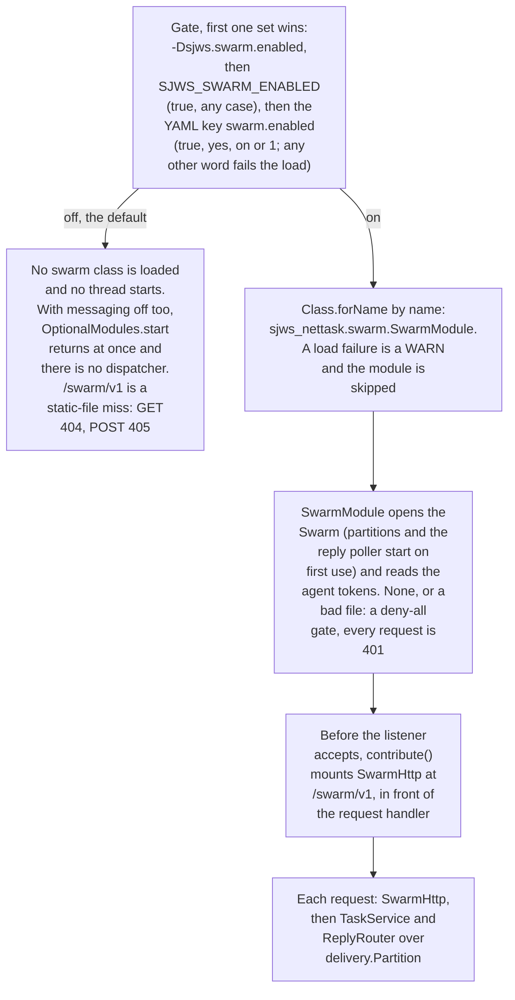
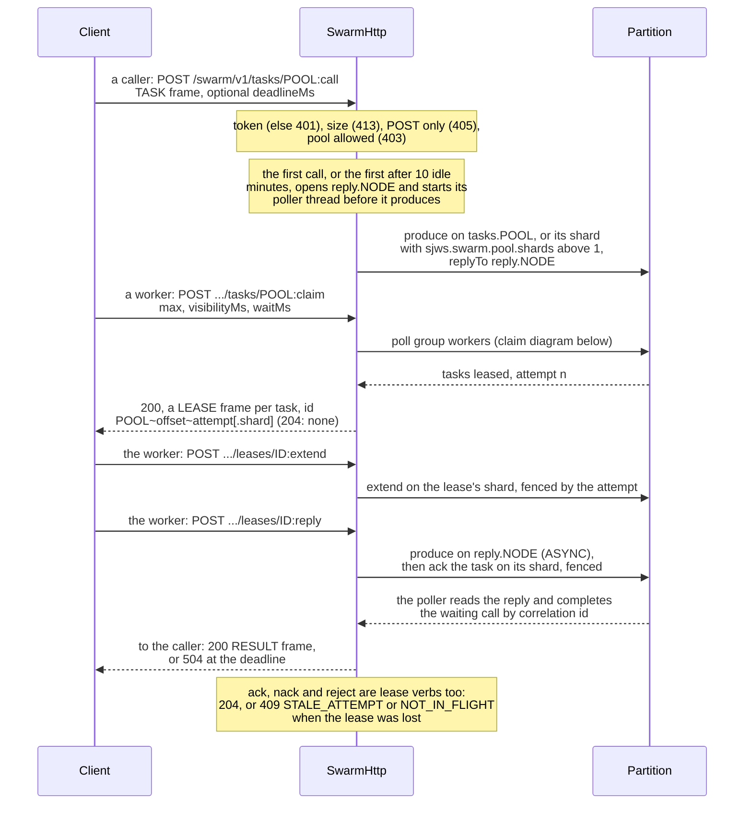
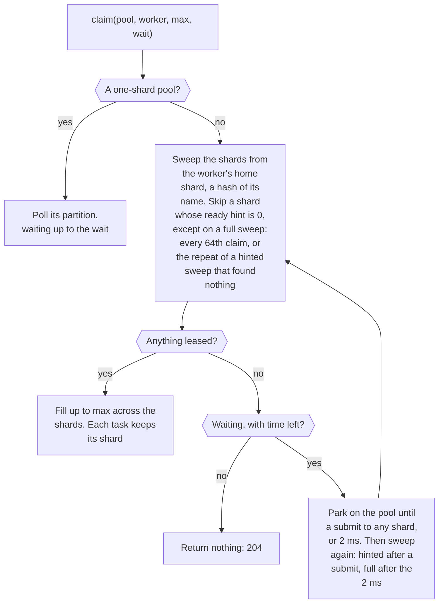

# Agent swarm layer (optional module): design

Status: **Draft, S1 shipped** · Base: master `e8389be` · Scope: design, plus as-built S1 notes.
Owner: sjws Architecture. **Co-author: Messaging Core** for §4–§5 (marked below), who signed off on #90.

Every reference to existing code is a path and line on master `e8389be`. This doc contains **no new benchmark numbers**. §13 quotes the messaging baseline already measured in PR #69 and lists pass targets; the swarm's own numbers will come from the runs §13 describes.

## 1. Goal and the hard rule

The swarm layer lets many *agents* (LLM-backed workers, tools and orchestrators) cooperate through sjws:
- they exchange tasks over the messaging ledger;
- they stream tokens to callers;
- they find each other by service name;
- they authenticate with control-plane identities;
- they spend per-agent budgets;
- they call LLM backends through the proxy's resilience features;
- they can be traced end to end.

**HARD RULE: optional and zero cost when off.**
- When `swarm.enabled` is false (the default), no `sjws_nettask.swarm` class is loaded, no thread is started, and no request-path code reads a swarm flag.
- The core hot paths (`Http1Connection`, `h2`, `h3`, `core`, `routing.ProxyHandler`, `messaging.delivery.Partition`) are not modified by this workstream.
- The swarm builds on their public APIs, as the composition root already does for other optional features.

How this is enforced is in §3.3.

**Addendum:** agent graphs (DAGs with bounded loops, fan-out/fan-in, subgraphs, durable runs) are designed in [agent-graphs.md](agent-graphs.md).

## 2. Non-goals
- **An agent runtime or LLM framework.** No prompt templating, no planning, no tool-calling logic in the server. Agents are external processes using the SDK (§11).
- **Hosting models.** sjws proxies to LLM backends (§10). It never runs inference.
- **Exactly-once task execution.** This follows messaging's v1 decision of at-least-once with producer dedup (`docs/messaging/design.md` §3, §10). Tasks must be idempotent or carry an idempotency key (§4.4).
- **A new consensus or storage engine.** Tasks are messages in `messaging.delivery.Partition`; identities and policy live in the CP (`sjws_nettask.cp`, `sjws_nettask.controlplane`).
- **Kafka/AMQP/MQTT compatibility.** Messaging rejected these for v1 (`docs/messaging/design.md` §10.1).
- **Changes to the content request path, or to proxy defaults** (see §10.2 on retries).

## 3. Module boundaries and dependency direction

### 3.1 Packages
| Package | Contents | May depend on |
|---|---|---|
| `sjws_nettask.swarm` | Built (S1): `SwarmModule` (bootstrap), `Swarm`, `Topics`, `TaskService`, `Task`, `TaskEnvelope`, `LeaseKeeper`, `ReplyRouter`, `SwarmHttp`, `SwarmGate`, `TokenGate`. Planned: `TokenStream`, `AgentDirectory`, `BudgetLedger`, `TraceContext`, `LlmGateway` | Built: `core`, `messaging.delivery`, `messaging.ledger`, `config.SecureKeyFile`, `swarm.wire`. Planned: `controlplane`, `cp` (read-only views), `routing` (`GcraTable`, `Resilience`, `discovery.*`, `WeightedHandler`, `ProxyHandler`), `observe` |
| `sjws_nettask.swarm.wire` (new) | Frame codec for the swarm wire protocol (§11.2) | `core` only |
| `sdk/python/sjws_swarm` (new, outside `src/`) | Thin client (§11.1) | — |

### 3.2 Direction
Planned edges. In S1 only the arrows to `messaging.delivery` / `ledger` and `core` exist.
```
            swarm  ──▶  messaging.delivery / ledger
              │──────▶  controlplane (Rbac, Operator)   cp (signed config, node labels)
              │──────▶  routing (GcraTable, Resilience, discovery, ProxyHandler/WeightedHandler)
              └──────▶  observe, core
  messaging, cp, controlplane, routing, observe, core, http1, h2, h3  ──✗──▶  swarm
```
- `swarm` depends on the others. **Nothing outside `swarm` imports `swarm`**, except the one composition-root hook in §3.3.
- `swarm.wire` depends only on `core`, so the SDK conformance tests can use it without the server.

### 3.3 Enforcement (three mechanical checks plus one benchmark check)
1. **Dependency test**, added next to `SourceGuardTest.coreDoesNotDependOnTransports` (`tests/sjws_nettask/SourceGuardTest.java:59-66`), in the same text-scan style. It asserts:
   - no file under `src/` outside `sjws_nettask/swarm/` contains `sjws_nettask.swarm`, except `OptionalModules.java`, which must name it exactly twice (the `SWARM_CLASS` constant and its javadoc);
   - `swarm.wire` imports only `core`.
2. **Class-load test**, cloned from `tests/sjws_nettask/cp/ClassLoadTest.java:1-45`. That test starts `sjws_nettask.ha.BenchServer --mode=single` under `-Xlog:class+load=info` and asserts that no `sjws_nettask.cp.`, `cluster.` or `service.` class was loaded. The swarm test adds `assertFalse(text.contains("sjws_nettask.swarm."))`, in standalone mode and in `data`/`gateway` mode without `swarm.enabled`.
3. **Single entry point** (shipped in #90). `sjws_nettask.OptionalModules` is the only code outside `swarm` that names the swarm, and it does so only as the string constant `SWARM_CLASS = "sjws_nettask.swarm.SwarmModule"` (`src/sjws_nettask/OptionalModules.java:39`).
   - When the JVM property `-Dsjws.swarm.enabled=true` is set, or the environment variable `SJWS_SWARM_ENABLED=true` (the property wins), it loads `SwarmModule` by reflection, `Class.forName(...).asSubclass(OptionalModule.class)` (`OptionalModules.java:56-65` for the gate, `:131-139` for the load).
   - Otherwise it returns a shared no-op `OptionalModules.NONE`, so no swarm class is loaded or verified.
   - Both startup paths call it once, before the listener accepts and outside any request path, so a module that implements `core.HandlerContributor` can mount handlers. `SwarmModule` mounts `SwarmHttp` at `/swarm/v1` (S1b). With the swarm off that class is not loaded and no mount table is installed.
   - The YAML key `swarm.enabled` (S1, #94) is read last: the property, then the environment variable, then the key; the first one set wins.
   - No existing package used this pattern before #90: `service/Bootstrap.java:43` is only the `"messaging"` capability string, not a gate.
4. **Off-mode wrk gate** (§13, item 3). It is the backstop, not the proof. wrk cannot resolve a single extra volatile read; tests 1–3 can.

As built in S1, from the gate to the mount. `swarm` itself imports only `core`, `messaging.delivery`, `messaging.ledger`,
`swarm.wire`, `config.SecureKeyFile` and the root `OptionalModule` interface, and the guard tests above keep every file
except `OptionalModules` from naming it:



## 4. Task model on messaging (Co-author: Messaging Core; their notes integrated 2026-10-13, signed off on #90)

This section is grounded in what is merged: #21 ledger, #33 delivery, #69 snapshots/retention, #37 stats, #39 config schema (parsed and validated, not applied yet). Items marked **GAP** do not exist on master.

### 4.0 What exists today (single node)
- A "topic" is **one `Partition`** (`messaging/delivery/Partition.java:53`). Multi-partition topics with key hashing are a **GAP**; the swarm shards a pool over several partitions itself (`sjws.swarm.pool.shards`, topics `tasks.<pool>#i`, §5.1).
- There are no message headers or keys. The payload is opaque `byte[]` (`Delivery.java:8-9`, `LedgerEntry.Enqueue` at `LedgerEntry.java:16`), so all swarm metadata rides in a payload envelope until headers exist (**GAP: headers**).
- There is no general broker network protocol and no replication of partitions (**GAP**): `/swarm/v1` is the only network binding of `Partition`'s poll and ack, and `/messaging/v1` serves plain log topics. The swarm is therefore **single-node** for messaging until those land (§12).
- Stats: `MessagingStats.snapshot()` is lock-free and pull-based, and `MessagingStats.NONE` is used when messaging is off (`messaging/stats/MessagingStats.java:8-16`).

### 4.1 Mapping onto existing primitives
| Swarm concept | Existing primitive (master) |
|---|---|
| Task queue for a service | Topic `tasks.<pool>` (the pool is the service name from §7; shard `i` is `tasks.<pool>#i` when `sjws.swarm.pool.shards` is above 1). The worker pool is a consumer group; a worker is the `consumer` id in `poll`. Competing consumers are built in: each message is leased to one consumer of the group. |
| Submit | `Partition.produce(producerId, seq, payload[, durability])` . Dedup on `(producerId, seq)` with a window of 4096 per producer (`DeliveryState.java:40`), durable across restarts via snapshots. |
| Claim + lease | `Partition.poll(group, consumer, max, visibilityMs)` . It records `LedgerEntry.Deliver(group, offset, consumer, deadlineMs, attempt)` (`LedgerEntry.java:27`). A lease that expires is redelivered by the first poll at or after `deadline + backoffMs(attempt)` (no timer), with `attempt + 1`. |
| Complete | `Partition.ack(group, offset, attempt[, durability])` (batched: `ack(group, offsets[], attempts[], durability)`)  |
| Transient failure (rate limit, tool timeout) | `Partition.nack(group, offset, attempt, retryAfterMs)` : `notBefore = now + max(delay, backoff)`. Backoff is `RetryPolicy.backoffMs`, `base << (attempt-1)` capped at `backoffMaxMs`. The default is `RetryPolicy(5, 100, 30_000)` (`RetryPolicy.java:7-20`). |
| Deterministic failure (bad input) | `Partition.reject(group, offset, attempt, reason)`  sends the message straight to the DLQ. |
| Worker crash | Lease expiry, which counts as an attempt. |
| Exhausted | At `maxAttempts` the message moves to `<topic>.dlq` (`Partition.deadLetterQueue()`, `Partition`) with origin group, offset, attempts and reason, e.g. `lease-expired:max-attempts` / `nacked:max-attempts` . |
| State | `MessageState { ENQUEUED, IN_FLIGHT, ACKED, DEAD_LETTERED }` (`MessageState.java:4`) |

The retry policy is set per topic through the `retry:` block of the #39 schema (`docs/messaging/config.md`). That schema is parsed and validated (`config/MessagingSettings.java`), but no code applies it to a `Partition`'s `RetryPolicy` yet (**GAP**).

### 4.2 Heartbeat = lease extension (Messaging Core, #91 merged)
- `extend(group, offset, attempt, visibilityMs) → LeaseResult`.
- Batched form: `extend(group, long[] offsets, int[] attempts, visibilityMs) → List<LeaseResult>`. The attempts travel with the offsets, because a bare list of offsets cannot be fenced.
- Ledger record: `Extend(group, deadlineMs, offsets[], attempts[])`, **record type 7**. One record is written per call and covers the accepted leases only; replay sets the lease deadlines. A build older than #91 refuses a log that contains it.
- `LeaseResult` is `{OK, NOT_IN_FLIGHT, STALE_ATTEMPT}`, the same result the fenced settles return (§4.3).
- Cost: one small append per heartbeat call. Heartbeat at ≤ visibility/3. The #91 bench shows batched heartbeats cost −1.4 % (within noise) and unbatched about −9 %, so **`LeaseKeeper` must use the batched form**.
- The swarm extends leases with `Partition.extend` (#91); the default claim lease is fixed.

### 4.3 Fencing (Messaging Core, **#87 merged**)
- Before #87, `ack`/`nack`/`reject` took `(group, offset)` only, so a stale worker whose lease had expired and been re-leased could settle the *new* attempt.
- #87 adds fenced forms that carry the `attempt` from `Delivery` as a lease token and return `LeaseResult {OK, NOT_IN_FLIGHT, STALE_ATTEMPT}`.
- The old unfenced overloads still match any attempt. They are not yet deprecated: the `@Deprecated(forRemoval = true)` follow-up (pointing at the fenced forms) is pending in Messaging Core, and they are removed one release after it lands.
- **The swarm SDK and wire protocol expose only fenced settles.** The SDK passes the attempt automatically.

### 4.4 Results, idempotency, exactly-once
- **Order:** the worker writes the reply with `Durability.ASYNC` via `produce(…, durability)` and **acks the task only when the reply's durability future completes**. A crash before that redelivers the task, and the caller deduplicates by `taskId`. Results are not lossy. Once partitions replicate, the reply uses the decided majority in-memory ack (`strict` per topic is available), and the task ack follows the reply's replicated ack.
- **Producer side** (implemented in `Partition.produce` and `TaskService.submit`; HTTP submits are anonymous, producerId 0, until an `Idempotency-Key` binding lands): `(producerId, seq)` dedup. Agents persist `producerId` and a monotonic `seq`, or derive `seq` deterministically (e.g. the step number in a plan), so a publish retried after a crash is dropped.
- **Consumer side** (application): delivery is at-least-once, so side effects are keyed by `taskId` (plus `attempt` for fencing). Tools that call external APIs pass `taskId` as their idempotency key (also §10.2).
- Exactly-once consume-transform-produce would need a cross-partition transaction (**GAP**). It is not proposed for v1.

### 4.5 Task envelope (in the payload until headers exist)
`{version:u8, taskId:16B (idempotency key), correlationId:16B, replyTo:topic, deadlineMs:absolute (caller clock), traceparent, tracestate?, budgetRef, schema/contentType, body}`.

Wire layout v1 (big-endian): `[version:u8][taskId:16][correlationId:16][deadlineMs:i64][replyTo][traceparent][tracestate][budgetRef][contentType][bodyLen:i32][body]`, each text field `[len:u16][bytes]`. **Text fields are standard UTF-8** (RFC 3629), not Java's modified UTF-8 (`DataOutput.writeUTF`): NUL is the single byte `00`, a supplementary character such as U+1F600 is four bytes (`f09f9880`), and `len` counts bytes, at most 65535 (decided 2026-10-13, inceptor; pinned by `TaskEnvelopeUtf8Test` and the `task-env-*` golden frames).

When headers land (**GAP 3** in §4.8), the metadata fields move to headers and the `version` byte selects the layout.

### 4.6 Further gaps the swarm relies on
- **Deterministic jitter:** ±25 % derived from `(offset, attempt)`, so replay stays exact.
- **DLQ redrive:** `redrive(dlqOffset)` re-enqueues into the origin topic with a fresh attempt budget and keeps the origin fields for audit. The TUI and admin API expose it behind `Rbac` (§6).
- **Broker-side TTL:** an `expireAt` field on `Enqueue` makes `poll` skip and count dead work instead of spending a lease on it.
- **Per-key ordering:** a single partition delivers in offset order, but with N concurrent leases tasks run in parallel. Strict per-key order needs `max in-flight per key = 1`.

### 4.7 Stats
- `MessagingStats` can expose, per group: lag, inFlight, acked, deadLettered, redeliveries, dlqDepth and oldestPendingAgeMs, once the swarm registers its partitions in a `PartitionStatsRegistry` (not wired on master). That would cover pool dashboards: queue depth, stuck work, retry storms.
- Per-task detail (attempt history, current worker, lease deadline) comes from `LedgerInspector` pages (`messaging/delivery/LedgerInspector.java:33-38`) for the TUI drill-down, not from the stats provider.
- **GAP:** per-consumer counters (in-flight per worker, extends, last heartbeat age) in `DeliveryCounts`, plus fixed-bucket latency histograms (enqueue→first delivery, delivery→ack) updated on the partition thread.

### 4.8 Gap order (Messaging Core)
1. Attempt-fenced ack/nack/reject (PR #87, **merged**); deprecate the unfenced forms (pending) and remove them one release later.
2. `extend`, with the `Extend` record (type 7) and the fenced batched form (PR #91, **merged**).
3. Message headers in `Enqueue`.
4. Broker-side TTL / `expireAt`.
5. Multi-partition topics with key hashing (the swarm's own pool sharding exists); max in-flight per key.
6. DLQ redrive; deterministic jitter.
7. Producer backpressure signal; per-consumer stats and latency histograms.
8. Producer-id expiry (needed before long-lived agents churn producer ids).
9. Network protocol and replication (per #17 / HA). These are required before agents run on more than one node.

## 5. Request/reply and token streaming (Co-author: Messaging Core; their notes integrated, signed off on #90)

### 5.1 Request/reply
- Reply topics are **one per requesting node or process**: `reply.<nodeId|processId>`, demultiplexed in memory by `correlationId` (`correlationId → future`). Each `Partition` owns writer, syncer and snapshotter threads, doubled with its `.dlq`, so a topic per agent would not scale.
- Reply topics are meant to be created **without a DLQ** (`Partition.open(..., deadLetterQueue = false)`, #106), but `swarm.Topics` still opens them with one.
- They are **closed after 10 minutes idle** (a `ReplyRouter` constructor argument; idle means no pending call and no reply read). The files are kept and the topic reopens on demand; deletion after retention plus a grace period is not built.
- A Messaging follow-up adds shared writer/syncer executors.
- **Deadlines:**
  - `TaskService.claim` rejects a request whose `deadlineMs` passed before it started (`reject("deadline")`, DLQ reason `rejected:deadline`).
  - `TaskService.claim` shortens a lease that would outlive `deadlineMs`, and `LeaseKeeper` never extends past it (HTTP `:extend` does not check).
  - The requester times out locally and answers the HTTP caller with a 504-class error. A late reply is acked and discarded.
  - Broker-side TTL is §4.6.
- **Durability:** replies are written with `Durability.ASYNC` (`messaging/ledger/Durability.java`), and the task is acked only after the reply is durable (§4.4). `NONE` is not used for replies: a crash after the ack would lose both the reply and the task.

As built in S1, one request and reply through `/swarm/v1`. Streaming, quotas and tracing are not built yet:



A claim, as `TaskService.claim` runs it. A pool has one partition unless `sjws.swarm.pool.shards` is above 1; then
shard 0 is topic `tasks.POOL` and shard `i` is `tasks.POOL#i`, each with its own lock, ledger and dead-letter queue.
The ready hint of a shard counts tasks submitted to it and not yet claimed by this service, so it ignores
redeliveries and other processes' submits:



A settle goes to the task's shard. `TaskService.ackAll` sends one batched fenced ack per shard, and
`LeaseKeeper` batches its extends per pool and shard.

### 5.2 Token streaming
There are two delivery legs. Messaging Core specifies the ledger leg; the HTTP leg is Architecture's.

- **Ledger leg (Messaging Core).**
  - One stream maps to one partition key, `streamId`, and all chunks of a stream land on one partition, so they are ordered by offset. Until multi-partition topics exist, a stream topic is sharded as one `Partition` per shard.
  - **Chunk framing** in the payload envelope: `streamId`, `chunkSeq` (u32, starting at 0), `flags` (`FIRST`, `LAST`, `ERROR`, `CANCELLED`) and `bytes`.
    - **Layout (v1, S2c PR 2):** the payload of a `TOKEN` frame is `[version:u8 = 1][streamId:16][chunkSeq:u32][flags:u8][bytes]`, big-endian, a 22-byte header (`swarm.wire.StreamChunk`, `sjws_swarm/chunks.py`, goldens in `tests/sjws_nettask/swarm/wire/golden-chunks-v1.txt`). Flags: `LAST = 0x01`, `CANCELLED = 0x02`, `ERROR = 0x04` (same values as the frame flags) and `FIRST = 0x08` (chunk-only; masked out of the frame flags). `CANCELLED` or `ERROR` require `LAST`. `bytes` is at most 2^24 − 1 − 22. The consumer reorder window defaults to 64 chunks; a `LAST` that disagrees with an earlier `LAST`, or lands at or below a chunk already seen, is a protocol conflict and is not absorbed.
    - **Worker produce path (S2c PR 3):** `-Dsjws.swarm.stream.enabled=true` (env `SJWS_SWARM_STREAM_ENABLED`, off by default, read only when the swarm is on; off loads no stream class) turns on `TaskService.streamChunk` / `streamLast` (`swarm.TokenStreams`). Settings, read once at startup: `sjws.swarm.stream.shards` (default 1, 1–64; restart to change), `sjws.swarm.stream.window` (64) and `sjws.swarm.stream.sinkChunks` (256). The stream id is the task's `correlationId`; chunks go to the **submitter's** `stream.<submitter>#i` (no DLQ, #225; the submitter is the node of the task's `replyTo`, `reply.<submitter>`, so routing follows the unary reply; #234 routing fix) with `Durability.NONE`, `LAST` with `ASYNC`; the task is acked (fenced) only after `LAST` and the reply are durable. Chunk produce is fenced by attempt on the node (a chunk from an attempt older than one that already produced is `STALE_ATTEMPT`). A same-process caller reads chunks from a bounded in-order sink (`TokenStreams.open`). Cancellation and the probe are PR 5 (below); the HTTP leg and resume are PR 4.
    - **HTTP leg (S2c PR 4, same flag; off: `StreamHttp` is not loaded and `GET /swarm/v1/replies/*`, `:stream` and `:chunk` answer 404):**
        - **`POST /swarm/v1/tasks/{pool}:stream?deadlineMs=`:** submits a streaming call. The deadline defaults to 30 s and is capped at 1 h; a stream always has one. Returns 201 with a `TASK` frame carrying the 16-byte session id, and `Location: /swarm/v1/replies/{hex}`.
        - **Session (§12 Q2):** a random 128-bit id (`SecureRandom`) bound to the `SwarmGate.Agent` id.
            - An unknown or expired session, or another agent's, gets 404.
            - One reader at a time (409 otherwise). At most 64 sessions per agent and 4096 per node (503 beyond).
            - A session lives until `LAST` + 60 s or the deadline + 60 s. Expired sessions are swept on every stream request and, since S2c PR 5, every 5 s by one shared daemon thread (`sjws-stream-sweep`), started only when the first `StreamHttp` is built (flag on). Sessions are in memory only, so a node restart loses them.
        - **Retention:** chunks are drained into the session as they are produced, including before the first `GET`. They are retained up to `sinkChunks` and 4 MiB (with the credit sub-flag on, plus the slack of *Retention slack with credit on* below), and the oldest are trimmed. `LAST` is never lost.
        - **`GET /swarm/v1/replies/{session}`, SSE (default):** sends `retry: 1000`, then one event per chunk: `id: <attempt>.<chunkSeq>` (the resume token, PR 5), `event: chunk`, and the bytes as UTF-8 with one `data:` line per line. SSE is for text: invalid UTF-8 is replaced with U+FFFD, so use the binary type for bytes. The stream ends with `event: end` and `data: ok|cancelled|error|deadline`.
        - **Binary:** with `Accept: application/vnd.sjws.swarm.v1`, chunks are sent as `TOKEN` frames. The terminal is the `LAST` frame, or an `ERROR|LAST` frame whose payload is `deadline` or `gap <from> <to> <reason>`.
        - **Gaps are never skipped.** A trimmed range (reason `overflow`) or a dropped chunk is sent as `event: gap` with `data: <from> <to|?> <reason>`, followed by `end: error`.
        - **Resume:** `Last-Event-ID: <attempt>.<n>` resumes from n + 1, and `?attempt=a&from=n` from n; a bare `n` means the current attempt. Resuming with an older attempt first gets `RESET(current)` (below). Resuming after the end returns the terminal state at once.
        - **Attempts and RESET (S2c PR 5, §12 reset rule):** chunk layout v2 carries `attempt:u32` in every header (`[2][streamId:16][attempt:u32][chunkSeq:u32][flags:u8][bytes]`, 26 bytes; v1 still decodes as attempt 0; goldens in `golden-chunks-v2.txt`). The server stamps the lease's attempt on each chunk, whatever the client sent. The consumer sink keeps one attempt: a newer one discards everything buffered or retained, emits `RESET(attempt)` and restarts at `chunkSeq` 0; an older attempt's chunk is dropped and counted (`staleChunks`). SSE sends `event: reset` / `data: <attempt>`; binary sends an empty `TOKEN` frame whose chunk has the chunk-only `RESET = 0x10` flag. Workers may not send `RESET` (400).
        - **Cancel (S2c PR 5):** `POST /swarm/v1/tasks/{session}:cancel`, where `{session}` is the stream session id (hex). Allowed for the agent the session is bound to or an admin (`SwarmGate.isAdmin`; with `TokenGate`, an agent granted `*`); others get 403, and an unknown or expired session 404. Idempotent: 200 `{"state":"cancelled"}`, or the terminal state (`ok|error|cancelled`) if the stream had already ended; never `running`. A cancel that lands after the session exists but before the task is placed ends the session at once and the task-side cancel runs as soon as the submit places the task (at most once). A cancel:
            - marks the task in the node's `CancelSet` (swarm memory; messaging stores no cancel state), so the worker gets `CANCELLED` on its next chunk (409 `cancelled`) or its next `:extend`, whichever comes first;
            - produces an opaque cancel record (`[0xC1][targetOffset:i64][deadlineMs:i64][correlationId:16]`) on the task's own topic, an ordinary produce with no new `LedgerEntry` type. A claim on any node that reads it applies it to that node's `CancelSet`, **creating** the cancelled entry if the node never saw the task (it lives until the record's deadline + grace; never refused by the cap, counted in `overCap` if over it), and acks it, so a lease held on that node then gets 409 / `CANCELLED` (two-node takeover test: `cancelTakesEffectOnAnotherNodeAfterATakeover`); it is never handed out as a task. A redelivered cancelled task is rejected with reason `cancelled`;
            - gives the reader `event: end` / `data: cancelled` after what was already produced, and exits the session through the single exit function (sink closed, `clearStream`, slots released). The session stays readable, and the cancel idempotent, until it is swept. The worker's own `LAST|CANCELLED` is still accepted and acks the task; its final reply then arrives after `clearStream` and is counted late by the router.
            - **Limits:** cancel is cooperative (a worker that ignores 409 runs until its lease ends). On another node the cancel takes effect when a claim on that node reads the record (with competing consumers, a node that never claims again learns only at its lease end or deadline). **Capacity:** the `CancelSet` holds at most 65 536 locally submitted streams; a full set refuses a new stream with 503 before it is submitted (counted: `cancelRejections`, `CancelSet.refused`), so no stream ever runs without cancel and deadline state. **Fence purge:** idle fences are purged by the 5 s stream sweep thread; the inline purge on the worker thread at 65 536 fences stays only as a memory backstop. Unary `:call` and fire-and-forget tasks have no session and are not cancellable yet. **Routing fix (#234, cross-node chunk delivery):** a worker writes every chunk to the **submitter's** shard `stream.<submitter>#i`, shard `hash(streamId) % shards`, never to its own node's shards. The submitter comes from the task metadata the reply already uses (`replyTo = reply.<submitter>`, set at submit; a task without it falls back to the writing node), and the shard partition is opened lazily without a DLQ on whichever node writes it. On the submitter, one daemon reader thread (`sjws-stream-<node>`, group `stream-reader`, flag on only, started by the first open sink and subscribed before the task is submitted, stopped after 30 s without sinks) consumes the node's own shards and offers each chunk to its sink, so `RESET(attempt)` and the new attempt's chunks from seq 0 reach the reader after a takeover onto another node, and a first worker on another node streams to it the same way. Chunks of a local worker still go straight to the sink in-process (`deliverLocal`, before the produce); their ledger copies are recognised (same attempt, seq already held, or older attempt) and skipped without touching the sink's capacity or counters. Messaging is used only through its existing `Partition` API (`openWithoutDlq`, `subscribe`, `poll`, batched `ack`). Tested with two nodes (`Swarm.sharing`): takeover (RESET, B's chunks from 0, LAST) and B as the first worker. **Shard count (#234 review):** the submitter stamps its own `sjws.swarm.stream.shards` into the stream task, as the W3C `tracestate` member `sjws-stream=shards:<n>` of the task envelope (next to `replyTo` and the stream id; no envelope format change), and a writer on any node picks `hash(streamId) % <submitter's n>`, so the writer's own setting never decides the shard (tested with A=1/B=4 and A=4/B=1, no chunk lost). A stamp that is malformed or outside 1–64 is refused (the chunk fails before the fence moves; counted in `invalidShardStamps`), never clamped; only a task without the member falls back to the writer's own count. The setting stays restart-only. **Submitter name:** the node taken from `replyTo` must match the node id pattern `[A-Za-z0-9._:-]{1,64}`; any other value is treated as no submitter (the writer's node), and counted (`invalidSubmitters`). **Single process only (until cross-process delivery lands):** both nodes of these tests share one process's ledger; messaging has no remote write path yet, so a worker in another process cannot reach the submitter's shards. With the flag on, startup therefore fails with a clear error when more than one process is configured: a `--bootstrap` (control/data) node, `cp.peers` in the config file, or `sjws.cp.nodeId` / `sjws.cp.peers` (`SJWS_CP_NODE_ID` / `SJWS_CP_PEERS`) set (`SwarmModule`, `OptionalModule.Refused`). Tracking: #236. **Credit is single-node until #236:** CREDIT (S2c PR 6, *Backpressure* below) is computed only on the node that holds the stream's session; a `:chunk` served anywhere else gets no credit and is never refused.
        - **`CancelProbe` (S2c PR 5):** with the flag on, task partitions (`tasks.*`, not `.dlq`) open with the `CancelSet` probe, so messaging's `extend` returns `LeaseResult.CANCELLED` after the fence for a cancelled stream task or one past its deadline. Over HTTP, `:extend` (flag on) also clamps the lease to the task deadline, answers 409 `cancelled` with `"reason":"deadline"` past it, and gives `"reason":"cancelled"` or `"deadline"` for a probe `CANCELLED`. With the flag off, partitions open exactly as before (no probe), and no `CancelSet` class is loaded (`ClassLoadTest`).
        - **Workers:** `POST /swarm/v1/leases/{leaseId}:chunk` takes one `TOKEN` frame with a StreamChunk v2 (or v1) payload.
            - **Stream id and attempt from the claim (#261 Q1, [ruling](https://github.com/BlivionIaG/sjws_nettask/issues/261#issuecomment-6402189176), [re-ruling](https://github.com/BlivionIaG/sjws_nettask/issues/261#issuecomment-6402230244) on [Architecture's review](https://github.com/BlivionIaG/sjws_nettask/issues/261#issuecomment-6402225519)).** A chunk's stream id must be the task's `correlationId` (else 400), which the `LEASE` frame does not carry. So with the flag on, a `200` from `:claim` whose batch contains at least one stream task carries two headers, each as exactly one field (`set`, never repeated), built in the same loop as `sjws-lease-traceparent`:
                - `sjws-lease-stream`: one comma-separated entry per `LEASE` frame, in frame order. An entry is `<32 lower-case hex of the correlationId>/<attempt>` for a stream task, or `-` for a unary one. `attempt` is the lease's attempt as an unsigned decimal u32 (`Integer.toUnsignedLong`), the value the admit stamps on every chunk and `CREDIT` carries; the lease id's `.shard` suffix never appears. Workers take the attempt from here, never by parsing the lease id, which stays a non-contract. Goldens: `tests/sjws_nettask/swarm/wire/golden-lease-stream-v1.txt`.
                - `sjws-stream-window: <n>`: this node's reorder window, `sjws.swarm.stream.window` (decimal). The SDK's effective window is `min(its configured window, n)`, or **1** when the header is absent; the configured value defaults to 8 and is capped at 64 (#261 Q7). The SDK keeps the span of seqs it has issued (highest issued minus lowest not yet accepted) below the effective window, so out-of-order arrivals never reach the `Reorder` `OVERFLOW` (#261 P1, S2c PR 7).
                - **Both are omitted when no `LEASE` in the batch is a stream task**, so unary claims stay byte-identical with the flag on, and "no header" means the same as on a flag-off or older server. With the flag off there is no header and no work: one final-field null check per claimed task (`ClassLoadTest`).
                - **Stream task** means the envelope's `tracestate` has the `sjws-stream` member (`TokenStreams.isStreamTask`, the one predicate shared with the shard-stamp parser; it matches the member name, so a malformed stamp still gets an entry and its chunks are refused as before). `:stream` (`StreamHttp`) is the only HTTP stream submitter and always stamps; HTTP unary submits always have an empty `tracestate`, so the marker cannot be forged over HTTP.
                - **Reading it (SDK):** join every field of the name before splitting (HTTP libraries may expose repeated fields separately), and fail closed when the entry count differs from the number of `LEASE` frames; never attribute stream ids by position after a mismatch. A worker that does not know the headers ignores them. The correlation id is not a capability: sessions are keyed by a separate random id, `:chunk` needs the lease, and cancel goes through the session.
                - **Size:** at `max=256`, `sjws-lease-stream` is about 11 KiB (plus about 14 KiB of `sjws-lease-traceparent` with tracing on): within Python's 64 KiB header-line limit, above Node's default 16 KiB total, so SDK `claim(max=…)` defaults stay small. HTTP/1.1, HTTP/2 and HTTP/3 carry the same fields (`SwarmHttp` is transport-agnostic); tested over HTTP/1.1 (`sdk/python/tests/test_lease_stream_e2e.py`) and HTTP/3 (`LeaseStreamHttp3Test`, `:claim` only: the HTTP/3 listener ignores request bodies today, so submit and `:chunk` over HTTP/3 are out of scope here).
            - A `LAST` chunk writes the reply (body = the chunk bytes) and acks once both are durable. If that takes over 30 s, the answer is 504 (retry).
            - A 409 `cancelled` carries `"reason":"cancelled"` (extend) or `"reason":"deadline"` (a chunk past the task deadline). The claim stays cached, so the worker acks it.
            - **CREDIT (S2c PR 6, #247; `swarm.StreamCredit`):** with the credit sub-flag on, an accepted non-`LAST` chunk is answered `200` with a `CREDIT` frame, and a chunk sent with no credit left gets `429` `problems/credit`. The rules are under *Backpressure* below. With the sub-flag off, `:chunk` answers exactly as above.
        - **Before the flag may be enabled:**
            - ~~Final reply counted late on `reply.<node>`~~: resolved by #232; `:stream` registers the session with `ReplyRouter.registerStream(id, deadline + 60 s)` (503 if refused) and every session exit calls `clearStream`.
            - ~~The resume token must carry the attempt~~: done in PR 5 (`<attempt>.<chunkSeq>`, reset rule item 4).
        - **Still open after PR 5:** resume from the ledger (a reader reconnecting to a session on another node, or after a restart); since the #234 routing fix, a worker on any node streams to the session on the submitting node.
  - Chunks are produced with the **agent's own `producerId`/`seq`**, not a per-stream producer id. Producer dedup state (≤ 4096 seqs per producerId) is never evicted, so per-stream ids would leak forever; producer-id expiry is recorded as a messaging gap (§4.8). **Consumers drop duplicates by `(streamId, chunkSeq)`**, which they already track in order to reorder.
  - **Payload size:** at most 1 MiB inline per message by default, configurable per topic. The hard limit is 64 MiB (`RecordBatch.MAX_FRAME_BYTES`). Larger bodies go by reference to a **blob store owned by the swarm** (or a storage module), not by messaging, which stays opaque bytes plus ordering and retention.
  - **Coalescing:** a chunk closes at 1–4 KiB or 20 ms, whichever comes first. Per-token messages would cost about one append per token.
  - **Consumer:** one consumer per stream, reordering by `chunkSeq`. Gaps after a lease expiry are filled by redelivery. Max in-flight per key = 1 is the later alternative (§4.6).
  - **Durability:** chunks use `NONE`/`ASYNC`. The final `LAST` chunk may use `GROUP` when the caller needs it durable. Per-append durability already exists .
- **HTTP leg (Architecture).**
  - The gateway node that holds the caller's session consumes the stream and writes it as HTTP/1.1 chunked (`http1/Http1Writer.java:346-395`), as `text/event-stream` ([WHATWG HTML, Server-sent events](https://html.spec.whatwg.org/multipage/server-sent-events.html)), or as h2/h3 DATA frames.
  - The body is a `core.Body.Stream`, which already pulls one chunk at a time (`routing/ProxyHandler.java:55-58`).
  - A reconnecting caller resumes from its last `chunkSeq`.
- **Backpressure.**
  - The consumer is pull-based already (`poll(max)` bounds its own buffer), and the ledger writer queue is bounded.
  - **GAP:** a producer-side signal, either per-group lag from `MessagingStats` or a `produce` that fails or blocks when lag exceeds a limit. Until then, the SDK's agent-side `stream()` throttles on the `CREDIT` frames of §11.2, specified below.
  - **CREDIT (S2c PR 6; spec from #247: [Architecture's conditions](https://github.com/BlivionIaG/sjws_nettask/issues/247#issuecomment-6397907891), adopted by [inceptor's ruling](https://github.com/BlivionIaG/sjws_nettask/issues/247#issuecomment-6397914190); implemented in S2c PR 6: `swarm.StreamCredit`, `swarm.wire.Credit`, `sjws_swarm/credit.py`, tests in `StreamCreditTest`).** Application-level backpressure from the server to a streaming worker, on top of h2/h3 flow control. It prevents the retention overflow (`gap … overflow`) that a slow reader causes today.
    - **Flag:** `-Dsjws.swarm.stream.credit.enabled=true` (env `SJWS_SWARM_STREAM_CREDIT_ENABLED`), **off by default**, read only when `sjws.swarm.stream.enabled` is on. Off means: `:chunk` answers stay `204`, byte-identical to master; no credit state is allocated; the credit hook is `null` (the `CancelProbe` pattern above) and the credit class is not loaded, pinned in `ClassLoadTest`.
    - **Direction and carrier:** the server grants credit to the worker in the answer to `POST /swarm/v1/leases/{id}:chunk`, the only back channel of the unary worker leg. Readers grant credit implicitly by reading the session.
    - **Value: an absolute snapshot, not an increment** (unlike h2 `WINDOW_UPDATE`), so a lost or retried response never skews it. Two dimensions, both mandatory, because retention trims at `sinkChunks` chunks **or** 4 MiB (`StreamHttp.RETAIN_BYTES`):
      - For the session's current attempt: `unreadChunks = max(0, maxSeq − readNext + 1) + heldChunks + reservedChunks` and `unreadBytes = max(0, appendedBytes − readBytes) + heldBytes + reservedBytes` (the reservation term is below, #248 r3);
      - `chunks = max(0, sinkChunks − unreadChunks)` (default `sinkChunks` = 256) and `bytes = max(0, 4 MiB − unreadBytes)`.
      - **Published counters (#248 review, gap 1).** All of them are volatiles or atomics, so the check reads them without the session lock:
        - **Drain side** (`Session.drain`, under the session lock it already holds per chunk): a volatile `maxSeq` (−1 before the first chunk of an attempt) and a volatile cumulative `appendedBytes` for the current attempt (the sum of `StreamChunk.size()` of every chunk appended in this attempt). Today's `maxSeq` and `retainedBytes` are plain fields guarded by the session lock, so they cannot be read on the lock-free path as they are. On append, each retained chunk also stores its **cumulative byte offset** (a prefix sum: `appendedBytes` before the chunk). On a newer attempt (RESET) the drain zeroes the window as today, restarts `maxSeq` at −1 and `appendedBytes` at 0, and publishes the new `attempt` **last** (#248 r2, nit N2).
        - **Reader side:** `readNext` is a new `volatile` field on `Session`: the next `chunkSeq` the session's reader will send, written only by the single `Reader` thread; 0 before the first `GET`. (`Reader.next` is per connection and stays as it is.) Next to it the reader publishes `readBytes`, the bytes of all chunks before `readNext`: after sending chunk c it is `offset(c) + size(c)`, and on a rewind it is the stored offset of the target chunk (#248 r2, nit N1; this also covers a reader waiting at `maxSeq + 1`, whose next chunk does not exist yet). It also publishes `readAttempt`, the attempt those two belong to. **Write order (#248 r2, nit N2; amended by #257 [R3](https://github.com/BlivionIaG/sjws_nettask/pull/257#issuecomment-6401100453)):** the reader writes `readBytes`, then `readNext`, then **`readAttempt` last** (as the drain publishes `attempt` last); the check reads `readAttempt` first, then `readNext`, then `readBytes`. A check that sees the new `readAttempt` then reads that attempt's position; a check that sees the old `readAttempt` with a new position also reads the new `Session.attempt` afterwards (the drain publishes it before the reader learns of the RESET), so the RESET-race rule counts nothing read. The order before #257 (`readAttempt` first) let a check pair the old attempt's `readNext`/`readBytes` with the new `readAttempt` while the reader was preempted between its stores, so it saw an empty window with the new attempt's window full.
        - **Rewind on resume.** `Last-Event-ID` and `?from=` can move a reader back, so `readNext` decreases. A plain cumulative "bytes read" would then over-report what was read and make credit too generous. Because a rewind publishes the stored offset of the target chunk, `readBytes` moves back with `readNext`: O(1), no walk.
        - **RESET race.** The drain zeroes the window on a newer attempt while the single reader may still publish the old attempt's `readNext` and `readBytes`. When `readAttempt` differs from `Session.attempt`, the check treats the read position as 0 (`readNext = 0`, `readBytes = 0`), so unread is everything retained.
        - **Held chunks (#248 review, gap 2).** Out-of-order arrivals wait in the sink's `Reorder` (up to `window − 1`), not in `Session.retained`, so `maxSeq` and `appendedBytes` do not see them. The sink publishes `heldChunks` and `heldBytes` for the current attempt as atomics adjusted by deltas. **Implementation obligation (#248 [r4](https://github.com/BlivionIaG/sjws_nettask/pull/248#issuecomment-6398678329), B3):** on `BUFFERED` the sink increments them under the sink lock; on a flush of k held chunks, the offering thread lowers them by k (and their bytes) only **after** its listener (`Session.drain`) returns, so the flushed chunks are already in `maxSeq`/`appendedBytes` (the drain holds the session lock for its whole loop, so a concurrent drain on the reader thread has published `maxSeq` by then too); on a RESET they are zeroed after the session has zeroed its window. Today's `Reorder` does the reverse: it lowers `held` inside `offer` under the sink lock (`TokenStream.java:232-241`), before the session drain runs through the listener, so a flushed chunk is briefly counted nowhere. **The PR 6 code PR fixes that order**; this spec describes the required behaviour, not master's. (`Session.retained` itself only ever receives in-order chunks, because `Reorder` releases contiguously, so `maxSeq − readNext + 1` is exact there, not an over-count.)
        - **Per-session reservation (#248 r3 blocker; [inceptor's ruling](https://github.com/BlivionIaG/sjws_nettask/pull/248#issuecomment-6398523376), option 1).** Without it, N concurrent `:chunk` requests at credit 1 could all pass the check before any of them is admitted (the counters above only move when an admit lands), so the overshoot would be N − 1, bounded only by the worker's own concurrency. To close that, the check claims its credit with an atomic reserve and then validates it (#248 r4):
          - `Session` gets one `AtomicLong reserved`, packing `reservedChunks` (high 24 bits) and `reservedBytes` (low 40 bits) so both dimensions move in a single CAS (layout accepted in [r4](https://github.com/BlivionIaG/sjws_nettask/pull/248#issuecomment-6398678329)). The fields are always extracted as unsigned, `chunks = r >>> 40` and `bytes = r & ((1L << 40) − 1)`, and **the packed value is never compared numerically** (it is negative once chunks reach 2^23). Ranges: a reservation lives only while its request is between the reserve and its release, so the word is bounded by one session's concurrent `:chunk` requests (2^24 chunks, 2^40 B at ≤ about 1 MiB per HTTP chunk are unreachable). It counts the non-`LAST` chunks of requests that reserved and have not yet released. It is allocated only with the credit sub-flag on (part of the credit state above).
          - **Reserve before seq allocation, then validate (#248 [r4](https://github.com/BlivionIaG/sjws_nettask/pull/248#issuecomment-6398678329), B1).** The `:chunk` handler reads `reserved` (value r), reads the published counters in the order below, computes the credit with r included, and, if the chunk is admitted (or exempt), does `compareAndSet(r, r + (1, size))`. A failed CAS means another request moved `reserved`, so the handler re-reads everything and re-evaluates; it never waits on a lock. **A successful CAS is not enough on its own** (ABA: another request can reserve, publish and release between this request's read of r and its CAS, leaving `reserved` at r again while this request's counters never saw that chunk). So after a successful CAS the handler **re-reads** `reserved` (now including its own reservation) and the published counters, in the same read order, and **re-checks with the same test, including the same exemption test** (an exempt chunk stays exempt on re-validation). If the chunk no longer passes, it releases its reservation and answers `429`; nothing has been written, so that `429` also leaves no trace. All of this happens before the producer seq is allocated and before the fence, `deliverLocal` and the produce.
          - **Exactly one release per reservation, on the request thread (#248 [r4](https://github.com/BlivionIaG/sjws_nettask/pull/248#issuecomment-6398678329), B2).** A chunk refused before the CAS (`429`) never reserved, so it leaves `reserved` untouched. After a successful CAS, the reservation is released **exactly once, by the request thread, in a `finally` after `admitAndWrite` returns or throws** (or right away when validation refuses). The drain never touches `reserved`: `Session.drain` also runs on the reader thread and also consumes ledger-delivered and in-process chunks that never reserved, so it cannot tell which chunks carry a reservation. Because `deliverLocal` → `Sink.offer` → the listener → `Session.drain` all run synchronously inside the admit, by the time the `finally` runs the chunk has been published (to held or retained) or discarded, so the release comes after the publish (destination first: counted twice for an instant, never zero times). The same single `finally` covers every outcome that publishes nothing: a stale attempt at the sink (possible after a RESET delivered through the ledger), `CONFLICT`, `AFTER_LAST` or `WRONG_STREAM` from the sink, no sink in `deliverLocal`, a cancelled session whose drain discards the chunk, a `409` from the admit (`cancelled`, `STALE_ATTEMPT`, fence), a reorder-dedup drop of a duplicate, a sink drop, and an exception (including one thrown by the produce after the chunk was published). There is no per-chunk tag and no "published?" report. The reader lowers *unread* only through `readNext`/`readBytes`. In-process `TaskService.streamChunk` and ledger-delivered chunks carry no reservation and never touch `reserved`.
          - **Underflow-checked release.** The release is a CAS loop that checks both fields are at least the amount being released, never a bare `getAndAdd(−δ)` (a double release would borrow across the field boundary and make the session read "no credit" until the deadline: fail-closed, but a silent stall). On a violation it clamps the short field at 0, increments the bug counter `creditReserveUnderflow` (*Counters* below) and releases the rest. With the single release above it should never fire; it is a backstop.
          - **Never-refused chunks reserve too.** A liveness-exempt filler (below) and a chunk whose lease attempt is newer than the session's (RESET) are admitted unconditionally, but they still add their reservation (a CAS, no refusal), so every in-flight checked chunk is counted by every concurrent check, and they release it in the same `finally`. A RESET does not zero `reserved`: each request still releases its own reservation exactly once in its `finally`, whether it was admitted into the new window, rejected `409` `STALE_ATTEMPT`, or discarded by the sink as stale.
          - **Why this makes the bound hold under concurrency.** Order the admitted checked requests by the time of their successful CAS. Each validates after its own CAS, so after every earlier CAS. At its validation an earlier request is either still reserved (counted in `reserved`, which is read first) or already released; if released, its chunk was published first (release in the `finally` after the admit, held lowered only after the drain returns), so the counters read afterwards include it. So checked admissions never exceed the credit beyond the reader-side torn read below, and at credit 1 exactly one of N concurrent requests is admitted: the first winner's validation sees only its own reservation, and the others' CASes fail or their validation sees it. **Scope:** chunks that never reserve are not linearised against checks and fall outside this bound: in-process `TaskService.streamChunk` chunks and ledger deliveries (e.g. a `Swarm.sharing` pair). They are the existing backstop paths (*Counters* below).
          - **Cost.** With the sub-flag on, per checked `:chunk`: one reserve CAS (retried only when the same session's worker has concurrent requests, ≤ `window` for a compliant SDK), one re-read of the volatiles for validation (no extra atomic), and one release CAS loop. This amends point 8 of the #247 ruling to **atomic counters, no lock, no walk of `retained`**. With the sub-flag off there is no `reserved` field, no CAS and no atomic: the credit hook is `null`, so the cost is zero (byte-identical `204`, the credit class not loaded).
        - **Read order (#248 r3, nit N5).** The check reads, in this order: (1) `reserved`; (2) the reader counters `readAttempt`, `readNext`, `readBytes` (`readAttempt` first because the reader publishes it last, #257 R3; a stale reader side means more unread, which is conservative); (3) `heldChunks`, `heldBytes`, before `maxSeq`, so a chunk moving from held to retained is counted twice rather than missed (required: the flush lowers `heldChunks`/`heldBytes` only after the drain has advanced `maxSeq`/`appendedBytes`, see *Held chunks* above; today's code does the reverse and PR 6 fixes it); (4) `attempt`, then `maxSeq` and `appendedBytes` (`attempt` before `maxSeq`, because a RESET publishes `attempt` last). Reading `appendedBytes` before `readBytes` could make the computed unread bytes come out below the true value, which is why the reader side comes first. Rule: every transfer (held → retained, and a request's reservation → held or retained, released only after the admit returns) publishes its destination before lowering its source, and the check reads sources before destinations. The validation re-read after the CAS uses the same order.
        - **Approximate to within one chunk.** The volatile reads above still do not form an atomic snapshot, so a check can be torn across one concurrent read or release on the reader side. Concurrent `:chunk` requests do not widen this (the reserve CAS plus the validation re-read linearise checked chunks, see *Why this makes the bound hold* above), so for checked chunks the check is approximate to within one chunk **of over-admission** for any number of concurrent requests (chunks that never reserve are outside this, as stated there), and drop-and-gap (*Counters* below) stays the backstop. The write orders above (reader: `readBytes` → `readNext` → `readAttempt`; drain: destination before source, `attempt` last on RESET; both publish the attempt last, #257 R3) together with the read order keep a torn read on the conservative side, also across a RESET on either side. In the other direction a check can be off by more than one chunk: just after a RESET, `readAttempt ≠ attempt` while the drain still shows the old `maxSeq` makes unread count the whole retained window for one check, so it can answer a spurious `429` (#248 r2, nit N3). That is harmless: the `429` leaves no trace, the published values converge, and the retry re-evaluates the check. It is a retry, not a livelock.
        - The unread counts never come from walking `retained` or the reorder buffer.
      - The initial window is therefore `sinkChunks` chunks plus 4 MiB, **not** `sjws.swarm.stream.window` (64, the reorder bound). `window` (advertised on `:claim` as `sjws-stream-window`, #261 R1; see *Workers* above) instead caps the SDK's concurrent in-flight `:chunk` requests: in flight ≤ min(`chunks`, `window`) chunks **and** the sum of in-flight chunk sizes ≤ the `bytes` snapshot (#248 review, gap 2), so out-of-order arrivals never hit the reorder `OVERFLOW` and held chunks never flush past the credit.
      - **`window ≤ sinkChunks` with credit on (#257 [R2](https://github.com/BlivionIaG/sjws_nettask/pull/257#issuecomment-6401100453)).** The sink refuses an offer when `remainingCapacity < 1 + held`, and the session drains the sink synchronously, so held chunks alone fill it at `held ≥ sinkChunks`. Credit admits out-of-order chunks while `unread < sinkChunks`, so with `window > sinkChunks` held could reach `sinkChunks`: the exempt filler would then be answered `200` and dropped, the reader would end by gap, and every later chunk would get `429` until the deadline. With the credit sub-flag on, startup therefore fails unless `sjws.swarm.stream.window ≤ sjws.swarm.stream.sinkChunks` (`OptionalModule.Refused`, so the process does not start rather than skipping the module; the error names both values; fail closed, no clamp). Then `held ≤ window − 1 ≤ sinkChunks − 1`, so held plus the filler always fit the sink whatever the concurrency (`Reorder` caps held, not credit). The sink is unchanged; with the sub-flag off the settings are accepted as before.
      - **Retention slack with credit on (#257 [R1](https://github.com/BlivionIaG/sjws_nettask/pull/257#issuecomment-6401100453)).** Checked chunks may overshoot the credit window by up to two (the liveness exemption plus one torn read, see *Counters*), and `LAST` is never refused. If retention trimmed at exactly the window (`sinkChunks`, 4 MiB), that overshoot would trim an unread chunk and end the reader by gap; at defaults the exempt filler alone does it in the bytes dimension (four held 1 MiB chunks plus a 1 MiB filler). So with the sub-flag on the session retains up to `sinkChunks + 3` chunks and `4 MiB + 3 × MAX_REQUEST` bytes (`StreamHttp.CREDIT_RETAIN_SLACK` = 3: the two-chunk bound plus one `LAST`), while the credit window stays `sinkChunks` / 4 MiB. Unread chunks are then never trimmed for HTTP workers that obey credit, and the trim only removes chunks already read. Chunks that never reserve (in-process, ledger and remote) can still exceed it, and drop-and-gap stays their backstop. This was chosen over "never trim unread chunks up to the bound": it is a constant at session creation, adds no branch or published-counter read to the drain's trim loop, and costs at most about 3 MiB more retention per credit-on session. With the sub-flag off the caps are unchanged.
      - Bytes already handed to the transport count as read: a leak, bounded by the h2/h3 flow-control window. With no reader attached, credit drains to 0, bounded by the task deadline; that is intended. Likewise, a reader that has ended (on a gap or a terminal event) stops advancing, so its worker gets `429` until the deadline; that is acceptable for PR 6 (#248 r2, nit N4).
    - **Credit is derived, not stored.** There is no per-`(streamId, attempt)` credit map in PR 6: credit is a function of session state, and the session already clears its window on a newer attempt (RESET). The cross-node map at the submitter belongs to #236 (below).
    - **Refusal:** a non-`LAST` chunk is refused when `chunks == 0`, or when `unreadChunks > 0` and its size exceeds `bytes`. "Size" is the chunk's data bytes, `StreamChunk.size()`, exactly what retention counts. So `unread = 0` is never refused (no deadlock for one oversized chunk with nothing queued: then `chunks = sinkChunks ≥ 1` and the bytes clause needs `unread > 0`).
      - **Chunk size over HTTP.** A `:chunk` body is capped at `MAX_REQUEST` (1 MiB + 6 + 1024), so a chunk that reaches the credit check is at most about 1 MiB. A single chunk larger than 4 MiB only arises for in-process `TaskService.streamChunk` callers (up to `StreamChunk.MAX_BYTES`, about 16 MiB), which never pass through credit; it is retained alone, as "never trim the newest" already does.
      - **Liveness exemption (#248 review, gap 2; conditions ruled in [r2](https://github.com/BlivionIaG/sjws_nettask/pull/248#issuecomment-6398253140)):** a chunk whose `chunkSeq` is `maxSeq + 1` of the current attempt (the `Reorder` cursor) is never refused while `heldChunks > 0` **and the reader has sent every in-order chunk of that attempt** (`max(0, maxSeq − readNext + 1) == 0`, with `readNext = 0` when `readAttempt ≠ attempt`). Call that quantity `unreadIn`; it is the in-order term of `unreadChunks` above, read with the same RESET-race rule.
        - **Why:** counting held chunks would otherwise bring back a deadlock: the reader has drained everything in order and waits for chunk k, the held k+1… already fill the credit, and k is refused on every retry until the deadline. With the exemption the hole always fills.
        - **Why `heldChunks > 0`:** without it, a serial worker would bypass credit (with nothing held, its every chunk is `maxSeq + 1`, and refusing it is what backpressure is for: a slow reader frees the credit by reading).
        - **Why `unreadIn == 0`:** without it, a worker with many holes could get up to `window − 1` (63) hole-fillers admitted at zero credit (about 63 MiB over HTTP): each filler flushes the next held chunk, `heldChunks` stays > 0, and the next filler is exempt again. With it, at the moment of exemption unread is the held chunks only, each of which passed the credit check, so admitting the filler overshoots by at most one chunk (≤ about 1 MiB over HTTP); after the flush `unreadIn > 0` until the reader catches up, so no second exemption is possible until then. For an SDK that follows the in-flight caps below, the filler was already counted and there is no overshoot at all.
        - **Use `unreadIn == 0`, not `readNext == maxSeq + 1`,** so a reader that resumed ahead (`?from=n` with `n > maxSeq + 1`, waiting for a chunk behind the hole) still progresses; the equality test would deadlock it. Before the first `GET`, `readNext = 0`, so the exemption applies to chunk 0 of the attempt (`maxSeq = −1`) and otherwise once a reader has drained; with no reader at all, credit stays at 0 until the deadline, as above.
        - **Torn reads:** `heldChunks` changes under the sink lock and is read lock-free. A stale `heldChunks == 0` gives a false refusal, and the retry is admitted (the deadlock state is stable until the hole fills or a RESET). A stale `heldChunks > 0` gives at most one false exemption per `held → 0` transition (or a duplicate the reorder dedup drops), within the one-chunk approximation above. Only a chunk with `chunkSeq == maxSeq + 1` can be exempt, so concurrent exempt requests are duplicates of the same seq: one is admitted, the others are dropped by the dedup and release their reservations. Peak overshoot for checked chunks is therefore the exemption chunk plus one torn-read chunk, **≤ 2 chunks (≤ about 2 MiB over HTTP) for any number of concurrent `:chunk` requests** (the reservation and validation above; #248 r3, [r4](https://github.com/BlivionIaG/sjws_nettask/pull/248#issuecomment-6398678329)). Chunks that never reserve (in-process, ledger) are outside this bound.
    - **Answers on `:chunk`** (flag on), in this precedence: `400` (bad frame or payload) → `409` lease not held / stale attempt → `409` `cancelled` / `deadline` → **`429` credit** → admit.
      - **Cancel lookup only on the refusal path (#248 review, gap 5).** The deadline check already runs earlier and costs nothing. The credit check runs next. If credit admits the chunk, there is no extra lookup: the admit's own cancel check (`admitAndWrite`) answers `409` `cancelled`. If credit would refuse, a read-only `CancelSet` lookup runs first and answers `409` `cancelled` when the task is cancelled, `429` otherwise. The precedence is the same, and the accept path adds nothing (the lookup builds the topic string and boxes the offset, so it is kept off the hot path).
      - **The admit stays authoritative.** The pre-admit cancel lookup only orders the answers. The admit's cancel and fence checks stay authoritative and must not be removed as "duplicate": a cancel that lands after the lookup is still caught by the admit (the worker gets `409` there, or `429` and then `409` on its retry). The precedence before the admit is best-effort: before the admit, staleness is only visible as a lease attempt lower than the session's, so an attempt retired by the fence floor with the *same* attempt number can still get a `429` before its `409`. The fence is authoritative.
      - **Accepted, session on this node:** `200`, `content-type: application/vnd.sjws.swarm.v1`, body = one `CREDIT` frame (§11.2) carrying the snapshot read after the admit, without the session lock (like the check, other requests' reservations included), with `attempt` = the lease's attempt. The value is advisory: the server enforces credit on every chunk, so a snapshot one chunk stale is harmless.
      - **Zero credit:** `429` problem+json, type `https://sjws.dev/problems/credit`, `"reason":"credit"`, and `Retry-After: 1` (whole seconds, RFC 9110 §10.2.3; the SDK may retry sooner on its own short backoff). The type keeps it apart from the route `RateLimitFilter`'s 429. The check, including its reservation CAS, runs **before the producer seq is allocated** and before the fence, `deliverLocal` and the produce, so a 429 leaves no trace (no fence move, no ledger record, no seq consumed, no reservation held) and the worker retries the same `(attempt, chunkSeq)`; an already-accepted duplicate is dropped by the reorder dedup. 429, not 503: 503 means the node is overloaded and counts as a breaker failure through a sjws proxy. Blocking the request and accept-and-drop are rejected.
      - **Never refused:** `LAST`, `LAST|CANCELLED` and `LAST|ERROR` (they keep today's answers: `204`, or `504`/`503` on the durability timeout, with no `CREDIT` frame). With the flag on, a worker must therefore also accept `204` for `LAST`, as well as `204` for a non-`LAST` chunk with no local session (below). A chunk whose lease attempt is newer than the session's is never refused (it RESETs the window). A chunk whose lease attempt is older skips the credit check and gets `409` `STALE_ATTEMPT` from the admit, so a stale worker never spins on 429.
      - **No local session** (the session lives on another node, e.g. a `Swarm.sharing` pair, or it is gone): `204` with no body and no `CREDIT` frame, meaning "credit unknown, not refused".
    - **Hot path:** the check is O(1): **atomic counters, no lock, no walk of `retained`** (point 8 of the #247 ruling, as amended by [inceptor's #248 r3 ruling](https://github.com/BlivionIaG/sjws_nettask/pull/248#issuecomment-6398523376)). It reads the published volatiles, does one reserve CAS on `reserved` (retried only under contention), one volatile re-read to validate, and one underflow-checked release CAS loop in the request's `finally`; it never takes the session lock (the drain path already holds that lock per chunk). With the sub-flag off none of this runs.
    - **Counters:** `creditRefusals` (429 answers, including refusals on validation after the CAS), `creditUnknown` (204 for no local session) and `creditReserveUnderflow` (a bug counter: a release that would take a `reserved` field below 0, clamped; expected to stay 0, #248 [r4](https://github.com/BlivionIaG/sjws_nettask/pull/248#issuecomment-6398678329)). `sinkDrops` and the `gap` events are unchanged: overflow stays reachable through in-process `TaskService.streamChunk` callers, the ledger and remote path, and `LAST`, so drop-and-gap remains the backstop. There is no violation counter in PR 6: with server-side enforcement an HTTP worker cannot exceed its credit by more than two chunks, the one allowed above for the liveness exemption (which needs `heldChunks > 0` and `unreadIn == 0`, so it cannot repeat until the reader catches up) plus one from a torn read, however many `:chunk` requests it sends concurrently (the per-session reservation with validation, #248 r3/r4). That bound covers checked HTTP chunks only; in-process and ledger chunks never reserve and stay under drop-and-gap. `creditViolation{peer}` comes with #236's cross-node credit.
    - **Codec and goldens (PR 6):** the Java and Python `CREDIT` payload codec, checked against `tests/sjws_nettask/swarm/wire/golden-credit-v1.txt` (layout in §11.2), including its negative vectors. **SDK throttling is PR 7.** The Python SDK has no `:chunk` client yet, so `204` → `200` breaks no existing consumer.
    - **Single-node until #236.** Credit is computed only where the session lives. Cross-node design input, approved in the ruling for #236 step 2 (Messaging Core): the submitter owns credit, never the `tasks.*` owner; a submitter-side hook `admitChunk(streamHi, streamLo, attempt, last)` defaults to `UNLIMITED`; the chunk-forward ack carries `credit:u32` only when the value is not `UNLIMITED`, so flag-off acks stay byte-identical; `NO_CREDIT` is retryable and consumes the forwarding seq. Credit state keyed by `(streamId, attempt)` at the submitter is part of that design, not PR 6.
    - **Tests (deterministic, PR 6):** unread = 0 ⇒ never refused; a slow reader gets 429 and no overflow gap, run with in-flight = 1 so it stays deterministic; with forced out-of-order arrival and the reader drained (`unreadIn == 0`), the hole-filler is admitted at zero credit and the overshoot is ≤ one chunk; several holes, set up so that credit is at zero through held chunks and the reader has caught up (`unreadIn == 0`) and then pauses: the first filler is exempt and admitted, and the second filler is refused with `429` because `unreadIn > 0` after the flush; the overshoot is ≤ one chunk (#248 r2, i; setup per r3 nit T1); a separate case: with no reader ever attached and `maxSeq ≥ 0`, even the first filler is refused (`unreadIn = maxSeq + 1 > 0`); the reader drains, then the next filler is admitted at zero credit (r2, ii); a reader that resumed ahead (`?from=` beyond `maxSeq + 1`) with held chunks filling the credit is not deadlocked (r2, iii); a reader that rewinds (`?from=`) gets credit computed from the stored offset, not more; a reader still publishing an old attempt after RESET counts as nothing read; credit comes back after the reader drains; RESET restores the window and the first chunk of a new attempt is not refused; a 429 leaves no trace (no fence move, no ledger record, no seq consumed); **N concurrent `:chunk` requests at credit 1** (N ≥ 8 threads released together by a latch, each a distinct `chunkSeq` of the current attempt, reader paused): exactly one is admitted (`200`) and N − 1 get `429`, the producer seq advances by exactly one and the ledger has one record, whatever the interleaving (#248 r3); **an ABA interleaving** (forced with a test hook: A reserves, publishes and releases between B's read of `reserved` and B's CAS) never admits both, because B's validation refuses it (#248 r4, B1); `reserved` returns to baseline (both fields 0, extracted unsigned) **after every request outcome**: `429`, validation refusal, a published admit, a held chunk, a stale sink attempt, `CONFLICT`, `AFTER_LAST`, no sink, a cancelled session's discard, admit `409` `cancelled` and `STALE_ATTEMPT`, a dedup-dropped duplicate, a sink drop, and an exception thrown after the publish (#248 r4, B2); a flush lowers `heldChunks` only after the drain has advanced `maxSeq` (#248 r4, B3); an exempt filler and a RESET chunk reserve and release too; every test asserts per field that `reserved ≥ 0` and that **`creditReserveUnderflow` stays 0** (#248 r4); a bytes-cap refusal with chunks over 16 KiB; a cross-node pair (`Swarm.sharing`) gets `204` with no `CREDIT` and no refusal; `LAST`, `LAST|CANCELLED` and `LAST|ERROR` are never refused; cancelled is answered before credit (409 before 429); a stale attempt gets 409, not 429; with the flag off, responses are byte-identical, no `reserved` state is allocated, and `ClassLoadTest` passes. **Added by #257 (each fails before its fix):** at default settings the exempt filler in the bytes dimension trims no unread chunk and the reader gets chunks 1–5 with no gap (R1); with `window == sinkChunks`, held reaching `window − 1`, the filler is delivered (not dropped) and the filler plus `LAST` at a full window trim nothing unread (R1, R2); with credit on, `window > sinkChunks` fails at startup naming both values (R2); a reader paused mid-RESET between its stores (test hook) never lets a new-attempt chunk past a full window (R3).
    - **What tests match (#248 review, gaps 4 and 6 nits):** HTTP tests match the status, the problem `type`, the machine field `"reason"` and `Retry-After`, never the human `title` or `detail`. Codec tests match the rejection (Java `IllegalArgumentException`, Python `ValueError`, as the existing codec tests do) and the golden's reason token (`version` or `length`), which the exception message starts with, so the version-before-length order stays pinned; the rest of the message is free text and is not matched.
    - **Scope guard:** the code PR lists the paths it touches. Any path outside the stream files (`SwarmHttp` dispatch, claim, lease, heartbeat or transport, or anything outside `sjws_nettask.swarm`) triggers the S1c rr and off-mode re-runs. Messaging Core sign-off is required only if `sjws_nettask.messaging` is touched; as specified, PR 6 touches nothing there.
- **Cancellation.**
  - The caller sends `cancel(correlationId)` on the request's reply/control topic.
  - The producer stops and emits a `LAST|CANCELLED` chunk.
  - Consumers ack the pending chunks of a cancelled stream without processing them, and retention (#69) reclaims them once acked.

**DECIDED (2026-10-13, inceptor): streaming path.**
- The **ledger is the default** for tasks and results.
- The **direct path** (agent → HTTP gateway over h2/h3: no ledger write, no resume, no replay) is allowed **only for ephemeral token streams to HTTP-gateway clients** (HTTP LLM-gateway responses). It is **opt-in per request or per route** (`stream: direct` in the request; the SDK's `stream(..., direct=True)`). Messaging Core accepts it under these conditions (sign-off on #90):
  - It is documented as **lossy and non-resumable**: a failure ends the stream with an `ERROR` chunk, and there is no replay.
  - It uses the same chunk framing (`streamId`, `chunkSeq`, `flags`, `bytes`) and the same `TOKEN`/`CANCEL`/`CREDIT` frames as §11.2, so clients have one decoder.
  - It lives outside `sjws_nettask.messaging`, so the §3.3 guards hold.
- Even on the direct path, the **final result is always written to the ledger**, as a `LAST` result message on `reply.<nodeId|processId>`, followed by the fenced task ack (§4.3/§4.4). Only intermediate tokens skip the ledger.
- A direct stream that breaks ends with an `ERROR` chunk and is not resumable. The caller falls back to the ledger result.

## 6. Agent identity and RBAC
- **Identity. DECIDED (2026-10-13, inceptor):** agent certificates come from a **separate intermediate CA** under the CP trust root (`cp/KeyRing.java`, `cp/TrustKey.java`), not from the node enrollment CA (`service/NodeEnrollment.java`, `service/JoinMaterial.java`). Agent certificates are short-lived and numerous, and they are revoked separately from node certificates. Revoking an agent never touches node trust, and a compromised agent CA can be rotated without re-enrolling nodes. Every agent connection is mTLS. The agent id is the certificate subject, which `controlplane.Rbac.ClientCert(subject)` already models (`controlplane/Rbac.java:50`).
- **Authorization.** `Rbac.authenticate(Credential)` and `Rbac.authorize(credential, permission, target, version)` (`Rbac.java:91,118`) are reused unchanged. Today's `Permission` set is operator-oriented (`READ, EDIT_ROUTES, ROLLOUT, ROLLBACK, NODE_DRAIN, …`, `controlplane/Permission.java:22-30`), and `Role` is `VIEWER/OPERATOR/ADMIN` (`Role.java:24-27`).

  **DECIDED (2026-10-13, inceptor):** agent permissions (`TASK_SUBMIT(service)`, `TASK_CLAIM(service)`, `LLM_CALL(backend)`) live in a **separate `swarm.AgentPolicy` CP document**, distributed like `controlplane.AccessPolicyDocument`.
  - **Core RBAC is untouched:** `Permission`, `Role` and `Rbac` don't change.
  - **It costs nothing when the swarm is off:** no `AgentPolicy` is parsed or held, and no `swarm` class is loaded (§3.3).
  - The swarm evaluates `AgentPolicy` itself. It may reuse `Rbac.authenticate` for the certificate subject, but never adds permissions to it.
- **Placement.** The node role is the existing `DataPlaneRole { GATEWAY, STATIC, BROKER, EDGE }` (`service/DataPlaneRole.java`). The swarm adds no role; it uses **labels** (`swarm=agent-host`, `swarm=llm-gateway`) from the node's enrollment (`service/NodeEnrollment.java:79`). Task partitions live on `BROKER` nodes, and LLM gateway routes on `GATEWAY`/`EDGE` nodes.
- **Audit.** Agent mutations (submit, claim, cancel, budget changes) go to the hash-chained `controlplane.AuditLog` that `Rbac.complete` already writes (`Rbac.java:139`).

**Interim gate until S2d (2026-10-13).** `/swarm/v1` is admitted through `swarm.SwarmGate` (`authenticate(Request) → Agent`, `allows(Agent, pool)`, `maxRequestBytes()`); S2d replaces the implementation, not the interface. The interim `swarm.TokenGate` reads `<agentId> <token> <pool,...|*>` lines from `-Dsjws.swarm.tokens.file` / `SJWS_SWARM_TOKENS_FILE` (**recommended**; read with `config.SecureKeyFile`: no symlink, owned by this process, mode 0600 or 0400, secure parent directories, at most 1 MiB; any failure denies all with a WARN naming only the path) or the `SJWS_SWARM_TOKENS` environment variable (`;`-separated; logs a WARN because the environment is visible in `/proc/<pid>/environ` and inherited by children), never from a command-line value. Tokens must be at least 43 characters, i.e. 32 random bytes in base64url (`openssl rand -base64 32`); keeps only SHA-256 digests and compares them with `MessageDigest.isEqual` against every entry; and never prints a token. Deny by default: no or invalid configuration installs `SwarmGate.DENY_ALL` and every request gets `401`; a pool outside the agent's list gets `403`; a body above `sjws.swarm.maxRequestBytes` / `SJWS_SWARM_MAX_REQUEST_BYTES` (default and maximum: the S1 request cap) gets `413`, whether its length is declared or not (chunked). Refused credentials are counted and answered with `error="invalid_token"` (RFC 6750) when a token was presented. **Deferred to S2d:** binding a lease to the agent that claimed it (today any agent allowed on a pool can settle that pool's leases), rate limiting of failed authentication, token rotation/reload and expiry. Clients send `Authorization: Bearer <token>` (Python SDK: `Client(..., token=...)` or `SJWS_SWARM_TOKEN`).

## 7. Discovery by service name
Agents register under a **service name**, e.g. `summarize.v1`. The swarm reuses the routing discovery seam from PR #84:
- `routing.discovery.UpstreamSource` (`UpstreamSource.java:36`) and `UpstreamRegistry.lookup(service)` (`UpstreamRegistry.java:41`) return an `UpstreamSet(service, version, Endpoint[] ready, LbPolicy policy)` (`UpstreamSet.java:31`).
- `swarm.AgentDirectory` implements `UpstreamSource` for **push-style** agents (agents that expose an HTTP endpoint) and publishes endpoints from agent registration plus heartbeats. `routing.EndpointBalancer` (`EndpointBalancer.java:56`) then load-balances to them with the existing `LbPolicy` (`LbPolicy.java:26`).
- **Pull-style** agents (the default) need no endpoint: the service name maps to the queue `tasks.<service>` (§4). Discovery only answers "is anyone serving this?" (consumer count), for fast-fail on submit.

## 8. Per-agent quotas and budgets
- **Rate (requests or tasks per second)** reuses `routing.GcraTable` from PR #82 (`GcraTable.java:31`):
  - `new GcraTable(intervalNanos, burst, buckets, clock)` (`:46`);
  - `stripe(hash)` with `mix` (`:75,80`);
  - `admit(slot)`, which returns 0 when admitted or the nanoseconds until the next admit (`:90`);
  - `delay(slot)` (`:110`).

  One table per (service, dimension) is keyed by an agent-id hash. It is fixed-size and striped, so it adds no allocation per check. A refusal maps to `429` with `Retry-After`, in the same shape as `gateway.Quota.retryAfterSeconds` (`gateway/Quota.java:27-45`).
- **Budgets (tokens or cost per window)** are *not* a rate. `BudgetLedger` keeps per-agent counters that are debited from the LLM response's usage. It debits an estimate up front and settles the actual on completion. Counters are node-local `LongAdder`s, reconciled to the CP through the node report (`observe/NodeReport.java`, `observe/NodeReporter.java`).

  **DECIDED (2026-10-13, inceptor): soft global cap for S0–S2.** Hard per-node sub-allocation by the CP comes later (phase S3+, §12).

  **Maximum overshoot of the soft cap.** Each node admits a call when its last-known global remaining budget covers the call's *estimate*. It debits the estimate locally, settles to the actual on completion, and reconciles with the CP every `T_sync`. Over one budget window, with nodes `n = 1..N`:

  ```
  Overshoot ≤ Σ_n [ F_n · ε_max ]  +  Σ_n [ D_n(T_sync) ]
  ```
  - `F_n` is the maximum number of in-flight (admitted, unsettled) budgeted calls on node `n`, bounded by the node's concurrency limit.
  - `ε_max` is the maximum per-call estimate error, `max(actual − estimate, 0)`.
  - `D_n(T_sync)` is the most node `n` can debit, in estimates, between two reconciliations: at most `r_n · T_sync · e_max`, where `r_n` is the node's GCRA admit rate for budgeted calls (plus its burst) and `e_max` is the maximum per-call estimate. This is the staleness term: other nodes' debits are invisible for up to `T_sync`.

  With uniform limits this reduces to `Overshoot ≤ N · (F · ε_max + r · T_sync · e_max)`.

  Two consequences:
  - When the gateway enforces the estimate as a hard per-call cap (e.g. the request's `max_tokens`), `ε_max = 0` and only the staleness term remains.
  - The overshoot shrinks linearly with `T_sync`.

  The doc fixes no values. Operators set `F`, `r`, `T_sync` and the estimate policy, and the admin API reports the computed bound for the current configuration.
- Quotas and budgets are checked at **submit** and at **LLM call**, never on the static-content path.

## 9. Tracing across a chain of agents
- **S2b (propagation) is implemented**, off by default: `-Dsjws.swarm.trace.enabled=true` / `SJWS_SWARM_TRACE_ENABLED=true`, with the swarm on. Code: `src/sjws_nettask/swarm/trace/SwarmTrace.java` (a leaf with no sjws imports), used only by `SwarmHttp` behind a final `trace` flag and by `SwarmModule`. With tracing off no `sjws_nettask.swarm.trace.` class is loaded (`ClassLoadTest`) and the handler allocates nothing for tracing; `SourceGuardTest` pins that only those two files name the package. `observe` has no tracing code to reuse (metrics, the access log and node reports only: `observe/RequestObserver.java`, `observe/AccessLog.java`, `observe/ServerMetrics.java`).
  - Ingress: `submit` and `:call` read `traceparent`, validate it strictly (W3C Trace Context §3.2: lower-case hex only, so upper case is invalid; an invalid value is dropped, never forwarded; more than one `traceparent` field is invalid, so the trace restarts; future versions are accepted by their first 55 characters and re-emitted as `00`) and store it in `TaskEnvelope.traceparent`. The envelope is stored per shard unchanged, so it survives any shard count.
  - Each claim mints a child span (same trace id and flags, fresh span id). `:claim` returns them in `sjws-lease-traceparent`, one entry per `LEASE` frame in frame order, `-` for an untraced task.
  - `:reply` writes the reply with the claim's child span, and `:call` returns it as the `traceparent` response header. Every outgoing value is re-validated (`child(parse(stored))`, and `parse` of the reply's traceparent), because stored envelopes can also come from in-process callers; an invalid stored value yields `-` / no header, never a failed claim.
  - A re-claim after lease expiry gets a new sibling child of the caller's span: the ledger keeps the parent, and the child lives only in the HTTP claimed-lease cache.
  - Not yet: `tracestate` ingress, span recording and export (S4).
- The swarm propagates [W3C Trace Context](https://www.w3.org/TR/trace-context/) `traceparent` and `tracestate`:
  - HTTP ingress reads the header;
  - the task envelope carries it (§4.5);
  - each claim creates a child span id;
  - LLM calls forward `traceparent` upstream (the proxy already forwards end-to-end headers, `ProxyHandler.java:60-65`).
- **Export** is pluggable, and off unless configured: OTLP ([OpenTelemetry protocol spec](https://opentelemetry.io/docs/specs/otlp/)), with span attributes following the [OpenTelemetry GenAI semantic conventions](https://opentelemetry.io/docs/specs/semconv/gen-ai/). The exporter lives in `swarm` (or a later `observe.trace` package) and is fed off the request thread through a bounded queue, like `observe.LogQueue`.
- The swarm adds **no tracing to the core request path**. Only swarm endpoints create spans.

## 10. LLM backend gateway
### 10.1 Reuse
An LLM backend is a route whose upstreams are model servers, for example OpenAI-compatible endpoints ([API reference](https://platform.openai.com/docs/api-reference/chat)). The swarm composes existing routing pieces rather than adding a proxy:
- **Weighted, canary and sticky routing**: `routing.WeightedHandler` (`WeightedHandler.java:36`, Vose alias table, sticky hashing, PR #80).
- **Circuit breaking and retry budget**: `routing.Resilience(Retry, Circuit)` (`Resilience.java:33,63`) with `RetryBudget`/`CircuitBreaker` as used by `ProxyHandler` (`ProxyHandler.java:141-155`).
- **Streaming**: `ProxyHandler`'s `Body.Stream` pass-through (`ProxyHandler.java:55-58`), so SSE token streams flow without buffering.
- **Rate and budget**: §8. **Endpoint sets**: §7 / `UpstreamRegistry`.

### 10.2 The retry gap, without changing proxy defaults
Today the proxy retries **only idempotent, bodyless methods** (`ProxyHandler.java:272-287`; `Resilience.java:39`; `docs/user/config-file.md:289-291`). LLM calls are `POST` with a body, so they are never retried, which is correct for a generic proxy.

**DECIDED (2026-10-13, inceptor).** The swarm's `LlmGateway` wraps `ProxyHandler` and retries a `POST` **only when the request carries an `Idempotency-Key`** ([IETF draft](https://datatracker.ietf.org/doc/draft-ietf-httpapi-idempotency-key-header/)). The SDK sets it to `taskId:attempt` (§4.4).
- The earlier "failed before send" clause is dropped. A connect failure is only provably pre-send at the transport level, and the policy is simpler without that exception.
- Retries still spend the same `RetryBudget`.
- `ProxyHandler`'s behavior and defaults stay unchanged. If a hook is needed, it is an additive constructor parameter, reviewed with the routing owner.
- A failure after the response head has started aborts the stream, as in `ProxyHandler` today (`:69-70`).

### 10.3 Usage accounting
The swarm parses the backend usage report (the final SSE event, or the JSON `usage` field), only on swarm routes, to settle `BudgetLedger` (§8).

## 11. Client SDK and wire protocol
### 11.1 Python SDK (first)
`sjws_swarm` is a thin, dependency-light package. S1b ships a synchronous stdlib (`urllib`) `Client` with submit, call, claim and the lease verbs; the asyncio API below (stdlib `ssl` + `asyncio`, an optional `httpx` transport) is S2+:
```python
async with Swarm.connect("sjws://gw:7443", cert=..., key=..., ca=...) as s:
    r = await s.call("summarize.v1", payload, deadline=30)            # request/reply
    async for tok in s.stream("chat.v1", payload): ...                 # token stream
    async for task in s.serve("summarize.v1", concurrency=4):          # agent side
        async with task.lease(heartbeat=5):                            # auto-extend (§4.2)
            await task.reply(result)                                   # reply, then ack (§4.4)
```
Trace context is taken from the active OpenTelemetry context when present. The SDK holds no business logic, so other languages port by implementing §11.2.

### 11.2 Wire protocol (v1)
The target transport is mTLS over **HTTP/2 or HTTP/3**, so it reuses the existing listeners, `h2` and `h3`, and their flow control; S1 serves `/swarm/v1` behind the bearer-token gate (§6) and is exercised over HTTP/1.1. A raw TCP framing can be added later on the same frames.
- **Claim headers:** with token streaming on, a `:claim` batch that contains a stream task also carries `sjws-lease-stream` (per `LEASE`, in order: `<32-hex correlationId>/<attempt>` or `-`) and `sjws-stream-window: <n>`; both are omitted otherwise (§5.2 *Workers*, #261).
- **Unary operations:** `POST /swarm/v1/tasks/{service}` (submit), `POST /swarm/v1/tasks/{service}:claim`, `POST /swarm/v1/tasks/{service}:call` (request/reply), `POST /swarm/v1/leases/{id}:extend`, `POST /swarm/v1/leases/{id}:ack|nack|reject`, `POST /swarm/v1/leases/{id}:reply`.
- **Streaming:** `GET /swarm/v1/replies/{session}`, as SSE, or as binary frames when `Accept: application/vnd.sjws.swarm.v1`.
- **Binary frames:** `[version:u8][type:u8][flags:u8][len:u24][payload]`.
  - The leading version byte follows messaging's format-version decision (`docs/messaging/design.md` §10).
  - Types: `TASK, CLAIM, LEASE, EXTEND, RESULT, TOKEN, ERROR, CANCEL, CREDIT`.
  - `CREDIT` grants per-stream send credit, on top of h2/h3 flow control, for application-level backpressure (rules in §5.2 *Backpressure*; S2c PR 6, #247). The server sends it to the worker as the body of a `200` answer to `:chunk`.
    - **Payload v1** (29 bytes, big-endian): `[version:u8 = 1][streamId:16][attempt:u32][chunks:u32][bytes:u32]`. `attempt` is the lease's attempt; `chunks` and `bytes` are the absolute credit left, unsigned (Java decodes all three into `long`, e.g. `Integer.toUnsignedLong`; the `u32-max` vector pins this, and the other positive vectors pin the byte order).
    - **Frame flags** are reserved for `CREDIT`: a sender sets them to 0, and a receiver ignores non-zero flags (it does not reject the frame). This follows the existing frame convention: `Frame.decode` treats flags as opaque, and the payload codec never sees them. A new meaning needs a new payload version, never a flag.
    - **Decoding:** an empty payload or one whose length is not 29 is rejected, and so is a version byte other than 1 (checked first when present). Goldens: `tests/sjws_nettask/swarm/wire/golden-credit-v1.txt`.
    - The frame-level golden `credit-1024` in `golden-v1.txt` (payload `00000400`) stays byte-identical. It is **not** a v1 payload (its first byte is `0x00`), so `golden-credit-v1.txt` lists it as a negative vector. No "connection-level" or reserved meaning is defined for it.
- **Errors** use RFC 9457 problem+json ([RFC 9457](https://www.rfc-editor.org/rfc/rfc9457)), which the routing layer already emits (`routing/ProblemErrorHandler.java`).
- A conformance suite (golden frames under `tests/.../swarm/wire`) is shared by the Java codec and the Python SDK.
- All text on the wire (envelope text fields, §4.5) is **standard UTF-8**, never modified UTF-8. The golden set includes envelopes with NUL and a supplementary character that both codecs must reproduce byte for byte.

## 12. Phases and exit criteria
| Phase | Deliverable | Exit criteria |
|---|---|---|
| S0 | **Done (#90).** This design, plus the guard tests from §3.3 (dependency and class-load) and the single entry point, merged before any swarm code | Tests green on master ✅; Messaging Core sign-off on §4–§5 ✅, received on #90 (https://github.com/BlivionIaG/sjws_nettask/pull/90#pullrequestreview-5500560114) with three doc fixes, all applied here. **S0 exit criteria met.** |
| S1 | Uses the Messaging Core fencing PR **#87** ("fence ack/nack/reject with the delivery attempt (lease token)"), which ships separately. `swarm` package: submit, claim with fixed lease, fenced ack/nack/reject, DLQ, request/reply via `reply.<nodeId|processId>`; `swarm.wire` codec; Python SDK unary. **Shipped early in S1:** messaging gap 2 (`Partition.extend`, batched and fenced, `Extend` record type 7, #91) and the batched `LeaseKeeper` (`src/sjws_nettask/swarm/LeaseKeeper.java`, #97), which calls `TaskService.extend`. `/swarm/v1/leases/{id}:extend` (#102) extends one lease per call; `LeaseKeeper` is not wired to HTTP. **Decided (2026-10-13, inceptor), done:** (a) the YAML key `swarm.enabled` (#94); the property and environment gate still take precedence over it. (b) a class-load test that starts a real `data`/`gateway` role process, using a CP fixture from Integration Tests, and asserts that no `sjws_nettask.swarm.` class is loaded with the swarm off (`RoleClassLoadTest`, #95) | #87 merged; `swarm.enabled` YAML key parsed (off by default); data/gateway role class-load test green; §3.3 tests green; off-mode gate (§13) within band; task-dispatch and request/reply targets (§13) met or recorded |
| S2 | Exit tests for the S1 `extend`/`LeaseKeeper` (S2a, done: `LeaseExitTest`, #164); ledger token streaming (`chunkSeq` framing + HTTP leg), the default; cancellation; W3C trace propagation; `AgentPolicy` document and the agent intermediate CA; GCRA quotas; `BudgetLedger` with the **soft global cap** (§8) | Stale-worker fencing and lease-expiry redelivery tests; heartbeat and streaming targets (§13); trace spans across 3 hops; mTLS-only agent auth with agent-CA revocation tests; 429 + `Retry-After` tests; a budget test asserting that the overshoot stays within the §8 bound |
| S3 | **Hard per-node budget sub-allocation by the CP**; `AgentDirectory` discovery for push-style agents | Sub-allocation tests (no node exceeds its grant; re-grant on node loss) |
| S4 | `LlmGateway` (weighted routing, circuit breaking, retries only with `Idempotency-Key`, usage accounting); the opt-in **direct** token path for HTTP-gateway clients, with the final result still in the ledger (§5.2); OTLP exporter | Fault-injection tests (backend down, mid-stream abort); a test that a direct stream always produces a ledger result; wrk2 latency through the gateway |
| S5 | Other SDKs | SDK conformance suite green |

**S2 sub-phase labels.** S2a = exit tests for the S1 `extend`/`LeaseKeeper` (done: `LeaseExitTest`, #164); S2c = ledger token streaming (`chunkSeq` framing + HTTP leg) and cancellation (scope: §5.2, wire §11.2); S2d = `AgentPolicy` document + agent intermediate CA (§6), and follows S2c. The other S2 deliverables in the table above are not yet assigned sub-phase labels.

**S2c decisions (2026-10-16, inceptor).**
- **Scope:** the ledger leg, the HTTP leg and cancellation of §5.2, using the `TOKEN`/`CANCEL`/`CREDIT` frames of §11.2. The opt-in direct path (§5.2) stays in S4.
- **Flag:** `sjws.swarm.stream.enabled`, **off by default**, read only when the swarm itself is on. When it is off, no streaming route is mounted and no streaming class is loaded, so the off cost is zero (AGENTS.md *Efficiency rule*, §3.3).
- **Exit criteria:** the streaming targets of §13 (token-streaming row and Architecture addition 1, streaming over HTTP), the off-mode gate of §13, and the S1c request/reply gate kept passing: pooled absolute rr p99 < 500 µs.
- **PR 6, CREDIT ([#247 ruling](https://github.com/BlivionIaG/sjws_nettask/issues/247#issuecomment-6397914190), 2026-10-25, inceptor):** Architecture's 10 conditions ([#247](https://github.com/BlivionIaG/sjws_nettask/issues/247#issuecomment-6397907891)) are the spec, recorded in §5.2 *Backpressure* and §11.2. Behind the sub-flag `sjws.swarm.stream.credit.enabled`, off by default. Point 8 (hot path) is amended by [inceptor's #248 r3 ruling](https://github.com/BlivionIaG/sjws_nettask/pull/248#issuecomment-6398523376): atomic counters (a per-session reservation), no lock, no walk of `retained`. Order: this docs PR first; Architecture approves, then inceptor, then the code PR starts. Architecture reviews PR 6. **No hard §13 gate in PR 6** (see §13 *CREDIT and PR 8*). PR 7 does the SDK throttling.

**Open questions (S2c).** Answered in review on #224; answers recorded below.
1. Do stream chunks go on the caller's `reply.<node>` topic (demultiplexed by `streamId`) or on separate stream shards (one `Partition` per shard, §5.2 ledger leg)? *Owner: Messaging Core + Architecture.*
   Answer (agreed by [Architecture](https://github.com/BlivionIaG/sjws_nettask/pull/224#issuecomment-6213972600) and [Messaging Core](https://github.com/BlivionIaG/sjws_nettask/pull/224#issuecomment-6213968173)): **separate stream shards.** Lazy per-node `stream.<node>#i`, shard chosen by `hash(streamId)` (**#234 routing fix:** the node is the stream's **submitter**, taken from the task's `replyTo`, exactly as unary replies go to `reply.<submitter>`; workers on any node write there and the submitter's shard reader feeds its sinks, see §5.2), opened only when `sjws.swarm.stream.enabled` is on, and opened **without a DLQ**. `reply.<node>` stays for unary replies and the final `LAST` result (§5.2). Depends on the no-DLQ partition open path that `swarm.Topics` does not use yet (§5.1 note); this is a prerequisite. Reviewers differed on the default shard count (Architecture 4 per node, Messaging Core 1 per node).
   **Blivion decision (2026-10-16):** **1 stream shard per node by default**, configurable through `sjws.swarm.stream.shards`. The setting is read **at startup only**; changing it needs a restart, because the shard is chosen by `hash(streamId) % shards` and a resume must land on the same shard. Raise the default to 4 only if PR 8's stream benchmark (§13 token-streaming row) shows a gain. **#234:** the count that decides a stream's shard is the **submitter's**, stamped in the task (`tracestate` `sjws-stream=shards:<n>`, §5.2), so nodes with different settings never lose chunks; an invalid stamp is refused, an absent one falls back to the writer's count. Cross-process delivery is not there yet: the flag refuses to start on a multi-process deployment until Messaging Core's remote write path lands (#236).
2. Is the session id of `GET /swarm/v1/replies/{session}` (§11.2) the `correlationId`, bound to the caller's token so that only the submitter can read it (§6)? *Owner: Architecture.*
   Answer ([Architecture](https://github.com/BlivionIaG/sjws_nettask/pull/224#issuecomment-6213972600)): **no.** The session id is a separate, server-minted random 128-bit value (`SecureRandom`), bound to the authenticated `SwarmGate.Agent` id (not the token, so it survives the S2d switch to mTLS). A `GET` from a different agent gets **404**, not 403, so session existence is not revealed. The `correlationId` stays an internal routing key and is never a capability.
3. Does the worker learn of a cancel (§5.2 *Cancellation*) by getting `CANCELLED` back on its next chunk produce or `:extend` call? *Owner: Architecture + Messaging Core.*
   Answer ([Architecture](https://github.com/BlivionIaG/sjws_nettask/pull/224#issuecomment-6213972600), [Messaging Core](https://github.com/BlivionIaG/sjws_nettask/pull/224#issuecomment-6213968173)): **both are required signals.** The worker learns of a cancel on whichever comes first, its next chunk produce or its next `:extend`. `CANCELLED` is returned on the next chunk produce (fail fast) and on `:extend` (HTTP 409, problem type `cancelled`), so non-streaming workers that only heartbeat also stop. A cancel never releases the lease: the worker acks (fenced) after `LAST` or `LAST|CANCELLED`, and on redelivery `TaskService.claim` rejects with `reject("cancelled")`. **Where they differ:** Architecture calls `:extend`/`LeaseKeeper` the guaranteed path (it reaches every leased worker); Messaging Core calls the chunk response the primary signal (stop within one chunk, ≤ 20 ms). Architecture proposed a `LeaseResult.CANCELLED`; Messaging Core asked that it not be added to messaging's `LeaseResult` and be mapped at the swarm layer instead.
   **Blivion decision (2026-10-16):** `CANCELLED` must **not** live in the swarm layer only. Messaging's `LeaseResult` gets a `CANCELLED` value (Architecture's proposal; today `{OK, NOT_IN_FLIGHT, STALE_ATTEMPT}`, §4.2/§4.3). Requirement: zero cost when the swarm is off, meaning no extra lookup or allocation on the extend path for non-swarm users. [Messaging Core sign-off](https://github.com/BlivionIaG/sjws_nettask/pull/224#issuecomment-6216920456) (2026-10-16): `CANCELLED` is appended **last** in the enum. Messaging stores **no cancel state**; the swarm installs a `CancelProbe` hook that is `null` by default, so with the swarm off the cost is one null check on extend. Only `extend` returns `CANCELLED`, and only **after the fence**; `ack`/`nack`/`reject` are unchanged and the lease is not released server-side. No ledger, replication or wire change; HTTP maps it to 409. Benches must show no regression with the swarm off. **Ownership:** Messaging Core ships the enum value, the hook, the HTTP mapping and the no-DLQ open path (Q1 prerequisite) in one PR; Agent Swarm wires the probe. The chunk-side `CANCELLED` comes from the swarm layer (the probe checked on the swarm's stream produce path), not from messaging: `Partition.produce` is unchanged ([Architecture nit](https://github.com/BlivionIaG/sjws_nettask/pull/224#issuecomment-6216936334)).

**S2c stream-reset rule (accepted by inceptor 2026-10-16, from [Architecture's #230 review](https://github.com/BlivionIaG/sjws_nettask/pull/230); implemented in PR 4/5).** A new attempt restarts `chunkSeq` at 0 under the same `streamId`, and the PR 3 attempt fence is node-local, so consumers must not splice two attempts:
1. **Wire:** every chunk header carries `attempt:u32` (chunk layout v2). Carrying it only on `FIRST` is rejected, because a lost `FIRST` (`Durability.NONE`) would hide the reset.
2. **Consumer:** reorder state is keyed by `(streamId, attempt)`. A chunk with a higher attempt discards all buffered and undelivered chunks of older attempts, emits `RESET(attempt)` to the caller (the HTTP leg sends SSE `event: reset`; the client discards rendered output) and restarts at `chunkSeq` 0. A chunk with a lower attempt is dropped and counted as stale. `LAST`/`CONFLICT` (#227) apply per attempt.
3. **Fence source:** the attempt comes from the lease (the lease record carries it; `:extend`/ack are fenced on it), not from a node-local map, so a takeover on another node still produces a higher attempt that every consumer honours. The PR 3 node-local fence (atomic check-and-write, tombstone after a successful final ack) stays as a cheap pre-filter.
4. **Resume:** resume tokens are `(streamId, attempt, chunkSeq)`. Resuming with an older attempt returns `RESET(current)` and starts from `chunkSeq` 0 of the current attempt.

**Follow-ups raised in review (S2c, not yet resolved unless marked resolved).** The cancel route, the topic cancel records are written to, and the HTTP `:extend` deadline check **must be resolved before S2c PR 2** ([Architecture](https://github.com/BlivionIaG/sjws_nettask/pull/224#issuecomment-6216936334)); they do not block this docs PR. All three were ruled on by inceptor on 2026-10-16 (below).
- `LeaseResult.CANCELLED` (Q3): **resolved**, decided by Blivion 2026-10-16 and signed off by Messaging Core ([Messaging Core sign-off](https://github.com/BlivionIaG/sjws_nettask/pull/224#issuecomment-6216920456)); see Q3.
- **Resolved by inceptor ruling (2026-10-16):** `POST /swarm/v1/tasks/{id}:cancel`, allowed for the submitter or an admin; anyone else gets 403. Idempotent: cancelling an already-terminal task returns its current state. *Raised as:* Cancel route is undefined: §5.2 sends `cancel(correlationId)` "on the request's reply/control topic", but no control topic exists and the worker doesn't read `reply.<node>`. Architecture suggests `POST /swarm/v1/replies/{session}:cancel` (or `DELETE` on the session). ([Architecture](https://github.com/BlivionIaG/sjws_nettask/pull/224#issuecomment-6213972600))
- **Resolved by inceptor ruling (2026-10-16):** a cancel is a ledger state transition on the task's own partition. *Conflict resolved* ([Messaging Core, #224 issuecomment-6217115893](https://github.com/BlivionIaG/sjws_nettask/pull/224#issuecomment-6217115893)): no conflict with the `LeaseResult.CANCELLED` sign-off, provided a cancel is an **ordinary produce of an opaque swarm record on the task topic**, with **no new messaging `LedgerEntry` type**. *Raised as:* Which topic cancel records are written to: Messaging Core suggests the task's own shard topic or a per-pool `cancel.<pool>` topic, not `reply.<node>`. Architecture notes a cancel record must be durable and visible on the node holding the lease. ([Messaging Core](https://github.com/BlivionIaG/sjws_nettask/pull/224#issuecomment-6213968173), [Architecture](https://github.com/BlivionIaG/sjws_nettask/pull/224#issuecomment-6213972600))
- Cancel authorization: only the submitter may cancel, same as the session read (Q2). ([Messaging Core](https://github.com/BlivionIaG/sjws_nettask/pull/224#issuecomment-6213968173))
- **Resolved by inceptor ruling (2026-10-16):** `:extend` clamps the lease to the task deadline, and once the task is past it returns `CANCELLED`. *Resolved* ([Messaging Core, #224 issuecomment-6217115893](https://github.com/BlivionIaG/sjws_nettask/pull/224#issuecomment-6217115893)): there is **no `EXPIRED`** value; the `CancelProbe` treats a past-deadline task as cancelled, so `extend` returns `CANCELLED`, and the swarm HTTP layer gives the reason (`cancelled` or `deadline`) in the 409 body. *Raised as:* HTTP `:extend` ignores the task deadline (`SwarmHttp` sets `now + visibilityMs`, unlike `LeaseKeeper`), so a streaming task can run past its deadline. ([Architecture](https://github.com/BlivionIaG/sjws_nettask/pull/224#issuecomment-6213972600))
- **Resolved by Q3** (lease is not released server-side; the worker acks): Lease release on `:extend`: should `CANCELLED` on `:extend` also release the lease server-side (implicit fenced reject), or leave the ack to the worker? Messaging Core prefers leaving it to the worker. ([Messaging Core](https://github.com/BlivionIaG/sjws_nettask/pull/224#issuecomment-6213968173))
- Resume needs retention: chunks must survive until the session grace expires; define a per-session retain-from pin (`retain-from.pins`) or limit resume to chunks not yet acked. ([Architecture](https://github.com/BlivionIaG/sjws_nettask/pull/224#issuecomment-6213972600))
- Owner of the per-agent chunk seq: who allocates `producerId`/`seq` across concurrent streams of one agent so the ≤ 4096 dedup window doesn't reject valid chunks ([Architecture](https://github.com/BlivionIaG/sjws_nettask/pull/224#issuecomment-6213972600)). Messaging Core's view: dedup is per partition per producer, so one seq counter shared across reply and stream topics is fine ([Messaging Core](https://github.com/BlivionIaG/sjws_nettask/pull/224#issuecomment-6213968173)).
- Ordering of `LAST` vs chunks: they sit on different partitions, so order is not guaranteed; the gateway must drain chunks up to the final `chunkSeq` carried in `LAST`, or time out with `ERROR` ([Messaging Core](https://github.com/BlivionIaG/sjws_nettask/pull/224#issuecomment-6213968173)). Architecture: define which wins if `LAST` and the reply disagree; the reply topic should be authoritative ([Architecture](https://github.com/BlivionIaG/sjws_nettask/pull/224#issuecomment-6213972600)).
- Resume must name the stream shard; deriving it from `hash(streamId)` is enough. ([Messaging Core](https://github.com/BlivionIaG/sjws_nettask/pull/224#issuecomment-6213968173))
- Session lifetime and readers: reconnect allowed until expiry (`LAST` + grace or call deadline), then 404/410; one active reader per session; rate-limit failed `GET`s and cap open sessions per agent; a node restart loses the in-memory session map, to be documented. ([Architecture](https://github.com/BlivionIaG/sjws_nettask/pull/224#issuecomment-6213972600))
- Cancellation is cooperative: a worker that ignores 409 runs until its lease expires; say so in §5.2. Cancel-set entries live no longer than `deadlineMs`. ([Architecture](https://github.com/BlivionIaG/sjws_nettask/pull/224#issuecomment-6213972600), [Messaging Core](https://github.com/BlivionIaG/sjws_nettask/pull/224#issuecomment-6213968173))
- Off-mode gate: with the flag off, no stream topics opened and `GET /swarm/v1/replies/*` returns 404, not 501; add to the ClassLoadTest/SourceGuardTest extension. ([Architecture](https://github.com/BlivionIaG/sjws_nettask/pull/224#issuecomment-6213972600))
- Define the Q2 agent binding against `SwarmGate.Agent` now so S2d does not change the session contract. ([Architecture](https://github.com/BlivionIaG/sjws_nettask/pull/224#issuecomment-6213972600))

**S2 security note.** On master, `/swarm/v1` is admitted only through the interim `SwarmGate`/`TokenGate` (§6): deny by default, bearer tokens per agent and pool. It does **not** bind a lease to the claiming agent, rate-limit failed authentication, or rotate tokens. S2d (`AgentPolicy` + agent intermediate CA, §6) replaces the implementation behind the same interface and must stay deny by default and fail closed when policy or trust material is missing (AGENTS.md *Security*).

**Deferred items (recorded 2026-10-13, not scheduled in a phase yet):**
- **Deadline sweeper.** Expired HTTP claims are dropped by a linear scan of the claimed-lease cache on every claim (`SwarmHttp.sweep`, `src/sjws_nettask/swarm/SwarmHttp.java`), and expired tasks are only noticed when claimed (`TaskService.claim`). Replace this with a hashed timing wheel (one thread, O(1) insert/cancel per lease or deadline), using the same timing-wheel implementation as the graph runner's per-shard step timers (graphs §6.2), not the same instance: graphs §6.2 specifies a per-shard wheel owned by the shard's runner thread (single-writer, graphs §5), so sharing an instance would add a cross-thread handoff.
- **Reply-ack thread outlives `Swarm.close()`.** The durability-then-ack executor (`ACKER` in `src/sjws_nettask/swarm/TaskService.java`) is a static single-thread executor, so it is not shut down by `Swarm.close()` / `SwarmModule.close()` and survives module reloads. Make it owned by `Swarm` (closed with it, after pending acks drain) and add a test that no swarm thread remains after close.

## 13. Benchmark plan
All runs report the machine (CPU model, vCPU count and the worker count, RAM, disk, kernel, JDK) and the commit. Every A/B comparison uses **≥ 5 alternating runs** (master, branch, master, …), reported as mean ± stddev, as Messaging Core did for #69. The load generator and the server are pinned to disjoint CPUs with `taskset`.

**Messaging baseline already measured** (PR #69 body: `DeliveryBench`, ASYNC, 256 B, 5 alternating runs):
- produce ×1: 74,342 ± 3,230 ops/s
- produce ×4: 136,611 ± 3,933 ops/s
- consume ×1 with a 1.2 M backlog: 60,244 ± 365 ops/s
- poll p50 2.6–2.8 µs
- recovery 3.1–4.4 s/GiB full replay (1.56 s/GiB with a snapshot)
- 191–192 B heap per live message, including the 64 MiB payload cache

These are the reference points for the targets below. Neither this PR nor the targets are measurements.

**Targets** (Messaging Core, single node, same box as #69; these are pass thresholds, not results):
| Workload | Target |
|---|---|
| Task dispatch (poll + ack, 1 KiB task, **workers = vCPU count**; 8 on the reference box) | ≥ 50k tasks/s, poll p99 < 100 µs |
| Heartbeat/extend (10k leases, every 5 s) | ≤ 2k appends/s; < 2 % throughput loss vs no heartbeats |
| Request/reply round trip (in-process) | p50 < 50 µs, p99 < 500 µs at 10k req/s |
| Token streaming (1 KiB chunks, 1k concurrent streams) | ≥ 100 MiB/s aggregate, in order, chunk p99 < 1 ms producer→consumer |
| Lease-expiry redelivery | within visibility + backoff + 10 ms (visibility + 10 ms with `backoffBaseMs = 0`) |
| Recovery with 1 M in-flight tasks | < 5 s |
| Off | wrk within the noise band; no messaging threads |

**CREDIT and PR 8 (#247 ruling, 2026-10-25).** PR 6 (CREDIT) has no hard §13 gate: off, it costs nothing by construction (the §5.2 off-mode tests prove it); on, it is an O(1) check on `:chunk` only, which the rr, claim and heartbeat paths never execute. Instead:
- **PR 8's stream bench runs with credit on**, the configuration the SDK uses, and must meet the token-streaming row above as **absolute** targets (≥ 100 MiB/s aggregate, chunk p99 < 1 ms, 1k streams). That is a hard requirement for S2c exit (§12).
- PR 8 also reports credit on vs off with the v2.2 Williams/paired-d method (#234), **information only**, stating its MDE; the block-8 sd look decides n. At the sd_d ≈ 6 pp seen in #234, MDE = (t.975 + t.80)·sd/√n is about 3.96 pp at n = 20, and a 2 pp gate would need n ≥ 76. If inceptor ever rules a hard gate here, it is 5 pp at n = 20 or 2 pp at n ≥ 76 (throughput and chunk p99), never a threshold below the MDE.
- The S1c rr and off-mode re-runs are required only when the PR 6 diff leaves the stream files (§5.2 *Scope guard*).

**S1c gate (decided 2026-10-14, inceptor).** The S1c latency gate is: claim p99 < 100 µs on the task-dispatch row, heartbeat loss < 2 %, and request/reply p99 < 500 µs. Dispatch is measured with **workers = the machine's vCPU count**, and every result states that core count. The reference box has 8 vCPU, so the gate is `SwarmBench dispatch 8`. The 16-worker run (16 on 8 vCPU) is reported as a **stress line, not the gate**: with more runnable workers than cores, a lock holder can be descheduled mid-section, so its p99 measures scheduling as much as code. The batched variant (`SwarmBench batched <W>x<B>`: claim up to `B` and settle with one batched fenced ack, `TaskService.ackAll`) is reported separately and is not the gate, because its claim latency is per batch, not per task. The §13 claim-1/ack-1 workload stays as it is.

**S1c result: NOT PASSED (re-measured 2026-10-14, 05:29–05:56 CEST).** An earlier PASSED call, based on the median of per-run p99s from the #176 quiet-window runs, was withdrawn by inceptor. **Gate statistic:** the mean ± stddev of the per-run p99 across ≥ 5 runs; no median.
- **Setup:** commit `3097866` (master `1e09588` + bench fixes), OpenJDK 25.0.4.1, 8 vCPU, default G1, `-Dsjws.swarm.pool.shards=4`. Every run was under `flock /tmp/sjws-bench.lock`, with `nice -n 10 taskset -c 0-7` (the load generator and the server share those 8 CPUs; they are not disjoint). Raw output: `bench/results/s1c-2026-10-14.txt`.
- **Load rule:** every run starts with the 1-minute load < 4. Request/reply runs whose peak or end load reached 4 were discarded and retried. Session load: 3.95 at the start, peak 10.25, 3.27 at the end. **Caveat:** `dispatch 8` and `heartbeat` keep 8 or more threads runnable on 8 vCPU, so they push the 1-minute load above 4 by themselves (peaks 4.7–6.7). Those runs are kept and marked self-loaded in the raw file.

| Metric (gate) | Command | Per-run values | Mean ± stddev | Verdict |
|---|---|---|---|---|
| Request/reply p99 (< 500 µs) | `SwarmBench reqreply 10000 10` (1 worker) | 1290 / 289 / 668 / 2629 / 2332 µs | **1441 ± 1019 µs** | **FAIL** |
| Claim p99 (< 100 µs) | `SwarmBench dispatch 8 5` (workers = 8 = vCPU) | 26.7 / 23.3 / 27.0 / 23.4 / 24.4 µs; 495k ± 29k tasks/s | 25.0 ± 1.8 µs | pass (self-loaded) |
| Heartbeat loss (< 2 %) | `SwarmBench heartbeat off` / `keeper 20`, 10 000 leases held, alternating | 3.2 / 4.1 / 5.8 / −3.3 / 0.4 % | **2.0 ± 3.5 %** (mean 2.04) | **FAIL** (and within noise) |

Not the gate, reported as extras:
- **Multi-worker request/reply** (`reqreply-mw 4x10000 10`, G1): per-run p99 1346 / 2226 / 1539 / 2504 / 1622 µs, mean 1848 ± 493 µs.
- **ZGC request/reply** (`-XX:+UseZGC reqreply 10000 10`): per-run p99 1604 / 790 / 912 / 1023 / 203 µs, mean 906 ± 502 µs.
- **Failures:** 0 failed and 0 missing calls in every request/reply run (100 000 of 100 000 each). Failures are counted as failures, never as 0 µs samples.

**Root cause (open).** The request/reply p50 is about 27–32 µs in every run, but the p99 varies 9× between runs at similar load. That points to tail events outside the steady path rather than per-call cost. #176's JFR attributed the tail to G1 young-collection pauses. That attribution is not re-verified here, and ZGC is still above the gate (906 µs mean), so GC is unlikely to be the whole cause. Two other factors are untested: the generator and server share CPUs, and other tenants on the box. Heartbeat loss is dominated by run-to-run noise (stddev 3.5 points). A decision needs disjoint CPU sets for the generator and server, and a box free of other jobs.
- **Known limit, not a gate:** `shards=1` on G1 (#176 quiet window: p99 896 µs).

**Architecture additions:**
1. **Streaming over HTTP:** time-to-first-token and inter-token latency added by sjws, agent emit → caller receive, on HTTP/1.1 chunked, SSE, h2 and h3. Ledger leg vs the optional direct path (§5.2).
2. **Throughput through the swarm wire protocol** (§11.2), not only in-process: tasks/s at saturation with 256 B and 4 KiB payloads.
3. **Off-mode gate:**
   - `wrk -t4 -c128 -d30s --latency`, plus `wrk2 -R` below saturation, against a 1 KiB static file.
   - Master vs branch with `swarm.enabled=false`, in standalone and `data`/`gateway` mode, alternating and CPU-pinned.
   - Pass when the difference lies within the measured A/A spread.
   - `tools/swarm-off-ab/swarm-off-ab.sh` scripts the wrk part in standalone and YAML-off mode (manual, not run in CI); wrk2 and `data`/`gateway` mode are not scripted.
   - Request-path cost is also asserted by the §3.3 tests: no `sjws_nettask.swarm.` class loaded. The matching `sjws_nettask.messaging.` check (per Messaging Core, neither configured) is still to be added, in the pattern of `tests/sjws_nettask/cp/ClassLoadTest.java`.

## 14. Risks
| Risk | Mitigation |
|---|---|
| The swarm leaks into core paths over time | §3.3 tests fail the build; reviewer checklist |
| Missing lease extension forces long leases, so failure detection is slow | `Partition.extend` and the batched `LeaseKeeper` shipped in S1 (#91, #97); the S2a exit tests are in `LeaseExitTest` |
| Token-per-message ledger write amplification | Chunks coalesced to 1–4 KiB or 20 ms (§5.2); opt-in direct path for ephemeral HTTP token streams only (decided, §5.2) |
| Direct-path stream lost on gateway failure | Not resumable by design; the final result is always in the ledger (§5.2) |
| Stale worker acks a re-leased attempt | Attempt-fenced ack/nack/reject (#87) and extend (§4.3), used exclusively by the swarm |
| Multi-node agents blocked on messaging network protocol and replication | Single-node scope until gap 9 (§4.8); phases S1–S3 run on one broker node |
| Budget overspend across nodes (S0–S2) | Soft global cap with a stated bound, `Σ F_n·ε_max + Σ D_n(T_sync)` (§8); `ε_max = 0` when the estimate is enforced as a per-call cap; hard per-node sub-allocation in S3 |
| Retrying non-idempotent LLM POSTs duplicates cost | Retry a POST only with `Idempotency-Key` (decided, §10.2) |
| An agent cert compromise | Separate agent intermediate CA with short-lived certs, revoked independently of nodes (§6); `AuditLog`; per-agent GCRA caps the blast radius |
| Large prompts and results bloating the ledger | Inline size limit, plus storage by reference (1 MiB inline default, swarm-owned blob store, §5.2) |

## 15. Decisions (2026-10-13, inceptor)
1. **Streaming:** the ledger is the default; the direct path is opt-in per request for ephemeral HTTP-gateway token streams only; the final result is always in the ledger (§5.2).
2. **Budget:** soft global cap for S0–S2 with the overshoot bound in §8; hard per-node sub-allocation by the CP in S3.
3. **RBAC:** `AgentPolicy` is a separate CP document; core RBAC is untouched and costs nothing when the swarm is off (§6).
4. **Agent certificates:** a separate intermediate CA; short-lived, numerous, revoked separately from nodes (§6).
5. **Fencing** ships first, as Messaging Core PR #87; S1 references it (§12).
6. **LLM retries:** a POST is retried only with an `Idempotency-Key` (§10.2).

No Architecture/CP questions remain open.

## 16. Messaging Core questions: resolved

Messaging Core answered every remaining question in its sign-off (https://github.com/BlivionIaG/sjws_nettask/pull/90#pullrequestreview-5500560114). No messaging questions remain open.

1. **Default streaming path:** the ledger for everything routed through the swarm. The direct path is an opt-in for HTTP LLM-gateway responses only, lossy and with shared framing (§5.2).
2. **Inline payload:** 1 MiB maximum by default, configurable per topic, with a 64 MiB hard limit (`RecordBatch.MAX_FRAME_BYTES`). Above that, use a by-reference blob store **owned by the swarm**, not messaging (§5.2).
3. **Replicated results:** the decided majority in-memory ack, with `strict` per topic; the task ack follows the reply's replicated ack (§4.4).
4. **Network protocol:** the swarm wire protocol (§11.2) is the **first network binding of `Partition`**. Its frames are defined generically (produce, poll, ack, nack, reject, extend, with lease tokens) and referenced from `docs/messaging/design.md` §10, rather than building a parallel broker protocol.
5. **Reply topics:** one per node or process, `reply.<nodeId|processId>`, demultiplexed by `correlationId`. Meant to have no DLQ (§5.1); closed after 10 minutes idle and reopened on demand; deletion after retention plus a grace period is not built.
6. **Unfenced settles:** to be deprecated in a Messaging Core follow-up (#87 is merged) and removed one release later. The swarm exposes only fenced settles (§4.3).
