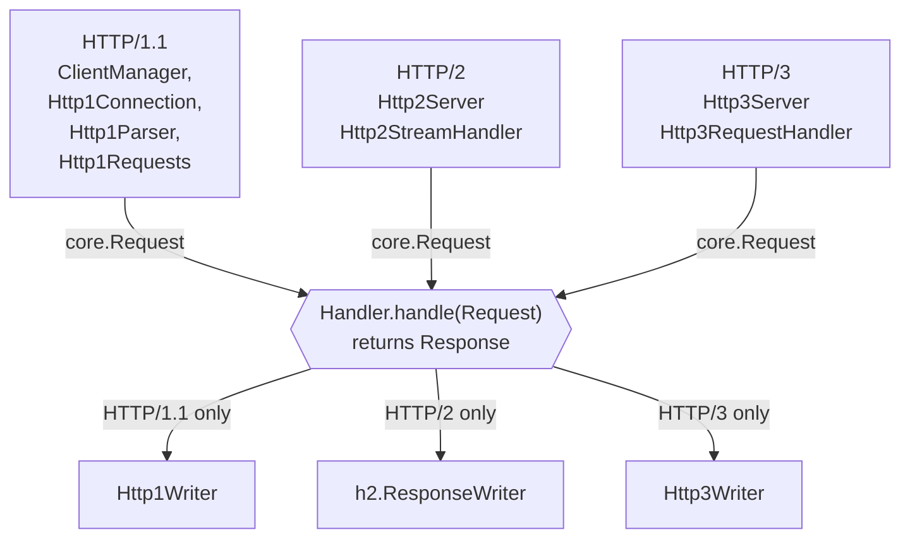
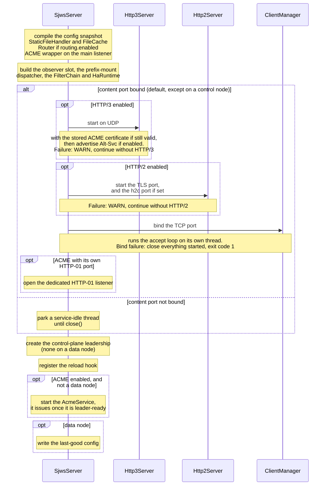
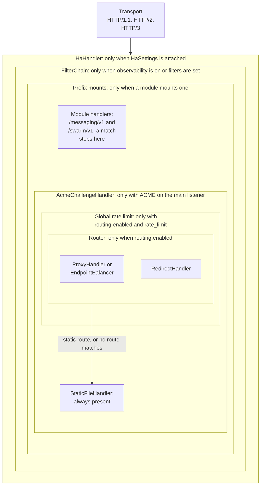
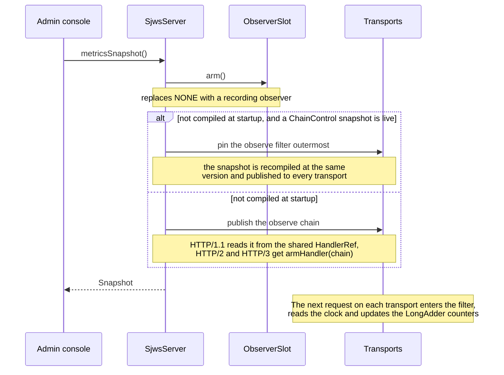
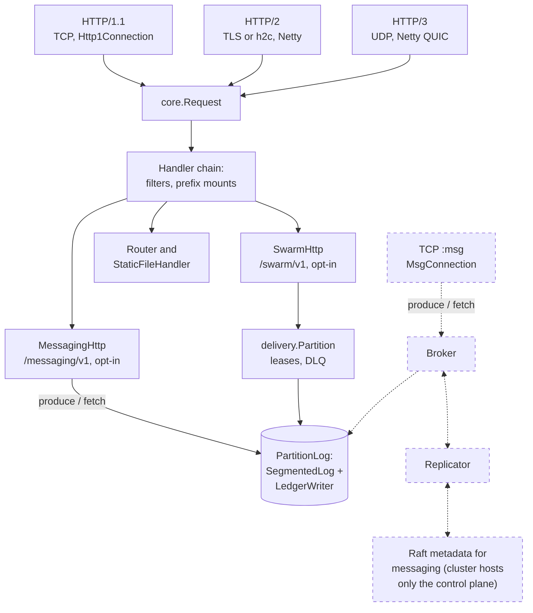

# Architecture

How the code on `master` is organised. User-visible behaviour (options, limits, caching, ranges) is
documented under [docs/](../index.md) and the [configuration reference](../user/configuration.md); the
tests that pin each behaviour are listed in [docs/development/testing.md](../development/testing.md).

## Layers

| Layer | Package / classes | Responsibility |
|---|---|---|
| Entry / config | `Sjws_nettask` (CLI, exit codes), `ServerConfig` | parse arguments and `WEB_SERVER_*` variables, validate, start |
| Lifecycle | `SjwsServer`, `Transport` (+ `Transport.Factory`), `AltSvc` | build the `StaticFileHandler`, bind TCP, start the optional HTTP/3 and HTTP/2 transports, Alt-Svc, shutdown |
| HTTP/1.1 connections | `ClientManager` (accept loop, per-IP limit, one virtual thread per connection), `Http1Connection`, `ConnectionReaper` (single timer thread for all deadlines), `ChannelOutput` | socket lifecycle, keep-alive, pipelining, body draining, timeouts |
| HTTP/1.1 wire format | `sjws_nettask.http1`: `Http1Parser`, `ChunkedDecoder`, `Http1Requests`, `Http1Writer`, `ParseError` (+ legacy `HTML`, `Page`, `Header`) | bytes ⇄ `Head`; `Head` → `core.Request`; `core.Response` → bytes |
| HTTP/2 | `sjws_nettask.h2`: `Http2Server`, `Http2StreamHandler`, `ResponseWriter`, `Http1FallbackHandler` | Netty on its own TCP port: TLS with ALPN `h2` (HTTP/1.1 fallback) and optional h2c; a virtual thread per request runs the shared handler; stream, in-flight and file caps, rapid-reset and CONTINUATION-flood limits |
| HTTP/3 | `sjws_nettask.h3`: `Http3Server`, `Http3RequestHandler`, `Http3Writer`, `Limits`, `RateGuard`, `NoRetryTokenHandler` | Netty QUIC (quiche) ⇄ core types; file slots, fair share, min send rate, handshake caps, GOAWAY |
| TLS | `sjws_nettask.tls`: `TlsMaterial`, `SelfSignedDer` | PEM certificate/key loading (encrypted keys), self-signed certificate |
| Core contract | `sjws_nettask.core`: `Handler`, `Request`, `RequestHeaders`, `RequestBody`, `Response`, `ResponseHeaders`, `Body` | protocol-neutral request/response |
| Application | `core.StaticFileHandler` + `PathResolver`, `RequestRules`, `SafeOpen`, `FileCache`, `FileMeta`, `ByteRanges`, `EntityTag`, `Validator`, `Mime`, `HttpDate`, `DateClock`, `PerIpLimit` | every status decision for static files |
| Observability | `sjws_nettask.observe`: `RequestObserver`, `ServerMetrics`, `Snapshot`, `AccessLog` | access log, in-process metrics, `/healthz`, optional `/metrics` |

`SourceGuardTest` enforces the boundaries: no `synchronized`; no Netty in `core`, `http1` or `cluster`; `core` imports no transport and no sockets; `h3` does not import HTTP/1; `cluster` does not import `ha` or HTTP/1; nothing outside `swarm` names it (except the `OptionalModules` class-name string); `swarm.wire` imports only `core`; the control-role `cp` types stay inside `cp`.

## Request flow

Each transport turns its wire format into a `core.Request`, hands it to the shared handler and writes
the returned `Response` through its own writer. The handler is the narrow waist; nothing above it
knows which protocol carried the request.

* `core.Handler` (`Response handle(Request)`) is the seam between transports and application logic.
  `StaticFileHandler` implements it; `Http1Connection` depends on `Handler`. Optional request
  filters (`RequestFilters`, [docs/development/filters.md](../development/filters.md)) wrap that handler. With none
  registered, HTTP/1.1 still calls `StaticFileHandler.handle` directly.
* Every transport calls the same handler, so behaviour is identical by construction; parity tests
  compare every HTTP/2 and HTTP/3 response with the HTTP/1.1 bytes for the same request. `Request`
  carries the client address, whether the connection is TLS, a streamed body (HTTP/1.1 `Content-Length`
  requests only) and the raw header map. HTTP/1.1 always fills the map, HTTP/3 only when a filter
  chain or a non-static terminal is installed at startup, and HTTP/2 (h2/h2c streams) when the live
  generation has `attachBodies` on (otherwise the six typed fields only; the HTTP/1.1 ALPN fallback
  on the HTTP/2 TLS listener uses the same gate).
* Errors raised before a request reaches the handler (parse errors, 408 deadlines, 431 on HTTP/3) use
  `StaticFileHandler.error(...)`, so their pages match the handler's. Status lines and
  error-page titles use `StaticFileHandler.reasonPhrase` (all RFC 9110 codes plus 429, empty for
  unregistered ones); `Mime` maps extensions to `Content-Type`.

## Startup

`SjwsServer` is the composition root. `SjwsServer.start` builds the pieces in this order. HTTP/3 and
HTTP/2 are optional: if one cannot start (port busy, QUIC natives missing, bad certificate) the server
logs a `WARN:` line and keeps serving the others. Two things stop the server: two overlapping prefix mounts,
which fail before any bind, and a failure to bind the TCP port or to open the dedicated HTTP-01 listener,
after which it closes everything it had already started.

## Handler composition

What a transport calls is decided once, in `SjwsServer`. Each box below is a `Handler` that wraps the
one inside it, and each exists only when its feature is on. With none of them, every transport calls
the live config snapshot's handler (the `StaticFileHandler` itself unless routing or ACME wrap it),
so a reload is visible on the next request.

| Layer | What it does |
|---|---|
| `HaHandler` | answers `/healthz` and `/readyz` from `HealthBoard`; everything else goes to the published generation, or to the config handler until one is published |
| `FilterChain` | `ObserveRequestFilter` at order 0, then the other filters by order, registered at startup or compiled from a `FilterDocument` that `ChainControl` applies ([filters](../development/filters.md)) |
| Prefix mounts | `HandlerMounts`: a dispatcher built at startup in front of the live snapshot's handler (or of the replacement terminal an embedder passes to `SjwsServer.start`). A request under a mounted prefix goes to that optional module's handler, everything else falls through. The filters wrap it, so they see both. Not built when nothing mounts. Two modules mount, both off by default: messaging at `/messaging/v1` (`sjws.messaging.enabled`) and the swarm at `/swarm/v1` (`sjws.swarm.enabled`) |
| `AcmeChallengeHandler` | answers `/.well-known/acme-challenge/` before anything else, including the file handler's dotfile check |
| Global rate limit | `routing.rate_limit`: one limiter in front of the Router, so a refused request (429) never reaches a route. It exists only with `routing.enabled` ([routing](proxy-routing.md)) |
| `Router` | first matching route wins: `ProxyHandler` (an `EndpointBalancer` for an upstream with endpoints), weighted backends, `RedirectHandler`, or the static handler (also the fallback when no route matches, so behind the global limit too); a route with `errors: problem` wraps its handler in `ProblemErrorHandler`, and a route `rate_limit` sits inside that wrapper ([routing](proxy-routing.md)) |
| `StaticFileHandler` | every status decision for a file ([access rules](../user/access-rules.md), [caching](../user/caching-and-ranges.md)) |

The file-handler leaf reads the live snapshot, on the command line and under filters an embedder
registers, so a reload (document root, access rules, routes) reaches HTTP/1.1, HTTP/2 and HTTP/3 on
the next request. Only a replacement terminal that an embedder passes to `SjwsServer.start` keeps the
leaf it was compiled around. `SjwsServer.chainControl` opens the slot a control plane uses: each
`FilterDocument` it applies is compiled and published to every transport with one volatile write per
transport ([filters](../development/filters.md)).

## Current gaps

Still open, each small and without file moves:

1. OPTIONS and 405 are decided inside `StaticFileHandler`. HTTP/1.1 already passes those methods
   through the handler (and therefore through filters, when any are registered).
2. `X-Content-Type-Options` and `Content-Security-Policy` are applied by the file handler, so
   filters see them on the way out. `Date`, `Server`, `Content-Length`, `Connection` and `Alt-Svc`
   are still added by the writers after the chain returns.

## Future direction

The project's goal is a reliable, fast, low-latency message-oriented middleware that is also a web
server. Messaging is partly built: the ledger and delivery engine (`messaging.ledger`, `messaging.delivery`,
`messaging.stats`) and an opt-in HTTP produce/fetch module at `/messaging/v1` (`messaging.http`).
The client wire protocol is still in design; the `core.Handler` seam and the protocol-neutral
`Request`/`Response` contract are where it is expected to plug in. The target design and migration
plan follow below.

## Observability

`observe.ObserveRequestFilter` sits at order 0, outermost among equal orders, and only when observability is on. `SjwsServer` builds it with `RequestFilters.create().add(0, filter)` and copies any caller filters inside it. While the filter is absent a request does not read the clock, does not update a counter, and does not look at the path for `/healthz` or `/metrics`, so a document-root file at `/healthz` is served. `--access-log`, `--metrics` (other than `off`) and `--healthz` install it at startup. The admin TUI's status view calls `SjwsServer.metricsSnapshot()`, which arms counters on the first call (publishing the filter if startup did not) without enabling `/healthz`. HTTP/1.1 reads that published handler on the next request; HTTP/2 and HTTP/3 learn about it through `Transport.armHandler`. Duration is the time until the handler returns, before the socket write. Protocol failures that never enter the chain are not recorded. `ServerMetrics`, `Snapshot` and `AccessLog` stay in `observe`.

Arming from the admin console, step by step:

Counters are `LongAdder`s, and only after the observer is recording. The access log is a bounded lock-free queue drained by one thread. Neither path blocks a request on I/O.

The latency histogram is a fixed log2 scale (ratio 2, from 1 ms through 16.384 s, then `+Inf`). `ServerMetrics.LATENCY_BOUNDS_NANOS` and `LATENCY_LE_LABELS` are the stable contract: a cluster merges by summing `Snapshot.latency().counts()[i]` across nodes, or by summing Prometheus `sjws_http_request_duration_seconds_bucket` series that share an `le` label. The in-process counts are not cumulative; the exposition is.

---

# Target: message-oriented middleware that is also a web server

Goal (from Blivion): a **reliable, fast, low-latency message-oriented middleware (MOM)** that also serves HTTP. This section is the target design and the plan to get there. Every number below was measured with `bench/` (§B); figures for external systems are linked to their source.

## T0. Principles
1. **One I/O + threading core, many protocols.** HTTP/1.1, HTTP/2, HTTP/3 and the messaging protocol(s) are adapters on the same listeners, buffer pool and deadline machinery (today `ClientManager` + `ConnectionReaper`).
2. **The log is the source of truth.** Messages are durable only once they are in an append-only segmented log. Queues, topics, consumer offsets and replication are all views over or copies of that log.
3. **Single writer per partition.** One thread owns each partition's append path, so there are no locks on the hot path. Producers hand records over through a bounded queue, which is also the backpressure signal.
4. **Durability is explicit and configurable** per stream: `none` / `async` (the single-node default) / `group` (fsync batching) / `replicated` (majority in-memory ack, the **decided cluster default**) / `replicated+fsync` (opt-in quorum + fsync), never implicit.
5. **Behavior-preserving, incremental migration.** The web server keeps working at every phase, and every phase ships with benchmarks.

## T1. Shared I/O and threading core
| Decision | Choice | Why |
|---|---|---|
| Connection model | **Keep blocking NIO + one virtual thread per connection** ([JEP 444](https://openjdk.org/jeps/444)) for HTTP/1.1 and the messaging TCP protocol | Measured: 20k req/s at 1 connection (p50 45 µs) and 205k req/s at 256 connections on 8 vCPU (§B1), with simple sequential code. The earlier design study (`sjws_nettask-core-architecture.md`) found Netty epoll vs NIO within ±3 %, so the syscall layer is not the bottleneck at this scale. |
| Netty | **Only where the protocol needs it** (QUIC/HTTP/3, the HTTP/2 listener and the proxy client today). It could become an optional front-end later behind `Transport` | Avoids two threading models in the core. Netty's p99 was worse in the earlier study. |
| Hot partitions | Dedicated **platform thread** per partition writer (`LogBench` shape) and, later, per replication sender | Blocking file I/O on a virtual thread captures its carrier (the JDK compensates by growing the pool). Dedicated platform threads make this explicit and bounded. |
| Buffers | One **pooled direct `ByteBuffer` slab allocator** (power-of-two size classes, per-carrier free lists), shared by HTTP and messaging | Removes the per-connection `allocate` in `Http1Connection.fill`, and the log writer needs direct buffers anyway (`LogBench` uses a 4 MiB direct buffer). |
| Zero-copy | `FileChannel.transferTo` (sendfile) **for both static files and log-segment reads to consumers**, as Kafka does for consumers ([Kafka design: efficiency](https://kafka.apache.org/37/design/design/)) | Already used for large static files. Requires the on-disk record format to equal the wire format (T3). |
| Deadlines | Generalize `ConnectionReaper` timers to messaging sessions (heartbeat/idle, ack timeout) | Reuse, not a second timer wheel. |

## T2. Messaging engine
* **Protocols** (resolved by Messaging Core, PR #17). (1) Our own native binary TCP protocol, length-prefixed frames, with **batched produce and fetch** whose frames match the log record format; (2) **HTTP bindings** through the existing `core.Handler` seam: `POST /topics/{t}` publishes, `GET /topics/{t}?offset=` fetches, SSE or WebSocket streams, so the web server *is* a messaging gateway (as built: `POST` and `GET /messaging/v1/topics/{t}/records`; SSE and WebSocket are not built); (3) AMQP/MQTT come later, as gateways. The Kafka wire protocol will not be implemented.
* **Model.** *Topic* = named stream split into *partitions* (one log each, ordered within a partition). *Queue* = a topic with one shared consumer group, competing consumers and per-message ack/redelivery. Per-message state (deliver/ack/nack/DLQ records) is stored as records in the partition's own log, not in a separate store (PR #17 §2.1). *Subscription / consumer group* = a durable cursor (committed offset) stored in an internal compacted log. This is how Kafka models it ([Kafka design](https://kafka.apache.org/37/design/design/)). NATS JetStream offers the same split (streams + consumers, [docs](https://docs.nats.io/reference/config/jetstream/)).
* **Delivery semantics.** At-most-once (ack before processing), **at-least-once by default** (ack after durable append; redelivery after ack timeout), and effectively-once via **idempotent producers** (producer id + sequence number deduplicated at the partition leader). There is no exactly-once in v1 (PR #17); producer deduplication covers retries.
* **Backpressure.** End to end and credit-based: (a) each partition writer has a bounded queue (`LogBench` uses 65 536 entries), and a full queue makes the producer's send block or get a `retry-after`; (b) consumers grant **credits** (max in-flight messages/bytes), the server never pushes beyond them, and on HTTP the equivalent is long-poll / chunked fetch with `max_bytes`; (c) per-connection write deadlines (`ConnectionReaper`) drop slow consumers instead of buffering without bound.
* **Ordering.** Per partition. Key-hashing picks the partition.

## T3. Storage log
Prototype: `bench/LogBench.java` (bench code only, not server code).
* **Segmented append-only log** per partition: files `<baseOffset:020d>.log` (1 GiB default) plus a sparse `.index` (relative offset → file position, one entry every 4 KiB). Kafka uses the same layout ([Kafka design: log](https://kafka.apache.org/37/design/design/)).
* **Record frame** (prototype): `[len:int][crc32c:int][offset:long][payload]`. Production adds a **format version byte** (PR #17) and a batch header (base offset, count, timestamp, producer id/seq) so that **disk format = wire format** and fetch can use sendfile.
* **Fsync policy** per stream:
  * `none`: write to the page cache; fast but loses data on power failure. Measured **489k rec/s** (8 producers, 256 B), p50 11 µs.
  * `async` (**default for single node**): ack after `write(2)` into the page cache; a background syncer fsyncs continuously, off the ack path. A process crash loses nothing, and a power or kernel failure loses at most the records written since the last completed fsync ([messaging design](../messaging/design.md) §2.2).
  * `group` (opt-in): the writer drains everything queued, does one `write` + one `fsync`, then acks the batch. Measured: 1 producer 1.7k rec/s (≈ the fsync rate), 8 producers 6.9k rec/s, **64 producers 48.6k rec/s at p50 1.1 ms**. Throughput scales with concurrency because each fsync covers more records.
  * `each`: fsync per record. 1.6–1.7k rec/s regardless of producer count, p50 4.2 ms at 8 producers. Only for compliance-style streams.
  * `replicated` (**cluster default, decided by Blivion on 2026-10-12**): `append` is acked once a **majority of the replica set holds the entry in memory**. No follower fsync is required; the leader's and followers' fsync follows the stream's local policy (`group` or the background timer). This matches Kafka's recommended default ([flush.messages](https://kafka.apache.org/43/configuration/topic-configs/), [Hardware and OS](https://kafka.apache.org/43/operations/hardware-and-os/)) and NATS JetStream, which acks on quorum and syncs on a 2-minute timer by default ([replication and R=3](https://docs.nats.io/learn/clustering/replication-and-r3), [sync_interval](https://docs.nats.io/reference/config/jetstream/sync_interval)). Trade-off, documented on purpose: an acked message survives the loss of any minority of nodes, but it can be lost if a majority loses power before its next fsync.
  * `replicated+fsync` (**explicit opt-in, per stream/topic**): the ack waits until a majority has **fsynced** the entry (one `group` commit on each replica in the quorum). This closes the simultaneous-power-loss window, at the cost of about one fsync (≈ 0.5 ms here, §B2) plus a round-trip on every ack. Set in the stream/topic config (e.g. `durability: replicated+fsync`). It is never the implicit default.
  * A later option for `group`: linger N µs to grow batches at low concurrency. The 1-producer result shows a closed loop gets no batching benefit.
* **Recovery.** Scan the last (unsynced) segment, validate CRCs, truncate at the first bad record, rebuild its index. Kafka does the same for segments not known to be fsynced ([Hardware and OS](https://kafka.apache.org/43/operations/hardware-and-os/)).
* **Retention.** Delete whole segments by age or size (cheap: unlink), plus **compaction** (latest value per key) for internal topics (consumer offsets, cluster metadata).
* **Reads.** Tail reads come from the page cache. Lagging consumers use index lookup + sendfile. A cached small-file path like `core.FileCache` is not reused for the log.

## T4. Cluster layer
* **Replication.** One Raft group per partition (`cluster.RaftGroup`), multiplexed by group id on the node's transport. Commit = **majority of the replica set**; followers apply the committed log in index order, and consumers see only committed offsets. The Kafka-style follower fetch with an in-sync-replica set was declined ([HA design](../ha/design.md), "Decisions for PR #16"). The groups exist; the messaging partitions do not use them yet.
* **Metadata, membership, leader election.** A small **Raft** group ([Raft paper](https://raft.github.io/raft.pdf)) holds cluster metadata (members, partition assignment, leaders, epochs). This is the shape of Kafka's KRaft ([KIP-500](https://cwiki.apache.org/confluence/display/KAFKA/KIP-500%3A+Replace+ZooKeeper+with+a+Self-Managed+Metadata+Quorum)) and of NATS JetStream's meta group. No external ZooKeeper/etcd dependency.
* **Failover.** Elections are per group. A new leader bumps the **leader epoch**, and writes carrying a stale epoch are fenced. Clients follow metadata redirects (not built yet).
* **Dual-node HA.** Two nodes **cannot form a majority after one fails**, so pure 2-node quorum is not split-brain safe. The choice between a witness and async primary/standby is settled in [two-node HA](two-node-ha-decision.md): use two data nodes plus a witness, and do not promote a data node that is alone.
* **HTTP in a cluster.** Static content is served by every node. Messaging HTTP endpoints redirect or proxy to the partition leader.

## T5. How the existing code fits
Dashed boxes are not built yet. The ledger and delivery code in `sjws_nettask.messaging` covers part of
`PartitionLog` and of the partition logic. Two opt-in modules, messaging and the swarm, reach it through
prefix mounts in the handler chain. Both are off by default.

* `core.Handler` (PR #4) stays the HTTP seam. Messaging over HTTP is just another `Handler` in the chain, so it needs no transport change.
* `Transport` is the generic listener interface for everything next to the HTTP/1.1 accept loop: `Http3Server` (UDP, QUIC) and `Http2Server` (TCP, TLS and h2c) implement it, and `Transport.Factory` builds them. A messaging TCP listener would be a third `Transport`.
* `SjwsServer` becomes the composition root: config → log/broker → handler chain → transports.
* Messaging must **not** go through `Request`/`Response` (those are HTTP semantics). The broker API is its own (`produce(batch) → CompletionStage<offsets>`, `fetch(partition, offset, maxBytes)`).

## T6. Phased migration
| Phase | Deliverable | Exit criteria |
|---|---|---|
| 0 (done) | Target doc + `bench/` baselines | Numbers reproducible |
| 1 (done) | Widen `ClientManager`/`Transport`/h3 to `Handler`. Introduce the buffer pool (HTTP only) | No regressions in `HttpBench` (±5 %); `mvn verify` green |
| 2 (built as `messaging.ledger`) | `storage` package: production `PartitionLog` (segments, index, recovery, retention, fsync policies) with crash tests (kill -9 / truncated tail) | Recovery tests; `LogBench` numbers within 10 % of the prototype |
| 3 (partly built as `messaging.delivery` and `messaging.http`) | Single-node broker: topics, partitions, consumer groups, offsets log, at-least-once, credits; HTTP bindings via `Handler` | End-to-end produce→consume latency bench; backpressure tests |
| 4 | Native binary protocol + idempotent producers | Batch-produce throughput vs HTTP baseline |
| 5 | Raft metadata + replication + failover; witness-based dual-node HA | Jepsen-style partition/kill tests; no acked-message loss under minority failures in `replicated`, nor under majority power loss in `replicated+fsync` |
| 6 | Optional: Netty or io_uring front-end behind `Transport` if benchmarks justify it | Measured win > 20 % |

## B. Benchmarks (measured)
Run on **b8055fe** (master at the time + this PR's `bench/`; later master merges, e.g. daemon mode, were not re-benchmarked). Machine: shared cloud VM, **8 vCPU Intel Xeon (model not exposed), 15 GiB RAM, Linux 6.12, virtio disk (`vda`, reported rotational), overlay root filesystem**, **OpenJDK 25.0.4.1 (Temurin)**, default JVM flags. Client and server ran on the same host over loopback, so treat the numbers as **relative baselines, not capacity claims**. Reproduce with `bench/README.md`.

### B1. HTTP/1.1 keep-alive closed loop (`HttpBench`, 10 s after a 2 s warm-up, GET of a static file)
| Connections | Body | req/s | p50 | p99 | p99.9 |
|---|---|---|---|---|---|
| 1 | 1 KiB | 20,099 | 45 µs | 114 µs | 649 µs |
| 64 | 1 KiB | 167,455 | 211 µs | 2.99 ms | 7.07 ms |
| 256 | 1 KiB | 204,667 | 816 µs | 6.75 ms | 11.4 ms |
| 64 | 64 KiB | 87,207 | 466 µs | 4.62 ms | 9.54 ms |

(A shorter 5 s run at 64 connections gave 278k req/s, p50 199 µs. Run-to-run variance on this shared VM is significant; compare only runs on the same host.)

### B2. Append-only log write path (`LogBench`, 256 B payloads, closed loop, latency = enqueue → ack)
| Mode | Producers | rec/s | MB/s | fsyncs | p50 | p99 | p99.9 |
|---|---|---|---|---|---|---|---|
| none | 8 | 489,126 | 133.0 | 0 | 11 µs | 63 µs | 373 µs |
| none | 64 | 656,117 | 178.5 | 0 | 67 µs | 486 µs | 3.35 ms |
| each | 1 | 1,618 | 0.4 | 5,000 | 541 µs | 1.90 ms | 4.22 ms |
| each | 8 | 1,737 | 0.5 | 20,000 | 4.20 ms | 10.7 ms | 18.1 ms |
| group | 1 | 1,673 | 0.5 | 20,000 | 506 µs | 2.23 ms | 5.60 ms |
| group | 8 | 6,896 | 1.9 | 99,201 | 970 µs | 3.88 ms | 20.0 ms |
| group | 64 | 48,579 | 13.2 | 12,265 | 1.12 ms | 4.95 ms | 8.31 ms |

**Takeaways.** (1) One fsync on this disk costs about 0.5 ms, which caps per-record-durable writes at about 1.7k/s no matter how many producers there are. (2) Group commit scales almost linearly with concurrency: 64 producers gave 28× the per-record throughput at roughly 2× the p50. Group commit is therefore the policy to use when an ack must wait for an fsync (the single-node default later became `async`, see §A). (3) Without fsync the single writer thread sustains about 0.5–0.65 M rec/s, so the write path is not CPU-bound. (4) A durable round-trip (~0.5–1 ms) is larger than the whole HTTP request latency (45 µs). This is why the decided cluster default is the **majority in-memory ack** (T3 `replicated`): it beats local fsync whenever the network RTT is below fsync latency, which phase 5 must measure.

## A. Alignment with sibling workstreams
Updated 2026-10-12, 16:36 Paris time.

### Decided
* **Cluster ack default** (Blivion, 2026-10-12): majority **in-memory** ack (`replicated`), with no follower fsync. Quorum + fsync (`replicated+fsync`) is an explicit per-stream/topic opt-in (T3). This settles the former HA open question "does a replicated ack require a follower fsync?".

### Messaging Core: resolved by PR #17 (`docs/messaging/design.md`)
1. Protocol: **our own binary protocol plus HTTP**. AMQP/MQTT come later as gateways. No Kafka wire protocol.
2. **No exactly-once in v1**; producer deduplication instead.
3. Queues are **a shared consumer group, with per-message state records in the partition log** (no separate store).
4. **`async` is the single-node default** (ack after write, background group fsync); `group` and `each` are opt-in per topic or producer.
5. The on-disk/wire format carries a **format version byte**.

Aligned: the [messaging design](../messaging/design.md) makes majority in-memory (`RELAXED`) the cluster default and quorum + fsync (`STRICT`) the opt-in.

**High Availability: decided** in the [HA design](../ha/design.md), "Decisions for PR #16":
1. Dual-node HA is two data nodes plus a witness; without one, automatic failover is not split-brain safe.
2. Raft covers metadata and each message partition; static files are not in any log.
3. RPO 0 only in `STRICT`; a crash is repaired within the election timeout plus the lease (about 2.5 s with the design timings).
4. Static HTTP serving is active on all nodes, independent of Raft leadership.

## Routing and reverse proxy (`sjws_nettask.routing`)

Plain `core.Handler` implementations, so they slot into the handler/filter chain like any other handler:

* `Router(List<Route>, fallback)`: first match wins; a `Route` is host (exact, `*.suffix`, or any) + path prefix (segment boundary) + optional prefix rewrite + target `Handler`. No match: fallback (e.g. `StaticFileHandler`) or 404.
* `RedirectHandler(status, location, keepPath)`: 301/302/303/307/308.
* `ProxyHandler(Settings)`: forwards to one upstream over a Netty HTTP/1.1 keep-alive pool (`UpstreamPool`, no redirects) and streams both ways: a `Content-Length` request body is copied upstream chunk by chunk (over `max_body` 413, chunked 501) and the response is a `Body.Stream` with backpressure. Adds `X-Forwarded-Host`, `X-Forwarded-Proto`, `Forwarded`; drops hop-by-hop and writer-owned fields; connect/IO error → 502, timeout → 504, non-origin-form target or invalid method → 400. An upstream with `endpoints` goes through `EndpointBalancer`.

Design and phases: `docs/design/proxy-routing.md`.
