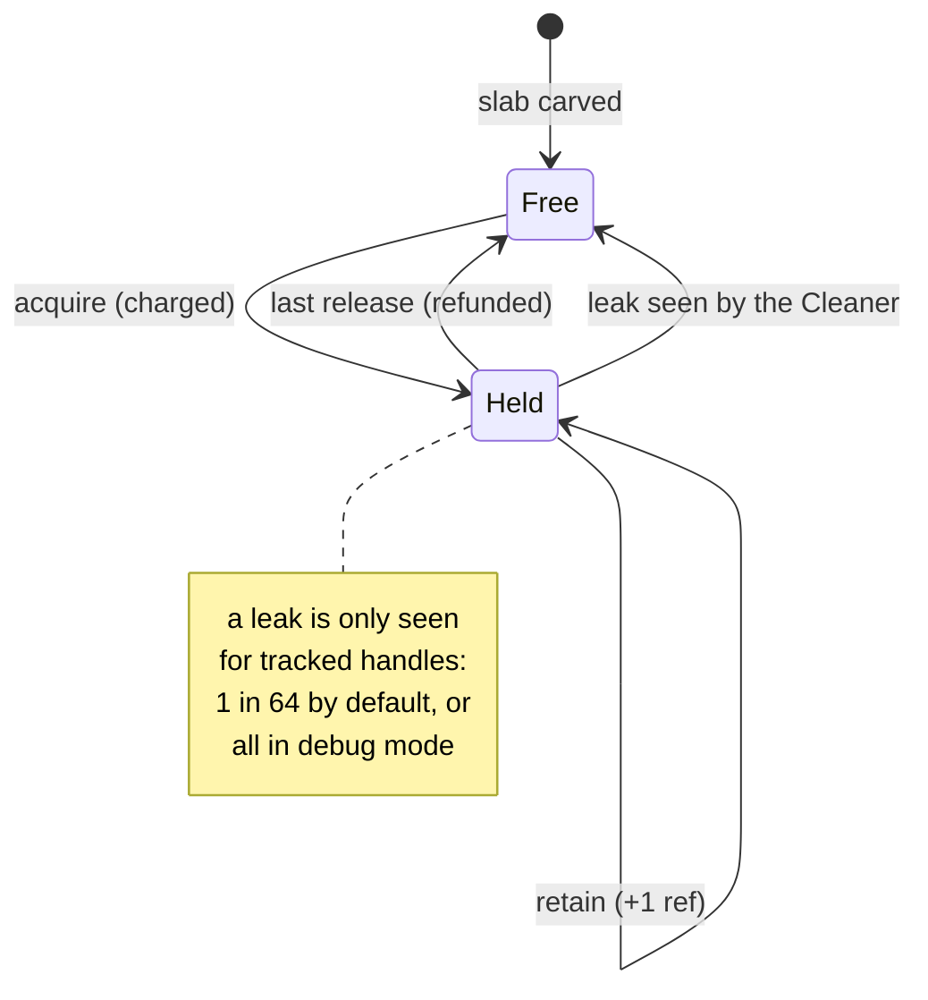
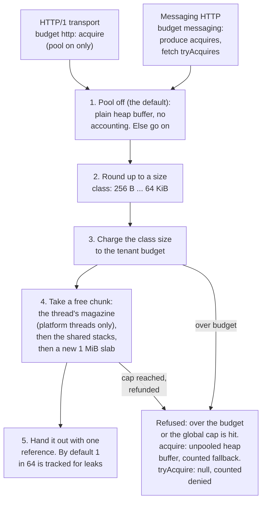

# Shared pooled direct-buffer allocator + zero-copy: API proposal (draft for Messaging Core)

Status: **PR (a) implemented; used by HTTP/1 and `/messaging/v1`** (`core.buf`, flag off by default). The API was approved by Messaging Core on 2026-10-13, and every question is answered in §14. Base: origin/master 6333e66. Every claim about the code is from that tree. Measured numbers are in §15 and §16; the others come later from the benches listed under "Bench plan".

## 1. Where buffers come from today
| Site | What it does now | Pool candidate? |
|---|---|---|
| `Http1Connection.idleFill/fill` (:228, :240) | Heap 256 B "small" buffer, kept for the connection's lifetime. Heap 2 KiB `INPUT_BUFFER` allocated on the first full read of each request (my earlier idle-footprint change). | **Yes.** This is the per-connection allocation to remove. |
| `Http1Writer` (:209–233) | Small files (≤ 64 KiB) and bytes (≤ 256 KiB): a new `byte[head+body]` per response. Bigger bytes: a 64 KiB `byte[]` chunk. `copy()` uses a 64 KiB heap buffer. | **Yes:** head and body staging. |
| `ChannelOutput.transferFrom` (:98–130) | Already uses **sendfile** (`FileChannel.transferTo`, 64 KiB chunks) for files over 64 KiB on plain HTTP/1. Allocates a 16 KiB heap `slice` lazily when the socket is full. | Slice from the pool. |
| Heap buffers to `SocketChannel` | The JDK copies each one into a temporary direct buffer, cached per **carrier** (`sun.nio.ch.Util`: `TerminatingThreadLocal extends CarrierThreadLocal`, at most IOV_MAX buffers per carrier). | A direct pooled buffer saves that copy. |
| h2 `ResponseWriter` (:213, :251) | `ctx.alloc().ioBuffer(n)`, which is Netty's pooled allocator. Small files are read in; large ones are read in chunks. | **No new pool.** Keep Netty's. Add `DefaultFileRegion` (sendfile) on the **h2c** cleartext listener only. |
| h3 `Http3Writer` (:204, :263) | `Unpooled.wrappedBuffer`/`copiedBuffer`. QUIC encrypts every packet. | Use `ctx.alloc()` (Netty pool) in place of `Unpooled.copiedBuffer`. **No sendfile.** |
| Messaging `LedgerEntry.encode` (:55), `RecordBatch.encode` (:46) | A new heap `ByteBuffer` per entry or batch (8.8% of sampled allocation in #105's profile). | **Yes** (append encode). |
| `LedgerWriter` (:57, :201) | One owned direct buffer of 1 MiB that doubles as needed. | Keep it owned. It's a single writer and needs no pool. Optionally take it from the pool's huge class. |
| `Segment.load` (:230), `Segment.scan` (:250, up to 4 MiB) | A new heap buffer per readahead or scan. | **Yes** (segment read buffers). Consumer fetch over plain TCP goes to **transferTo** instead. |

## 2. API (package `sjws_nettask.core.buf`)
```java
public final class BufferPool {
  static BufferPool shared();                 // process-wide, configured once at startup
  static BufferPool disabled();               // plain allocate(): what every caller uses when the pool is off
  BufferBudget budget(String tenant);         // named sub-budget view ("http", "messaging"), created from config
  Stats stats();
}

/** A tenant's view of the shared pool. Every buffer is charged to the budget it came from until it is released. */
public final class BufferBudget {
  PooledBuffer acquire(int minCapacity);      // never null: when the budget or global cap is exhausted, an UNPOOLED buffer (counted as fallback)
  PooledBuffer tryAcquire(int minCapacity);   // null when this budget (or the global cap) is exhausted; never unpooled
  PooledBuffer acquireLarge(int minCapacity); // above 64 KiB up to 4 MiB (rounded up to a power of two), transient use only (recovery, compaction, scan): release when done
  String name(); long limitBytes(); long usedBytes();
}

public final class PooledBuffer implements AutoCloseable {
  ByteBuffer buffer();         // position 0, limit = capacity, same object until release
  int capacity();
  boolean pooled();            // false: pool off, over budget, or too large
  PooledBuffer retain();       // +1 ref (rare: shared reads, e.g. one segment chunk to several consumers)
  void release();              // -1 ref; returns to the pool at 0; a release below 0 throws IllegalStateException
  @Override public void close() { release(); }
}
```
### Ownership rules
1. **One owner.** `acquire` returns refCnt = 1 and the caller owns the buffer.
   - Handing it to another thread transfers ownership. The sender must not touch it afterwards.
2. **Release once.** Release in `finally`/try-with-resources. `buffer()` after the final release always throws; only debug mode also poisons the chunk (§5).
3. **No slices escape.** `duplicate()`/`slice()` views must not outlive `release()`. APIs that keep bytes (`Body.Bytes`, `RecordBatch` records, the `Delivery` payload) copy out or `retain()`.
4. **Refcount is `retain`/`release` only.** It is a `volatile int` updated through a `VarHandle` and is checked on every call: no use-after-free through the handle, and a release below 0 throws.

## 3. Size classes and slab layout
- **Size classes:** powers of two, 256 B, 512 B, 1, 2, 4, 8, 16, 32, 64 KiB (9 classes). Larger:
  - **Large class: 128 KiB – 4 MiB, transient use only (approved).** Through `acquireLarge`, for recovery, compaction and segment scans. The caller releases it when the operation ends and must not keep it as a per-partition buffer. Large buffers come from a small bounded LRU of `allocateDirect` buffers (≤ 4 per class), are charged to the budget, and are freed by idle trim.
  - **Not for the `LedgerWriter` group buffer:** it stays owned.
  - **Over 4 MiB:** never pooled.
- **Slab:** one `allocateDirect(1 MiB)` region, carved into equal chunks of a single class. A chunk is a `slice(off, size)`, built once and reused, so `buffer()` does not allocate.
  - A slab only lists its chunks; free chunks sit in the stripes' array stacks and the platform-thread magazines.
  - Slabs are allocated lazily per class on first demand. **The pool allocates nothing at startup.**
- **Memory accounting:** the cap counts both pooled slab bytes and huge-class bytes against `sjws.buf.maxBytes`.

## 4. Caches and virtual threads
- Today one **virtual thread per connection** serves HTTP/1 (and messaging TCP later); partition writers are platform threads.
- **Per-carrier free lists:** `architecture.md` T1 already names them. There is no public API for them. `jdk.internal.misc.CarrierThreadLocal` needs `--add-exports java.base/jdk.internal.misc`. A virtual thread can also park between `acquire` and `release` and resume on another carrier, so carrier-local state can't be held across a call.
- **Proposal:**
  - **Shared level: striped stacks.** Each class gets N = `nextPow2(availableProcessors)` stripes. Each stripe is an array stack guarded by a short `ReentrantLock` section (no CAS, so no ABA). The stripe comes from `Thread.currentThread().threadId() & (N-1)` and falls back to the neighbouring stripes. Nothing is held across a park, so it is safe under migration.
  - **Platform-thread magazines (optional; approved, in PR (a)):** `ThreadLocal` (not carrier-local) magazines of up to 8 chunks per class, used only when `!Thread.currentThread().isVirtual()`. This serves partition writers, the h2/h3 event loops if they ever use the pool, and the reaper. A magazine is flushed to the shared stripes when its thread terminates (`Thread.onExit` isn't available, so via a `Cleaner` on the thread).
  - **No `ThreadLocal` for virtual threads:** a million connections would mean a million caches.
- **Opt-in carrier caches:** a carrier-local magazine via `CarrierThreadLocal`, enabled only when `--add-exports` is present, with pop/push done without parking. This is **not in v1**; measure first.

## 5. Leak detection
- **Release mode (default):** a `Cleaner` on each `PooledBuffer` handle object, not on the chunk. If a handle becomes unreachable with refCnt > 0, the chunk returns to the pool, `leaked` is counted, and one WARN line is logged per 60 s with the class.
  - This bounds a leak to the pool cap instead of memory growth.
  - Cost: one `Cleaner.register` per tracked acquire. 1 in 64 acquires is tracked by default (`sjws.buf.leakSample`, as Netty's SIMPLE level does); debug mode tracks all (§15).
- **Debug mode (`-Dsjws.buf.debug=true`, on in the tests that pass it and in the CI HTTP/1 rerun):**
  - Records the acquire stack per handle.
  - Poisons the chunk (fills it with 0xDE) on release.
  - Every access through a released handle throws.
  - `BufferPool.outstanding()` returns the live handles with their stacks.
- **Test hooks:**
  - `NoBufferLeaks.assertNoLeaks(pool)` (a test class): forces GC plus cleaner processing, then asserts no tracked buffer is outstanding, every budget is back at 0 used bytes and no new leak was counted.
  - A JUnit extension (`@ExtendWith(NoBufferLeaks.class)`) on transport and messaging suites.
  - Fault tests: client reset mid-request, shrinking file, TLS handshake failure, segment read error. All must end with 0 outstanding.

The life of one pooled chunk as built (`PooledBuffer`, `BufferPool.recycle`). A large buffer is allocated on its own and parks in a cache of at most four per size, and a heap fallback is never pooled. Only a tracked handle can be recovered by the `Cleaner`:



## 6. Cap, sub-budgets and exhaustion
- **One shared cap with named sub-budgets (approved).** `sjws.buf.maxBytes` is the global cap. `sjws.buf.budgets` (for example `messaging=50%`) gives each tenant a fraction of it:
  - default `messaging: 50%`;
  - `http` gets the rest (`100%` minus the other budgets), so messaging fetch can never use more than half and cannot starve HTTP.
  - Budgets are hard limits per tenant. The global cap also applies, and the sum of budgets must not exceed 100% (validated at startup).
- **Charging:** a buffer is charged to its budget at acquire, both pooled bytes and large bytes. Pooled chunks are charged at class size. The charge is refunded at final release, even if the buffer is released on another thread.
- **`acquire` vs `tryAcquire` (approved):**
  - `acquire` never fails. Over the budget or cap it returns an **unpooled** buffer (heap for HTTP input, direct for I/O users). That buffer is not charged, but is counted as `fallback_unpooled{tenant}`.
  - `tryAcquire` returns **null** when the tenant's budget or the global cap is exhausted, and the caller sheds load (messaging fetch answers retry-after). It never returns an unpooled buffer.

- **Cap:** `sjws.buf.maxBytes`, default **64 MiB** (open: should it scale with max connections?). No per-class share is enforced.
- **Neither method blocks.** Blocking would add latency and could deadlock under backpressure.
- **Trimming:** `BufferPool.trim(idleNanos)` frees slabs whose chunks have all been free for that long and drops the cached large buffers, but nothing schedules it yet, so slabs stay until exit. Direct memory goes back when the dropped buffers are collected.

One `acquire` as built (`BufferBudget.acquire` into `BufferPool.take`). `acquireLarge` (above 64 KiB up to 4 MiB,
rounded up to a power of two) skips the slabs: it reuses one of at most four cached buffers of its size, or
allocates a direct buffer, under the same budget and cap:



## 7. Config: zero cost when off
- `buffers.pool: true|false` in the YAML config, or `-Dsjws.buf.pool=on|off` (which wins; there is no `--buffer-pool` flag), default **off** for the first release, then on after benches.
- **Off:** `BufferPool.disabled()` is a final class whose `acquire` is `ByteBuffer.allocate` plus a tiny handle with no Cleaner or accounting. The JIT should inline it, so code paths stay identical to master. The footprint benchmark checks that idle heap per connection is unchanged.
- **Read once at startup.** A reload does not toggle the pool.
- `sjws.buf.debug`: a system property for tests.

## 8. Metrics
As built, `BufferPool.stats()` returns `LongAdder` counters per tenant (limit, used, acquired, denied, fallbacks) and for the pool (reserved bytes, slabs, leaked, trimmed slabs). Nothing exports them to `/metrics` yet. The planned series, per class and per tenant:
- `acquired`, `released`, `outstanding` (gauge)
- `budget_used_bytes{tenant}`, `budget_limit_bytes{tenant}`, `try_acquire_denied{tenant}`
- `pooled_bytes`, `slabs` (gauge)
- `fallback_unpooled`, `leaked`, `trimmed_slabs`

Global: `direct_bytes_total`, which counts the pool against `-XX:MaxDirectMemorySize`. Updating the counters costs nothing until the observer is recording, as with `architecture.md` T1 counters.

## 9. HTTP use
1. **`Http1Connection`:**
   - Acquire a 2 KiB chunk for a request's input on the first full read (where it allocates today). **Release it when the request is done and the connection goes idle.**
   - The idle 256 B small buffer comes from the pool and is held while the connection idles. Alternative: drop it and read idle connections into a pooled chunk acquired per wake. Open, decided by the footprint bench.
   - Goal: **0 bytes allocated per connection after warm-up.**
   - Both are **direct**, which saves the JDK's carrier temp copy.
2. **`Http1Writer`:** stage the head and a small body in a pooled direct buffer, then do a gathering `write(ByteBuffer[])` of head plus `Body.Bytes` data. That's one syscall with no `byte[head+body]` copy.
3. **h2/h3:** keep Netty's `PooledByteBufAllocator` (ctx alloc); don't bridge it into ours. Replace `Unpooled.copiedBuffer` with `ctx.alloc()`. h2c (cleartext) large files get a `DefaultFileRegion`.

## 10. Messaging (PartitionLog) use
Messaging Core implements these callers in PR (c). Every messaging call goes through `BufferPool.shared().budget("messaging")`.
- **Append encode:** `LedgerEntry.encode` and `RecordBatch.encode` gain `encodeInto(ByteBuffer)` overloads. The producer path acquires a class-sized chunk, encodes, hands it to the writer queue (ownership transfers), and the writer releases it after `write`. The writer's own group buffer stays an owned direct buffer, or a huge-class acquire.
- **Segment reads:**
  - `Segment.load` readahead takes pooled chunks up to 64 KiB.
  - `scan` (recovery, compaction, snapshot rebuild) uses `acquireLarge` and releases at the end of the scan.
  - A cached `Chunk` holds the ref while it is cached and releases it on eviction.
  - Decoded `RecordBatch` records must be **copied out** before release, as today. Alternatively `RecordBatch` could hold a `retain()`ed view. That is the main API question (see below).
- **As built (`/messaging/v1`):** produce stages the request body in a `messaging`-budget buffer (`acquire`, or `acquireLarge` above 64 KiB); fetch encodes into one `tryAcquire` chunk and answers 503 when it is refused. Segment reads, scans and the writer do not use the pool yet.
- **Consumer fetch over the native TCP protocol** (architecture T1/T3): with the on-disk format equal to the wire format, send `FileChannel.transferTo(segmentPos, len, socket)` for plain TCP. TLS (JDK `SSLEngine`) requires reading into a pooled direct buffer and encrypting from it. kTLS isn't available from Java without native code, so it is **out of scope**.

## 11. Where transferTo / sendfile applies
| Path | sendfile? |
|---|---|
| HTTP/1 plain, file over 64 KiB | **Already yes** (`ChannelOutput.transferFrom`) |
| HTTP/1 plain, small file ≤ 64 KiB | Today head+body are copied in one write; option: head `write`, then `transferTo` (2 syscalls). Bench decides. |
| HTTP/1 over TLS | Not applicable: there is no HTTP/1 TLS listener today (TLS is on the Netty h2 listener) |
| h2 over TLS | No (`SslHandler` encrypts); chunked pooled reads |
| h2c cleartext | Yes, via Netty `DefaultFileRegion` (needs a check that `Http2FrameCodec` accepts a FileRegion. It probably does not, because DATA frames need framing, so it may be limited to the HTTP/1 fallback on the h2c port) |
| h3 / QUIC | No (per-packet encryption) |
| Messaging fetch, plain TCP | Not yet: HTTP fetch re-encodes into a pooled buffer; the plan is `transferTo` from segment files |
| Messaging over TLS | No; pooled direct read buffers |

## 12. Bench and test plan (for the implementation PRs)
1. **HTTP:**
   - wrk 1 KiB, 64 KiB and 1 MiB static at 64/256 connections, plus wrk2 at a fixed rate for p99/p99.9.
   - Each with the pool off on master, off on the branch, and on.
   - JFR `ObjectAllocationSample` totals, young GC count and pause, `bench/footprint` idle heap per connection.
2. **Messaging:** `LogBench` and `SwarmBench reqreply`, measuring allocation per request and young GCs, before and after.
3. **Tests:**
   - Leak extension on the transport and messaging suites.
   - Fault tests (§5).
   - An exhaustion test at the cap, which must fall back without errors.
   - Concurrent acquire/release stress with virtual threads, including park inside a held buffer.
   - Refcount misuse throws in debug mode.
4. **Rollout:** 3 PRs.
   - (a) the pool with sub-budgets, `tryAcquire`, `acquireLarge`, platform-thread magazines, tests, metrics and API docs, with the flag off and no callers;
   - (b) HTTP/1 callers;
   - (c) messaging callers, after Messaging Core agrees the API.

## 13. Open questions for Messaging Core
1. **Decoded record lifetime:** may `RecordBatch.records()` stay `byte[]` copies (simple and safe), or do you want zero-copy views that `retain()` the segment chunk? Views save a copy per record but put refcounting into consumer code.
2. **Encode handoff:** should producers encode into a pooled buffer and pass ownership through the writer queue, or should the writer encode from the records into its own group buffer (no pool on append, one copy)?
3. **Huge buffers:** `Segment.scan` up to 4 MiB and the `LedgerWriter` group buffer of 1 MiB or more. Pool them (huge LRU), or keep them owned per partition? Ownership is simpler, but the memory is per partition.
4. **Fetch path:** will the native protocol frame equal the on-disk `RecordBatch` bytes exactly (needed for transferTo)? Is TLS required for messaging v1, which would rule out sendfile?
5. **Exhaustion policy for fetch:** use `tryAcquire` and answer "retry-after" under memory pressure, or fall back to an unpooled buffer like HTTP does?
6. **Threading:** partition writers are platform threads. Are thread-local magazines OK for them, given one writer thread per partition so magazine count = partition count?
7. **Who owns the cap:** one shared `sjws.buf.maxBytes`, or separate HTTP and messaging budgets so a fetch storm can't starve HTTP?

## 14. Decisions (Messaging Core, 2026-10-13)
| # | Decision | Where |
|---|---|---|
| 7 | One shared `sjws.buf.maxBytes` plus named sub-budgets. `messaging` defaults to 50% so a fetch storm can't starve HTTP. Callers use a per-tenant `BufferBudget` view. | §2, §6 |
| 5 | `tryAcquire` respects the sub-budget and returns null when it is exhausted. `acquire` still falls back to unpooled. | §2, §6 |
| 6 | Optional per-thread magazines for platform threads (partition writers) stay in v1. | §4 |
| 3 | The large class is for transient use (recovery, compaction, scan) with release afterwards. It is not a per-partition retained buffer. | §3, §10 |
| — | Messaging callers (PR c) are done by Messaging Core. PR (a) must ship complete API Javadoc: the ownership rules, the thread-handoff rule, `acquire` vs `tryAcquire` semantics, the large-buffer lifetime, debug mode, and the test hooks (`NoBufferLeaks`). | §2, §5 |

Questions 3, 5, 6 and 7 in §13 are answered above, and 1, 2 and 4 in the table below.

### Remaining answers (Messaging Core, 2026-10-13)

| # | Question | Decision |
|---|---|---|
| 1 | Records: copy or view? | Records stay `byte[]` copies by default. An opt-in zero-copy `records(view)` holds a ref on the segment chunk, and the caller releases it. Only fetch/sendfile and replication use it. |
| 2 | Who encodes the batch? | The writer encodes into its own group buffer. Producers pass records through the queue. |
| 4 | Fetch frame layout | Byte-identical to the on-disk RecordBatch (it has no version byte yet), so sendfile can work on plain TCP; HTTP fetch does not use it yet and re-encodes into a pooled buffer. TLS is not required for messaging v1; TLS falls back to a pooled copy. Fetch uses `tryAcquire` and returns 503 + Retry-After when the budget is exhausted. |

## 15. PR (a) implementation notes (deviations from the sketch above)

- Stripes are short `ReentrantLock` sections over array stacks, not CAS. This avoids ABA and allocation.
- The fallback when a budget is exhausted is a heap buffer (`pooled() == false`), not unpooled direct.
- Stats are per tenant (budget), not per size class.
- Config comes from system properties for now: `sjws.buf.pool` (default false), `sjws.buf.maxBytes`, `sjws.buf.budgets`, `sjws.buf.debug`, `sjws.buf.leakSample`, `sjws.buf.magazine`. PR (b) added the YAML key `buffers.pool` (sets `sjws.buf.pool` unless it is already set) and wired HTTP/1: pooled direct input buffers in `Http1Connection` (the 256-byte one held while idle, the 2 KiB one only during a request), head + body sent with one gathering write from a pooled head buffer, small files read into a pooled buffer, and a pooled transfer buffer for pooled sinks without sendfile. Leases start cleared; debug poisoning clears the limit first.
- Leak tracking is sampled, 1 in `leakSample`. An unsampled leaked handle keeps its chunk and its budget charge forever. Debug mode tracks every acquire.
- Default `leakSample=64`, chosen from the measured Cleaner cost (bench/BufferPoolBench.java, see the PR description). Single thread, 2 KiB, ReentrantLock build: sample 0 = 114.9 ns/op, 1/64 = 126.0 ns/op (about 1.9 B/op), 1/1 = 252.8 ns/op (160 B/op). These were measured on a shared, heavily loaded box (load 9–84 on 8 cores), so treat them as indicative. Known follow-up: with 8 platform threads hammering one class, the pool on was slower than heap allocation (about 1.4 µs vs 0.8 µs per op), so stripe and magazine contention needed work before callers landed (fixed in §16).

## 16. Contention fix (follow-up to PR (a))

Profiling by ablation (8 platform threads, one 2 KiB class, magazines on): the shared state touched on every operation was what hurt, not the stripes:

| variant | ns/op per thread |
|---|---|
| as merged | 1213.4 |
| without the budget CAS | 682.7 |
| without the per-slab free counter and `lastFreeNanos` write | 1092.4 |
| without both | 135.2 |

The magazines already served almost every acquire, so stripe selection and the stripe locks were not on the hot path.

Fix:
- **Budgets** keep per-stripe credit in padded cells (128 B apart, indexed by thread id). A charge or refund is a CAS on the thread's own cell. The shared `used` counter is touched only to lease a batch (at most min(256 KiB, limit / 4·cells)) or to return the excess above 2 batches. When a lease would exceed the limit, the budget first takes back every cell's parked credit, so a denial is still exact. `usedBytes()` excludes parked credit.
- **Slabs** no longer keep a shared free counter. Each slot records when it was last freed (written by the releasing thread). `trim` checks idleness and membership under the stripe locks.
