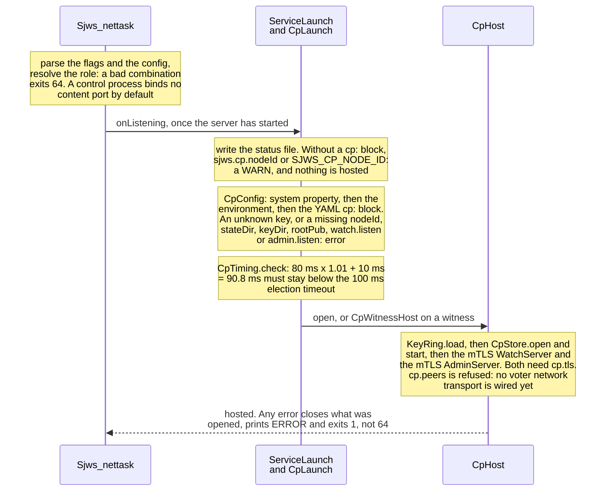
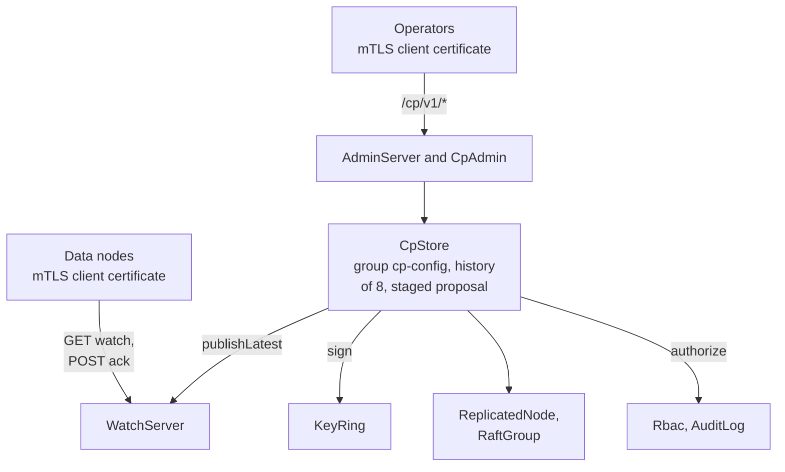
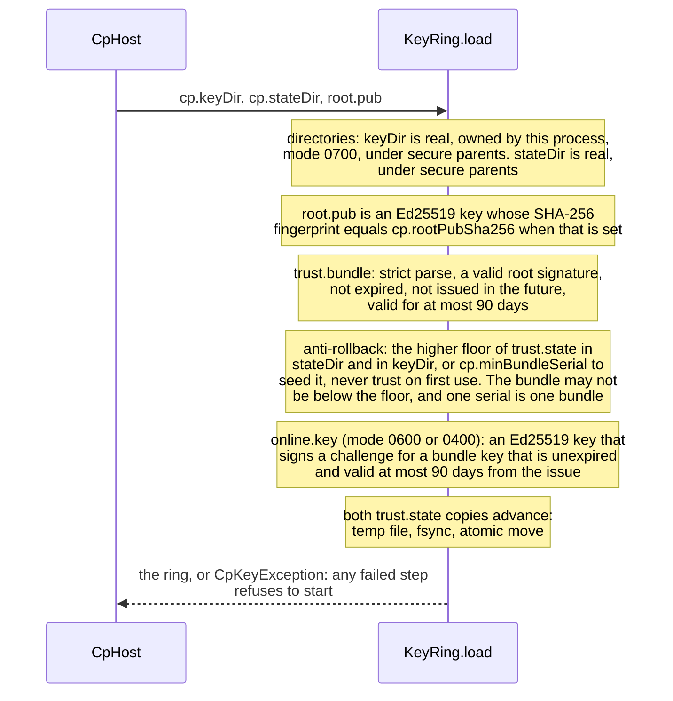

# Control-plane process hosting

Status: revised after Security review (B1, B2, N1-N7). Docs only. Anything not already in master is marked **proposed**.
Builds on `docs/design/control-plane.md`, `docs/design/control-plane-security.md` and the #38 review.

## 1. Starting a control-role process

**Today (master):**
- `NodeRole` is `CONTROL` or `DATA`. `CpStore.resolveRole(cli, env, yaml)` delegates to `NodeLifecycle.role`.
- `ServiceLaunch.onListening` opens `NodeEnrollment` and, only for `NodeRole.DATA`, a `DataWatch`. No production
  path opens `CpStore`, `WatchServer` or `AdminServer`; tests construct them directly.
- `CpStore.open(stateDir, KeyRing, Clock[, adminSan])` runs one Raft group `cp-config` with
  `GroupOptions(RELAXED, 1 MiB, electionTimeout 100 ms, heartbeat 40 ms, ...)` (CpStore.java:114).
  `ready()` = `/readyz` ok AND `leaderReady()`. `bindsContentPort()` is false for the control role.
- `WatchServer` refuses a non-loopback plain listener; sockets come from `openServerSocket(address, AdminTls)`.
  `AdminServer` refuses to bind without cert, key and admin-CA trust.

**Proposed start order** (in `ServiceLaunch`, new `NodeRole.CONTROL` branch, reached by reflection the same way as
the swarm so data-only builds load no CP class):
1. Resolve role and CP config (section 4); validate file permissions (section 3). Any error -> exit non-zero.
2. Load `KeyRing` from disk (section 2).
3. `CpStore.open(stateDir, keys, clock)` with the peer list (multi-voter, below).
4. Bind `WatchServer` (mTLS), then `AdminServer` (mTLS).
5. Report ready only when `CpStore.ready(...)` is true.

**Implemented** in `sjws_nettask.cp.CpLaunch` / `CpHost` / `CpWitnessHost`. Hosting starts only when `cp` settings
exist (a `cp:` block, `sjws.cp.nodeId` or `SJWS_CP_NODE_ID`); a control bootstrap without them keeps today's
behaviour and logs a WARN. Once configured, every error is fatal.

The start, as implemented:



What a control process hosts once it is up. Activate and rollback are signed with the online key of the `KeyRing`:



**Proposed shutdown order** (reverse): stop accepting admin writes (close `AdminServer`) -> close `WatchServer`
(watchers fail over to another voter) -> `CpStore.close()` (Raft node, log) -> zero private key bytes held in memory.
Shutdown stays within the existing drain budget (`Sjws_nettask.drainBudgetMillis`).

**Multi-voter fit (proposed, my next PR):** `CpStore.open` gains a static peer list (3 or 5 full voters, or
2 data + 1 witness, section 6). Every voter hosts `WatchServer`; non-leaders answer watches from their applied
state, admin writes go to the leader (existing `FailoverCpClient` already retries across addresses).
Peers come from config; membership changes are out of scope for v1.

## 2. KeyRing on disk

**Today:** `KeyRing` is in-memory only: `KeyRing.generate(keyId, notAfter, versionMin, versionMax[, floor])` makes an
Ed25519 root and online key; the root signs `SnapshotCrypto.trustInput(versionFloor, keys)`. There is no load path.
That is what blocks Security.

**Proposed layout:**

| File | Where | Content | Owner / mode |
|---|---|---|---|
| `root.pub` | outside `stateDir` and `keyDir`; prefer a root-owned path the service user cannot write (e.g. `/etc/sjws/cp/root.pub`) | pinned root SPKI | root or service uid, no group/other write (0644 ok) |
| `trust.bundle` | `cp.keyDir` | signed binary bundle (section 2.1) | root or service uid, no group/other write |
| `online.key` | `cp.keyDir` | PKCS#8 DER Ed25519 private key of **this voter's** online key | service uid, 0600 (0400 accepted) |
| `keyDir` itself | | | service uid, 0700 |
| `trust.state` | `cp.stateDir` (not a replaceable file) | anti-rollback floor `(maxBundleSerial, maxVersionFloor)` (section 2.2) | service uid, 0600, fsynced |

The root private key is **never** on a CP host. The CP process needs no write access to `root.pub`.

### 2.1 Bundle format (answers former open question 2)

A versioned, domain-separated canonical **binary** wrapper, not YAML/JSON. Big-endian, length-prefixed, reusing the
`SnapshotCrypto` encoders but with its own label, so a bundle signature never verifies as a snapshot signature and
vice versa:

```
"sjws-cp-trust-bundle\0" || u8 formatVersion || u8 purpose(=trust-bundle)
 || u64 bundleSerial || u64 issuedAt || u64 notAfter || u64 versionFloor
 || u16 n || n x ( lp keyId || lp SPKI || u64 notAfter || u64 versionMin || u64 versionMax
                  || u8 purpose(=snapshot-signing) )
 || lp rootKeyId
 || root signature over all bytes above
```

Strict parsing: known `formatVersion` and `purpose` only, no trailing bytes, keyIds sorted and unique, size caps on
`n`, keyIds and SPKIs. `bundleSerial` is strictly increasing across every bundle the root ever signs. A text form exists
only for display (`sjws-cp keys show`).

### 2.2 Anti-rollback (B1)

Every voter and data node persists `(maxBundleSerial, maxVersionFloor)` in `trust.state`, outside the replaceable key
files (write temp, fsync, rename, fsync dir; 0600). A bundle is refused if `bundleSerial < maxBundleSerial` or
`versionFloor < maxVersionFloor`, or if it is past its own `notAfter`. The check runs:
- at load (startup);
- on SIGHUP (section 2.4);
- when a bundle arrives over the watch. Data nodes take new bundles only from snapshots, verified against the pinned
  `root.pub`, never against an online key.

On acceptance of a higher serial, `trust.state` is advanced (and fsynced) **before** the new ring is used. An equal
serial is accepted only if the bytes are identical. A missing `trust.state` on a node that has run before is an error;
first start initialises it from the loaded bundle and logs that it did.

**Planned test (`KeyRingRollbackTest`):** load bundle N, then present bundle N-1 (validly root-signed) at load, on
SIGHUP and over the watch: each is refused, the old ring stays in use, an audit event is logged. Also: lower floor with
higher serial refused; a bundle signature fed to snapshot verification (and the reverse) fails.

### 2.3 Loading, fail closed (B2 included)

A new `KeyRing.load(keyDir, rootPub, stateDir)`:
1. **Permission checks (StrictModes-style):** open with `NOFOLLOW_LINKS`; check type (regular
   file / directory), owner and mode on the opened descriptor. `root.pub`, `trust.bundle`, `keyDir` and **every parent
   directory up to `/`** must be owned by root or the service uid and not group- or world-writable. A sticky directory
   owned by root or the service uid may be group- or world-writable (`/tmp`). `online.key` must be
   owned by the process uid with 0600/0400; `keyDir` 0700. Resolve only the parent with `toRealPath()`, then open
   `parent.resolve(fileName)` with `NOFOLLOW_LINKS`, so a symlinked leaf is refused and a symlinked parent is not a
   false refusal. `sjws_nettask.config.SecureKeyFile` is that check: every resolved parent must be
   owned by root or this process, and a group- or world-writable parent is refused unless it is
   sticky and owned by root or this process. `KeyRing.load` calls it.
2. **Root pin:** parse `root.pub`. If `cp.rootPubSha256` is set (install time, config file), refuse on mismatch.
   Log the root fingerprint (SHA-256 of the SPKI) at startup; never log key bytes.
3. Parse `trust.bundle` strictly (2.1), verify the root signature and `rootKeyId`, apply the anti-rollback check (2.2).
4. Parse `online.key` (read into a `byte[]`, `Arrays.fill` right after `KeyFactory`); its public half must equal an
   unexpired `TrustKey` in the bundle whose keyId belongs to this node.
5. Any error throws and the process exits. No fallback, no auto-generate in production (`generate` stays for tests and
   the ceremony tool).

`cp.tls.key` (Security) gets the same owner/mode checks; inline PEM is never accepted through YAML, env or property.

**Non-POSIX filesystems (answers former open question 3):** refuse by default. The only override is
`cp.insecureSkipPermissionChecks: true` **in the config file** (never env or CLI). It logs a loud WARN at startup and
every hour, sets a flag on `/cp/v1/health`, and still checks for symlinks and regular files. Dev only.

### 2.3.1 Implementation notes (`KeyRing.load`)

- `trust.state` is kept in **both** `cp.stateDir` and `cp.keyDir` (same format, 0600); load uses the higher floor,
  logs a WARN when the copies differ, and rewrites both before the ring is used. Wiping or restoring `stateDir` alone
  cannot lower the floor.
- First start is explicit: with no `trust.state` in either place, load refuses unless `cp.minBundleSerial` is set,
  and then seeds from it (audit `cp.trust.init`). `cp.minBundleSerial` is also enforced on every load.
- An equal `bundleSerial` is accepted only when the bundle's SHA-256 equals the one recorded in `trust.state`.
- Bundle validity (`notAfter - issuedAt`) and the online key's `notAfter - issuedAt` are capped at 90 days.
- `root.pub` and `trust.bundle` are read with `SecureKeyFile.readPublic` (root or service uid, no group/other write);
  `online.key` and `cp.tls.key` with `SecureKeyFile.read` (owner-only 0600/0400); `keyDir` must be 0700.
- CP listeners: `CpTls.serverContext(CpListenerConfig)` (TLS 1.3, client cert required);
  `CpServerTls.reloadTls()` builds new material first and keeps the old on failure.

The steps of `KeyRing.load`, in order:



### 2.4 SIGHUP (answers former open question 1)

One atomic step: build a new `KeyRing` plus TLS material (`cp.tls.*`) from disk, with all checks above (permissions,
root signature, serial/floor per 2.2, online key matches an unexpired `TrustKey`), then swap a single reference. On
any failure the old material stays, the error is logged and counted. A half-loaded ring is never installed. SIGHUP
cannot introduce a key the root has not signed; it only picks up the ceremony's output. `root.pub` is **not** reloaded
on SIGHUP, only on restart.

Shutdown "zeroing" is best effort: Java cannot zero a `PrivateKey` (`destroy()` is not implemented for EdDSA and the
provider copies bytes). We fill our own buffers and disable heap and core dumps for the control role.

## 3. Online keys vs offline root (proposed)

- **Online keys, one per voter (#38 F1b):** keyId = `nodeId` + serial. Each signs snapshots (`KeyRing.sign`), is
  short-lived (`notAfter`) and bounded to `versionMin..versionMax`. All voters' keys sit in the same bundle, so
  retiring a compromised voter is one bundle without its key.
- **Offline root:** on an air-gapped machine; signs only trust bundles.
- **Rotation ceremony:** (1) each voter generates its new online pair **on the voter** (`sjws-cp keys gen`); private
  bytes never leave it; (2) only the SPKI is carried to the offline box; (3) the root signs a new `trust.bundle` with a
  higher `bundleSerial`, fresh `issuedAt`, old + new keys; (4) copy the bundle to every voter; (5) SIGHUP or restart;
  (6) once all data nodes report the new serial, sign another bundle (higher serial) without the old keys.
- **Expiry alarm:** warn (log, metric, health) when an online key has less than 25% of its lifetime left.

### 3.1 Compromise runbook

1. **Detect** (alert, audit anomaly, host compromise). Isolate the voter.
2. **Re-sign:** on the offline box, the root signs a bundle with a higher `bundleSerial` that drops the bad key and
   sets `versionFloor` above the highest version the bad key could have signed (its `versionMax`).
3. **Push:** copy to the remaining voters, SIGHUP; data nodes receive it via snapshot and verify it against `root.pub`.
4. **Enforce:** every node advances `trust.state`; anything below the new serial or floor is refused, including a
   restored older bundle.
5. **Audit** which versions the bad key signed; rebuild the voter with a newly generated key in a later bundle.

Root compromise is out of scope here: it needs a new `root.pub` on every node (restart), pinned via `cp.rootPubSha256`.

### 3.2 Audit (#38 F10)

Audit events for: bundle loads (serial, floor, keyIds, root fingerprint), SIGHUP outcomes, and every refusal
(rollback, signature, permission, pin mismatch).

## 4. Config keys (proposed)

Follow `OptionalModules`: JVM property `sjws.cp.*`, env `SJWS_CP_*`, YAML `cp:` block; property > env > YAML.

| Property | Env | YAML | Meaning |
|---|---|---|---|
| `--role` (existing resolution via `NodeLifecycle.role`) | `WEB_SERVER_ROLE` | `node.mode` | `control` / `data` |
| `sjws.cp.stateDir` | `SJWS_CP_STATE_DIR` | `cp.stateDir` | Raft log + snapshots |
| `sjws.cp.keyDir` | `SJWS_CP_KEY_DIR` | `cp.keyDir` | section 2 |
| `sjws.cp.rootPub` | `SJWS_CP_ROOT_PUB` | `cp.rootPub` | pinned root key path (must pass 2.3 checks) |
| — | — | `cp.rootPubSha256` | optional install-time pin of the root SPKI |
| — | — | `cp.insecureSkipPermissionChecks` | dev-only override (2.3), config file only; a property/env setting is refused |
| — | — | `cp.minBundleSerial` | lowest accepted `bundleSerial` (default 0; Security) |
| — | — | `cp.maxClockDriftRatio` | proposed, default 0.01 (1%); rate error over one lease (HA) |
| — | — | `cp.leaseSafetyMargin` | proposed, default 10 ms; fixed margin in the startup check (HA) |
| `sjws.cp.nodeId` | `SJWS_CP_NODE_ID` | `cp.nodeId` | this voter |
| — | — | `cp.peers[]` (`id`, `address`, `witness: bool`, optional `wire`) | voter set; `wire` defaults to the 1-based list position, so list peers in the same order on every voter |
| `sjws.cp.watch.listen` | `SJWS_CP_WATCH_LISTEN` | `cp.watch.listen` | WatchServer |
| `sjws.cp.admin.listen` | `SJWS_CP_ADMIN_LISTEN` | `cp.admin.listen` | AdminServer |
| — | — | `cp.tls.{cert,key,ca,adminCa}` | owned by Security |

The role key is the existing `--role` / `WEB_SERVER_ROLE` / `node.mode` (`NodeLifecycle.role`); there is no `sjws.cp.role`.
Implemented in `sjws_nettask.cp.CpConfig` and `CpKeyConfig`; `ConfigLoader` keeps the `cp:` block raw so a
non-control process names no cp class.

## 5. Zero cost when the CP role is off

Existing guards: `tests/.../cp/ClassLoadTest`, `CpCoverageTest`, `SourceGuardTest`; `ServiceLaunch` already names
no cp type except behind the role branch (`DataWatch` is typed loosely). Proposed: the control branch is reached by
reflection; extend `cp/ClassLoadTest` to assert a data-role and a no-role start load no `CpStore`, `WatchServer`,
`AdminServer` or `KeyRing`, a witness host loads no `KeyRing`, and `SourceGuardTest` to forbid those names outside `cp/` and the reflective entry.
Benchmark: wrk A/B, CP off, 5 alternating pinned runs.

## 6. Voters and witnesses (HA input)

Source: HA, #118, `docs/design/high-availability.md` (HA's doc), #133, #142, #146.
1. **Witness = vote-only voter**, not a `CpStore` replica. No log; durably records last acked `(index, term)` and
   votes. Joins the CP Raft group as a witness voter (same groupId multiplexing), never serves reads, never leader.
2. **Co-hosting allowed:** a data node may host a CP voter in-process as a separate Raft group over the shared
   cluster transport, as long as the control role does not bind the content port (`CpStore.bindsContentPort()` is
   already false). Failure domains are then shared, so the witness MUST be on a third host or site.
3. **Voter counts:** 2 data + 1 witness (option A) or an odd number of full voters (3/5). A bare 2-voter config is
   rejected at startup (`QuorumPolicy`, #142). Majority is always over all voters. STRICT needs both data nodes
   durable (a witness ack is not a disk copy); RELAXED needs any 2 of 3.
4. **Timing (HA):** leases are measured on each node's monotonic clock, so wall-clock offset does not matter;
   only the clock *rate* error over one lease does. Startup check (fail closed):
   `lease * (1 + cp.maxClockDriftRatio) + cp.leaseSafetyMargin < electionTimeout`. Defaults:
   `cp.maxClockDriftRatio = 0.01`, `cp.leaseSafetyMargin = 10 ms`. With master's current CP timings
   (`electionTimeout = 100 ms`, `heartbeat = 40 ms`, `GroupOptions.leaseNanos()` = `heartbeat * 2` = 80 ms;
   CpStore.java:114) that is `80 * 1.01 + 10 = 90.8 < 100`, so the check passes and the default timings do not
   change. Pre-vote is mandatory. Heartbeats are HMAC-authenticated with a boot epoch (#134/#144/#145); the dead
   interval drives both failover and lower-epoch acceptance. Other master defaults: `LocalCluster.start`
   `deadAfter = Duration.ofSeconds(5)`; `HeartbeatAuthenticator.WINDOW_MILLIS = 5_000L`.
   **Note:** the 100 ms election timeout is aggressive given JVM GC pauses and can trigger spurious elections.
   It is tunable; raising it is a follow-up that needs failover-time measurements (HA), not a change in this doc.

## 7. Split of work

- **Security:** listener config for `WatchServer`/`AdminServer` (`cp.tls.*`) and SIGHUP `reloadTls()`; node-to-CP
  mTLS (item b) replaces the interim node credential from #141. Reviews this doc.
- **Architecture (me):** control-role hosting in `ServiceLaunch`, `KeyRing.load`, the key ceremony CLI, multi-voter
  `CpStore` with witness support, class-load/SourceGuard tests.
- **HA:** witness voter semantics and timing review.

## 8. Resolved questions (Security review of #151)

1. SIGHUP reloads TLS + `trust.bundle` + `online.key` atomically; `root.pub` only on restart (2.4).
2. Bundle encoding: versioned, domain-separated binary wrapper, strictly parsed (2.1).
3. Non-POSIX: refuse; config-file-only override with recurring WARN and health flag (2.3).
4. Max clock drift (**resolved, sjws High Availability**): not an absolute ms value. Use
   `cp.maxClockDriftRatio` (default 0.01) and `cp.leaseSafetyMargin` (default 10 ms); startup refuses unless
   `lease * (1 + driftRatio) + margin < electionTimeout`. With current 80/100 ms timings the check passes
   (`90.8 < 100`); defaults stay. The 100 ms election timeout is flagged as aggressive for JVM GC and left
   tunable for a later HA follow-up with failover-time measurements.
5. All voters host `AdminServer`; followers return the leader address for writes (control-plane.md §14); every voter
   enforces RBAC and the denylist.
6. Static peers for v1; future membership changes are an `admin`-only, audited operation.
7. Witness is a separate small class; witness hosts never load `KeyRing` (asserted in `ClassLoadTest`).
