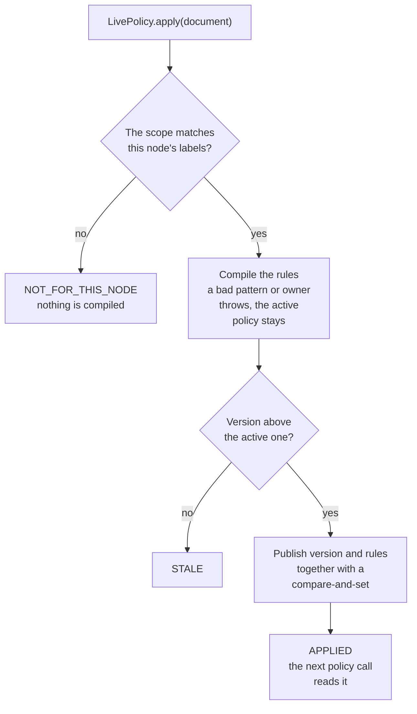
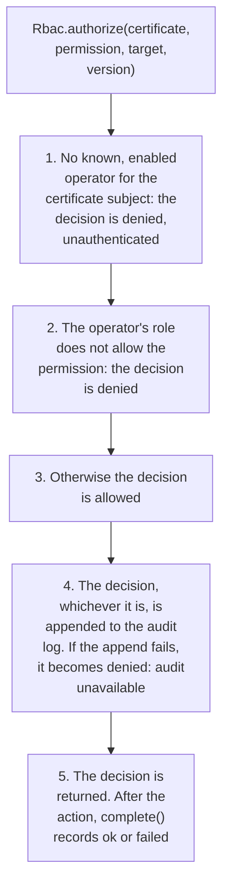

# Control plane: distributable access policy, operator RBAC and audit

Status: building blocks in `sjws_nettask.controlplane`. `Rbac`, `AuditLog` and the roles back the control-plane
admin API (`cp.CpStore`, `cp.AdminServer`); `LivePolicy` and `AccessPolicyDocument` have no caller yet. A node that
is not managed by a control plane (CP) loads none of it and runs exactly the code it ran before.
`docs/design/control-plane.md` (the HA workstream) owns the overall CP design. This page covers
only the security pieces, and the seams they leave for it.

## Distributable access policy

`AccessPolicyDocument` is `version + Scope + AccessSettings`, with a canonical text form:

```
sjws-access-policy 1
version 42
scope label:env=prod        # or *, or route:NAME
dotfiles false
owner -
world-readable false
deny /private
rule hide:*.bak
sha256 <hex of the lines above>
```

* Deterministic: the same document always encodes to the same bytes, so a CP can hash it or sign
  it, or compare it across nodes.
* Strict on load: `decode` checks the digest, the field order and the canonical form, then
  compiles every rule (patterns and owner lookup). Any error is thrown before the document can
  become active. The size limit is 1 MiB.
* The digest only detects corruption. Authenticating the sender is the transport's job (mTLS
  between the CP and the node), or a signature over `encode()` once the CP design defines a
  signing key.

`LivePolicy` implements `AccessPolicy` on top of an `AtomicReference<Active(version, AccessRules)>`.
Each request does one volatile load. `apply()` compiles the rules off the request path and then
publishes them with a compare-and-set:

* `STALE`: the version is less than or equal to the active one (a replayed or reordered push).
  A rollback is the CP re-issuing old content under a new, higher version.
* `NOT_FOR_THIS_NODE`: the scope doesn't match this node's labels. `route:` scopes are for the
  proxy router to attach to a route, never as a node default.
* An invalid document throws, and the active policy stays in place.

In order, `apply` does this:



To install it, build the handler with `new StaticFileHandler(root, …, livePolicy)` in place of
the static `AccessRules`, only when the node is CP-managed.

## Operator RBAC

`Rbac.authorize(credential, permission, target, configVersion)` is the single call that the CP
API and the admin TUI make before every action.

| Role     | READ | EDIT_ROUTES | ROLLOUT | ROLLBACK | NODE_DRAIN | MANAGE_OPERATORS |
|----------|:----:|:-----------:|:-------:|:--------:|:----------:|:----------------:|
| viewer   |  ✓   |             |         |          |            |                  |
| operator |  ✓   |      ✓      |    ✓    |    ✓     |     ✓      |                  |
| admin    |  ✓   |      ✓      |    ✓    |    ✓     |     ✓      |        ✓         |

* Identities: mTLS only (v1). The operator is the URI SAN (e.g. `urn:sjws:admin:alice`) or the
  RFC 2253 canonical subject DN of its client certificate, mapped to a role in the CP-distributed
  operator table (#38 §12.7). **The TLS layer must have verified the certificate against the
  admin CA** before it hands over the identity. There are no admin bearer tokens; the only tokens
  in the control plane are the one-shot node join tokens (#38 §12.4). This matches decision 13
  in `docs/design/control-plane.md`.
* Deny by default: unknown, disabled or malformed credentials are refused, and so is any
  permission outside the role. If the audit write fails, the action is denied.
* `putOperator` and `removeOperator` need `MANAGE_OPERATORS`. Each change is atomic and takes
  effect immediately, so a removed or disabled operator is refused on its next request. A change that would leave no
  enabled admin is refused.

What `authorize` does, in order. The first two steps end in a denial when their condition holds. The
audit write then sits on every path, and an allowed decision whose line cannot be written is denied:



## Audit trail

`AuditLog` is append-only, hash-chained JSONL with one entry per decision and per outcome
(`complete()`):

```
{"seq":N,"ts":"…","actor":"ops","action":"ROLLOUT","target":"v5","outcome":"allowed","version":5,"prev":"<hex>","hash":"<hex>"}
```

`hash` is the SHA-256 of the line without its `hash` member, and `prev` links each line to the
one before it. `AuditLog.verify` reports the first line that was edited, inserted, deleted,
reordered or torn, and opening a broken log fails. Lines cut from the end can only be detected
against an anchored `head()`, so the CP should record that head in the Raft log with every
config commit. The log never contains secrets.
