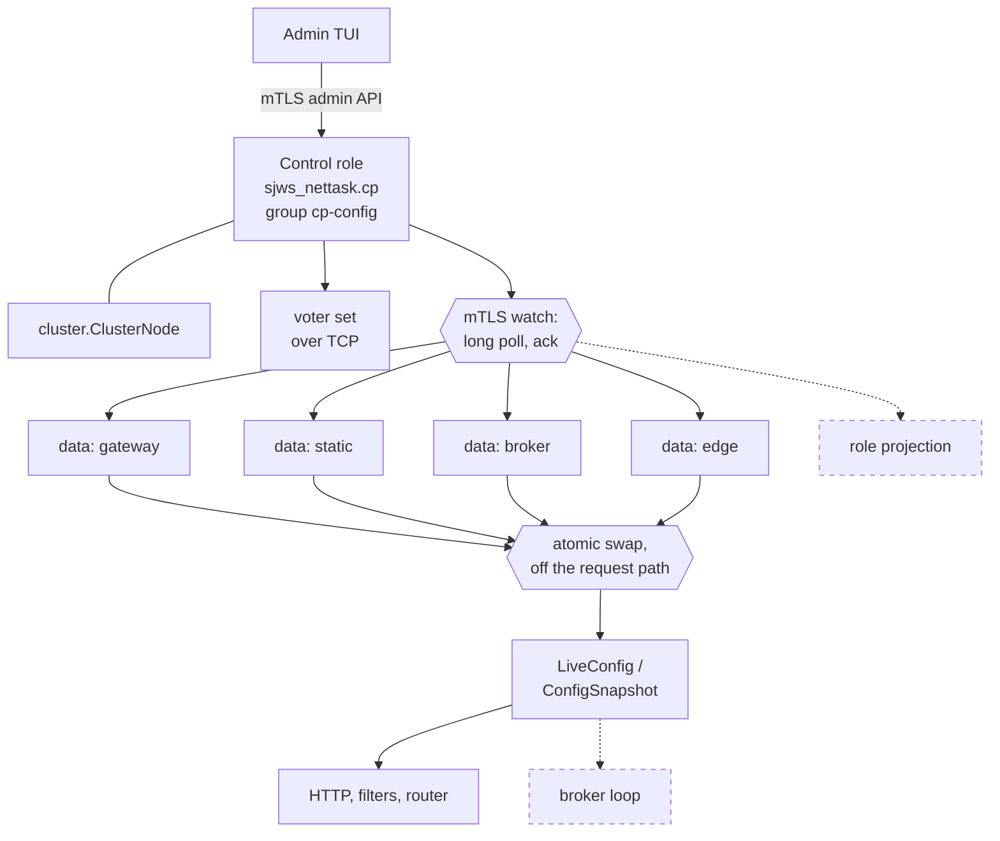
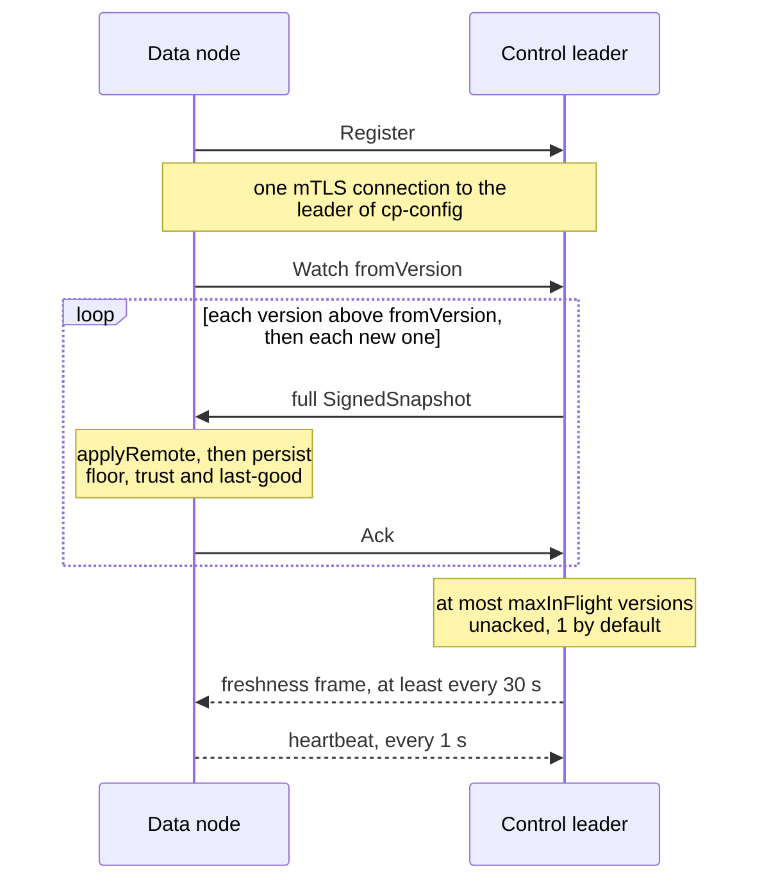
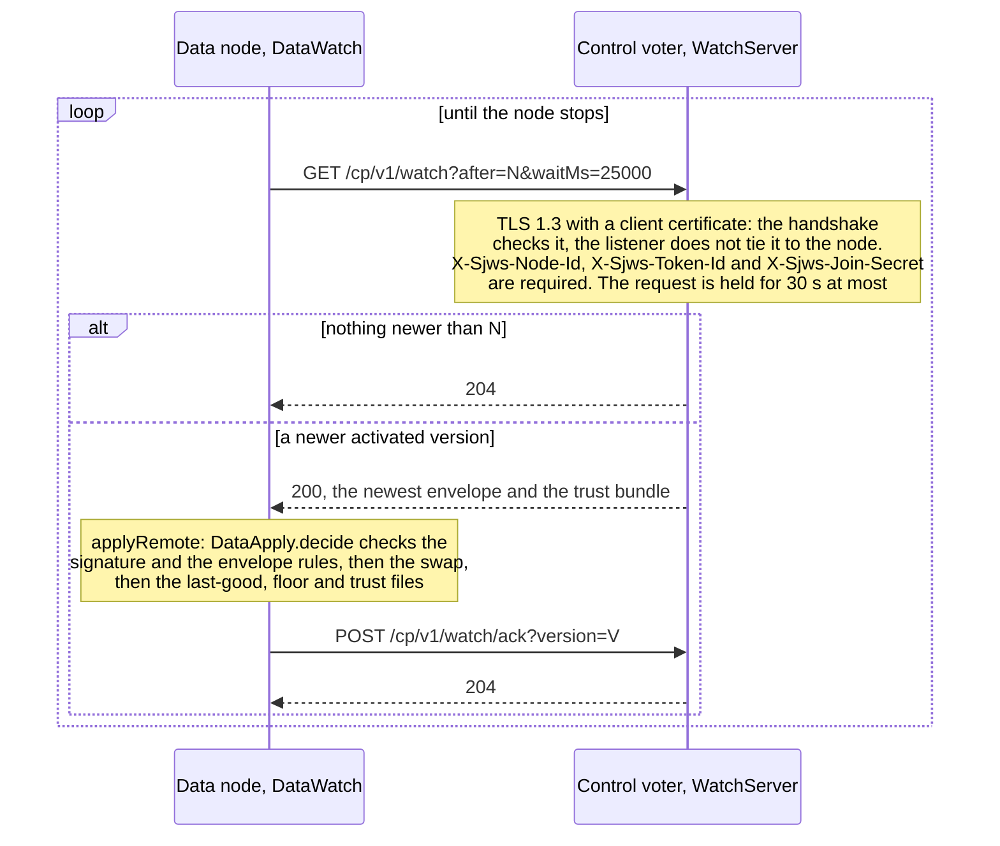
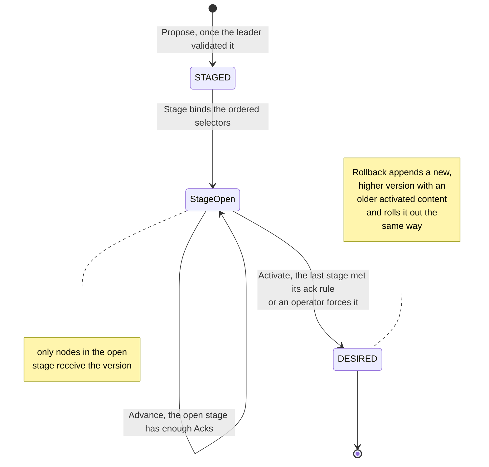
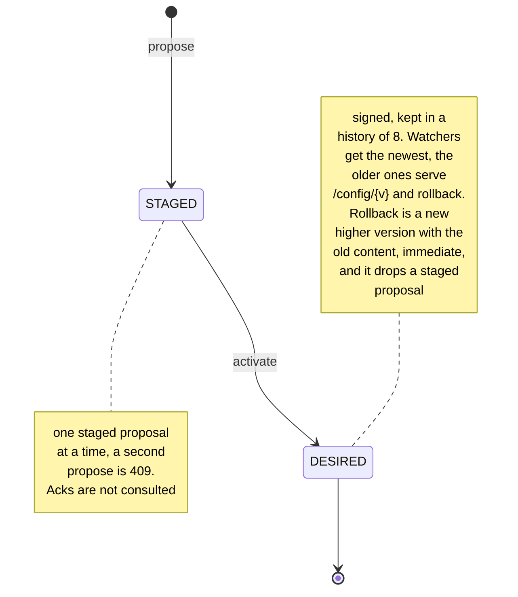
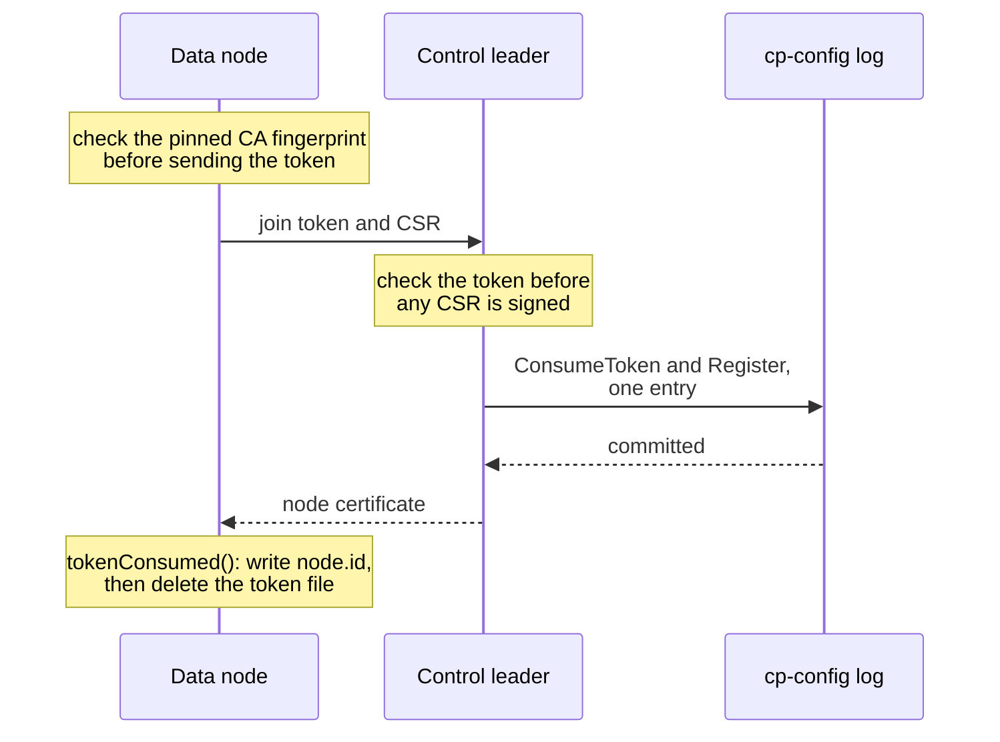

# Control Plane / API Gateway Mode — sjws_nettask

Status: Draft · Scope: control plane and config distribution
Base: master `a38fdb5` (Java 25), which includes the config model from [PR #42](https://github.com/BlivionIaG/sjws_nettask/pull/42) and the Rights package from [PR #47](https://github.com/BlivionIaG/sjws_nettask/pull/47) (`sjws_nettask.controlplane`)
Consistent with: [high availability](../ha/design.md) (the document PR #14 added as `docs/design/high-availability.md`; PR #34 moved it), the per-group Raft API shipped in [PR #29](https://github.com/BlivionIaG/sjws_nettask/pull/29), and the cluster harness in `tests/sjws_nettask/clusterharness`.

PR #29 is merged: the per-group Raft API is `sjws_nettask.cluster` on master. This design calls that API. Implementation PRs do not reimplement Raft.

Binding decisions, which override a review where the two disagree:

1. One hash. `canonicalHash` is the SHA-256 of the canonical serialization (`ConfigCodec.text`). The signature covers `canonicalHash`, `version`, and `schema`, and also `parentVersion`, `kind`, and `keyId`.
2. `ConfigDiff` is a per-section report. Distribution always sends a full signed snapshot. It never sends a patch.
3. Signature checks and rollback checks run inside `SjwsServer.applyRemote` and fail closed.
4. The control plane's last-good config is `<stateDir>/config/last-good.json`.
5. SIGHUP reloads local settings only. It never pulls a snapshot from the control plane.
6. Drain finishes inside the daemon's `drain-ms` budget. The default budget is 30 seconds.
7. systemd `active` is not readiness. Readiness is `GET /readyz` returning 200. A control node is ready only when that probe is 200 and `leaderReady()` is true.
8. A data node whose control plane is down serves last-good. With no last-good it stays not-ready and keeps retrying the watch.
9. Past max-staleness, readiness goes false and the node keeps serving. Max-staleness does not drain.
10. A join token is idempotent for one node identity for its TTL. Presenting it again from that same identity is the same join.
11. The control role does not bind the content port unless the operator sets an explicit content listener.
12. Role precedence is the command line, then the environment, then YAML.
13. Admin roles are `viewer`, `operator`, and `admin`. Admin authentication is mTLS only. The client certificate maps to a role through `sjws_nettask.controlplane.Rbac` (the Rights package). There is no admin bearer token. The only token is the one-shot join token.

Decisions 5–12 override [PR #65](https://github.com/BlivionIaG/sjws_nettask/pull/65) where that daemon slice assumed a different lifecycle (a SIGHUP that cannot run, max-staleness calling `drain()`, a content port on the control role, and an open question on role precedence). Decision 13 overrides the bearer-token half of [PR #47](https://github.com/BlivionIaG/sjws_nettask/pull/47): the Rights types stay, and `Rbac.Token` is not an admin credential.

## 1. Context

sjws_nettask is one binary. Today it serves static files, optional HTTP/2 and HTTP/3, a filter chain, access rules, a YAML config snapshot with ACME, and a messaging ledger. The request path holds one `AtomicReference` of an immutable `ConfigSnapshot` (`LiveConfig`). `ReloadHook.run()` rebuilds that snapshot off the request path. HA ([docs/ha/design.md](../ha/design.md)) already decided that a request never waits on another node, that `ha-control` is one Raft group on the shared cluster transport, and that the default ack is majority in memory (`Durability.RELAXED`) with quorum-plus-fsync opt-in.

This mode adds a control plane for the desired configuration: routes, filters, access rules, certificates, and messaging topics. Control nodes (3 or 5) replicate that desired state. Data-plane nodes apply it locally and keep serving the last good snapshot when the control plane is unreachable.

The content request path reads the snapshot that is already installed. It does not call the control plane, the Raft group, or the watch stream.

## 2. Principles

1. **One binary, three startup roles.** `standalone` (the default), `control`, or `data`. The choice is made once at process start. `standalone` constructs no control-plane object, opens no `cp-config` group, and starts no watch. The HTTP path stays the path on master `a38fdb5`.
2. **Zero cost when the control plane is off.** With `standalone`, the accept loop and `Http1Connection` do not read a role, a lease, a generation from Raft, or a control-plane flag. Evidence for every PR, including this one, is a `wrk` / `wrk2` before/after on the same host. The gate is the same shape as HA: report req/s and p50/p90/p99/p99.9.
3. **Lock-free hot path.** A request performs one volatile read of an immutable snapshot (`LiveConfig.get` / `handler()`), then runs that snapshot's `Handler`. Publish is an atomic swap (`AtomicReference.set`) of the whole snapshot. The handler chain, the HA generation leaf, and the HTTP/3 handler supplier all read that snapshot. They do not keep a leaf captured at startup (§5.6). Readers take no lock. An in-flight request keeps the handler it already loaded.
4. **Raft I/O on dedicated threads.** Election, replication and the `RELAXED` fsync run on the node's Raft thread (`raft-<node>`, one per process; a `STRICT` fsync runs on the appender). `GroupListener.onCommitted` and the append futures of a group run on that group's own delivery thread (`raft-deliver-<group>`, index order, `ApplyLagException` past 4096 queued deliveries; see [the delivery executor](raft-delivery-executor.md)). Those threads are distinct from the accept loop and from request virtual threads.
5. **The control plane bootstraps without the broker.** `sjws_nettask.cp` does not import `sjws_nettask.messaging`. Messaging does not import `sjws_nettask.cp`. Topic and group desired state is a neutral schema in `sjws_nettask.config` (§13.5). The control plane names those records and does not name broker runtime types. The broker opens partitions from the applied document on its reconcile thread.
6. **Fail static.** A data-plane node that cannot reach a leader keeps the last successfully applied snapshot, including across a restart from the persisted last-good file. A minority of control nodes cannot publish.
7. **Config & ACME own the model.** The control plane stores, versions, signs, and ships the document that workstream already validates. It does not invent a second schema.

## 3. Architecture



Solid boxes and arrows run in a shipped process. Dashed ones do not: the role projection and the broker loop are
not written. A control process hosts one voter on an in-process transport, or, with `cp.peers`, one member of a
static voter set (3 or 5 voters, or 2 + a witness) linked by `cluster.TcpTransport` over the `cp-peer` mTLS
listener with a CP-only Raft key. Every data role runs the same watch client against the whole document, with no
per-role projection. See
[Control-plane and data-node service](../operations/control-plane-service.md) and
[Control-plane process hosting](control-plane-hosting.md).

### 3.1 Packages and the dependency cut

| Package | Role |
|---|---|
| `sjws_nettask.cp` | Raft state machine, signing, rollout, admin API, watch, registration. Depends on `sjws_nettask.cluster`, the config model, and `sjws_nettask.controlplane` for admin RBAC. Owns `SignedSnapshot`. Does not apply patches. |
| `sjws_nettask.config` | Owns `ConfigDocument`, `ConfigCodec`, `canonicalHash`, `contentHash`, `ConfigValidator`, `ConfigDiff.between`, `ConfigSnapshot.compile`, `ConfigReloader.apply`, `LiveConfig`, and the neutral messaging records (`MessagingSettings`, `TopicSpec`, `GroupSpec`, `PartitionAssignment`). It does not mention a `cp` type and does not name broker runtime types. Signature checks are not here; they are inside `SjwsServer.applyRemote` (§5.5). |
| `sjws_nettask.cluster` | Per-group Raft from PR #29. Unchanged by this workstream. It imports neither `sjws_nettask.cp` nor `sjws_nettask.messaging`. |
| Data plane (`http1`, `h2`, `h3`, `routing`, `core`, `messaging`, `acme` on a data node) | Sees a `Handler` or, for the broker and the composition root only, `AppliedConfig` (§3.2). Does not depend on `sjws_nettask.cp`. |

`sjws_nettask.cp` does not import `sjws_nettask.messaging`, `sjws_nettask.routing`, `sjws_nettask.http1`, `sjws_nettask.h2`, or `sjws_nettask.h3`. The only messaging shape it is allowed to name is the neutral records in `sjws_nettask.config` (`MessagingSettings`, `TopicSpec`, `GroupSpec`, `PartitionAssignment`). It does not name `Partition`, `LedgerWriter`, `MessagingStats`, or any other broker type. A control process boots, elects, and reaches `leaderReady` with no messaging class loaded (§15). `cp-config` has its own log directory and its own segments. It does not share the messaging ledger's segments, so compaction or truncation of one cannot affect the other. A broker is not a `cp-config` voter by default. Co-location is allowed and couples the two failure domains; production placement keeps them apart.

The composition root is `Sjws_nettask` / `SjwsServer`, with `sjws_nettask.service.ServiceLaunch` as the role branch. The control role is reached only by name (`sjws_nettask.cp.CpLaunch`, a string) and the data role opens `cp.DataWatch`. `standalone` names neither, so the verifier does not load `sjws_nettask.cp` or `sjws_nettask.cluster` (§16).

### 3.2 Narrow snapshot interface

The data plane's only view of configuration is the applied snapshot:

```java
package sjws_nettask.config;

/** What HTTP, the filter chain, the router, and the broker are allowed to see. */
public interface AppliedConfig {
    /** Cluster-wide monotonic desired-config version. 0 for a snapshot that never came from the CP. */
    long version();
    /** Raft term of cp-config that signed this snapshot. 0 when local. */
    long epoch();
    /** Lowercase SHA-256 of the canonical serialization. Empty when the snapshot never came from the CP. */
    String canonicalHash();
    ConfigDocument document();
    /** Prebuilt handler. One volatile read at the call site, then plain invocation. */
    Handler handler();
}
```

`ConfigSnapshot` implements `AppliedConfig`. `version()` is `ConfigDocument.bundleVersion()` (0 when unset). `canonicalHash()` is `ConfigDocument.canonicalHash()`. `epoch` is one extra `long` on the snapshot (0 when local). That field is the only new hot-path cost. `LiveConfig` remains the `AtomicReference` holder. The harness method `DataNode.contentHash()` returns this `canonicalHash`.

Transports do not import `AppliedConfig`. They already depend on `Supplier<Handler>` and `HandlerRef`, which is the narrower seam, and that stays. HTTP/1, HTTP/2, and HTTP/3 read the supplier the publish step installs (§5.6). `AppliedConfig` is for the broker's reconcile thread and the composition root. That thread reads `document()` to learn the desired topic set and opens or closes partitions. It is not a partition writer: each partition keeps its own writer thread. The read is not on the HTTP request path and is not a call to the control plane.

### 3.3 Roles in the one binary

| Startup role | Process |
|---|---|
| `standalone` | Today's server. Control-plane code is not started. |
| `control` | Voter of `cp-config`. Admin API. ACME only while leader-ready (§6). Does not bind the content port unless the operator sets an explicit content listener. No content request path that consults Raft. |
| `data` | One data role: `gateway`, `static`, `broker`, or `edge`. Registers, watches, applies, serves from `LiveConfig`. |

A data node also carries labels (`String` map) and capabilities (`http1`, `http2`, `http3`, `proxy`, `static`, `messaging`). Labels select rollout stages. Capabilities bound the projection in §12.4.

The role is chosen once, before any socket is bound. Precedence is the command line (`--role`), then the environment (`WEB_SERVER_ROLE`), then YAML (`node.mode` for `standalone` / `control` / `data`; the data-plane role is `data-role` in the bootstrap file). A later source does not override an earlier one. When none of the three names `control` or `data`, the process is `standalone`.

The control role binds the admin listener (§14) and does not bind the content port by default. `listen=` in the daemon bootstrap is the admin address, not a content listener. A content port on a control process exists only when the operator sets one. Firewall rules for the control unit therefore do not assume a content listener.

### 3.4 Threading

| Work | Thread |
|---|---|
| Accept, parse, `Handler.handle` | Existing accept loop and request virtual threads. They read the live snapshot supplier only. |
| Raft election, replication, fsync | The node's `raft-<node>` virtual thread (one per process). A `STRICT` fsync runs on the appender. |
| Apply: `onCommitted`, append futures | `raft-deliver-<group>`, one virtual thread per group. It does not compile or sign. |
| Compile and sign on a control leader | The admin request thread (`CpStore`); there is no dedicated compiler thread yet. Raft apply is a different thread, so a large document cannot stall it. |
| Verify, compile, `publish` on a data node | One applicator thread per process, started only for role `data`. It is the only caller of remote `publish`, so it serializes with itself. |
| Admin API | Its own listener, control role only, distinct port from content. |
| Watch stream | One virtual thread per data node, not a content request. A slow ack blocks that thread only. |
| ACME | Existing ACME thread, and only on the control leader after `leaderReady()`. |

## 4. CP Raft store

Control nodes open one replication group through the PR #29 API:

```java
cluster.openGroup(new GroupId("cp-config"), options, listener);
```

`options` uses the `GroupOptions` constructor that omits durability, so the ack mode is `Durability.RELAXED` (majority in memory, fsync after the ack). A deployment that must not lose a committed config under a simultaneous majority crash passes `Durability.STRICT`. That is the same choice HA records for `ha-control`.

Voters are the control nodes. The supported sets are 3 or 5 full voters (majority 2 and 3), or 2 full voters plus a witness. Data-plane nodes are not voters. A 1-voter group (no `cp.peers`) is a development configuration and logs a WARN. Two control nodes without a witness are not a supported failover mode: a single survivor cannot commit, which matches the HA decision that two data nodes without a majority do not publish.

A control process runs `cp-config` on its own `ReplicatedNode` and `TcpTransport` (the `cp.peers` listener, `cp-peer` mTLS). Frames carry `groupId`, so another group on that node adds no socket. `ha-control` (membership, VIP, static-generation STAGE/ACTIVATE) stays a different group. Config bytes are log entries of `cp-config` only. Static file bytes stay out of every log, as HA §13a requires. Message records stay in per-partition groups owned by messaging.

The state machine, applied in index order on the group's delivery thread (`raft-deliver-cp-config`):

| Entry | Effect |
|---|---|
| `Noop` | Empty entry appended by a new leader in its term (§6). |
| `Propose` | Validated canonical YAML, stored as staged at the commit index. |
| `Stage` | Binds a staged proposal to an ordered list of label selectors. |
| `Advance` | Marks the next stage eligible for push. |
| `Activate` | The staged proposal becomes the desired version. |
| `Rollback` | A new version whose content hash equals an older activated version. |
| `Register` / `Heartbeat` / `Revoke` | Data-node liveness and denylist. `Register` commits in the same entry as `ConsumeToken` (§12.4). |
| `TrustBundle` | Root-signed delegation of per-voter online signing keys, CA intermediates, and the version floor (§12.3). `admin` only. |
| `Rbac` | Certificate-to-role policy for `viewer`, `operator`, and `admin` (§12.7). `admin` only. A `Propose` that carries it is rejected. |
| `Audit` | One control-plane audit record (§12.10). Replicated so one voter cannot drop it. |
| `CertReference` | ACME result: chain reference and envelope-encrypted key material (§5.7, §12.6). |

As built, the log carries `Propose`, signed `Activate` and `Rollback`, `Rbac`, `Revoke`, rollout and advance entries, idempotency wrappers, and join issue and consume entries. Audit lines are written per voter to `<stateDir>/audit.jsonl` and are not replicated.

Designed, not wired: `SnapshotControl.take` / `install` / `truncateAndCompact` compact the log to the latest activated snapshot plus the live registration table. Compaction runs off the request path, on the group's delivery thread, past an index that is both snapshotted and acked. The compactor keeps the latest value per key (current desired snapshot, denylist, registrations). History required for rollback is retained for a configured number of activated versions (default 8) inside the snapshot payload, then dropped. As built, `cp-config` keeps its whole log, and the history of 8 activated versions is held in `CpStore` memory.

Membership changes of the voters use `ReplicationGroup.changeMembership` (joint consensus). Learners are non-voting (§11).

## 5. Config version and snapshot model

### 5.1 Reuse the config model

The model is the one PR #42 merged: `ConfigDocument` (`ServerConfig`, `AcmeSettings`, `Routing`, `List<MiddlewareSpec>`, `AccessSettings`, `NodeSettings`, `schemaVersion`, `bundleVersion`), `ConfigCodec`, `ConfigValidator`, `ConfigDiff.between`, `ConfigReloader.apply`, and `SjwsServer.applyRemote`. The control plane does not grow a second document. Topics (§13.5) are added to that document, not beside it.

Two digests already exist, and they stay different:

| Accessor | Bytes |
|---|---|
| `contentHash()` | SHA-256 of the operator file that was read. Null when there is no file. Key order in that file changes it. |
| `canonicalHash()` | SHA-256 of `ConfigCodec.text`. Fixed key order, maps sorted, TLS key password omitted. This is the only hash the control plane signs. |

`ConfigLoader` remains the strict parser. `ConfigSnapshot.compile` remains the step that builds the handler. `ConfigReloader.reload` remains the local-file path and is what `ReloadHook.run()` calls. A remote apply does not call `ReloadHook.run()`.

### 5.2 Identifiers

Three numbers, kept distinct on purpose:

| Name | Meaning |
|---|---|
| `version` | `ConfigDocument.bundleVersion()`. Cluster-wide monotonic `long`. Assigned when `Activate` or `Rollback` commits. Strictly increasing. `0` means unset, so a local edit with no version still applies. This is the number a data node resumes from. |
| `schema` | `ConfigDocument.schemaVersion()`. Schema 1 is the only accepted value and is inside the canonical YAML. An unknown schema fails `ConfigValidator.validate` before compile. |
| `epoch` | Raft term of `cp-config` at the moment the leader signs the envelope. Changes when leadership changes. |
| `generation` | The existing process-local `ConfigSnapshot.generation` (`int`). It increases by one on every successful local reload and every successful remote apply in this process. Standalone keeps today's counter. |

`AppliedConfig.version()` exposes `version`. A standalone snapshot reports `0`.

### 5.3 Envelope

```java
record SignedSnapshot(
    byte[] keyId,           // which online signing key produced the signature
    long version,           // bundleVersion
    int schema,             // schemaVersion; 1
    long epoch,
    long raftIndex,
    long parentVersion,     // always 0; distribution does not send patches
    byte kind,              // always 1 (full). A different value fails closed
    String projectionId,    // node id the bytes were cut for
    byte[] canonicalHash,   // SHA-256 of ConfigCodec.text, 32 raw bytes
    long issuedAtMillis,
    long expiresAtMillis,
    byte[] nonce,           // 16 bytes, covered by the signature; not stored as a set
    byte[] canonicalYaml,   // the full canonical document, never a patch
    byte[] signature) {}
```

The signature input is the domain-separated encoding in §12.3. It covers `canonicalHash`, `version`, and `schema`, and also `parentVersion`, `kind`, and `keyId`. There is no second hash of "transmitted bytes": the bytes on the wire are the canonical YAML, and `canonicalHash` is their digest.

Canonical YAML is `ConfigCodec.text` of the document:

- UTF-8, LF line endings, no BOM. The codec already emits a fixed key order with maps sorted.
- The TLS key password is omitted.
- `schema` and `version` are the first lines.
- SHA-256 over those exact bytes, lowercase hex on `ConfigDocument.canonicalHash()`, raw 32 bytes in the envelope.

`kind` is signed so a rewritten kind fails closed, and `applyRemote` rejects any value other than 1. `parentVersion` is signed and must be 0. A non-zero parent is a reject, not a request for a patch.

### 5.4 Diffs

`ConfigDiff.between(before, after, http3Running)` is a per-section report. Each `Change` names a section (`schema`, `version`, `node`, `server`, `http3`, `tls`, `acme`, `routing`, `middleware`, `access`, `startup`, plus one row per topic or group), an effect (`LIVE` or `RESTART`), and a comma-separated list of field names. Topic rows are `topics/<name>`. A group-only change is `topics/<name>/groups/<group>`. The topics section is not one whole-section replace. It does not return bytes. There is no `ConfigDiff.apply`. A `Change` list is not turned back into a `ConfigDocument`.

Partition increase, retry, DLQ, and retention are `LIVE`. A replication-factor change is `LIVE` only as the start of a make-before-break rebalance (§13.5), and the detail says so. A durability change applies to new appends and is `LIVE` with that detail. Partition decrease, topic deletion, and group deletion appear in the report only after the guards in §13.5 accept them. A rejected proposal is not appended, so it has no diff.

The report is what `GET /cp/v1/config/diff` returns. Field names never include a password, a PEM body, or file bytes.

Distribution does not use this report. The watch sends a full `SignedSnapshot` for every version (§8). The Raft log stores the full canonical YAML. `Activate` and `Rollback` both ship that full document.

### 5.5 Validate, inside `applyRemote`

`SjwsServer.applyRemote` is the data-plane entry. Signature verification and rollback verification run inside that method, under `reloadLock`, before `ConfigReloader.apply`. A failure returns `ReloadResult.rejected` with the snapshot that is already installed. The method does not publish, does not compile, and does not throw the previous snapshot away. That is fail closed.

Order inside the lock:

1. Frame size, then the signature under the `keyId` in the envelope (§12.3). The online key must be inside its `notAfter` and its allowed version range, and the root delegation that names it must verify. `kind` must be 1 and `parentVersion` must be 0. `canonicalHash` must equal SHA-256 of `canonicalYaml`. `schema` in the envelope must equal the `schema` in that YAML.
2. Anti-replay and freshness (§12.3). `version` must be greater than the anti-rollback floor, `version - lastApplied` at most 2^20, and `version` at most `Long.MAX_VALUE - 2^20`. `epoch` greater than or equal to the highest epoch already applied is defense in depth. `expiresAtMillis` must still be in the future. `issuedAtMillis` must not be ahead of the local clock by more than 30 s.
3. Rollback check, when the activation is a rollback: `version` is strictly greater than the installed version, and `canonicalHash` equals the retained hash of `toVersion`. A missing retention, or a hash that does not match, is a reject. The historical document is what was re-signed; the old envelope is not replayed.
4. A document whose YAML contains `rbac` or `trust` is rejected. Those sections are their own log entries (§12.7).
5. Only then does `config` see the bytes. `ConfigValidator.validate` checks schema, the document root, cert and key files, and that `tls.cert` and `acme.enabled` are not both set. `ConfigReloader.apply(current, incoming, http3Running, board, keepLocalFile)` clamps bind-time fields. `keepLocalFile` is true, so a push does not retarget the local config path. A non-zero `bundleVersion` lower than the one already running is rejected. An equal version with the same `canonicalHash` is a successful no-op: ack, no second swap.
6. Secret references pass the allowlist in §12.6 before any file open. `ConfigSnapshot.compile` runs against the local document root and the local challenge board. The snapshot is fully built before it is published.

`node.mode` is clamped like `server.port`: a new mode is reported in `needsRestart` and the running mode stays until process restart. Labels apply on the successful swap. The config package does not import `sjws_nettask.cp`. `SjwsServer.applyRemote` is the composition-root method that names `SignedSnapshot`, because the checks are inside it. `standalone` does not call that method.

### 5.6 Publish, one path for local reload and remote apply

File reload and `applyRemote` share `reloadLock`, the lock `SjwsServer.reload()` already holds around `reloadLocked()`. `applyRemote` runs the checks in §5.5, then `ConfigReloader.apply`, then the same publish `reload()` uses: ACME listener, reaper timeouts, `live.set`, `replaceHandler`, `replaceTls`. It does not call `ReloadHook.run()`. Generation is assigned only inside the lock, from the snapshot currently installed. Two callers cannot both compute `generation + 1` from the same base. There is one generation authority.

SIGHUP, and the in-process `ReloadHook.run()` it maps to on a process that still has a terminal, reloads local settings only. The reload reads the local config file. It does not open the watch, does not call the control plane, and does not pull a snapshot. On role `data` the CP-owned sections stay as last applied: routing, middleware, access, topics, and ACME material that arrived in an envelope. A file that would change one of those sections is rejected and audited. Local-only fields still apply: this host's document root, labels, and the listen address. Role `standalone` keeps today's full file reload. The detached daemon child ignores SIGHUP so a closed terminal does not kill it, and the role units have no `ExecReload`. That absence is not a pull. Nothing on the reload path fetches from the control plane.

The publish step, for a file reload and for a remote apply:

1. The new snapshot is already compiled, including resources it owns (a router and its upstream pools, once that snapshot carries them). Compile finishes before the swap.
2. Under `reloadLock`: open or close the dedicated ACME HTTP-01 listener, update `ConnectionReaper` timeouts, `live.set`, and `Http3Server.replaceHandler` / `replaceTls`. The same side effects today's `reloadLocked()` performs.
3. The previous snapshot is closed after the swap, on the publisher thread, not on a request thread. Requests that already loaded the old handler keep it.
4. The accept loop stays open. Bind-time fields (port, backlog, connection caps, and an HTTP/3 listener's timeouts) are still reported as needing a restart and are not silently changed.

Handler sources all read the snapshot that `publish` installed:

- With no filters and no HA, HTTP/1 keeps the direct file-handler call when the leaf is a `StaticFileHandler`, and reads `live.handler()` when the leaf is anything else. That is the path on master today.
- With caller filters, a custom terminal, or an observe chain, the chain's leaf is a supplier of `live.handler()`, not a handler captured at startup. When the filter list itself changes, `publish` builds the new chain against that supplier and swaps the chain reference under the same lock.
- With HA, `generationLeaf` is `live::handler` (or the supplier-backed chain), not a captured `built`. `HaHandler` therefore serves the snapshot `publish` just set.
- HTTP/3 is given that same supplier. `replaceHandler` runs on every successful publish, including when HA or filters installed an `override` at startup. `override` points at a handler that reads the live snapshot.

A node acks a version only after `applyRemote` returns applied. An ack means HTTP/1, HTTP/2, and HTTP/3 will observe the new leaf. After that, the applicator persists the floor, the trust bundle, and `<stateDir>/config/last-good.json` (§5.8), then acks on the watch. The accept loop is not closed by apply. A test that samples the content port during `Activate` sees no non-2xx and no connection failure (§15).

### 5.7 Certificates

ACME runs on the control leader only, and only after `leaderReady()` (§6). Followers do not create accounts or orders. Data nodes do not talk to the ACME directory.

The leader publishes a `CertReference`: the certificate chain, the content hash, and key material sealed to the data nodes that terminate TLS (§12.5). The plaintext private key is written on the leader with the existing ACME store rules (mode `0600`, temp file, atomic move). It is not placed in `canonicalYaml` and it is not placed in a heartbeat.

Data nodes install the chain through the same `TlsMaterial` / `Http3Server.replaceTls` path a local reload uses, inside `publish` (§5.6).

### 5.8 Last-good persistence and the anti-rollback floor

The control plane's last-good config is `<stateDir>/config/last-good.json`. After every successful `applyRemote` the data node writes three files, each via a temp file, `ATOMIC_MOVE`, mode `0600`, and an `fsync` of the file and its directory. The floor write finishes first:

1. `<stateDir>/config/floor.json` — `(maxVersion, maxEpoch, keyId)`.
2. `<stateDir>/config/trust.json` — the trust bundle that verified the envelope, so a restart after key rotation can check the signature while the control plane is down.
3. `<stateDir>/config/last-good.json` — the signed snapshot: `schema`, `version`, `canonicalHash`, `keyId`, `epoch`, `parentVersion`, `kind`, `projectionId`, `issuedAtMillis`, `expiresAtMillis`, `nonce`, `signature`, and the canonical YAML.

`standalone` creates none of these and does not create `stateDir` for the control plane.

The config package still writes canonical YAML (no password) to the sibling `<config-file>.last-good` after a successful start or apply, and boots from that sibling only when the operator file is missing and `node.mode` is `data`. That sibling is not the signed envelope. A path that already ends in `.last-good` is not given a second suffix. Role `data` that has a `stateDir` serves CP-owned sections from `last-good.json`, not from the sibling.

Precedence for role `data`, at boot and at runtime:

| Source | What it wins |
|---|---|
| Pin file and join material, outside `stateDir` | Root public key and the root version floor. Required. A missing pin refuses to start. |
| `<stateDir>/config/floor.json` and `trust.json` | Highest applied `(version, epoch, keyId)` and the trust bundle. Read before `last-good.json`. |
| `<stateDir>/config/last-good.json` | CP-owned sections, after the same signature and rollback checks `applyRemote` uses. Fail closed: a bad file is not compiled. |
| Local `--config` file | Bind-time and local-only fields: port, listen address, this host's document root, `stateDir`. It does not override CP-owned sections. |
| `<config-file>.last-good` | Only the config package's missing-file boot. It does not override `last-good.json`. |

On startup the process reads the pin, then `floor.json` and `trust.json`, and only then considers `last-good.json`. The file is compiled when its signature verifies under the persisted bundle (which must chain to the pinned root), its `version` equals `maxVersion`, and its `canonicalHash` matches the canonical YAML in the file. Those checks are the boot path of `applyRemote`: a failure leaves the file uncompiled.

An envelope at or below the floor, or a last-good file older than the floor, is not compiled. The process does not serve CP-owned sections from the local YAML.

When the control plane is down, a data node that already has a verified `last-good.json` keeps serving that snapshot. The watch retries in the background. The request path does not wait on the retry. `/healthz` can be 200 while the process is up.

When there is no verified last-good (first boot, a wipe, or a file that failed the signature and floor checks), the node stays not-ready. `/readyz` is 503. The watch keeps retrying. The process does not exit and does not drain itself. A later snapshot that passes `applyRemote` is what makes the node ready.

A wipe or restore of `stateDir` deletes `config/floor.json`, `config/trust.json`, and `config/last-good.json` together, so those files cannot stop a replay by themselves. The floor that survives the wipe is the root version floor in the pin and in the join material (§12.3, §12.4). A node with an empty `stateDir` still refuses any envelope whose `version` is below that floor, stays not-ready, and keeps retrying until a newer envelope arrives.

## 6. Leadership interface

Config and ACME need a narrower view than `ClusterNode`. The control plane exposes this and implements it with the PR #29 group:

```java
package sjws_nettask.cp;

public interface ControlLeadership {
    /** Delegates to ReplicationGroup.isLeader() for cp-config. */
    boolean isLeader();

    /**
     * True after this term's election Noop has been committed and applied.
     * isLeader() can be true while this is still false. The harness reads this
     * on ControlNode. isLeader() alone is too early.
     */
    boolean leaderReady();

    /** Current Raft term. 0 before the group has a term. */
    long term();

    /**
     * term, leader id. Empty when the leader is unknown. Raft thread.
     * Wired to ClusterNode.onLeaderChange(new GroupId("cp-config"), ...).
     * Never invoked on a content request thread.
     */
    void onLeaderChange(BiConsumer<Long, Optional<String>> listener);

    /**
     * Fired on the group's delivery thread only after this leader's election Noop is applied.
     * appliedIndex is that entry. Not fired merely because isLeader() is true.
     */
    void leaderReady(BiConsumer<Long, Long> listener);
}
```

On each transition to leader, the new leader appends a single `Noop` in the new term before it proposes config or starts an ACME order. `leaderReady()` becomes true, and `leaderReady(term, appliedIndex)` fires, when the group applies that `Noop` (`onNoopApplied`). A leadership loss, or a leader id that is not this node, clears `leaderReady()` and cancels an in-flight ACME order. A later `leaderReady` for the new term may start again. ACME subscribes to `leaderReady(term, appliedIndex)` and does not contact the directory on `isLeader()` alone.

`standalone` uses a local stub that is leader and fires `leaderReady` once at startup, so today's ACME path is unchanged. `control` uses the real group. `data` does not construct an `AcmeService`.

`readBarrier` / lease reads stay inside the cluster package. Config publish uses `append` on the leader. The HTTP request path calls none of these methods.

### 6.1 Daemon lifecycle

[PR #65](https://github.com/BlivionIaG/sjws_nettask/pull/65) starts the process. This design owns what "up" means after that.

systemd `active` means the pid file exists. It is not readiness. Readiness is `GET /readyz` returning 200. A control node is ready only when `/readyz` is 200 and `leaderReady()` is true. `isLeader()` alone is not ready: the election `Noop` has to be applied first. A data node is ready when it is serving a verified snapshot that is still inside max-staleness. `/healthz` stays a liveness probe and can be 200 while `/readyz` is 503.

`--status` reports the control plane through `sjws_nettask.service.ControlPlaneBinding`: `connectionState()` is one of `pending`, `connecting`, `connected`, `disconnected`, `leader`, `follower`, and `configVersion()` is the applied version or `0`. `CpStore` can publish an implementation with `NodeEnrollment.attach`. `CpHost` does not call it yet, so a hosted control process still reports `connection=pending` and `config-version=0`; a data node's `DataWatch` attaches its own. `NodeEnrollment.current()` is null in a standalone process, and that class is not loaded there. Drain is still `SjwsServer.drain()`. `ControlPlaneBinding` has no stop method.

`NodeEnrollment.copySecret()` returns a clone of the join secret. The caller wipes the clone. `NodeEnrollment.tokenConsumed()` is meant to run after the join commit: it writes `stateDir/node.id` and then deletes the token file. No production code calls it yet, so the token file stays. A restart before that call presents the same token again, which is the same join (§12.4).

Drain is one call, `SjwsServer.drain()`. With HA attached that is `Lifecycle.drain()` (not-ready, deregistration delay, `Connection: close`, then close). With HA absent it is `close()`. The call has to finish inside the daemon's `drain-ms` budget. The default budget is 30 seconds, which covers the HA defaults (`drainDelay` 5 s plus `drainTimeout` 15 s) and leaves slack for the accept-loop join. A deployment whose `drainDelay + drainTimeout + 1 s` would reach that budget is refused at startup (`NodeLifecycle.drainBudgetMillis`), and `--drain-budget` does not lift that check. `--stop` waits for the recorded budget, capped at 10 minutes. The role units' `TimeoutStopSec` stays above the budget. There is no second drain API.

The control role does not bind the content port by default (§3.3). Role precedence is CLI, then environment, then YAML (§3.3).

## 7. Registration and heartbeats

A data node connects to a control node over the watch (§8). The first message after the handshake is `Register`: node id, the fingerprint of its node certificate, and the applied version. Role, labels, and capabilities are not taken from this message. They are the values the control plane wrote into the certificate when it consumed the join token (§12.4). A `Register` whose role, labels, or capabilities differ from that certificate is an authentication failure and an audit event. The connection closes. The projection is derived from the certificate.

The leader appends one Raft entry that is both `ConsumeToken` and `Register`, and only then returns the certificate (§12.4). Followers learn the registration through Raft. A follower that receives a watch redirects the node to the leader (the hint is the same idea as `NotLeaderException`: leader id and address). The data node retries against the hint.

Liveness heartbeats are records on that same stream, default interval 1 s, carrying the applied version and a monotonic send time. A broker heartbeat also carries a bounded aggregate for the topics that node hosts: per-topic lag, in-flight count, and DLQ depth. The record is plain numbers. It is not a broker stats type, and it never carries per-message data. `GET /cp/v1/nodes` returns the last aggregate (§14). There is no second stats path. The leader appends a coalesced `Heartbeat` (at most one committed entry per node per interval; intermediate beats update an in-memory freshness table on the leader and are included in the next entry). A node with no beat for 5 s is `SUSPECT`. A node with no beat for 15 s is `DEAD` for rollout accounting. Neither state changes what the data node is serving, and neither state moves a partition. Dead nodes are skipped by the current stage and do not block a stage whose policy allows a configured minimum of acks; a policy of "all targeted nodes" waits. Reassignment waits for an operator action or for `node_dead_after` (default 10 minutes) with no heartbeat (§13.5).

Separately, the leader pushes a signed **freshness** frame at least every 30 s, including when the desired version has not changed (§12.3). That frame is how a data node distinguishes "nothing new" from "a newer version is being withheld". It is not the liveness heartbeat above.

HA's 64-byte UDP heartbeat remains the failure detector for `ha-control` membership. Data-plane registration uses the mTLS watch so the identity is the node certificate. The two protocols are not merged.

## 8. Push / watch protocol

Transport: one mTLS connection (TLS 1.3) from the data node to the leader of `cp-config`. The listener is the control admin port's sibling, or the same port with a different ALPN (`sjws-cp-watch`). It is not the content port.

Frames are length-prefixed. The maximum frame size is 16 MiB by default and is configurable downward. A larger frame closes the connection before the body is buffered (§12.8). The signature of a snapshot or freshness frame is verified inside `applyRemote` before the payload is parsed (§5.5). There is no diff frame.

The client speaks first:

1. `Register` (§7).
2. `Watch { fromVersion }`, where `fromVersion` is the last version this node has applied and persisted, or `0`.

The server then sends, in version order, a full `SignedSnapshot` for every version above `fromVersion`. A client that already holds the parent still receives the full document. Patches are not a frame type.

The exchange as designed, from a data node's side:



As built, the watch is a long poll, not a stream. `DataWatch` asks the one control address it was started with
(there is no voter list and no failover) for the newest activated version, and `WatchServer` answers from that
voter's applied state, so a follower can serve it too. A node's first presentation of its token needs the leader:
a follower answers 401. `N` is the highest version the node applied or skipped, and its first poll does not wait.
There is no `Register`, no heartbeat, no freshness frame and no window of unacked versions, and a node that is
behind gets only the newest envelope. A rejected envelope is logged and skipped, and it is not acked:



After the client is caught up, the server sends each newly activated version the same way. The client replies after `applyRemote` has swapped the live snapshot, the side effects in §5.6 have run, and `floor.json`, `trust.json`, and `last-good.json` are durable. Swapping the snapshot is not the whole ack when the node hosts partitions. Opening a partition can take seconds, so a broker ack names each partition:

```
Ack {
  version,
  status: applied | partial | failed,
  details: [ { topic, partition, state: opening | serving | catching_up | failed, error } ]
}
```

`applied` means every partition assigned to this node is `serving`. `partial` means at least one is still `opening` or `catching_up`. `failed` means at least one is `failed`; the previous assignments stay in service. A gateway or static node has an empty `details` list and uses `applied` once the snapshot swap is durable. The broker applier runs on the reconcile thread and sends the ack when that thread reports. The control plane stores the report. It does not open the partition.

Backpressure: the server window is one unacked version by default (`maxInFlight`, configurable, minimum 1). It does not send version N+1 before `Ack` of N. The applicator queue on the client is bounded to that window. A slow apply stalls the stream. It does not buffer an unbounded log on the data node, and it does not stall Raft apply on the leader: the leader's push task reads the committed snapshot from memory and blocks on that one node's window only. Other nodes have their own windows.

Resume: a dropped connection reconnects with `Watch { fromVersion = last acked }`. The server sends only higher versions. Duplicate `Ack`s are idempotent. A version already applied is not compiled again (`version` equal to the installed version is a successful no-op).

The content request path does not read this socket.

Watcher cap: the leader runs at most one push task per node id, and at most a configured number of watch connections in total (default 1024). A connection past the cap is refused. Join and CSR work is rate-limited per source address (§12.8) and does not run on the Raft apply thread.

## 9. Staged rollout, canary, and rollback

An operator proposes canonical YAML through the admin API. The leader validates with `ConfigLoader`, appends `Propose`, and the proposal sits in `STAGED`.

`Stage` names an ordered list of selectors. Each selector is a conjunction of label matchers (`role=gateway`, `track=canary`) plus an optional percent of the matching registered nodes (stable hash of the node id, so membership jitter does not reshuffle the set while the stage is open). The first stage is the canary. A typical policy is `track=canary`, then `role=gateway`, then the remainder.

The leader pushes the staged version only to nodes in the open stage. Other nodes keep their installed version. A node that does not match any selector is untouched.

`Advance` opens the next stage after the open stage has enough `Ack`s. The default requirement is every targeted node that is `ALIVE`. A stage that targets brokers advances when those brokers report `serving` for the partitions that stage opened, not when they have only swapped the snapshot (§13.5). The operator can set a minimum count. A node that is `DEAD` is reported and, under the default policy, blocks advance; the operator may skip it explicitly. That skip is itself a log entry.

`Activate` commits when the last stage has met its ack rule, or when an identity with role `operator` forces it. Activation publishes the version as desired. Nodes that have not acked still receive it (subject to their window) and still serve last-good until they apply.

As designed, a proposal moves through these states:



As built, the stages are bookkeeping. Nothing is pushed before `Activate`, and every watcher then gets the newest
activated version:



`rollout` and `advance` are not transitions. They are accepted in any state and only record the selectors and a
stage counter, which `GET /cp/v1/rollout` reports. An activate or a rollback does not clear them.

`Rollback { toVersion }` appends a new version whose `canonicalHash` and canonical YAML equal the retained activated snapshot `toVersion`. The new version is higher than any current version, so anti-replay still moves forward. The rollout of a rollback uses the same stage list unless the operator selects a single stage of all nodes. Nodes that never installed the bad version treat the rollback as a no-op if their installed hash already matches, and ack it.

A proposal that fails validation is not appended. A failed `publish` on one node does not roll the others back automatically. The admin API shows the node error. The operator issues `Rollback`.

## 10. Partitions and stale config

A partition that leaves a minority of control nodes unable to reach a majority cannot commit. Those nodes do not sign a new version. Data nodes that can still see a leader keep watching. Data nodes that cannot see a leader keep the installed snapshot and keep answering requests.

Stale means the installed snapshot is past the signed freshness window (§12.3), or `installed version < desired version` while the watch is down. The watch thread publishes a gauge. The content path does not read it. Past max-staleness, `/readyz` returns 503 and the node keeps serving the installed snapshot. Max-staleness does not close the accept loop and does not call `SjwsServer.drain()`. Drain remains the operator action in §6.1.

On reconnect the node resumes from the persisted version. It does not drop the snapshot it is serving while the catch-up compile runs. The swap happens only after the new snapshot compiles.

Split brain of desired config is prevented by the single `cp-config` majority. Two sites that cannot see each other do not each elect a publisher (§11).

## 11. Multi-site

The default is one `cp-config` group for the whole deployment, with one version line. Voters sit where the operator places the 3 or 5 control nodes (one site, or spread across sites when the inter-site latency still meets the election timeout).

Other sites run **learners**: `changeMembership` adds them with an empty extra voter set and a learner set, which is the PR #29 joint-consensus API. A learner replicates the log, serves watches to data nodes in its site, and does not vote and does not sign. A site whose learners have the latest snapshot keeps pushing that snapshot locally during a WAN interruption. It does not advance the version.

An inter-site partition leaves each site serving the last snapshot its learners (or its data nodes) already applied. That is the HA fail-static rule. This design does not add a per-site quorum that can `Activate` on its own. HA's hierarchical quorum (per-site majority for local membership decisions, majority of sites for a global generation) remains the rule for `ha-control`. For desired config, local decisions are "keep serving" and "keep pushing an already-replicated version". Publishing stays one Raft group so a partition cannot fork the version line.

A later deployment that wants an independent per-site control plane is a separate group id and a separate version line, named explicitly by the operator. It is outside the default and outside this design's failure tests.

## 12. Security and threat model

### 12.1 Assets and boundaries

Assets: the desired config, TLS private keys for content certificates, node identity keys, the offline root key, the per-voter online signing keys, admin credentials, join tokens, and topic definitions. Message payloads stay in the messaging ledger. The control plane does not store them.

Boundaries:

| From | To | Channel |
|---|---|---|
| Admin (TUI or API client) | Control node | mTLS admin API, RBAC |
| Data node | Control leader | mTLS watch |
| Control voter | Control voter | `ClusterNode` transport, mutual auth (§12.2) |
| Control leader | ACME directory | HTTPS, leader-ready only |
| Content client | Data node | Existing content listener. This path has no control-plane call. |

The content listener is outside the control-plane trust boundary. Compromise of a request handler is contained by §12.4.

### 12.2 mTLS, identity, and cert rotation

TLS is 1.3 only. There is no fallback to 1.2, no 0-RTT early data, and no session-ticket resumption across an identity change (ticket keys rotate with the identity). Leaf keys are Ed25519 or ECDSA P-256. The URI SAN is exactly `urn:sjws:node:<nodeId>`. A verifier matches that SAN to the peer it expected: a voter checks a voter id, and a data node checks that the peer is a voter or learner id named by the trust bundle, not merely that the CA signed something. Today the voter links accept any certificate from the configured peer CA; binding it to the id is a tracked follow-up (see [control-plane hosting](control-plane-hosting.md) §4). Extended key usage splits `serverAuth` and `clientAuth`.

Three intermediates, each signed by the offline root (§12.3): one for voters, one for data nodes, one for admin clients. A data-node certificate cannot authenticate as a voter or as an admin. The online intermediate private keys live on the control leader only while `leaderReady()`, mode `0600`. The root private key does not.

Node certificates last 24 hours. The node renews by CSR at two thirds of that lifetime. The private key is generated on the node. The leader signs the CSR only while `leaderReady()` and only after the join token or the existing certificate has been checked. The control plane never receives the node private key. A sealing key (§12.6) is a different key from the identity key. There is no conversion of an Ed25519 identity key into an X25519 sealing key.

A peer that fails verification closes the watch or the admin connection. The data node keeps last-good. Content connections are unaffected.

Voter-to-voter mTLS is a ship blocker for every deployment except a single-node lab. A group with more than one voter refuses to start until voter mTLS is on (`cp.tls.peerCert`, `peerKey`, `peerCa`), and each voter's certificate is bound to its `cp.peers` id by a pinned URI or DNS SAN (`cp.peers[].san`, #175; see control-plane-hosting.md §4). Its frames also carry an HMAC under a CP-only key (`SJWS_CP_RAFT_KEY`) that must not equal the HA cluster key, and plain links exist only behind a test seam, on loopback. The watch and the admin API are mTLS in every role, including the lab.

### 12.3 Keys, signatures, freshness, and anti-replay

Two tiers of keys.

- The **root** is offline and operator-held. It signs `TrustBundle` entries. Data nodes pin the root public key in the pin file outside `stateDir`. They do not pin an online key as the trust anchor.
- Each voter has its own **online signing key** (Ed25519), named by `keyId`. The root delegates it in a `TrustBundle` with `notAfter` and an allowed version range. A compromised voter is revoked by a new bundle that drops that `keyId`. The other voters keep signing. There is no single signing key sealed to every voter.

The signature input is this canonical byte string, and nothing else is trusted outside it. Integers are unsigned big-endian, fixed width. Strings are a `uint16` length plus UTF-8 bytes. Hashes are 32 raw bytes.

```
"sjws-cp-snapshot-v1" || keyId || version:u64 || schema:u32 || epoch:u64 || raftIndex:u64
  || parentVersion:u64 || kind:u8 || projectionId
  || canonicalHash:32
  || issuedAtMillis:u64 || expiresAtMillis:u64 || nonce:16
```

`canonicalHash` is the SHA-256 of `ConfigCodec.text` (§5.3). `version` is `bundleVersion`. `schema` is `schemaVersion`. `keyId`, `parentVersion`, and `kind` are in the same encoding, so changing any of them without re-signing fails closed. `kind` is 1 and `parentVersion` is 0 on every snapshot this design sends.

A receiver rejects an envelope when any of the following holds:

- the signature fails under `keyId`, or the root delegation for that key is missing, expired, or outside the key's version range;
- `version` is less than or equal to the anti-rollback floor (§5.8);
- `version - lastApplied` is greater than 2^20, or `version` is greater than `Long.MAX_VALUE - 2^20` (a jump to the top of the `long` range is a reject, not a publish);
- `expiresAtMillis` is in the past, or `issuedAtMillis` is more than 30 s ahead of the local clock;
- `canonicalHash` does not equal SHA-256 of the canonical YAML, or `schema` disagrees with the YAML;

`version` is strictly monotonic, so a replay of an old envelope fails the floor check. The nonce is inside the signature so two signatures of the same body differ. It is not stored as a set. `epoch` is recorded and must be greater than or equal to the highest epoch already applied. That check is defense in depth against a deposed leader's key. `version` is what orders envelopes.

Every envelope carries `issuedAtMillis` and `expiresAtMillis` (default lifetime 15 minutes). While a version stays current, the leader also pushes a signed freshness frame at least every 30 s: `version`, `issuedAtMillis`, `expiresAtMillis`, `keyId`, and a signature over those fields with domain `"sjws-cp-freshness-v1"`. Max-staleness compares the local clock to that signed expiry. A withheld update and a quiet version are different: quiet still refreshes the freshness frame. A node past expiry without a new frame treats the snapshot as stale for readiness. Readiness goes false. The node keeps serving last-good. There is no automatic drain (§10).

Key compromise: the operator signs a new `TrustBundle` with the root. The bundle names the replacement online keys and a **version floor**. Every envelope signed by a retired `keyId`, and every envelope below that floor, fails verification even on a node whose `stateDir` was wiped. The floor is also written into the pin file and into join material so a node that has not yet seen the bundle still enforces it.

`Rollback` allocates a fresh version and is signed by a current online key. The historical document is what gets re-signed. The old envelope is not replayed.

### 12.4 Join tokens and bootstrap

A join token is `{tokenId, secret}` issued for one node identity. It is the only token the control plane accepts. It is not an admin credential and it is not an `Authorization` bearer. The control plane stores the hash of `secret`, a TTL (default 1 hour, maximum 24 hours), the role, the labels, the capabilities, and the node id. Within that TTL the token is one-shot: the first use burns it for that node identity, and the same node presenting it again within 10 minutes of the consume (after a restart or a leadership change) gets the recorded join back, not a second enrollment. Any other identity is rejected as used, and a presentation after the TTL is rejected. A joined node keeps authenticating with the same token id and secret until revoked. As built, an issued token records only its id, the secret hash and the expiry; the node id is recorded by the first consume.

The data node checks the pinned CA fingerprint **before** it sends the token. Role `data` has no trust-on-first-use path. A lab process may pass `--insecure-tofu`, and that flag is refused when the role is `data` or when the group has more than one voter. The bootstrap API returns the fingerprint and the token to its caller. A test does not scrape stdout for either value.

Role, labels, and capabilities come from the token record. The leader writes them into the node certificate (SAN and a role extension). The projection is derived from that certificate. `Register` cannot raise them. A `Register` that claims a different role is rejected.

`ConsumeToken` and `Register` are one Raft entry. The leader appends that entry and waits until it commits, and only then returns the certificate. A leadership change does not mint a second join for the same token and the same identity: the consume is already in the log and the re-presentation returns it, or it is not committed and the certificate was not sent. A different identity does not reuse that entry. Failed presentations are rate-limited and audited per source address. The token is checked before any CSR is signed, so an unauthenticated joiner does not cost a signature. `NodeEnrollment.tokenConsumed()` runs only after that commit (§6.1).

The join, in order, as designed. As built, a node sends its node id and join token in `X-Sjws-*` headers on the
watch (the hosted listener also requires a TLS client certificate, which it does not tie to the node id), the
leader commits one `JOIN_CONSUME` entry for the token, and there is no `Register`, no CSR and no node certificate
issued. No admin route issues join tokens yet:



Voter bootstrap tokens follow the same TTL, hash, and per-identity idempotency rules, and an enrolled `admin` must approve them. The one-voter lab configuration is not a production deployment. Production failure tests use 3 voters. The operator retires the one-voter group before data nodes join.

### 12.5 Compromised data-plane node

A data node is not a voter and cannot append to `cp-config`. It cannot become leader and cannot sign snapshots.

The leader pushes a **projection**, not the full document. The projection is the subset the certificate's role and capabilities allow:

| Role | Projection |
|---|---|
| `gateway` | routing, middleware, access, TLS references for the names it terminates |
| `static` | server file settings, access, TLS references |
| `broker` | this node's partition assignments and the specs of those topics, not the whole topics section |
| `edge` | the gateway projection plus the topics it is labeled to ingress |

`projectionId` is the node id from the certificate. The signature covers that id, so one node's envelope does not verify on another node. Secrets in the projection use the envelope encryption in §12.6, wrapped to that node's sealing key.

`Revoke` is a signed log entry: node id, certificate fingerprint, and the join-token ids issued for that identity. Every watch server, voter or learner, and every admin listener checks the denylist on handshake and again when the entry is applied, and drops a live connection that matches. A 24-hour certificate plus "no renewal" is what makes revocation stick on a peer that has not yet seen the denylist. On revoke, any secret previously wrapped to that node's sealing key is rotated, and the audit log records the rotation. The node keeps serving what it already applied. It receives no later version. Revocation does not remotely wipe last-good. An operator who needs that pulls the host.

A compromised node can still answer its own clients with the config it already has, or with local tampering. Containment is: it cannot move the desired version, it cannot read another node's projection, and further distribution stops.

### 12.6 Secrets

`canonicalYaml` contains no private keys, passwords, join tokens, or admin tokens. A secret is either a reference or ciphertext.

References are paths inside a secrets directory named by the `Rbac` entry (§12.7). The path is canonicalized. `realPath` must stay inside that directory. Symlinks that leave it are rejected. An error is a code. It does not include file bytes. A proposal that names `/etc/shadow` or a `..` path fails this check and is not opened.

Ciphertext is envelope encryption. Each version generates a data key. The secret is AES-256-GCM under that key, with AAD `version || nodeId || secretName`. The data key is wrapped to the recipient's current X25519 sealing key, which is separate from the identity key and rotates on its own `TrustBundle` entry. The Raft log stores the ciphertext and the wrapped data key. Only the recipient unwraps it, and only into a `byte[]`. After the `0600` atomic write, the buffer is wiped with `Arrays.fill`. Secrets are not Java `String`s. They are not placed in exception messages. `PrivateKey.destroy()` is not relied on.

A `Secret` value's `toString` is `***`. Logs, metrics, admin JSON, and validation errors are scanned in tests for token and sealed-blob patterns. `GET /cp/v1/config` and `GET /cp/v1/config/diff` return ids and hashes of sealed blobs, not the blobs.

Heap dumps and core dumps are in scope. The service unit sets `-XX:-HeapDumpOnOutOfMemoryError` and `ulimit -c 0`.

There is no admin bearer token. Join tokens are stored as hashes and are not admin credentials. Heartbeats and audit records carry node ids and versions, not secret bytes. The YAML loader does not interpolate `${env:}` or `${file:}`.

### 12.7 Admin RBAC

Admin authentication is mTLS only. The TLS layer verifies the client certificate against the operator CA before the handler runs. The verified identity is a URI SAN (`urn:sjws:admin:<id>`) or a subject DN. `sjws_nettask.cp` does not invent a second role enum. It calls the Rights package from [PR #47](https://github.com/BlivionIaG/sjws_nettask/pull/47):

```java
var decision = rbac.authorize(new Rbac.ClientCert(san), permission, target, version);
```

`Rbac` (`sjws_nettask.controlplane.Rbac`) is the CP policy. An `Operator` is enrolled with a certificate subject and a `Role`. `tokenHash` is null. `Rbac.Token`, `Authorization: Bearer`, and `Rbac.newToken` are not accepted on the admin API and are not issued for it. An unknown, disabled, or malformed certificate is denied. If the audit write fails, the action is denied.

The names are `viewer`, `operator`, and `admin`, which are `Role.VIEWER`, `Role.OPERATOR`, and `Role.ADMIN`.

| Role | Rights | Allowed |
|---|---|---|
| `viewer` | `Permission.READ` | Read desired config, diffs, nodes, leadership, per-node applied version. Responses omit sealed blobs. |
| `operator` | `READ`, `EDIT_ROUTES`, `ROLLOUT`, `ROLLBACK`, `NODE_DRAIN` | `viewer`, plus propose, stage, advance, activate, rollback, and drain of a data node. |
| `admin` | every `Permission`, including `MANAGE_OPERATORS` | `operator`, plus voter membership, revoke, `TrustBundle`, operator policy, and join-token issue. |

Only `admin` appends an `Rbac` entry (`Rbac.putOperator` / `removeOperator`, which require `MANAGE_OPERATORS` and refuse to leave no enabled admin). `Propose` is rejected when the YAML contains `rbac` or `trust`. An `operator` cannot grant itself `admin`, rotate keys, or issue join tokens. The TUI uses this API. It does not get a side channel into the content server, and it does not keep a bearer token.

### 12.8 Limits

| Limit | Default |
|---|---|
| Frame size | 16 MiB, configurable downward |
| Materialized document | 4 MiB |
| YAML aliases | `LoaderOptions.setMaxAliasesForCollections` at 50 |
| YAML nesting depth | 32 |
| YAML code points | the materialized-document cap |
| TLS handshake and idle | 10 s handshake, 60 s idle |
| Watch connections | 1024 total, one push task per node id |
| Join, CSR, and admin mutations | per-identity and per-source-address token buckets |

The signature is verified before a payload is parsed or decompressed. Compile is bounded in time and output size. An unauthenticated join is rejected on the token check before any signing work.

### 12.9 Audit

An append-only audit stream, separate from the access log, records actor SAN, role, action, target, `version`, `raftIndex`, result, source address, and timestamp. It covers every admin mutation, join success and failure, revoke, key and CA rotation, signature and anti-replay rejection, and admin authentication failure. In the design the control-plane events are `Audit` log entries, so one voter cannot drop them. As built, each voter writes its own hash-chained `<stateDir>/audit.jsonl` and the lines are not replicated (§4). The stream never contains token or secret bytes (§12.6).

### 12.10 What `standalone` does not do

Role `standalone` does not load `sjws_nettask.cp` or `sjws_nettask.cluster`, does not initialize a crypto provider for the control plane, does not create `stateDir` for it, and does not bind an admin or watch port. The proof is the class-load test in §15, not a throughput delta. `<stateDir>/config/last-good.json` is ignored outside role `data`.

## 13. Integration points

Each consumer keeps its own runtime objects. The control plane's job ends when `LiveConfig` swaps.

### 13.1 Proxy and routing

`Routing` inside `ConfigDocument` is the section from [proxy routing](proxy-routing.md) (`RouteSpec`, `Upstream`). `ConfigSnapshot.compile` already calls `RoutingCompiler` when `routing.enabled`. A pushed document takes that same path. The control plane does not construct a `Router` and does not open upstream connections. With `routing.enabled: false` the compiled handler remains the static file handler, as on master.

### 13.2 Filter chain

`List<MiddlewareSpec>` is stored as the document already stores it (`name`, `order`, `route`, `options`). Compile behavior is unchanged: an empty list builds no chain; names are not resolved inside the control plane. A data node that has factories bound applies them when it compiles, on the applicator thread, before `publish`. A document that names an unknown factory fails that compile and leaves the previous snapshot.

### 13.3 Access rules

`AccessSettings` travels in the document and is applied by `StaticFileHandler` at compile time, which is the rule `ConfigSnapshot.compile` already implements for the command-line access settings. The YAML `access:` section stays owned by config. The control plane does not evaluate a request against the rules.

### 13.4 Config and ACME

Local reload remains `ReloadHook` → `ConfigReloader.reload`. A remote apply is `SjwsServer.applyRemote`: signature and rollback checks, then `ConfigReloader.apply`, then the same swap, all under `reloadLock` (§5.5, §5.6). It does not call `ReloadHook.run()`. On role `data`, SIGHUP does not replace CP-owned sections. ACME issuance is leader-only and waits on `leaderReady(term, appliedIndex)` (§5.7, §6). Certificate bytes stay out of canonical YAML. Heartbeats carry `canonicalHash` and `version`, not PEM, passwords, or the process-local generation. Rotation accepts the previous CA and the new CA for one activated version, then drops the previous CA. Challenge responses on a data node still use the in-memory `ChallengeBoard` that `ConfigSnapshot.compile` already wraps in front of the handler when HTTP-01 is on the main listener. Tokens are placed by the leader's publish of the challenge reference inside the snapshot the data node applies, before the leader tells the ACME directory to validate. That ordering is the same as today's local ACME flow (token on the board before `trigger`), moved to the leader and the watch.

### 13.5 Messaging topics and groups

The snapshot carries messaging as neutral records owned by `sjws_nettask.config`: `MessagingSettings`, `TopicSpec`, `GroupSpec`, and `PartitionAssignment`. They are names, counts, durations, label matchers, and node ids. `sjws_nettask.cp` names those records and nothing from the broker. It does not name `Partition`, `LedgerWriter`, `MessagingStats`, or any other messaging runtime type, and it does not call into the broker to distribute config, to notify a change, or to write the audit stream. The watch stays the direct mTLS stream in §8. The broker maps the records onto its own classes after apply. The control plane never does that mapping.

`topics` is a map keyed by topic name. `groups` is a map on that topic. A consumer group exists only when the snapshot declares it, so it can be audited and deleted through the same document. The control plane does not create a group because a consumer showed up.

```yaml
messaging:
  enabled: true
  defaults:
    partitions: 3
    replication: 3
    durability: replicated          # replicated | async | group | strict
    durability_opt_in: [strict]     # none and each only when listed here
    retry: { max_attempts: 5, backoff_base: 100ms, backoff_max: 30s }
    visibility_timeout: 30s
    retention: { max_age: 7d, max_bytes: 10g, keep_resolved: false, compact_live_ratio: 0.5 }
    segment_bytes: 1g
  placement:
    broker_selector: { role: broker }   # same label matchers as a rollout selector
    spread_by: zone
  topics:
    orders:
      partitions: 6
      replication: 3
      durability: replicated
      durability_opt_in: [strict]
      retry: { max_attempts: 8, backoff_base: 100ms, backoff_max: 30s }
      dlq: { enabled: true, suffix: .dlq, retention: { max_age: 30d } }
      placement: { broker_selector: { role: broker, tier: ssd }, spread_by: zone }
      groups:
        billing:  { start: earliest }     # earliest | latest | offset:<n>, creation only
        shipping: { start: latest, visibility_timeout: 2m, retry: { max_attempts: 3 } }
      allow_destructive: false
  assignment:                          # written by the control plane, never by the operator
    "orders/0": [n1, n3, n5]           # first id is the preferred leader
```

Validation runs before the leader appends `Propose`, and again inside `applyRemote` before publish:

- Topic and group names match `[a-z0-9][a-z0-9._-]{0,127}` and must not end in `.dlq`.
- `partitions ≥ 1`. `1 ≤ replication ≤` the number of registered nodes whose labels match that topic's `broker_selector`.
- Topic `durability` is `replicated` (the default), `strict`, `async`, or `group`. `replicated` means majority in memory, the same default `cp-config` uses. `strict` means quorum commit plus fsync. `async` and `group` are local-only and require `replication: 1`. `none` and `each` are not topic defaults. They are accepted only inside an explicit `durability_opt_in` list. The document default list is `[strict]` and does not include them.
- `max_attempts ≥ 1` and `backoff_max ≥ backoff_base`.
- `dlq.enabled` defaults to true. The dead-letter name is `<topic><suffix>`, and the suffix defaults to `.dlq`.
- `start` is `earliest`, `latest`, or `offset:<n>`, and is used only when the group is created.
- An operator proposal that already contains `assignment` is rejected. Placement is computed below.

`cp-config` itself stays on majority in memory, with quorum-plus-fsync only when its group options say so. That is the control log's durability, not a topic's.

#### Destructive changes

| Change | Guard |
|---|---|
| Topic deletion | Validation error unless that topic sets `allow_destructive: true`. The commit records a tombstone. Broker data is removed only after `grace` (default 10 minutes) and only after the removal is committed in the partition group. A rollback that restores the topic cancels the tombstone. The rollback does not delete data. |
| Group deletion | The same flag on the topic, the same tombstone, and the same grace. Offsets stay until grace expires. |
| Partition-count decrease | Requires `allow_destructive: true` as the explicit confirmation, and is still rejected at schema version 1. Schema 1 has no migration that preserves records when the partition count shrinks. A later schema that defines that migration is the version gate that may accept the decrease. |
| Replication-factor change | Requires `allow_destructive: true`. It is not an in-place shrink of the log. The control plane schedules the make-before-break rebalance below. Raising or lowering the factor without the flag is a validation error. |

#### Placement, computed by the control plane

`placement.broker_selector` uses the same label-matcher conjunction as a rollout selector (§9). `spread_by` names a label key, for example `zone`. The leader computes `partition → ordered replica node ids` from that spec and the live registration table, and commits it in `cp-config` as `assignment` before it signs the envelope. The first id is the preferred leader. Candidates are registered nodes whose labels match the selector. Replicas spread by the `spread_by` label first, then by fewest hosted partitions, and ties break by a stable hash of `topic/partition`. Brokers do not run this computation. Two brokers that apply the same version see the same replica lists.

A broker projection carries only that node's assignments and the specs of the topics those assignments name. An edge projection is the gateway projection plus the topics that node is labeled to ingress.

Rebalance is add-before-remove. Each step is its own control-plane version, and the next step waits for the broker ack of the previous one:

1. Add the new replica as a learner on that partition's group.
2. Wait until the learner's lag is at most `catch_up_entries`.
3. Promote the learner to voter.
4. Remove the old replica.
5. After that removal is committed, the old node deletes local data only after `grace`.

The control plane does not remove a replica before the added replica has caught up and been promoted. A node marked `DEAD` (§7) does not by itself move a partition. Reassignment happens on an operator action, or after `node_dead_after` (default 10 minutes) with no heartbeat.

Partition-group membership changes are driven by these versions and executed by messaging, on its own groups, through `changeMembership`. The control plane never appends to a partition group. Messaging never appends to `cp-config`. `changeMembership` and `transferLeadership` are the cluster API from the HA stack (PR #29), which the implementation PRs merge. This design does not reimplement them. Preferred leader is a hint. Partition-group leadership belongs to that group's Raft. A broker does not stop leading because the control plane is unreachable, and a control-plane outage does not close a partition or move that group's leadership.

Partition increase adds empty partitions. Keyed producers observe a new key-to-partition mapping from the next version. That reordering is part of the change. No existing records move. Partition decrease stays behind the schema-1 gate above.

#### Apply, on the broker's reconcile thread

The broker reads `AppliedConfig.document()` on one reconcile thread. That thread opens and closes partitions. It is not a partition writer. Each partition keeps its own writer thread. The applier is idempotent: a version at or below the applied version is ignored, validation failure keeps the previous state, and the ack then reports `failed` with the object path. The reconcile thread reports when each assigned partition is `opening`, `serving`, `catching_up`, or `failed`, and the watch sends that as the `Ack` in §8.

Bind-time versus live matches the port report `applyRemote` already returns. Partition increase, retry, DLQ, and retention are live. A replication-factor change is a rebalance, not a field swap. A durability change applies to new appends only.

#### Bootstrap, with either plane down

1. Control voters form a quorum and activate version 1 with no dependency on brokers.
2. Brokers start from last-good, or from empty, open the partitions they already own locally, and serve.
3. They then connect to the watch and reconcile.

A broker restarts and serves those partitions while the control plane is down. A control process starts with no partition directory. Desired topic state and the message log are different Raft groups. Losing the control plane does not truncate a partition log.

## 14. Admin API and the TUI

The control role binds a dedicated admin address and does not bind the content port by default (§3.3). The content port, when a control process has one, does not serve these routes.

| Method | Path | Role | Rights | Body |
|---|---|---|---|---|
| `GET` | `/cp/v1/health` | `viewer` | `READ` | leader, term, `leaderReady`, voter count |
| `GET` | `/cp/v1/config` | `viewer` | `READ` | activated metadata and canonical YAML. Sealed blobs appear as ids and hashes. |
| `GET` | `/cp/v1/config/diff?from=&to=` | `viewer` | `READ` | `ConfigDiff.between` for the two retained versions: section, `LIVE` or `RESTART`, field names. Not a patch. Sealed blobs are omitted. |
| `POST` | `/cp/v1/config` | `operator` | `EDIT_ROUTES` | canonical YAML to `Propose` |
| `POST` | `/cp/v1/rollout` | `operator` | `ROLLOUT` | ordered selectors |
| `POST` | `/cp/v1/rollout/advance` | `operator` | `ROLLOUT` | open the next stage, or force |
| `POST` | `/cp/v1/rollback` | `operator` | `ROLLBACK` | `{ "toVersion": <long> }` |
| `GET` | `/cp/v1/nodes` | `viewer` | `READ` | id, role, labels, version, freshness, and the last heartbeat aggregate (per-topic lag, in-flight, DLQ depth). Not a second stats path. |
| `POST` | `/cp/v1/nodes/{id}/revoke` | `admin` | `MANAGE_OPERATORS` | denylist |
| `GET` | `/cp/v1/config/{version}` | `viewer` | `READ` | one of the retained activated versions (the last 8): metadata and canonical YAML. Any other version is 404. |
| `GET` | `/cp/v1/rollout` | `viewer` | `READ` | the current stage and the ordered selectors |
| `GET` | `/cp/v1/audit?after=&limit=` | `viewer` | `READ` | this voter's audit entries with a `seq` above `after`, at most 100 |
| `POST` | `/cp/v1/config:validate` | `operator` | `EDIT_ROUTES` | canonical YAML. The same checks as `Propose`, and no log entry. |
| `POST` | `/cp/v1/activate` | `operator` | `ROLLOUT` | signs and commits the staged proposal. 409 when nothing is staged. |
| `POST` | `/cp/v1/rbac` | `admin` | `MANAGE_OPERATORS` | `{ "san": <certificate SAN>, "role": <role> }` grants a role |

Every route authenticates with the client certificate. There is no `Authorization` bearer. A missing or unmapped certificate is 401. A mapped certificate whose role lacks the permission is 403.

Responses are JSON. Mutations return the committed `version` and `raftIndex`, or a validation error and no committed entry. A follower answers 503 `leader not ready` and does not append; clients try the next endpoint (the answer carries no leader address yet).

`sjws_nettask.admin.ServerControl` stays the in-process control for `standalone` (start, stop, reload). The TUI gains a control-plane client that implements the calls above when the operator points it at an admin URL. The standalone screens are unchanged. The TUI never links the admin client into `Http1Connection`.

## 15. Failure test plan

In-JVM unless a row says otherwise. The cluster transport is the PR #29 sim transport when the assertion is about commit. `mvn verify` remains the CI command. New package `sjws_nettask.cp` gets its own JaCoCo `PACKAGE` rule, because `DocsConsistencyTest` requires one per directory under `src/`. The root package branch floor stays **0.96**. This workstream does not lower it.

### 15.1 Harness seams

The suite that runs the four outage scenarios is in the tree: `tests/sjws_nettask/clusterharness`. `ClusterHarness.open(controlNodes, dataNodes, root, role, clock)` starts data nodes the way `FileServingEndToEndTest` does (`SjwsServer` on port 0). Control nodes go through `ControlPlane`: `CpStoreControlPlane` runs real `CpStore` voters, and `PendingControlPlane` only stands in when a scenario asks for none. The implementation reads `ClusterClock` for election, heartbeat, suspect, dead, watch retry, max-staleness, and `delay`. `GroupOptions` durations are arguments of the test cluster, not only the production defaults. The four scenarios run in `ClusterScenariosTest`, and none is `@Disabled`.

The in-JVM observation does not mint a `viewer` certificate. `ControlPlane` is the direct read: `leader()`, `ControlNode.leaderReady()`, `ControlNode.adminPort()`, `ControlNode.term()`, `push`, `rollback`, `contentHash(version)` (that value is `canonicalHash`), `partitionDataFromControl`, `heal`, `killLeader`, `delay`, and `awaitConverged`. A follower's leader address is data on that interface, not a log line. Admin and watch listeners bind `127.0.0.1:0` and return the bound port from `start`. A subprocess prints one line, `content=<port> admin=<port> watch=<port>`. Bootstrap returns the CA fingerprint and the join token to the caller. A test does not scrape stdout for either value.

While the watch is down, the oracle is the data node, not the admin API. `DataNode.version()` and `DataNode.contentHash()` read `AppliedConfig` (`bundleVersion` and `canonicalHash`). Role `data` also exposes a loopback status with version, epoch, `canonicalHash`, and whether the watch is connected. Role `standalone` does not register that route. A standalone snapshot reports version `0`.

`awaitConverged(version, timeout)` is the barrier: every data node in the open stage reports that `AppliedConfig.version()`. The deadline is time spent in the method. Election and delay move only when the clock advances. A node that missed an earlier canary stage stays on the previous version until its stage opens. History depth defaults to 8 and is settable on the test cluster so a rollback target is still present.

| Scenario | Hook |
|---|---|
| Network partition | `partitionDataFromControl` isolates every data node from every voter. `heal` restores the watch. This is separate from the minority-voter cut. |
| Leader kill | `killLeader` stops one in-process control node. One `ClusterClock.advance` of an election timeout makes a survivor `leaderReady` on its own admin port. `kill -9` stays the chaos row. |
| Slow node | `delay(dataNodeId, duration)` is one-way on the watch. The node still acks, only later. Other nodes' windows stay independent. Content, including the slow node's, keeps answering. |
| Config rollback | `rollback(toVersion)` appends `Rollback` and returns the new, higher version. Its `canonicalHash` equals `contentHash(toVersion)`. |

`applyRemote` does not close the content listener. A row samples that port concurrently with `Activate` and expects no non-2xx and no connection failure.

| Case | Assertion |
|---|---|
| Signature | A flipped byte, an unknown `keyId`, or a bad `canonicalHash` is rejected inside `applyRemote`. The installed snapshot is unchanged. |
| Unsigned field | Changing `parentVersion`, `kind`, or `schema` without re-signing is rejected. `kind` other than 1, or a non-zero `parentVersion`, is rejected. There is no patch to apply. |
| Version jump | `version - lastApplied` above 2^20, or a version within 2^20 of `Long.MAX_VALUE`, is rejected. |
| Expiry | An envelope past `expiresAtMillis`, or a node with no freshness frame past that expiry, is stale. Serving stays on last-good. |
| Anti-replay | An envelope at or below the floor is rejected. `epoch` below the highest applied epoch is rejected. No nonce set is required. |
| Wiped `stateDir` | With the pin floor set, a pre-floor envelope is rejected and the listener answers 503. Last-good is not compiled. |
| `operator` RBAC | A `Propose` that contains `rbac` or `trust` is rejected. The `Rbac` entry is unchanged. A bearer token is rejected. A `viewer` certificate cannot propose. |
| Secret path | A reference outside the secrets directory, including `..` and a symlink escape, is rejected. The error has no file bytes. |
| Learner revoke | A learner watch server drops a revoked node on the next handshake and on apply of `Revoke`. |
| Token replay | After a leader change, the same join token from the same node identity is the same join. A different identity is rejected. The certificate was returned only after `ConsumeToken` committed. |
| Role claim | `Register` claiming a role other than the token's role is rejected. The projection follows the certificate. |
| `Noop` | `leaderReady()` is false after the election callback and true only after the `Noop` is applied. ACME's directory client is not invoked before that. |
| Minority | With 3 voters and one link cut, the minority cannot `Activate`. |
| Leader loss mid-rollout | The new leader's `Noop` commits, then push resumes. A version already acked is not applied twice. |
| Watch drop | The data node keeps serving. Reconnect with `fromVersion` receives only newer versions. |
| Backpressure | A client that does not ack does not grow the server send queue past `maxInFlight`. Raft commit of a later version still completes. |
| Canary | A node whose labels miss stage 1 does not observe the new version until its stage opens. |
| Rollback | `toVersion` produces a higher version with the old `canonicalHash`. `applyRemote` checks that hash against the retained version and fails closed on a mismatch. Nodes that already hold the hash ack without a second swap. |
| Apply failure | `compile` throws. `LiveConfig` still returns the previous handler. |
| CP down at boot | Role `data` with a verified `<stateDir>/config/last-good.json` serves it while the control plane is down. With no last-good, `/readyz` stays 503 and the watch keeps retrying. Role `standalone` does not read that file. |
| CP down at runtime | Requests succeed against the installed snapshot. No request thread blocks on the watch. |
| Max-staleness | Past the freshness window, `/readyz` is 503 and the node keeps serving. `SjwsServer.drain()` is not called. |
| Drain budget | `SjwsServer.drain()` returns inside `drain-ms`. The default budget is 30 seconds. |
| Readiness | systemd `active` is not consulted. A control node is ready only when `/readyz` is 200 and `leaderReady()` is true. |
| Content port | Role `control` does not bind the content port unless a content listener was set. |
| Role precedence | `--role` wins over `WEB_SERVER_ROLE`, which wins over YAML. |
| Projection | A `broker` envelope fails verification on a `gateway` node id and contains no sealed blob for the gateway key. The broker projection is that node's assignments and those topic specs, not the whole topics section. |
| Destructive messaging | Deleting a topic or group, or changing `replication`, without `allow_destructive: true` is a validation error and is not appended. A partition-count decrease is rejected at schema 1 even with the flag. A rollback that restores a tombstoned topic does not delete partition data. |
| Placement | The committed assignment is a function of the topic spec and the registration table. An operator `assignment` block is rejected. A rebalance version adds the new replica and does not remove the old one until the add has acked `serving`. |
| Partition ack | `Ack` names `applied`, `partial`, or `failed`, and a per-partition state of `opening`, `serving`, `catching_up`, or `failed`. A broker canary does not advance on `opening`. |
| Control class load | A control process boots, elects, and reaches `leaderReady` with no `sjws_nettask.messaging` class loaded. |
| Broker without CP | A broker restarts from last-good and serves the partitions it already owns while the control plane is down. The outage does not close a partition and does not move that partition group's leadership. |
| Join token | A second presentation from the same identity within the TTL is the same join. A different identity fails. A presentation past TTL fails. The CSR is not signed before the token check. |
| Revoke | The node receives no version committed after `Revoke`. Secrets wrapped to it are rotated. |
| Chain swap | With HA and caller filters enabled, a pushed routing change is observed on HTTP/1, HTTP/2, and HTTP/3. The accept loop stays open. No non-2xx and no connection failure on the content port during `publish`. |
| One publisher | A remote apply and a SIGHUP overlap. One generation is assigned. Both run the ACME listener, reaper timeout, and `replaceTls` side effects. Role `data` rejects a SIGHUP that changes a CP-owned section. |
| Class load | `standalone` under `-Xlog:class+load` (or a `jdk.ClassLoad` JFR event) loads no `sjws_nettask.cp.*` and no `sjws_nettask.cluster.*` class. No admin port, no `stateDir`, no crypto provider init for the control plane. |
| Dependency cut | `cp` class files have no constant-pool reference to `sjws_nettask/messaging`. They may name `MessagingSettings`, `TopicSpec`, `GroupSpec`, and `PartitionAssignment` in `sjws_nettask.config`, and they do not name `Partition`, `LedgerWriter`, or `MessagingStats`. `config` sources do not reference `cp`. `SjwsServer.applyRemote` is the one composition-root method that names `SignedSnapshot`, because the checks run inside it; `standalone` does not call it. `cluster` sources reference neither `cp` nor `messaging`. |
| Limits | A frame over the cap, and a YAML alias bomb, are rejected before compile. |
| Redaction | A scan of logs, metrics, and admin JSON finds no token or sealed-blob bytes. `toString` of a `Secret` is `***`. |
| Standalone hot path | No `cp-` thread. With no filters, the handler is the static file handler. |
| Last-good mode | The file is `0600` on a POSIX filesystem. A crash between compile and rename leaves the previous file in place. |

Chaos that stays scripted, not a required CI step: `kill -9` of a leader, pause, asymmetric partition. The sim-transport rows cover the partition assertion the unit suite can make deterministic.

## 16. Benchmark gate

Every PR in this workstream reports `wrk` and `wrk2` on the same host, before and after, with the control plane off (`standalone`).

```
wrk  -t4 -c128 -d30s --latency http://127.0.0.1:<port>/index.html
wrk2 -t4 -c128 -d30s -R50000 -L http://127.0.0.1:<port>/index.html
```

1 KiB file, loopback, four threads, 128 connections. `wrk2 -R` stays well below saturation. Implementation PRs run at least five alternating before/after pairs. The PR body reports the median and the spread (min and max) of req/s and of p50/p90/p99/p99.9, plus the JDK, the commit, and the machine. `wrk` and the server are pinned with `taskset` to disjoint CPUs.

A new read on the request path is caught by the class-load test and by a `SingleNodeHotPathTest`-style assertion (§15), not by wrk. wrk cannot see one extra volatile read. The numbers still go in the PR body so a real throughput shift is visible. Shared-VM noise of the kind HA already recorded is the comparison band when the runs are not pinned. Pinned runs should sit tighter than that.

Implementation PRs also record a column for "control plane running, data node serving last-good, watch connected" and, when the change touches handler wiring, a column with HA and caller filters enabled. Those columns show the watch thread and the chain supplier are off the accept path. They are not a license to add a per-request call.

This design PR changes no `.java` file. Its before/after pair is noise on identical classes. The repeated pinned method above is the gate for the implementation PRs. The numbers already measured for this document are in the PR body.

## 17. Implementation plan

Each PR is based on current master (this document's base or newer), merges the HA stack when it needs `ClusterNode`, keeps `mvn verify` green, does not lower the 0.96 root branch floor, and does not merge itself.

1. **Design.** This document.
2. **Store and admin API.** `sjws_nettask.cp`: open `cp-config`, the state machine, `SignedSnapshot`, `ControlLeadership` including the election `Noop`, and `ConfigDiff.between` as a report. `SjwsServer.applyRemote` verifies the signature and the rollback inside the lock and fails closed, then uses `ConfigReloader.apply`. The handler chain reads the live snapshot. Last-good is `<stateDir>/config/last-good.json`. Admin routes in §14 authorize through `sjws_nettask.controlplane.Rbac` with `Role.VIEWER`, `Role.OPERATOR`, and `Role.ADMIN`. The client certificate is the only admin credential. RBAC stays out of `Propose`. Expose `sjws_nettask.service.ControlPlaneBinding` and `NodeEnrollment` with the signatures in §6.1. SIGHUP stays a local reload. Drain stays inside the 30 s `drain-ms` budget. Readiness is `/readyz` plus `leaderReady()` on a control node. Join tokens are one-shot and idempotent per node identity. The control role does not bind the content port by default. Role precedence is CLI, then environment, then YAML. This PR does not import `sjws_nettask.messaging`, does not compute partition placement, and does not open a partition. The topic schema, the destructive-change guards, CP-computed placement, and per-partition acks are the contract in §13.5. Tests from §15 that do not need a data-node watch, including the class-load test. Benchmark as §16.
3. **Registration and distribution.** Watch client and server, projection, ack window, full snapshots only, `<stateDir>/config/last-good.json`, staged rollout and rollback, label selection. Data role calls `applyRemote`. The broker projection is that node's assignments plus those topic specs, and `Ack` carries the per-partition states in §8. Placement is computed on the control leader and committed in `cp-config`. `ControlPlane` is implemented (`CpStoreControlPlane`), so the four harness scenarios run. Tests for resume, backpressure, canary, partition, revoke, destructive messaging changes, add-before-remove rebalance, and the broker serving from last-good while the control plane is down. Benchmark as §16.

The request path in both implementation PRs stays a volatile read of the immutable snapshot.
