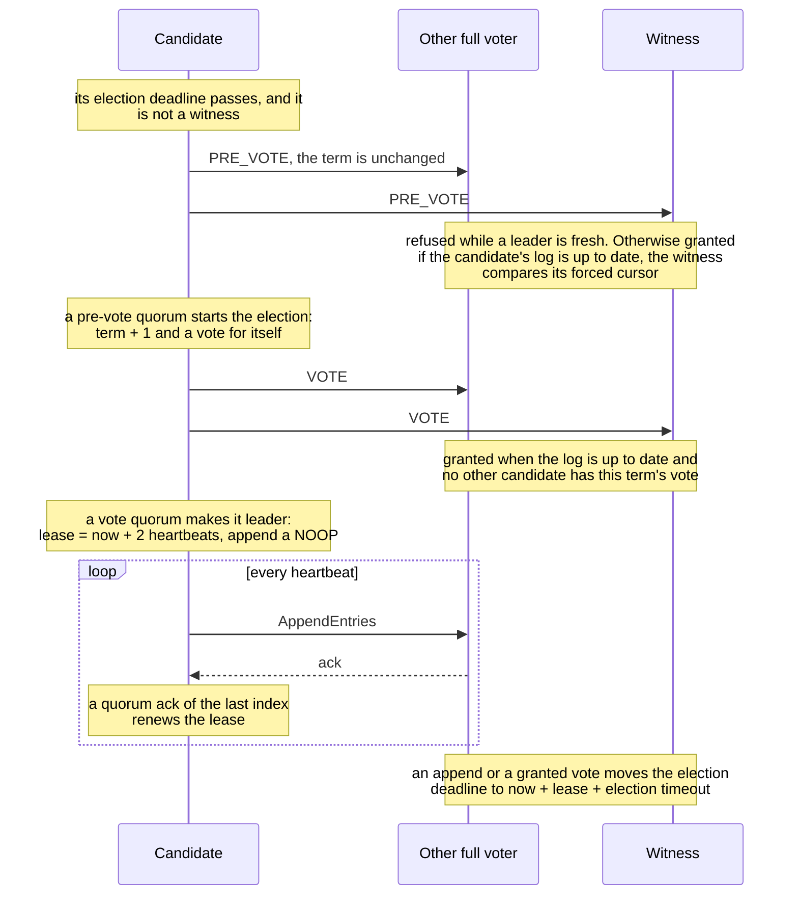
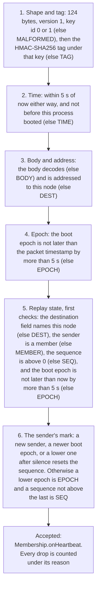

# High availability, as implemented

Status: what the code does · Docs only

This is the HA behavior on master after the witness vote cursor
([#133](https://github.com/BlivionIaG/sjws_nettask/pull/133)), the three-voter majority
([#142](https://github.com/BlivionIaG/sjws_nettask/pull/142)), the failover matrix
([#146](https://github.com/BlivionIaG/sjws_nettask/pull/146)), and authenticated heartbeats
([#134](https://github.com/BlivionIaG/sjws_nettask/pull/134),
[#144](https://github.com/BlivionIaG/sjws_nettask/pull/144),
[#145](https://github.com/BlivionIaG/sjws_nettask/pull/145)).
The choice of option A is recorded in [two-node HA decision](two-node-ha-decision.md).
[HA design](../ha/design.md) is the earlier draft (serving sketch, N-node roadmap).
Where this file and that draft disagree, this file is the implementation.

`sjws_nettask.cluster` does not import `sjws_nettask.ha`, HTTP, or Netty.
`HaSettings` is attached in code (`SjwsServer.start(config, ha)`). It is not a
`ServerConfig` flag.

## Per-group Raft

One `RaftGroup` is one `GroupId`, one log, and one commit index. `ReplicatedNode.openGroup`
opens it. `CpStore` uses the group id `cp-config` (`CpStore.GROUP`). `VipFence` and
`GenerationSync` name the serving group `ha-control`. Message topics are other group ids
on the same transport, not a second replication protocol.

A witness is a `Member` with `witness == true`. On `AppendEntries` it does not
`appendStored` user bytes. `countsAsStored` is false for it, so its disk is not a data
copy. It does not campaign (`tick` skips elections; `onTimeoutNow` returns immediately).

## Option A

Production HA is two data nodes plus a witness, opened with `VoterSet.dataAndWitness`.
The stored policy is `QuorumPolicy.majority()`: `majorityCount` is `voters / 2 + 1`, so
any two of the three voters are a quorum. Losing any one of them still leaves a quorum.
`QuorumPolicy.witness` is still in the tree (false unless the witness is in the ack set
and at least one data node is too). `VoterSet` does not use it.

`VoterSet.majority` rejects a voter set of size 2 that contains no witness
(`IllegalArgumentException`, message `two voters require a witness`). One voter stays
legal: `CpStore.open` calls the older `ReplicatedNode.open` with a single non-witness
member and `QuorumPolicy.majority()`, and `VoterSet.majority` allows a set of one.
Three data nodes and no witness stay legal. Two voters of which one is a witness are
not the bare-pair case and are not rejected by that check. The control role opens its
3 or 5 full voters through `VoterSet.majority` and 2 + witness through `dataAndWitness`
(`CpLaunch`, `CpStore.open`).

There is no async primary/standby and no one-node election. `GroupOptions.preferred`
only shortens that node's first election deadline to `electionTimeout / 5` (at least 1 ns).
It is not a second vote.

## Witness vote cursor

A witness's own `lastIndex()` stays 0 because it never stores user bytes. Before it acks
an `AppendEntries`, and again before it grants a vote, it forces the last acked
`(index, term)` and refuses a candidate whose log is behind that mark
(`WitnessCursor`, `LogStorage.noteWitness` / `witnessIndex` / `witnessTerm`).

`note` stages a pair only when it is strictly ahead in Raft order (higher term, or the
same term and a higher index). Index `< 1` or term `< 0` is ignored. The pair is not
moved backwards. `witnessIndex` and `witnessTerm` return the last pair that `force()`
published, not the staged one. `FileLogStorage` writes `{sanitized-group}.witness`:
16 bytes, big-endian index then term, via a temp file, `FileChannel.force(true)`,
`ATOMIC_MOVE`, then a directory fsync. A missing file or a file shorter than 16 bytes
loads as `(0, 0)`.

On an append the witness notes the acked pair, forces, then acks. An empty batch uses
`prevIndex` / `prevTerm`; a batch with entries uses the last entry's term. On a vote it
forces again, then compares. The candidate is behind when `lastTerm < witnessTerm`, or
`lastTerm == witnessTerm` and `lastIndex < witnessIndex`. An empty mark grants any
otherwise eligible candidate. If `force` throws, the witness does not ack, does not
grant, and does not set `votedFor`.

## RELAXED and STRICT

`Durability.RELAXED` is the default (`GroupOptions` constructors that omit durability).
A quorum ack from memory completes the append. Fsync is batched afterwards and does not
delay the future.

`Durability.STRICT` is opt-in. Followers that store the batch fsync it before they ack,
and the leader fsyncs before replicating.

### Restart safety and the exact RELAXED guarantee

What a voter keeps across a crash:

- **Term and vote are durable** for every voter, RELAXED or STRICT. `LogStorage.saveHardState`
  is called, and must return only once durable, whenever `term` or `votedFor` changes, before
  the vote request or grant is sent. The write comes first and memory changes only when it
  succeeds (`startElection`, stepping down to a higher term, a vote grant). A failed write leaves
  term and vote as they were, sends nothing, and the node stays a follower (a leader that cannot
  persist a higher term it has seen logs a WARNING and stays in its old term); a failed grant is a
  refusal. Messages only ever carry the durable term (a pre-vote reply carries the responder's own
  term, and the pre-candidate accepts a grant at a term at or below its own).
  `FileLogStorage` writes `{group}.vote`: 24 bytes big-endian, magic `SJVT`, version 1, term,
  voted-for wire id (0 for none), CRC32C of the first 20 bytes, with the same temp file, fsync,
  `ATOMIC_MOVE`, directory fsync sequence as the witness cursor. On open, a missing file with an
  empty log is term 0; a missing file with a log (an upgrade) is the last entry's term, treated as
  already voted (for this node), so it cannot grant a second vote in that term (a witness takes
  the term of its forced cursor); a missing file after `{group}.vote-saved` exists (written and
  fsynced before the first vote file) means the file was deleted and refuses to start; the file is
  opened with `NOFOLLOW_LINKS`, so a symlink in its place refuses to start; a short file, a bad magic, an unknown version or a CRC mismatch refuses to start with an
  error naming the file. It is never silently reset. Before this,
  a restarted node came back at term 0 with no vote and could vote twice in one term. A custom
  `LogStorage` that does not override the default methods keeps that old behaviour.
- **A restarted data voter abstains.** When a data voter opens a group with a non-zero durable
  term or a non-empty log, it may have lost entries it acked from memory. Until it accepts an
  append whose `leaderCommit` it holds (`commitIndex >= leaderCommit`), or until
  `leaseNanos + 2 * electionTimeout` passes, it grants no pre-vote or vote and does not campaign.
  A voter that is a quorum on its own (`CpStore`'s single voter) is exempt. The window is what
  lets a cluster that restarted as a whole elect a leader again.

  **Caveat:** once that window expires, a RELAXED node that lost acked entries votes and campaigns
  again with its shorter log, and can help elect a leader that also lacks them. That only matters
  when no leader holding those entries reached it within `leaseNanos + 2 * electionTimeout` of its
  restart: the leader is down or partitioned from it too (a second failure), or the whole cluster
  restarted after losing them. In the 2 + 1 pair the witness cursor still refuses it if the
  witness acked those entries. STRICT entries are not affected: they were on disk before they
  counted.
- **A witness ack is never the only other copy.** A witness stores no entry. When no data peer
  has acked an index, the leader counts itself only up to its own forced index, so RELAXED with
  one data node down commits after the leader's next batched fsync (one tick), not from memory.
  Without this, a leader crash would lose the entry and the witness cursor, which had recorded
  it, would then refuse both data nodes forever.
- `FileLogStorage.lastIndex` loads the group's file. Before, a restarted node reported 0 until
  another call loaded the file, and compared candidates against an empty log.

The RELAXED guarantee is then: an acked entry survives the crash of **any one** voter, and of a
data node that restarts while a leader holding the entry is reachable. It can be lost when every
data copy that acked it crashes inside the same fsync window (at most one tick), for example both
data nodes of the 2 + 1 pair on a shared power failure, or a restarted data node that is still
inside its recovery window when the other data node is lost. STRICT has no such window: each
data copy that counts toward a commit has fsynced it.

`quorumFor` counts the witness in the ack set, so a witness vote still helps
`QuorumPolicy.majority` (and would still satisfy `QuorumPolicy.witness`). It does not
count as a data copy. When durability is `STRICT` and the group has a witness voter and
at least two data voters, `dataCopiesRequired()` is 2. Otherwise it is 1, so `CpStore`'s
single voter, a plain majority of data nodes, and a one-data-node-plus-witness group can
still commit. A `STRICT` commit on the option A group therefore does not complete on
leader-disk plus witness-vote alone.

## Failover matrix

`FailoverMatrixTest` is the option A matrix. A live leader is `isLeader()` and
`leaseExpiresAt() > clock.nanoTime()`. Each case keeps at most one live lease. The same
index on the two data logs does not hold two payloads.

| Failure | RELAXED | STRICT |
|---|---|---|
| Lose one data node (the other data node is cut from both the leader and the witness) | The remaining data node and the witness are a quorum. A new append commits. The cut node is not live. | At most one live lease. A new append does not commit. The entry committed before the cut is still on the surviving data disk. |
| Lose the witness (cut from both data nodes) | The two data nodes commit. The witness is not live. | Same: both data disks are enough. The entry committed before the cut is on both data logs. |
| Partition between the data nodes (each can still reach the witness) | Exactly one live leader, and an append on that leader commits. | At most one live lease. A new append on the old leader does not commit. Both data logs still hold the entry committed before the cut. |
| Isolated witness | Same as losing the witness. | Same as losing the witness. |
| Leader isolated with the witness (the other data node is cut from both) | That leader stays live and a new append commits. | A new append does not commit. The entry committed before the cut is still on the other data node's disk. |

Losing the witness is not an outage. That is `QuorumPolicy.majority` over three voters,
not the older `QuorumPolicy.witness` veto.

## Pre-vote

A campaign calls `startPreVote` before it increments `term`. The pre-vote does not change
`term` or `votedFor`. A receiver grants it only when the candidate's log is up to date
(the witness compares the durable cursor, and forces it first) and the receiver does not
still have a leader: `role == LEADER`, or a `FOLLOWER` with `leader != null` and
`now < electionDeadline`, refuses. A pre-vote quorum is what starts the real election. A node that is alone does
not raise the term, because its own pre-vote is not a majority of three.

That is what keeps the partition row above from splitting. The data node that cannot
hear the leader still reaches the witness, but the witness has a fresh leader and
refuses the pre-vote, so the term does not move and the leader that holds the witness
stays leader. `onTimeoutNow` (leadership transfer) still starts a real election; it does
not go through the pre-vote.

One election, from the first deadline to the lease, as a voter set runs it. The Raft side runs in tests and in a
control process (group `cp-config`: one voter sends no `PRE_VOTE` or `VOTE`, a set of voters from `cp.peers` runs
this exchange over TCP), not yet in an HA pair:



## Leader lease

`GroupOptions.leaseNanos()` is `heartbeat.toNanos() * 2`. The lease is a deadline on
`Clock.nanoTime()`, which is monotonic (`Clock.SYSTEM` uses `System.nanoTime()`).
`becomeLeader` sets `leaseExpires` to `now + leaseNanos`. `onAppendResp` refreshes it
when `quorumFor(lastIndex)` is true. `leaseExpiresAt()` is that deadline while the role
is `LEADER`, and `0` otherwise. A read barrier completes immediately while
`nanoTime() < leaseExpires`.

An append or a granted vote also sets the follower's election deadline to
`now + lease + electionTimeout`, so a node that is hearing a leader does not campaign.
A preferred node's first deadline is `electionTimeout / 5`. Every other node's first deadline is
`electionTimeout + ((wire - 1) mod voters) * (electionTimeout / voters)`. Each retry after a
failed pre-vote or vote waits `electionTimeout` plus a fresh jitter in `[0, electionTimeout)`,
so the wait stays under `2 * electionTimeout`. Failback hysteresis defaults to
`Duration.ZERO`; `withFailback` holds a demoted leader until that delay has elapsed.

`VipFence` claims a VIP only for `FailoverPolicy.ACTIVE_PASSIVE`, and only while this
node leads and the lease is outside the caller-supplied `releaseBefore` window.
`poll` releases when the node is not leader, `leaseExpiresAt` is `0`, or `now` is within
`releaseBefore` of the expiry. `VipFence.active` uses `releaseBefore` of zero and never
claims. The fence is not a substitute for the third vote. `isLeader` can stay true on a
node that has not yet seen a higher term; the lease is what drops the claim.

Raft election timeout and heartbeat are caller-supplied `GroupOptions`. They are not
`ha:` keys. The one place that picks them today is `CpGroup.options()` (used by `CpStore` and
`CpWitness`): `Durability.RELAXED`,
max batch `1024 * 1024` bytes, election timeout 100 ms, heartbeat 40 ms, snapshot every
`10_000` entries. The lease for that group is 80 ms. `ReplicatedNode` builds its
membership view with a 500 ms interval and a 5 s dead-after. `LocalCluster.start`'s
short form uses the same 5 s dead-after; the heartbeat interval is the caller's.

`HaSettings.defaults()` uses a drain delay of 5 s, a drain timeout of 15 s, and
`requireQuorum` false. `HealthBoard.readyNow` is
`snapshotLoaded && !draining && (!requireQuorum || quorumOk)`. With the default, a node
stays ready from its last snapshot when quorum is lost (fail-static). `requireQuorum`
true is what makes readiness wait on quorum.

## HMAC heartbeats

`ha.enabled` omitted is false. Heartbeats stay off and the authenticator is not loaded.
`ha.enabled: true` with no key refuses to start. The message tells the operator to set
`ha.cluster_key` or `WEB_SERVER_HA_CLUSTER_KEY`.

`ConfigLoader` accepts only these `ha` keys: `enabled`, `cluster_key`,
`cluster_key_previous`, `cluster_key_file`, `cluster_key_previous_file`. The key is not
part of the canonical config document, so a last-good copy does not store it and startup
logs do not print it. `ClusterKey.MIN_BYTES` is 16. A value is trimmed; `base64:` and
`hex:` select those encodings; anything else is the UTF-8 of the trimmed text. A trailing
newline from a file is not part of the key. `WEB_SERVER_HA_CLUSTER_KEY` overrides
`ha.cluster_key` and `ha.cluster_key_file`. `WEB_SERVER_HA_CLUSTER_KEY_PREVIOUS` overrides
the previous key. An empty current or previous variable is an error when HA is enabled;
it does not fall back to the file. The daemon child does not inherit either variable.
The key is never accepted on the command line (`--cluster-key` and `--ha-cluster-key`
are rejected, and the rejection does not echo the secret).

`ha.cluster_key_file` is opened once with `NOFOLLOW_LINKS`, must be mode 0600 or 0400,
must be owned by this process, and must be at most 4 KiB. A symlink is rejected. A
filesystem without POSIX permissions cannot be checked and refuses the key file. Mode
and owner are read from that same file descriptor. An inline `ha.cluster_key` in a
config file that is readable by group or others produces a warning. The file and the
inline form cannot both be set, and the same rule applies to the previous key.

Each datagram is 124 bytes (`HeartbeatAuthenticator.PACKET_BYTES`): version `1`, key id
(`0` current, `1` previous), the 64-byte membership body, an 8-byte wall-clock
timestamp, an 8-byte sequence starting at 1, an 8-byte boot epoch, a 2-byte destination
wire id, and a 32-byte HMAC-SHA256. The MAC input is
`sjws-ha-hb\0 || version || keyId || body || ts || seq || bootEpoch || dest`. The HMAC
key is HKDF-SHA256 of the cluster key with info `sjws-ha-heartbeat-v1`. The key id
selects one key; a packet is not tried against both.

The boot epoch is `clock.currentTimeMillis()` captured when the authenticator is
constructed. Replay state is `(sender, bootEpoch, sequence, lastAcceptedMillis)`, and
only members are inserted. A newer boot epoch resets that sender's sequence high-water
mark, so a restart is accepted. An epoch later than the packet timestamp, or later than
the receiver's now, by more than `WINDOW_MILLIS` (5000, inclusive at exactly ±5 seconds)
is dropped and does not update that state. A lower epoch is accepted only after the
sender has been silent for at least `max(deadAfterMillis, WINDOW_MILLIS)` (a 5 s floor);
the `HeartbeatAuthenticator(ClusterKey, Clock)` constructor passes `0`, which never
accepts a lower epoch, and `HeartbeatService` passes the membership dead interval.
`LocalCluster` and `ReplicatedNode` use 5 s. A timestamp older than this process's boot
is dropped. A destination other than this node is dropped. A sender that is not a member
is dropped. Skew warnings are rate-limited to once per 5 s (`WARN_EVERY_MILLIS`).

The order in which `HeartbeatAuthenticator.open` checks a datagram, and the reason that is counted when one check fails:



Rotation is the previous key. Put the new secret in `ha.cluster_key` or
`ha.cluster_key_file` and the key still in use in `ha.cluster_key_previous` or
`ha.cluster_key_previous_file`. Receivers accept either key id. Remove the previous key
once every node is sending with the new one.

The authentication timestamp is wall-clock milliseconds. It is a replay window, not the
leader lease. Monotonic clocks are not comparable across hosts.

## Zero cost when HA is off

`ha.enabled` false discards any key bytes and does not resolve `ClusterKey`.
`BenchServer --mode=single` does not load `sjws_nettask.cluster` or
`HeartbeatAuthenticator`, even when `WEB_SERVER_HA_CLUSTER_KEY` is set in the
environment (`ClassLoadTest`, `HeartbeatAuthClassLoadTest`). Cluster mode without a key
fails closed and does not echo a command-line secret.

`SjwsServer` started without `HaSettings` leaves `ha` null. `requestHandler()` then
returns the live file handler (or the non-HA override). `acceptPause` stays null, so the
accept loop does not sleep on a gate. `ClientManager` only reads `acceptPause` when it
is non-null. Active/active installs no accept gate (`HaSettings.acceptPause` is null
unless a caller sets one). The request path does not append to a Raft log.

## Clock drift

Leader leases are deadlines on `Clock.nanoTime()`. A wall-clock offset between hosts
does not move a lease. The error that matters is the clock *rate* over one lease: a
node whose monotonic clock runs fast expires its lease early relative to a peer whose
clock runs slow.

This check is implemented for the control role: `CpLaunch.start` runs `CpTiming.check`
against `CpGroup.options()` and refuses to start otherwise. The keys are read by
`CpConfig` from the `cp:` block (YAML only; `ConfigLoader` keeps the block raw, so it does
not list them). They are what [control-plane hosting](control-plane-hosting.md) records as
resolved with HA ([#151](https://github.com/BlivionIaG/sjws_nettask/pull/151)). That note
also flags the 100 ms `CpStore` election timeout as aggressive for JVM GC pauses. The
timeout stays the value `CpGroup.options()` sets; the check below does not change it.

| Key | Default | Meaning |
|---|---|---|
| `cp.maxClockDriftRatio` | `0.01` | Rate error allowed over one lease (1%). |
| `cp.leaseSafetyMargin` | `10 ms` | Fixed margin added in the startup check. |

Startup must fail closed unless

```
lease * (1 + cp.maxClockDriftRatio) + cp.leaseSafetyMargin < electionTimeout
```

`lease` is `GroupOptions.leaseNanos()` (`heartbeat * 2`). With the timings
`CpGroup.options()` uses (heartbeat 40 ms, lease 80 ms, election timeout 100 ms) the
expression is `80 * 1.01 + 10 = 90.8 ms`, and `90.8 < 100` holds, so those defaults
pass and force no timing change. A group whose election timeout is not strictly above
that expression is refused. `GroupOptions` itself does not run the check.

The ±5 second HMAC window (`HeartbeatAuthenticator.WINDOW_MILLIS`) is a separate bound.
It compares wall clocks for heartbeat anti-replay. It is not the lease rate bound.
