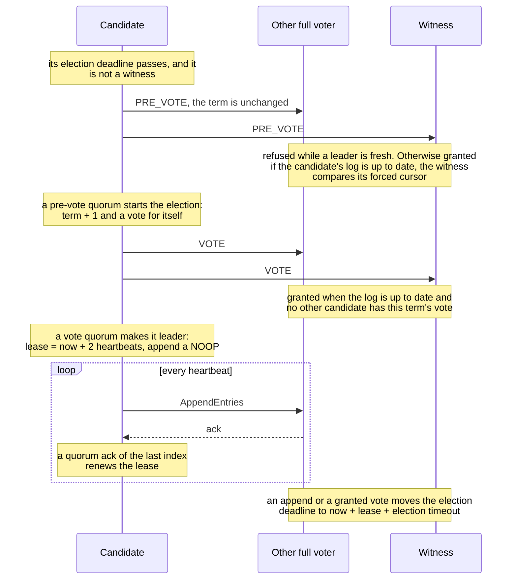
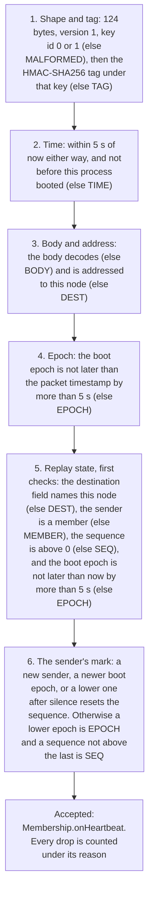

# High availability, as implemented

Status: what the code does · Docs only

This is the HA behavior on master after the witness vote cursor
([#133](https://github.com/BlivionIaG/sjws_nettask/pull/133)), the three-voter majority
([#142](https://github.com/BlivionIaG/sjws_nettask/pull/142)), the failover matrix
([#146](https://github.com/BlivionIaG/sjws_nettask/pull/146)), and authenticated heartbeats
([#134](https://github.com/BlivionIaG/sjws_nettask/pull/134),
[#144](https://github.com/BlivionIaG/sjws_nettask/pull/144),
[#145](https://github.com/BlivionIaG/sjws_nettask/pull/145)).
The choice of option A is recorded in [two-node HA decision](two-node-ha-decision.md).
[HA design](../ha/design.md) is the earlier draft (serving sketch, N-node roadmap).
Where this file and that draft disagree, this file is the implementation.

`sjws_nettask.cluster` does not import `sjws_nettask.ha`, HTTP, or Netty.
`HaSettings` is attached in code (`SjwsServer.start(config, ha)`). It is not a
`ServerConfig` flag.

## Per-group Raft

One `RaftGroup` is one `GroupId`, one log, and one commit index. `ReplicatedNode.openGroup`
opens it. `CpStore` uses the group id `cp-config` (`CpStore.GROUP`). `VipFence` and
`GenerationSync` name the serving group `ha-control`. Message topics are other group ids
on the same transport, not a second replication protocol.

A witness is a `Member` with `witness == true`. On `AppendEntries` it does not
`appendStored` user bytes. `countsAsStored` is false for it, so its disk is not a data
copy. It does not campaign (`tick` skips elections; `onTimeoutNow` returns immediately).

## Option A

Production HA is two data nodes plus a witness, opened with `VoterSet.dataAndWitness`.
The stored policy is `QuorumPolicy.majority()`: `majorityCount` is `voters / 2 + 1`, so
any two of the three voters are a quorum. Losing any one of them still leaves a quorum.
`QuorumPolicy.witness` is still in the tree (false unless the witness is in the ack set
and at least one data node is too). `VoterSet` does not use it.

`VoterSet.majority` rejects a voter set of size 2 that contains no witness
(`IllegalArgumentException`, message `two voters require a witness`). One voter stays
legal: `CpStore.open` calls the older `ReplicatedNode.open` with a single non-witness
member and `QuorumPolicy.majority()`, and `VoterSet.majority` allows a set of one.
Three data nodes and no witness stay legal. Two voters of which one is a witness are
not the bare-pair case and are not rejected by that check. The control role opens its
3 or 5 full voters through `VoterSet.majority` and 2 + witness through `dataAndWitness`
(`CpLaunch`, `CpStore.open`).

There is no async primary/standby and no one-node election. `GroupOptions.preferred`
only shortens that node's first election deadline to `electionTimeout / 5` (at least 1 ns).
It is not a second vote.

## Witness vote cursor

A witness's own `lastIndex()` stays 0 because it never stores user bytes. Before it acks
an `AppendEntries`, and again before it grants a vote, it forces the last acked
`(index, term)` and refuses a candidate whose log is behind that mark
(`WitnessCursor`, `LogStorage.noteWitness` / `witnessIndex` / `witnessTerm`).

`note` stages a pair only when it is strictly ahead in Raft order (higher term, or the
same term and a higher index). Index `< 1` or term `< 0` is ignored. The pair is not
moved backwards. `witnessIndex` and `witnessTerm` return the last pair that `force()`
published, not the staged one. `FileLogStorage` writes `{sanitized-group}.witness`:
16 bytes, big-endian index then term, via a temp file, `FileChannel.force(true)`,
`ATOMIC_MOVE`, then a directory fsync. A missing file or a file shorter than 16 bytes
loads as `(0, 0)`.

On an append the witness notes the acked pair, forces, then acks. An empty batch uses
`prevIndex` / `prevTerm`; a batch with entries uses the last entry's term. On a vote it
forces again, then compares. The candidate is behind when `lastTerm < witnessTerm`, or
`lastTerm == witnessTerm` and `lastIndex < witnessIndex`. An empty mark grants any
otherwise eligible candidate. If `force` throws, the witness does not ack, does not
grant, and does not set `votedFor`.

## RELAXED and STRICT

`Durability.RELAXED` is the default (`GroupOptions` constructors that omit durability).
A quorum ack from memory completes the append. Fsync is batched afterwards and does not
delay the future.

`Durability.STRICT` is opt-in. Followers that store the batch fsync it before they ack,
and the leader fsyncs before replicating.

### Per-append durability

`ClusterNode.append(group, batch, durability)` overrides the group's mode for one batch
(`null` uses `GroupOptions.durability()`). A STRICT batch in a RELAXED group is stored with the
`USER_STRICT` marker (4) instead of `USER` (0); listeners and snapshots see the same payload.
The leader fsyncs before replicating it, a follower that receives a batch containing one fsyncs
before acking, and committing any index at or past it needs `dataCopiesRequired()` data acks,
exactly as a STRICT group. Commits are a prefix, so RELAXED batches behind a pending STRICT one
wait for it. A new leader rescans its uncommitted suffix for the marker. A RELAXED override in a
STRICT group is still STRICT. The default interface method delegates `null` and fails anything
else with `UnsupportedOperationException`.

A STRICT override is refused up front, with `DurabilityUnavailableException` and nothing
appended, when the leader plus the data voters that answered an append within the last lease
are fewer than `dataCopiesRequired()` (in a two-data-plus-witness group: the other data node has
been silent for a lease). That keeps a degraded group writable for RELAXED appends. A new leader
has heard from nobody yet, so it refuses STRICT overrides until its first heartbeat round is
answered; retry. What remains: a data node that fails after a STRICT override was accepted
holds that entry, and every entry behind it, until the node is back or a leader with two
reachable data copies takes over (a new leader rescans the marker and needs the same copies, so
stepping down does not help). Bringing the data node back is the only way out today; a bounded
wait or an operator escape is tracked in #208. The leader makes such a stall visible:
`ReplicatedNode.strictPending(group)` (uncommitted STRICT overrides) and
`oldestStrictPendingAgeNanos(group)` (0 when none; followers report 0), and one WARNING per
entry once it has waited 2 x lease, naming the group, the index and how many data copies it has.
A STRICT group (`GroupOptions.durability()`) is unchanged and has no fail-fast.

The leader counts an append response only when the voter id in its body matches the
authenticated sender of the frame, so one member cannot refresh another's liveness or
`matchIndex` (a member holding the group key can still lie about itself, #175).

The marker byte is protected on the wire (inside the HMAC-covered frame body) but not on disk:
`FileLogStorage` records (`index, term, len, data`) carry no checksum, so a bit flip on disk can
turn `USER_STRICT` (4) into `USER` (0), or garble the payload, without detection. Per-record
CRCs are tracked in #207. Every member holds the group key, so a compromised member
can forge the marker either way (the #175 limitation).

### durableIndex and the RELAXED fsync-lag bound

`ReplicationGroup.durableIndex()` is the highest index this node has fsynced to its own log
(0 on a witness, which stores no entries; on restart, the last index found on disk). Under STRICT
it is never behind an entry the node acked. Under RELAXED it trails by a bounded amount set with
`GroupOptions.withRelaxedSyncBound(delay, entries)`:

- **Time:** the node fsyncs on the first tick at which the oldest unsynced entry is at least
  `relaxedSyncDelay` old. The default is `Duration.ZERO`, meaning the next tick, which is the earlier behaviour.
  The worst case is `relaxedSyncDelay` plus one tick interval.
- **Entries:** once `relaxedSyncEntries` entries are unsynced, the node fsyncs inside the append
  (leader) or before the ack (follower). The default is `Long.MAX_VALUE`, meaning no entry cap.

That bound is also the RELAXED loss window in the guarantee below. One interaction: with one data node
down in the 2 + 1 pair, a RELAXED commit waits for the leader's fsync (the witness stores
nothing), so it now waits up to the time bound rather than one tick. Keep `relaxedSyncDelay` small,
or use the entry bound, if that degraded mode must stay fast. A RELAXED group whose `relaxedSyncDelay`
exceeds the lease (`2 x heartbeat`) logs a WARNING when it opens. `durableIndex` never decreases
except when this node truncates conflicting uncommitted entries.

### Application snapshots

`SnapshotControl.setSnapshotTaker(SnapshotTaker)` replaces the built-in snapshot image (the
concatenated user payloads) with application bytes. The taker runs on the group's delivery
thread, queued after the delivery of every entry through `lastIncludedIndex` and ahead of later
ones, so the state it reads is exactly the state at that index. Its result moves the snapshot
forward only if it is still ahead of the current one. If the taker throws or returns null, that
snapshot is skipped and the log is kept. With a taker, `take(i)` accepts only `i == commitIndex()`,
is refused inside a callback, and blocks until the delivery thread has run the taker.
`GroupOptions.withoutAutoSnapshot()` (`snapshotEveryEntries == NO_AUTO_SNAPSHOT`) turns
automatic snapshots off, so the application decides when to call `take`.

Snapshots are held in memory and made durable only when a log prefix is about to be deleted.
`truncateAndCompact` and `install` first write the image through `LogStorage.saveSnapshot` and
only then delete the prefix; a storage whose `persistsSnapshots()` is false (the interface
default) refuses both, so committed state is never left in memory alone. `FileLogStorage` writes
`{group}.snap`: magic `SJSN`, version 1, last included index and term, image length, image, and
a CRC32C of all of it, created mode 0600 (the CP image holds token hashes and RBAC state), then
fsync, `ATOMIC_MOVE` and directory fsync. On open it is read with the `SecureKeyFile` rules
(leaf not followed, regular file, mode 0600 or 0400, owned by this process, parents not writable
by others) and validated (magic, version, length, `maxSnapshotBytes`, CRC); any failure refuses
to start. A group that opens with a snapshot starts with its commit and apply point at the
snapshot index and hands the image to `GroupListener.onSnapshotRestored` on the delivery thread
before any later entry; the default method ignores it, which is only right for a group that never
compacts. Under RELAXED the persisted image can be ahead of the local `durableIndex`: it holds
committed state, which is what a restart needs.

`install` refuses, changing nothing, an image above `maxSnapshotBytes`, an index that does not
advance past the current snapshot, and an index the local log holds with a different term;
`install(snapshot, crc32c)` also checks `LogSnapshot.crc32c()` for a snapshot that crossed a
process or disk boundary. `GroupOptions.withMaxSnapshotBytes` (default 64 MiB) also bounds the
image a taker returns and the built-in image: a larger one is skipped and counted
(`ReplicatedNode.skippedSnapshots`), like a failing taker.

Msg groups (`msgrepl`) do not take snapshots yet (#270). Their applied state includes the producer dedup table
(M2, `msgrepl.ProducerTable`; see partition-log.md "Producer dedup"), which is rebuilt by replaying the log today. A msg
snapshot taker must put `ProducerTable.write` at the snapshot index in the image together with the next offset at that
index, and `onSnapshotRestored` must `ProducerTable.read` it into `RaftReplica.restoreProducers` and restore the next
offset, or a restored follower would accept a retried batch twice.

Msg groups also advertise a feature bit in their append responses (`ReplicationGroup.advertiseFeatures`, read by the
leader with `votersHaveFeatures`): a leader proposes the first producer entry only when every voter applies it (#278).
Groups that advertise nothing (control plane, swarm) send byte-identical responses, and an older leader ignores the
trailing bytes.

### Snapshot transfer to followers

A data follower whose next entry is at or below the leader's snapshot index gets the snapshot
from the leader instead of entries (frames `SNAP_CHUNK` and `SNAP_RESP`). A witness keeps no
data and still gets the empty append it already handled. The leader sends the image in chunks of
1 MiB (well under `TcpTransport.MAX_FRAME_BYTES`); each chunk carries the term, the image's last
included index and term, its total length, the leader's commit index, the CRC32C of index, term
and image (`LogSnapshot.crc32c()`, as on disk), the offset and the bytes. The transfer is
stop-and-wait: the next chunk goes out when the follower acks the previous one, and the current
one is resent on each heartbeat until then. A transfer pins the image it started with. If the
leader compacts again meanwhile, the follower's `nextIndex` still lands inside the snapshot when
it completes, and another transfer starts.

The follower runs the leader checks of an append (term, step down, lease, election deadline). It
takes chunks only in order from offset 0 and answers anything else with the offset it wants. It
refuses an image whose total length is above its own `maxSnapshotBytes`, and checks the CRC32C of
the assembled image; a mismatch drops it and asks again from 0. A complete image is installed like
`install`: it is persisted before any prefix delete (refused on a storage without durable
snapshots), the local log is kept past the image only if it holds the image's index with the
image's term and is otherwise dropped, commit and apply move to the image index, and the image
goes to `GroupListener.onSnapshotRestored` on the delivery thread before any later entry. A
restarted voter's catch-up gate opens only when its commit index reaches the leader's commit index
carried in the chunk, as for an append, not merely because an image was installed. An
image at or below the follower's snapshot or commit index (with a matching term) is acked as
already installed. Counters: `ReplicatedNode.snapshotsSent` and `snapshotsInstalled`.

The CRC32C catches corruption, not forgery: the frames ride the authenticated Raft transport
(HMAC per frame on `TcpTransport`), which already decides who may act as leader. A follower holds
at most one image in memory (bounded by `maxSnapshotBytes`). The leader holds a reference to the
image it is sending, not a copy.

### Truncation bound

`SnapshotControl.setTruncationBound(TruncationBound)` lets the application limit how far the
Raft log prefix may be dropped. `truncatableThrough(group, snapshotIndex)` returns the highest
index the application no longer needs from Raft: its own state is durable through it, and
nothing it still serves (retention low watermark, the oldest consumer offset, the ledger low
watermark) lies at or below it. `Long.MAX_VALUE` means no limit beyond the snapshot, 0 keeps the
log. With a bound set:

- `truncateToBound(compactor)` truncates through `min(snapshot index, bound)`, compacts, and
  completes with the index the log is truncated through. The snapshot index passed to the bound
  is read first; the truncation never goes past it, even if a snapshot lands meanwhile.
- `truncateAndCompact(ackedThrough, compactor)` truncates through `min(ackedThrough, bound)`.
  Without a bound it behaves as before.
- A bound that throws fails the future and truncates nothing. A bound lower than an earlier
  truncation undoes nothing.

The bound is called on the caller's thread without the group lock, so it may read application
state but must not call back into the group. Automatic snapshots never truncate the log, with or
without a bound: they only move the in-memory snapshot point, which makes a lagging follower
receive the snapshot instead of entries. Truncation stays an explicit call (for messaging, from
the maintenance timer after retention and compaction). A data follower behind the leader's
truncation point catches up through a snapshot transfer (see above). Unused, the bound costs a null check in the two
truncation calls and nothing on the append or commit path.

Every truncation path persists the snapshot first (see Application snapshots) and refuses on a
storage without durable snapshots. `FileLogStorage` drops a prefix (or suffix) by writing the
kept records to a temp file and renaming it into place with fsyncs (#214), so a crash leaves the
whole old segment or the whole new one.

### Restart safety and the exact RELAXED guarantee

What a voter keeps across a crash:

- **Term and vote are durable** for every voter, RELAXED or STRICT. `LogStorage.saveHardState`
  is called, and must return only once durable, whenever `term` or `votedFor` changes, before
  the vote request or grant is sent. The write comes first and memory changes only when it
  succeeds (`startElection`, stepping down to a higher term, a vote grant). A failed write leaves
  term and vote as they were, sends nothing, and the node stays a follower (a node in any role that
  cannot persist a higher term it has seen logs a WARNING, at most one per group per 10 s with a
  count of the suppressed ones, and stays in its old term); a leader or candidate in that case
  also steps down at its own term, which needs no write: a leader stops reporting itself as
  leader and acking, and its pending writes fail as outcome unknown, and a candidate cannot go on
  to win the stale term (#255); a failed grant is a
  refusal. Messages only ever carry the durable term (a pre-vote reply carries the responder's own
  term, and the pre-candidate accepts a grant at a term at or below its own).
  `FileLogStorage` writes `{group}.vote`: 24 bytes big-endian, magic `SJVT`, version 1, term,
  voted-for wire id (0 for none), CRC32C of the first 20 bytes, with the same temp file, fsync,
  `ATOMIC_MOVE`, directory fsync sequence as the witness cursor. On open, a missing file with an
  empty log is term 0; a missing file with a log (an upgrade) is the last entry's term, treated as
  already voted (for this node), so it cannot grant a second vote in that term (a witness takes
  the term of its forced cursor); a missing file after `{group}.vote-saved` exists means the file was deleted and refuses to
  start. The marker is written (atomically, fsynced) right after the first vote file, so a crash
  between the two leaves a vote file and no marker, which loads normally, and the next save adds
  the marker; a crash before the first vote file lands leaves neither, which is safe because the
  vote was never sent. If an operator deletes both files, the node cannot tell this from an
  upgrade: it comes back at the last log term, treated as voted, which prevents a double vote in
  that term but not in a later term it had voted in before. Treat the state directory as one
  unit: restore or wipe it whole, never file by file; the file is
  opened with `NOFOLLOW_LINKS`, so a symlink in its place refuses to start; a short file, a bad magic, an unknown version or a CRC mismatch refuses to start with an
  error naming the file. It is never silently reset. Before this,
  a restarted node came back at term 0 with no vote and could vote twice in one term. A custom
  `LogStorage` that does not override the default methods keeps that old behaviour.
- **A restarted data voter abstains.** When a data voter opens a group with a non-zero durable
  term or a non-empty log, it may have lost entries it acked from memory. Until it accepts an
  append whose `leaderCommit` it holds (`commitIndex >= leaderCommit`), or until
  `leaseNanos + 2 * electionTimeout` passes, it grants no pre-vote or vote and does not campaign.
  A voter that is a quorum on its own (`CpStore`'s single voter) is exempt. The window is what
  lets a cluster that restarted as a whole elect a leader again.

  **Caveat:** once that window expires, a RELAXED node that lost acked entries votes and campaigns
  again with its shorter log, and can help elect a leader that also lacks them. That only matters
  when no leader holding those entries reached it within `leaseNanos + 2 * electionTimeout` of its
  restart: the leader is down or partitioned from it too (a second failure), or the whole cluster
  restarted after losing them. In the 2 + 1 pair the witness cursor still refuses it if the
  witness acked those entries. STRICT entries are not affected: they were on disk before they
  counted.
- **A witness ack is never the only other copy.** A witness stores no entry. When no data peer
  has acked an index, the leader counts itself only up to its own forced index, so RELAXED with
  one data node down commits after the leader's next batched fsync (one tick), not from memory.
  Without this, a leader crash would lose the entry and the witness cursor, which had recorded
  it, would then refuse both data nodes forever.
- `FileLogStorage.lastIndex` loads the group's file. Before, a restarted node reported 0 until
  another call loaded the file, and compared candidates against an empty log.

The RELAXED guarantee is then: an acked entry survives the crash of **any one** voter, and of a
data node that restarts while a leader holding the entry is reachable. It can be lost when every
data copy that acked it crashes inside the same fsync window (the RELAXED sync bound above; one tick by default), for example both
data nodes of the 2 + 1 pair on a shared power failure, or a restarted data node that is still
inside its recovery window when the other data node is lost. STRICT has no such window: each
data copy that counts toward a commit has fsynced it.

`quorumFor` counts the witness in the ack set, so a witness vote still helps
`QuorumPolicy.majority` (and would still satisfy `QuorumPolicy.witness`). It does not
count as a data copy. When durability is `STRICT` and the group has a witness voter and
at least two data voters, `dataCopiesRequired()` is 2. Otherwise it is 1, so `CpStore`'s
single voter, a plain majority of data nodes, and a one-data-node-plus-witness group can
still commit. A `STRICT` commit on the option A group therefore does not complete on
leader-disk plus witness-vote alone.

## Failover matrix

`FailoverMatrixTest` is the option A matrix. A live leader is `isLeader()` and
`leaseExpiresAt() > clock.nanoTime()`. Each case keeps at most one live lease. The same
index on the two data logs does not hold two payloads.

| Failure | RELAXED | STRICT |
|---|---|---|
| Lose one data node (the other data node is cut from both the leader and the witness) | The remaining data node and the witness are a quorum. A new append commits. The cut node is not live. | At most one live lease. A new append does not commit. The entry committed before the cut is still on the surviving data disk. |
| Lose the witness (cut from both data nodes) | The two data nodes commit. The witness is not live. | Same: both data disks are enough. The entry committed before the cut is on both data logs. |
| Partition between the data nodes (each can still reach the witness) | Exactly one live leader, and an append on that leader commits. | At most one live lease. A new append on the old leader does not commit. Both data logs still hold the entry committed before the cut. |
| Isolated witness | Same as losing the witness. | Same as losing the witness. |
| Leader isolated with the witness (the other data node is cut from both) | That leader stays live and a new append commits. | A new append does not commit. The entry committed before the cut is still on the other data node's disk. |

Losing the witness is not an outage. That is `QuorumPolicy.majority` over three voters,
not the older `QuorumPolicy.witness` veto.

## Pre-vote

A campaign calls `startPreVote` before it increments `term`. The pre-vote does not change
`term` or `votedFor`. A receiver grants it only when the candidate's log is up to date
(the witness compares the durable cursor, and forces it first) and the receiver does not
still have a leader: `role == LEADER`, or a `FOLLOWER` with `leader != null` and
`now < electionDeadline`, refuses. A pre-vote quorum is what starts the real election. A node that is alone does
not raise the term, because its own pre-vote is not a majority of three.

That is what keeps the partition row above from splitting. The data node that cannot
hear the leader still reaches the witness, but the witness has a fresh leader and
refuses the pre-vote, so the term does not move and the leader that holds the witness
stays leader. `onTimeoutNow` (leadership transfer) still starts a real election; it does
not go through the pre-vote. It acts only on a `TIMEOUT_NOW` that can still belong to a live
transfer (#255): from another voter, at a term no older than the receiver's, and at the
receiver's own term only while it follows and the sender is the leader it knows (or it knows
none yet). A higher term is adopted first, as from any frame. Anything else, such as one left
over from an old transfer reaching a sitting leader, is dropped without a reply.

One election, from the first deadline to the lease, as a voter set runs it. The Raft side runs in tests, in a
control process (group `cp-config`: one voter sends no `PRE_VOTE` or `VOTE`, a set of voters from `cp.peers` runs
this exchange over TCP), and, opt-in, in an HA messaging cluster (`ha.messaging`, see
[HA messaging bootstrap](#ha-messaging-bootstrap)):



## Leader lease

`GroupOptions.leaseNanos()` is `heartbeat.toNanos() * 2`. The lease is a deadline on
`Clock.nanoTime()`, which is monotonic (`Clock.SYSTEM` uses `System.nanoTime()`).
`becomeLeader` sets `leaseExpires` to `now + leaseNanos`. `onAppendResp` refreshes it
when `quorumFor(lastIndex)` is true. `leaseExpiresAt()` is that deadline while the role
is `LEADER`, and `0` otherwise. A read barrier completes immediately while
`nanoTime() < leaseExpires`.

An append or a granted vote also sets the follower's election deadline to
`now + lease + electionTimeout`, so a node that is hearing a leader does not campaign.
A preferred node's first deadline is `electionTimeout / 5`. Every other node's first deadline is
`electionTimeout + ((wire - 1) mod voters) * (electionTimeout / voters)`. Each retry after a
failed pre-vote or vote waits `electionTimeout` plus a fresh jitter in `[0, electionTimeout)`,
so the wait stays under `2 * electionTimeout`. Failback hysteresis defaults to
`Duration.ZERO`; `withFailback` holds a demoted leader until that delay has elapsed.

`VipFence` claims a VIP only for `FailoverPolicy.ACTIVE_PASSIVE`, and only while this
node leads and the lease is outside the caller-supplied `releaseBefore` window.
`poll` releases when the node is not leader, `leaseExpiresAt` is `0`, or `now` is within
`releaseBefore` of the expiry. `VipFence.active` uses `releaseBefore` of zero and never
claims. The fence is not a substitute for the third vote. `isLeader` can stay true on a
node that has not yet seen a higher term; the lease is what drops the claim.

Raft election timeout and heartbeat are caller-supplied `GroupOptions`. For the control plane they are not
`ha:` keys; the place that picks them is `CpGroup.options()` (used by `CpStore` and
`CpWitness`): `Durability.RELAXED`,
max batch `1024 * 1024` bytes, election timeout 100 ms, heartbeat 40 ms, snapshot every
`10_000` entries. The lease for that group is 80 ms. `ReplicatedNode` builds its
membership view with a 500 ms interval and a 5 s dead-after. `LocalCluster.start`'s
short form uses the same 5 s dead-after; the heartbeat interval is the caller's.

`HaSettings.defaults()` uses a drain delay of 5 s, a drain timeout of 15 s, and
`requireQuorum` false. `HealthBoard.readyNow` is
`snapshotLoaded && !draining && (!requireQuorum || quorumOk)`. With the default, a node
stays ready from its last snapshot when quorum is lost (fail-static). `requireQuorum`
true is what makes readiness wait on quorum.

## HMAC heartbeats

`ha.enabled` omitted is false. Heartbeats stay off and the authenticator is not loaded.
`ha.enabled: true` with no key refuses to start. The message tells the operator to set
`ha.cluster_key` or `WEB_SERVER_HA_CLUSTER_KEY`.

`ConfigLoader` accepts only these `ha` keys: `enabled`, `cluster_key`,
`cluster_key_previous`, `cluster_key_file`, `cluster_key_previous_file`, and the HA messaging keys
(`messaging`, `node_id`, `members`, `election_timeout`, `heartbeat`, `state_dir`, `topics`; see
[HA messaging bootstrap](#ha-messaging-bootstrap)). The key is not
part of the canonical config document, so a last-good copy does not store it and startup
logs do not print it. `ClusterKey.MIN_BYTES` is 16. A value is trimmed; `base64:` and
`hex:` select those encodings; anything else is the UTF-8 of the trimmed text. A trailing
newline from a file is not part of the key. `WEB_SERVER_HA_CLUSTER_KEY` overrides
`ha.cluster_key` and `ha.cluster_key_file`. `WEB_SERVER_HA_CLUSTER_KEY_PREVIOUS` overrides
the previous key. An empty current or previous variable is an error when HA is enabled;
it does not fall back to the file. The daemon child does not inherit either variable.
The key is never accepted on the command line (`--cluster-key` and `--ha-cluster-key`
are rejected, and the rejection does not echo the secret).

`ha.cluster_key_file` is opened once with `NOFOLLOW_LINKS`, must be mode 0600 or 0400,
must be owned by this process, and must be at most 4 KiB. A symlink is rejected. A
filesystem without POSIX permissions cannot be checked and refuses the key file. Mode
and owner are read from that same file descriptor. An inline `ha.cluster_key` in a
config file that is readable by group or others produces a warning. The file and the
inline form cannot both be set, and the same rule applies to the previous key.

Each datagram is 124 bytes (`HeartbeatAuthenticator.PACKET_BYTES`): version `1`, key id
(`0` current, `1` previous), the 64-byte membership body, an 8-byte wall-clock
timestamp, an 8-byte sequence starting at 1, an 8-byte boot epoch, a 2-byte destination
wire id, and a 32-byte HMAC-SHA256. The MAC input is
`sjws-ha-hb\0 || version || keyId || body || ts || seq || bootEpoch || dest`. The HMAC
key is HKDF-SHA256 of the cluster key with info `sjws-ha-heartbeat-v1`. The key id
selects one key; a packet is not tried against both.

The boot epoch is `clock.currentTimeMillis()` captured when the authenticator is
constructed. Replay state is `(sender, bootEpoch, sequence, lastAcceptedMillis)`, and
only members are inserted. A newer boot epoch resets that sender's sequence high-water
mark, so a restart is accepted. An epoch later than the packet timestamp, or later than
the receiver's now, by more than `WINDOW_MILLIS` (5000, inclusive at exactly ±5 seconds)
is dropped and does not update that state. A lower epoch is accepted only after the
sender has been silent for at least `max(deadAfterMillis, WINDOW_MILLIS)` (a 5 s floor);
the `HeartbeatAuthenticator(ClusterKey, Clock)` constructor passes `0`, which never
accepts a lower epoch, and `HeartbeatService` passes the membership dead interval.
`LocalCluster` and `ReplicatedNode` use 5 s. A timestamp older than this process's boot
is dropped. A destination other than this node is dropped. A sender that is not a member
is dropped. Skew warnings are rate-limited to once per 5 s (`WARN_EVERY_MILLIS`).

The order in which `HeartbeatAuthenticator.open` checks a datagram, and the reason that is counted when one check fails:



Rotation is the previous key. Put the new secret in `ha.cluster_key` or
`ha.cluster_key_file` and the key still in use in `ha.cluster_key_previous` or
`ha.cluster_key_previous_file`. Receivers accept either key id. Remove the previous key
once every node is sending with the new one.

The authentication timestamp is wall-clock milliseconds. It is a replay window, not the
leader lease. Monotonic clocks are not comparable across hosts.

## HA messaging bootstrap

Messaging replication (msgrepl phase A: one Raft group `msg/<topic>` per replicated topic plus
`msg/__offsets`, see `RaftReplicator`) has a production switch: `ha.messaging: off|on|auto`. **The default
is `off`.** Turning the default to `auto` is a separate change, held until the gates in the default-on
proposal (G1-G7) are met.

| `ha.messaging` | Member list absent | Valid member list naming this node, `ha.enabled: true` | Invalid member list (bare pair, `node_id` not listed, ...) | Member list, `ha.enabled` false |
|---|---|---|---|---|
| `off` (default) | single node | single node | single node (syntax still checked) | single node |
| `on` | refuses to start (exit 64) | replicates | refuses to start (exit 64) | refuses to start (exit 64) |
| `auto` | single node, silently | replicates | refuses to start (exit 64), by design | single node, with a warning |

`auto` with an invalid member list (fewer than 3 voters, a bare pair, ...) refuses rather than falling back to a
single node: one node quietly running alone next to replicating peers would fork the data (option B as read in
#274; inceptor to confirm).

In `on` and `auto`, a replicating member list with any address off loopback also refuses to start (exit 64)
unless `ha.messaging_insecure_plaintext: true` (#277); `off` and the single-node cases resolve no address.

A valid member list is two data nodes plus one witness, or three or more data nodes. A bare pair is refused
with the `VoterSet` words (`two voters require a witness`), and `VoterSet.majority` refuses it again when
the node opens. Every data node needs `http_url` (the 307 target when it leads). The timings must pass the
`CpTiming` rule: `2 * ha.heartbeat * 1.01 + 10 ms < ha.election_timeout` (defaults 100 ms and 1 s).

When the mode resolves to replication, the composition root (`HaMessagingStart`) loads
`sjws_nettask.msgrepl.HaMessaging` by name, before the server mounts the messaging module:

1. One `TcpTransport` on this member's `address`, HMAC-SHA256 per frame under `ha.cluster_key`, in its own
   frame domain `msgrepl` (tag label `sjws-msgrepl-frame`, HKDF info `sjws-msgrepl-frame-v1`), so the key
   is not a heartbeat tag and a CP voter (`sjws-raft-frame-v1`) or swarm peer frame never opens here, nor the
   reverse, even under the same key. Frames are authenticated, not encrypted, and on these plain sockets the
   claimed sender is not bound to the connection: any key holder can act as any member until #277 covers this
   transport. A member off loopback needs `ha.messaging_insecure_plaintext: true` (startup WARN); keep the
   member network private.
2. One rolling `FileLogStorage` under `<state_dir>/raft` (default `<--state-dir>/msgrepl`; files of
   `ha.snapshot.log_segment_bytes`, default 16 MiB) so prefix truncation after a snapshot unlinks sealed files.
   `ReplicatedNode` with `VoterSet.dataAndWitness` (with a witness) or `VoterSet.majority`.
3. A data node opens the snapshot runtime (`<state_dir>/snap`, one scheduler thread) and the install
   listener (Raft port + `ha.snapshot.port_offset`), builds `RaftReplicator(node, ha.topics, data-node
   http_urls, <state_dir>/apply, ..., runtime)` and hands it to `MessagingModule.replication`. Messaging must be enabled there (`sjws.messaging.enabled`), or the
   process refuses to start. The witness must not run messaging; it calls `RaftReplicator.openForWitness`
   with the same `ha.topics` and timings, so its groups match the data nodes' (#217 item 1).
4. `ReplicatedNode.begin` (10 ms tick). One INFO line names the node, the voter count, the topics and the
   timings. Shutdown closes the messaging module (and its replicas) first, then the node, the transport and the
   log storage.

Only `ha.topics` (and their consumer offsets in `__offsets`) are replicated. Any other topic keeps the plain
local path on a replicating node, exactly as with HA off: it is read and written on whichever node the client
talks to, with no consensus, no redirect and no 503, and existing data in it stays readable. Its consumer
offsets stay local too, in `__offsets_local` (same format, never replicated), so a replicated `__offsets`
never holds offsets into one node's local data. Each node's copy of an unlisted topic is its own.

### Migrating to HA messaging

Replication assigns offsets from 0 on every node, so a replicated topic (and `__offsets`) must start from an
empty log on every data node. At startup a node refuses (exit 64, naming the topic and both numbers):

- a topic in `ha.topics`, or `__offsets`, that already holds local records and has no replication state yet
  (data written with HA off, before the first replicated start);
- a replicated topic whose ledger end moved past the end recorded at the last clean stop (local writes while
  replication was off, see Rollback);
- a ledger below the offset its replication state started at (the ledger wiped, its state kept).

A ledger ahead of its replication state after a crash (the state not on disk yet) is still recovered from the
consensus log, as before. The supported migration is: stop the nodes, move or delete the messaging directories
of the topics that will be listed in `ha.topics`, and of `__offsets` (consumers re-commit), then start every
node with replication on. Topics that stay out of `ha.topics` keep their data. A one-time import of an existing
topic on one node (re-proposing its records through consensus) is not implemented.
The settings are read once at startup; changing them needs a restart.

Any `ha.members` list also marks the process as multi-process for the swarm stream guard
(`Sjws_nettask.multiProcess`, #236), whatever `ha.messaging` resolves to.

**Rollback.** Stop every node cleanly (SIGTERM or `--stop`: the signal hook waits up to 20 s for the messaging
module to close, which records each replicated topic's end), then `ha.messaging: off` (or remove `ha.members`) and restart: each node
serves its local applied ledger without consensus. The nodes no longer agree; keep one node writable and drain
the others. The Raft state under `state_dir` stays. Turning replication back on:

- with no local write on any replicated topic since the stop, it resumes from the kept state (every node,
  the state directory kept);
- after any local write on a replicated topic, the node refuses to start (exit 64): the other nodes do not have
  those records, and resuming would fork offsets. Re-enabling then needs those topics' messaging directories,
  `__offsets`, and the whole `state_dir`, wiped on every data node (a fresh start, as in Migrating), or a
  re-seed. The check relies on the clean stop; a node killed before the rollback has no record of where it
  stopped, so wipe it as well.

Known limits (gates before any default change): no multi-process test yet (G3); torn last record (#241); member links not encrypted and the sender not
bound to its connection (#277: until it ships, `ha.messaging_insecure_plaintext` stays mandatory for members
off loopback); members whose member lists or `ha.topics` differ are not detected (#217 item 2).
`ha.messaging`, `ha.topics` and `ha.members` are read at startup only: a SIGHUP reload that changes them reports
"until restart" and applies nothing.

### msg/* snapshots, truncation and install (#270)

Each data node snapshots its own `msg/*` groups and truncates their consensus log; a follower too far behind
installs a peer's ledger segments. Settings: `ha.snapshot` (defaults: every 10 000 applied entries, 1 000
entries kept behind, 1 MiB chunks, 64 MiB/s install rate, install port = Raft port + 1, 16 MiB consensus log
files). Classes: `msgrepl.RaftReplica` (taker, install, retention), `MsgSnapshot` (the manifest),
`SnapshotStore` (pins), `SnapshotTransfer` (side channel), `Snapshots` (settings and the shared runtime).

**What the snapshot is.** The consensus image is a small `MsgSnapshot` manifest, recorded with
`SnapshotControl.recordSnapshot` (the group's own taker stays off). It names the snapshot point
`(index, term)`, the ledger offset `endOffset` right after it, the replicated log start, a list of typed state
sections, and for each segment file from the log start to `endOffset` its byte length at the
point, its compaction marker and one SHA-256 per chunk. The data stays in the topic's segments; nothing is
copied into the Raft log.

**Taking one** (`snapshotAt`, on one scheduler thread per node; never on the produce path):

1. The point is the newest batch whose local append completed (`lastApplied`, published by the append
   completion). If the ledger's durable offset is behind it, the active segment is fsynced first, so the
   point is a **fsynced** offset, not only an applied one (constraint 1).
2. `SnapshotStore.pin` hard-links the segment files into `<state_dir>/snap/<topic>/<index>/` with a fsynced
   manifest, through a `.tmp` directory renamed into place. A link keeps the bytes of that inode whatever
   compaction (rename over) or retention (unlink) does later. The newest two pins per topic are kept, plus
   any a transfer is reading. Digests of whole chunks are cached per inode, so a sealed segment is hashed once.
3. `recordSnapshot` makes the manifest the group's durable snapshot (`FileLogStorage.saveSnapshot`, off the
   group lock). This is the persisted (index, term) to offset mapping.
4. `truncateToBound` drops the consensus log through `snapshot index - log_tail_entries` (the bound set at
   open; constraint 5). `FileLogStorage` for HA messaging rolls into `<group>.<first>.seg` files at
   `log_segment_bytes`, so truncation unlinks whole files instead of rewriting the log.
5. The apply stamp file (`apply/<topic>.applied`) is rewritten to start with the point as its header.

A crash anywhere leaves the previous snapshot and the whole log (each step is atomic, and later steps only
run after earlier ones are durable). `MsgSnapshotClusterTest.crashMidSnapshotRecovers` injects faults after
the pin, after the record, and after the stamp rewrite.

**Catch-up.** A data follower whose next entry is still in the kept tail gets entries
(`RaftGroup.inLogTail`, only when a truncation bound is set). Further behind, the leader sends the manifest as a
normal chunked Raft snapshot. On the follower's delivery thread `onSnapshotRestored` sees that its ledger ends
before `endOffset` and installs:

1. Write `apply/<topic>.install` (the manifest, fsynced). From now on no entry applies and no append is
   accepted on this replica; a restart redoes the install (on a virtual thread once the group is open,
   entries wait for it).
2. Fetch the newest pin at or above the index from the data nodes, leader first, with backoff, into
   `apply/<topic>.staging` (`SnapshotTransfer.fetch`). Chunks already staged with the right digest are kept,
   so an interrupted transfer resumes.
3. Wait for local appends in flight, take the topic's reads write lock, replace every segment with the staged
   ones (`SegmentedLog.replaceWith`: hard links, directory fsync) and reset the writer (`LedgerWriter.reload`).
4. Move the apply point to the snapshot, rewrite the stamps, restore the application state, run the
   `reloaded` hook (`LogOffsets.reload` for `__offsets`), delete the marker and the staging directory.

The follower keeps nothing below the leader's log start, and the files it installs are the leader's files
as they are, compacted or not (constraint 4, option b): no compaction is re-run, and each chunk is checked
against the manifest's SHA-256. `MsgSnapshotClusterTest.crashMidInstallRedoesItOnRestart` faults after the
marker, after the fetch, after the swap and after the stamps.

On restart a node restores its own manifest: its ledger already holds `endOffset` (constraint 1), so it
adopts the point and replays the kept tail. Entries already in the ledger are not appended again; with an
application state, they are fed to `onApplied` again after the image is restored.

**Install transfer and the #277 trust boundary.** One TCP listener per data node on the member's host at Raft
port + `port_offset`. Requests are HMAC-SHA256 under `HKDF-SHA256(cluster key, "sjws-msg-snapshot-v1")` (the
rotation key is accepted, and the reply uses the key the client proved), with a fresh 16-byte nonce (an LRU of
8192 refuses replays) and a timestamp within 120 s. Anything that fails is closed without an answer and
counted (`refused`). The manifest reply is MACed and bound to both nonces; chunk requests are MACed with a
strictly increasing sequence number. Segment bytes are not MACed: they are sent with `FileChannel.transferTo`
(sendfile, zero-copy) and the client checks each chunk's SHA-256 from the authenticated manifest before
writing it. Bounds: a plain topic name (no path), files named only from numeric bases, manifest at most
`maxSnapshotBytes`, chunks 4 KiB to 16 MiB, at most 4 sessions, 15 s read timeouts, one token bucket per sender
(`install_rate`, constraint 7). Like Raft frames, the channel is authenticated, not encrypted.

**Retention (constraint 3).** With replication, `LogTopics` does not delete segments on its own. Only the
ready leader computes the cut its retention pass would make and proposes `[R][term][origin][seq][offset]`
("advance the log start to offset"). Every replica applies it in log order: it raises `logStartOffset`, stamps
it (a restart keeps it), and deletes whole sealed segments ending at or below it under the reads write lock
(left to the next maintenance pass when one is running). All replicas therefore delete at the same logical
point.

**Producer dedup and offsets (constraint 2).** Consumer offsets live in `__offsets`, whose segments are
snapshotted and installed like any topic; `LogOffsets.reload` rebuilds the map from them after an install.
Producer dedup state for replicated topics is not on master yet (Messaging Core's `ProducerTable`, #278). The
manifest format is versioned (`"MSN1"`, version byte 1) and carries a list of sections `(id:u16, flags:u8,
len:int, bytes)`: id 1 is the replica's `ReplicaHooks.ReplicatedState`, id 2 is reserved for the producer table
in its own versioned `ProducerTable.write/read` encoding. A decoder skips a section it does not know unless the
section is flagged REQUIRED, in which case it refuses the snapshot. A section is captured at the snapshot index
exactly: the replica runs `onApplied` and the capture under one apply lock (only when a state is attached), and
restores the section before the next entry applies (on restart before the tail replays, on install before the
first entry after the snapshot). The tests use a dedup table through section 1: a duplicate is still recognised
after truncation, a restart, or an install. The #278 integration is a `ReplicatedState` whose `section()` is 2, registered with
`RaftReplica.addState` in the constructor before the group opens (so a restart restores it before the tail
replays). The next offset at the snapshot index (`expected`), which replay cannot recompute once the log is
truncated, is the manifest's `endOffset`.

**Witness (constraint 6).** Unchanged: it stores no entries, never receives snapshots (the leader never
sends one to a witness), and keeps only its hard state (term, vote) and its vote cursor (index and term of the
last entry it acked, at or past the snapshot point). No segments, pins or manifests.

**Zero cost when off.** Without `ha.messaging` replication none of this loads (`ReplicaHooks` and every
msgrepl class stay unloaded; `cp.ClassLoadTest`). A `RaftReplicator` built without a runtime never snapshots.
## Zero cost when HA is off

`ha.enabled` false discards any key bytes and does not resolve `ClusterKey`.
`BenchServer --mode=single` does not load `sjws_nettask.cluster` or
`HeartbeatAuthenticator`, even when `WEB_SERVER_HA_CLUSTER_KEY` is set in the
environment (`ClassLoadTest`, `HeartbeatAuthClassLoadTest`). Cluster mode without a key
fails closed and does not echo a command-line secret.

`SjwsServer` started without `HaSettings` leaves `ha` null. `requestHandler()` then
returns the live file handler (or the non-HA override). `acceptPause` stays null, so the
accept loop does not sleep on a gate. `ClientManager` only reads `acceptPause` when it
is non-null. Active/active installs no accept gate (`HaSettings.acceptPause` is null
unless a caller sets one). The request path does not append to a Raft log.

HA messaging decides at startup only. With `ha.messaging: off`, or with no `ha.members`, `HaMessagingStart`
returns the modules untouched: `LogTopics.replicator` stays null, every topic opens with no replica, and no
`sjws_nettask.msgrepl` class and none of `ReplicatedNode`, `RaftGroup`, `TcpTransport` or `FileLogStorage`
load. `cp.ClassLoadTest.haMessagingOffAndNoMemberListLoadNoReplication` pins that on a real server process
that produces and fetches.

## Clock drift

Leader leases are deadlines on `Clock.nanoTime()`. A wall-clock offset between hosts
does not move a lease. The error that matters is the clock *rate* over one lease: a
node whose monotonic clock runs fast expires its lease early relative to a peer whose
clock runs slow.

This check is implemented for the control role: `CpLaunch.start` runs `CpTiming.check`
against `CpGroup.options()` and refuses to start otherwise. The keys are read by
`CpConfig` from the `cp:` block (YAML only; `ConfigLoader` keeps the block raw, so it does
not list them). They are what [control-plane hosting](control-plane-hosting.md) records as
resolved with HA ([#151](https://github.com/BlivionIaG/sjws_nettask/pull/151)). That note
also flags the 100 ms `CpStore` election timeout as aggressive for JVM GC pauses. The
timeout stays the value `CpGroup.options()` sets; the check below does not change it.

| Key | Default | Meaning |
|---|---|---|
| `cp.maxClockDriftRatio` | `0.01` | Rate error allowed over one lease (1%). |
| `cp.leaseSafetyMargin` | `10 ms` | Fixed margin added in the startup check. |

Startup must fail closed unless

```
lease * (1 + cp.maxClockDriftRatio) + cp.leaseSafetyMargin < electionTimeout
```

`lease` is `GroupOptions.leaseNanos()` (`heartbeat * 2`). With the timings
`CpGroup.options()` uses (heartbeat 40 ms, lease 80 ms, election timeout 100 ms) the
expression is `80 * 1.01 + 10 = 90.8 ms`, and `90.8 < 100` holds, so those defaults
pass and force no timing change. A group whose election timeout is not strictly above
that expression is refused. `GroupOptions` itself does not run the check.

The ±5 second HMAC window (`HeartbeatAuthenticator.WINDOW_MILLIS`) is a separate bound.
It compares wall clocks for heartbeat anti-replay. It is not the lease rate bound.
