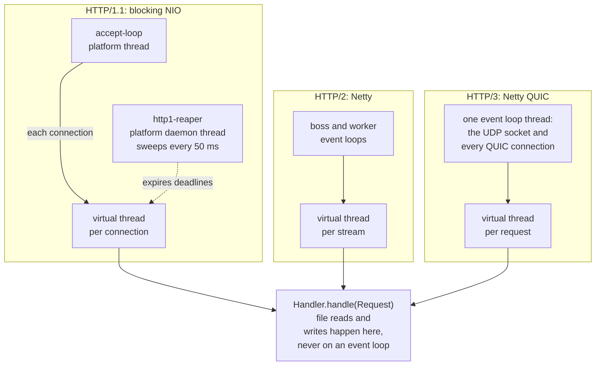

# Implementation overview and measured performance

See [docs/design/architecture.md](architecture.md) for the layers, the `core.Handler` seam and the request flow.

* **core** (`sjws_nettask.core`): protocol-neutral `Request`/`Response`/`Body` records, the
  `StaticFileHandler` (every status decision: path decoding and containment, index/listings, MIME,
  validators, conditionals, ranges), `SafeOpen` (no-follow, `openat`-based opens checked against the
  resolved file identity), the small-file `FileCache` and the per-address connection counter. Both
  transports call the same handler, so behaviour is identical by construction; a parity test compares
  every HTTP/3 response with the HTTP/1.1 bytes for the same request. Optional request filters
  (`RequestFilters`, see [docs/development/filters.md](../development/filters.md)) wrap whatever `Handler` is terminal
  (the static file handler, or a router when one is installed) on every transport. With none
  registered, and no other terminal, the static handler is called directly. `Request` carries the
  client address, whether the connection is TLS, and the raw header map.
* **HTTP/1.1** (`sjws_nettask` + `sjws_nettask.http1`): one virtual thread per connection on a blocking
  `SocketChannel`; an incremental, strict byte-level head parser (CL/TE smuggling, limits, obs-fold,
  Host, Expect); responses written whole (head and small bodies in one `write`, `Date` formatted once
  per second); files over 64 KiB that are not cached go out with `FileChannel.transferTo` (`sendfile`).
  A single timer thread enforces the idle, request-head (408) and write-progress deadlines and ends
  expired connections with `shutdown(2)` (it never blocks in `close()`).
* **HTTP/3** (`sjws_nettask.h3`, `sjws_nettask.tls`): Netty QUIC (quiche); a virtual thread per request
  stream runs the shared handler; file slots, a per-connection in-flight share, a minimum send rate
  under contention, handshake and half-open caps, GOAWAY drain.

Threads at runtime. Every request runs the shared handler on a virtual thread; platform threads exist
only for accepting, timing, event loops and background work:

Two more daemon threads exist only when their feature is on: `access-log` drains the bounded log
queue, and `acme-renew` issues and renews certificates.

**Measured** (loopback, 8 cores: server pinned to 4, `wrk -t4` to the other 4; 8 s per point, fresh JVM
with G1 and a 1 GB heap, 3 repetitions, medians; requests/s, or GB/s for 50 MB with a 30 s wrk timeout).
Each column is the server as of that step, all measured in the same session:

| File | Connections | before S3 | S3 (Date, cache, ETag) | S4 (channels, timer thread, sendfile) |
|---|---|---|---|---|
| 1 KB | 100 | 68k | 85k | 207k |
| 1 KB | 1000 | 54k | 67k | 218k |
| 100 KB | 100 | 43k | 60k | 69k |
| 100 KB | 1000 | 35k | 45k | 68k |
| 50 MB | 100 | 11.2 GB/s | 10.9 GB/s | 17.3 GB/s |
| 50 MB | 1000 | 11.3 GB/s | 11.3 GB/s | 16.6 GB/s |

Tails at 1000 connections: p99 as the median over runs (worst run in brackets), and the runs where wrk
reported socket timeouts (all were read timeouts: wrk's default 2 s; never connect errors). The last
two columns are the final code with the old and the new accept backlog, 7 runs each (50 MB: 3):

| File | before S3 | S3 | S4 | backlog 50 | backlog 1024 (default) |
|---|---|---|---|---|---|
| 1 KB p99 | 69 ms (687) | 46 ms (334) | 13 ms (612) | 14 ms (549) | 8.8 ms (25) |
| 1 KB timeouts | 1 of 3 runs (121) | 1 of 3 (3) | 1 of 3 (88) | 3 of 7 (65-127), one run at 5k req/s | 0 of 7 |
| 100 KB p99 | 55 ms (126) | 112 ms (623) | 64 ms (615) | 78 ms (1030) | 23 ms (40) |
| 100 KB timeouts | 0 of 3 | 0 of 3 | 1 of 3 (126) | 1 of 7 (39) | 0 of 7 |
| 50 MB p99 (30 s timeout) | 7.0 s | 6.8 s | 5.3 s | 5.0 s (17.5 GB/s) | 5.0 s (18.3 GB/s) |

Throughput at 1000 connections did not change with the backlog (1 KB 217k vs 219k req/s, 100 KB 68.8k vs
68.5k); the tails did. That is consistent with bursts of new connections overflowing an accept queue of 50,
whose SYN retransmits (after 1 s, then 3 s) show up as timeouts and p99 spikes. A 50 MB response at 1000 connections
takes longer than wrk's default 2 s timeout by itself (17 GB/s shared 1000 ways), so those runs use 30 s.

Memory per idle keep-alive connection: ~3.8–4.2 KB of heap after GC (measured with
`bench/footprint/run.sh` at 10k idle connections; ~6.6 KB before the idle-footprint changes, ~78 KB before S4):
a 256 B idle input buffer, the parked virtual-thread stack (~2.2 KB), no retained request head and
no output buffer. Caveats: these are
loopback numbers with the client on the same machine, small working sets that sit in the page cache
and wrk's closed-loop load (no think time); at fixed rates every variant could sustain (wrk2, 50k
req/s for 1 KB, 30k req/s for 100 KB) p50/p99 were within noise of each other (0.8-3 ms / 2-10 ms), and
the 1 KB / 100-connection p99.9 of S4 varied between 7 and 35 ms across runs (not GC; not explained
yet); two 1 KB runs with backlog 1024 were lower (137k, 185k req/s, no errors), also unexplained.
The search-only directory check on every cache hit (one `access(2)` per directory level, see the cache above)
costs, for 1 KB files at 100 connections, 224k → 200k req/s (-11%) for a file in the root and 213k
→ 157k (-26%) three directories down; with `--allow-unlistable-dirs` (no check) the difference is
within noise (-2 to -3%). System calls are slow on the measurement VM (~0.7 µs for one `access`,
~2.4 µs with 4 threads in parallel), so the share may be smaller on bare metal (not measured). Every cache hit stats the file (correctness first); skipping that stat for a 1 s window
measured +12-20% on 1 KB files and was deliberately not adopted. HTTP/3 throughput was not
benchmarked. A larger `sendfile` chunk (256 KiB, 1 MiB) was measured in S5 and moved 50 MB by
under 5%, so it stays at 64 KiB.
