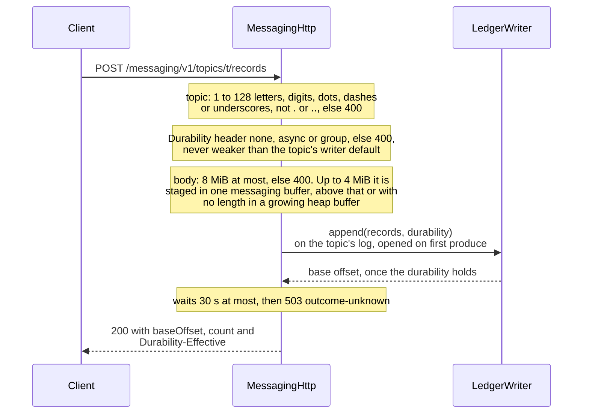
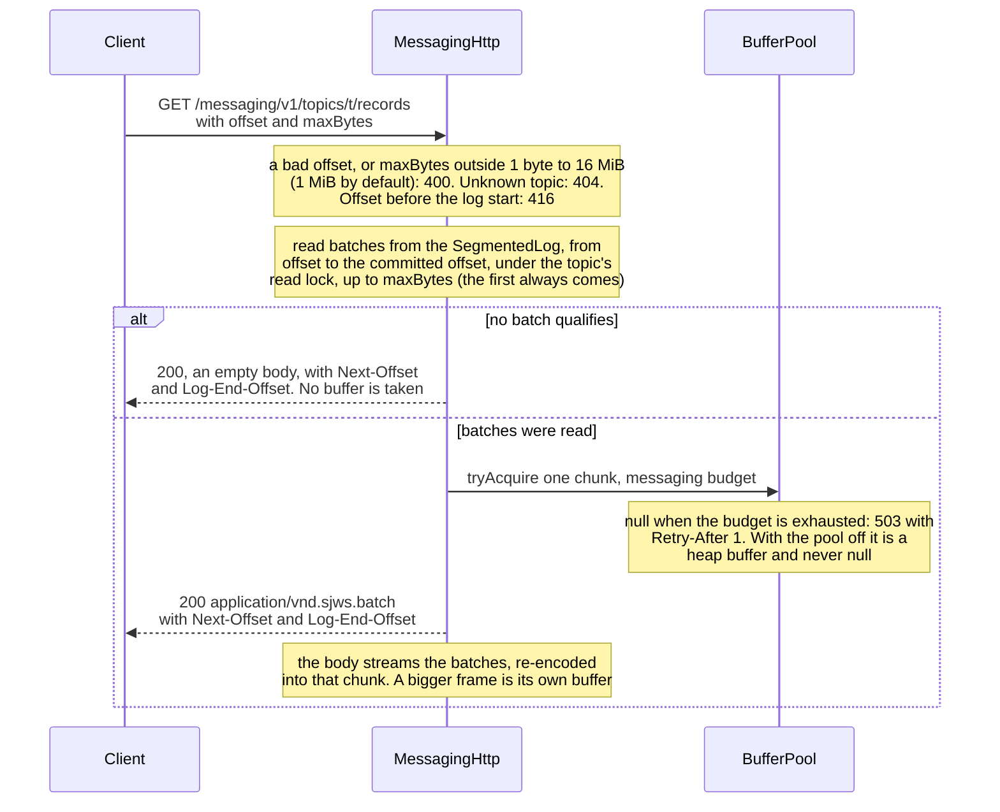
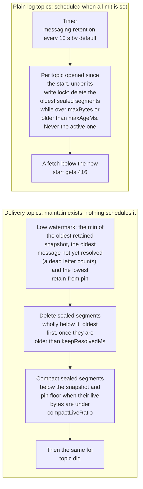

# Durable single-node partition log: gap analysis and design

Status: design note (2026-10-13); the gap PRs G1 to G4 in §3 are merged (G2 without its blocked-retention stat). Scope: one node, one partition = one log. Replication, multi-partition topics and the
cluster CP are out of scope. Most of the log already exists in `messaging/ledger` (#21: segmented CRC32C ledger, group
commit, kill -9 test; #69: snapshots and retention). This note maps each requirement to existing code or to a gap, makes
the open decisions, and lists the small PRs that close the gaps.

## 1. Requirement → code / gap

| # | Requirement | Status | Where / what is missing |
|---|---|---|---|
| R1 | Segmented append-only `PartitionLog` | **Exists** (named `SegmentedLog`) | `ledger/SegmentedLog.java` (append, read, scan, roll), `ledger/Segment.java` (`<base:020d>.log`). No rename: `PartitionLog` is this class. |
| R2 | On-disk format = wire format | **Exists** | `RecordBatch` frame `[len][crc32c][baseOffset][count][timestampMs] count×([recLen][bytes])` (`RecordBatch.java:9`). `MessagingHttp` serves it on `GET /messaging/v1/topics/{t}/records` (R9): the bytes equal the segment file, but fetch decodes each batch and re-encodes it into a pooled buffer instead of returning the frames unchanged (§2.2). |
| R3 | Sparse offset index | **Exists** | `.index`, one entry per 4 KiB (`Segment.INDEX_INTERVAL`), rebuilt by scan on open when stale or corrupt (`LedgerTest.staleOrCorruptIndexFallsBackToScan`). |
| R4 | Per-record CRC | **Per-batch exists; decision: per-batch suffices** | See §2.1. No per-record CRC is added. |
| R5 | Recovery truncates a bad tail | **Exists** | `Segment.recover` truncates at the first torn or corrupt frame; later segments after a torn sealed one are dropped (`SegmentedLog.open`). Tests: `tornTailAtEveryByte`, `randomTailCorruptionRecoversPrefix`, `gapAfterTornSealedSegmentDropsLaterSegments`, `PartitionTest.tornTailRecoversAPrefixState`. |
| R6 | Size and time retention | **Exists for plain log topics** | `LogRetention(maxBytes, maxAgeMs)` deletes the oldest sealed segments of a plain log topic (`LogTopics.enforceRetention`, run by `MessagingModule` on a timer; `sjws.messaging.retention.bytes`, `.ms` and `.check.ms`). `RetentionPolicy(keepResolvedMs, compactLiveRatio)` still deletes delivery-topic segments below the low watermark only, and `Partition.maintain` is not scheduled: there is **no size cap** and **no time limit for unconsumed delivery data** (by design the delivery layer never drops what a group still needs). G2, §2.3. |
| R7 | Single writer per partition, platform thread | **Exists** | `LedgerWriter`: `Thread.ofPlatform()` writer and syncer per log (`LedgerWriter.java:90-91`); producers hand off through a bounded queue. The shared writer/syncer pool (#86 §5.1, "PR 5") is planned; it keeps one writer *per partition at a time*. |
| R8 | Per-topic durability none / group, fsync opt-in | **Exists** | `Durability {NONE, ASYNC, GROUP, EACH}` as writer default (per partition, so per topic) plus per-append override (`Durability.java`). `ASYNC` is the default (background fsync); `GROUP` is the fsync opt-in. `sjws.messaging.durability` sets the module default and `sjws.messaging.durability.topics` (`topic:mode,...`) overrides it per topic (G3). |
| R9 | Produce / fetch through the `core.Handler` seam, off by default | **Exists** | `messaging/http/MessagingHttp.java` (produce and fetch), mounted by `MessagingModule` at `/messaging/v1` and loaded only when `sjws.messaging.enabled` is true (G1a, §2.2). `swarm/SwarmHttp` is the other `Handler` over messaging. |
| R10 | kill -9 and truncated-tail crash tests | **Exist** | `LedgerCrashTest.noAckedRecordLostAfterSigkill` (child JVM, `destroyForcibly`) plus the torn-tail tests in R5. `MessagingHttpCrashTest` does the same through produce over HTTP: `noAckedProduceLostAfterSigkill`, `truncatedTailIsCutAndProduceContinues` and `corruptTailByteIsCut` (G1b). |
| R11 | LogBench-style benches: append throughput, p99 produce/fetch | **Exists** | `bench/LogBench.java` (prototype write path) and `bench/LedgerBench.java` (append throughput by durability mode), plus `bench/MessagingLogBench.java` (in-process produce, fetch and fetch-fixed with p50/p99/p999) and `bench/messaging-http/run.sh` (wrk produce and fetch with latency) (G4). |
| R12 | Zero cost on the static path when off | **Exists** | `MessagingModule` loads by class name only when `sjws.messaging.enabled` (or `SJWS_MESSAGING_ENABLED`) is `true` (`OptionalModules`, `OptionalModulesTest`); there is no YAML key. The wrk before/after on static files is not recorded here. |
| R13 | Designed around JVM Footprint's shared buffer pool | **Exists for the HTTP handler** | `core.buf.BufferPool` ([buffer-pool.md](buffer-pool.md)); `MessagingHttp` uses its `messaging` budget. Segment reads and the writer do not use it yet. Decisions are in §2.4. |

## 2. Decisions

### 2.1 Per-batch CRC is enough
The CRC32C covers the whole batch frame after the crc field, so every record byte is covered. A record is only ever written,
acknowledged, recovered and fetched as part of its batch: there is no partial-batch ack, and recovery truncates at batch
boundaries. A per-record CRC would add 4 B per record and a second pass over the bytes on append, and it would detect
nothing the batch CRC misses. Consumers that need to verify a single record after a fetch verify the batch it arrived in
(fetch returns whole frames, R2). This is the same choice as Kafka's v2 record batch. Revisit only if a fetch API ever
returns sub-batch slices.

### 2.2 Produce / fetch HTTP surface (G1)
- `MessagingHttp implements core.Handler`, mounted at `/messaging/v1` through `HandlerContributor`. It is **off by default**; with the module off, no class loads.
- `POST /messaging/v1/topics/{t}/records`: the body is one or more records (length-prefixed). Optional headers `Producer-Id` and `Producer-Seq` (dedup, as `Partition.produce`) and `Durability: none|group`. The response is `{baseOffset}` once the requested durability holds.
- `GET /messaging/v1/topics/{t}/records?offset=&maxBytes=`: the body is raw `RecordBatch` frames (`application/vnd.sjws.batch`), starting at the batch that contains `offset` and stopping before `maxBytes`. The handler copies file bytes straight to the response (`transferTo` on plain TCP, otherwise a pooled buffer via `tryAcquire`, 503 under pressure); it never decodes.
- Errors are RFC 9457 problems, like `SwarmHttp`.
- Access goes through the existing rights or filters chain; no new auth.

As built (`MessagingHttp`, `LogTopics`), it differs from the plan above in four places. There are no `Producer-Id`
or `Producer-Seq` headers. `Durability` takes `none`, `async` or `group` and is never weaker than the topic's writer
default. Fetch decodes the batches and re-encodes them into a pooled buffer instead of using `transferTo`. The
responses carry more: produce answers `{baseOffset, count}` with a `Durability-Effective` header, and fetch adds
`Next-Offset` and `Log-End-Offset`. Produce:

Fetch:

Module settings, each a JVM property or the matching `SJWS_MESSAGING_*` variable: `sjws.messaging.enabled`, `.dir`,
`.segment.bytes`, `.retention.bytes`, `.retention.ms`, `.retention.check.ms`, `.durability` (the default for every topic)
and `.durability.topics` (`topic:mode,...`).

#### Write failures: problem types (#254, #256)

With HA replication on, a failed produce or offset commit tells the client which of three things happened. Each is an RFC 9457
`application/problem+json` body with one of these `type` URIs:

| `type` | Status | Meaning | What the client may do |
|---|---|---|---|
| `https://sjws.dev/problems/not-leader` | 307 with `Location` (leader known), else 503 + `Retry-After` | Refused: this node does not lead, so **nothing was appended**. | Resend to the leader. The 307 does this for clients that follow redirects. |
| `https://sjws.dev/problems/not-appended` | 503 + `Retry-After` (transient: backpressure, too few STRICT copies, a storage error that was rolled back or a fenced group, a closed node), or 400 (the batch itself is unacceptable) | Refused by the log: the write is **definitely not applied**. | Safe to retry the same body after `Retry-After` (503), or fix the request (400). A not-leader 307 or 503 is just as safe to resend: it is also a refusal. |
| `https://sjws.dev/problems/outcome-unknown` | 503 + `Retry-After`, **never a 307** | The log accepted the write, but this node cannot tell whether it commits: leadership was lost, the group failed closed, the node closed, or no ack came within 30 s. | Do **not** assume either result: the write may be applied or not. Read back first (from the leader in the `sjws-leader` header or the body's `leaderUrl`), or retry only with your own deduplication. |

Every 503 above carries `Retry-After`. A leader read (`GET` with `consistency=leader`) never gets `not-appended` or `outcome-unknown`, because both describe writes; when it cannot be confirmed it is a plain 503 `unavailable`. `outcome-unknown` also carries the leader hint (`sjws-term`, `sjws-leader`, and `term`,
`leader`, `leaderUrl` in the body) but no `Location`, because a redirect resends the body. The `detail` text is generic; the
server logs the cause.

### 2.3 Retention (G2)
Add `maxBytes` and `maxAgeMs` to the log-level policy for **plain log topics** (topics with no delivery groups, i.e. the
fetch API). These delete the oldest sealed segments past either limit. Topics with delivery groups keep today's rule:
nothing at or above the low watermark is deleted. A size cap may still not override it. Reporting that as `retention.blocked`
in `MessagingStats` is not built, and delivery topics have no size cap yet. This keeps work-queue semantics exact.

What exists today, for the two kinds of topic:

### 2.4 Buffers (agreed with JVM Footprint, `core.buf.BufferPool`)
- **Public API copies:** public `records()` keeps returning `byte[]` copies. An opt-in zero-copy view is used only by fetch/sendfile and by replication.
- **Writer:** it encodes into its own per-partition group buffer. Writer and syncer threads may use per-thread pool caches.
- **Recovery:** not built yet (`Segment` allocates heap scan buffers); the plan is the pool's large cache, only during recovery.
- **Fetch:** the fetch frame is byte-identical to the on-disk batch. As built it is re-encoded into a pooled buffer (§2.2); `transferTo` on plain TCP is not used yet. There is no TLS in v1. Fetch takes buffers with `tryAcquire` and answers `503` + `Retry-After` under pool pressure instead of blocking.
- **Budget:** one pool cap, with a messaging sub-budget.
- **Observability:** it will define `sjws_messaging_*` metrics with `topic`/`partition`/`group` labels. The log leaves two hook points, `MessagingHooks.produced` and `fetched` (topic, status, bytes, time; a fetch shed under pool pressure is status 503). Retention deletes or blocks have no hook yet. The exporter, not the log, defines the metric names.
- **When off:** the log allocates nothing.

## 3. Gap PRs (each one change; all merged, G2 without its blocked-retention stat)
1. **G1a**: `MessagingHttp` produce and fetch handler, off by default, with tests and a wrk static-path check (R9, R12).
2. **G1b**: kill -9 through HTTP produce, plus a truncated-tail fetch test (R10).
3. **G2**: size and age retention for group-less topics, with a blocked-retention stat (R6).
4. **G3**: per-topic durability config key (R8).
5. **G4**: fetch bench and an HTTP produce/fetch p99 bench in `LogBench` style (R11).
