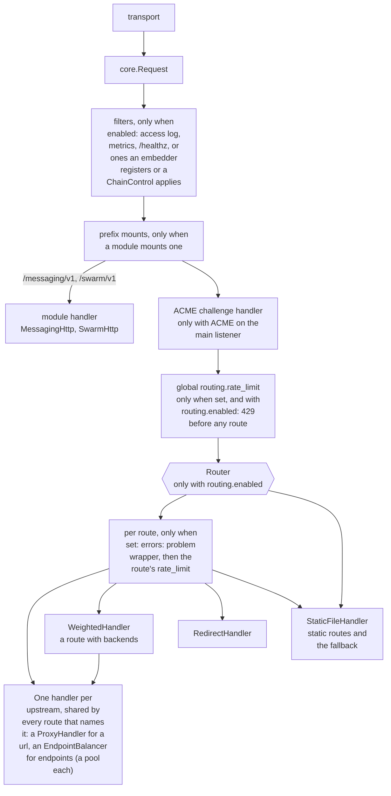
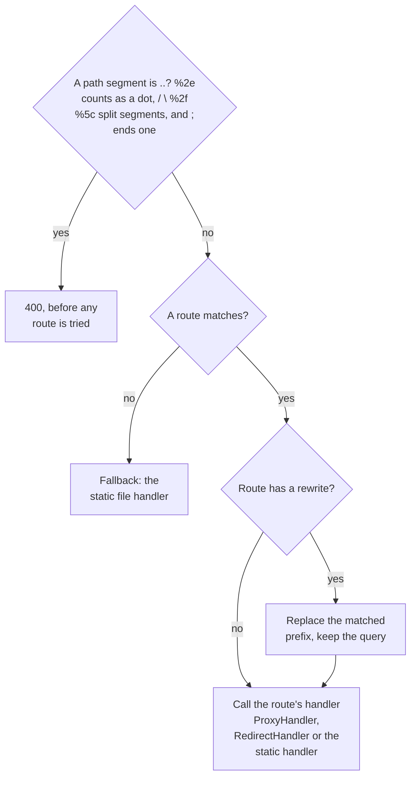
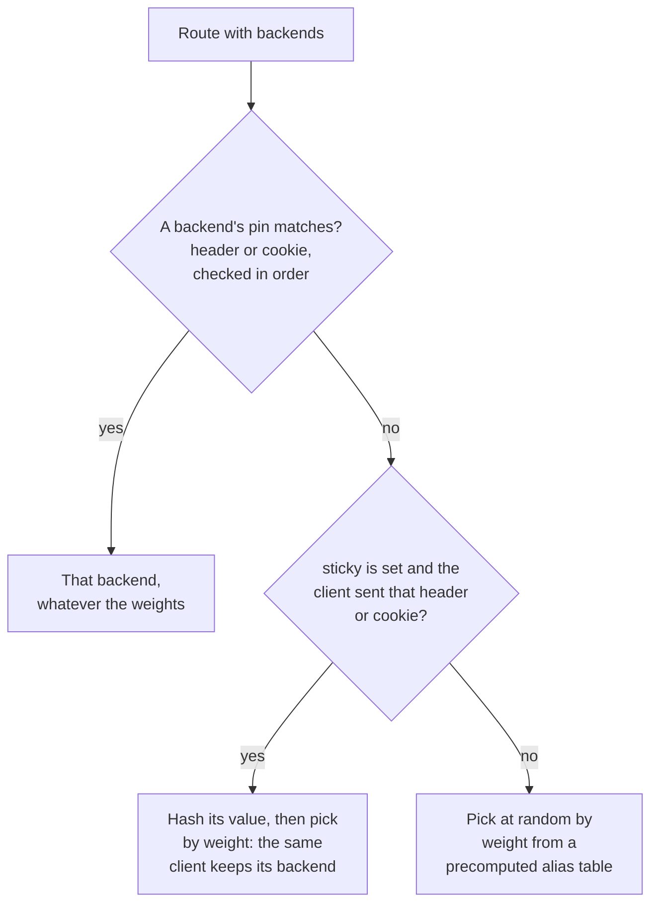
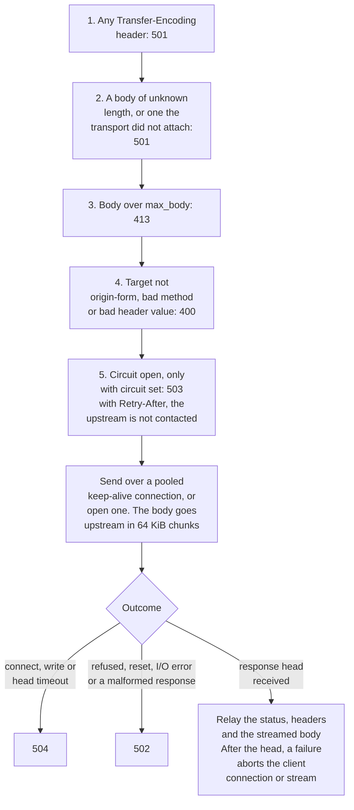
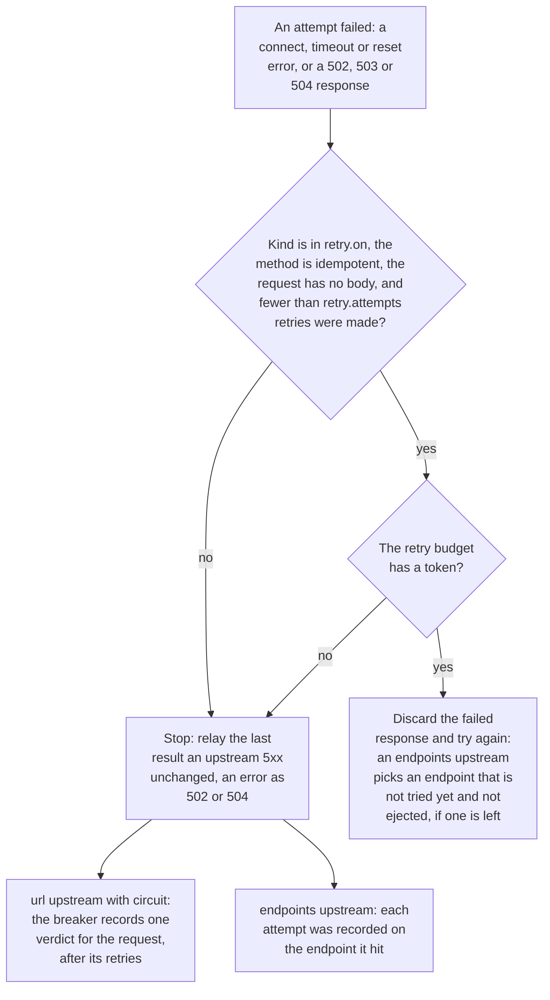
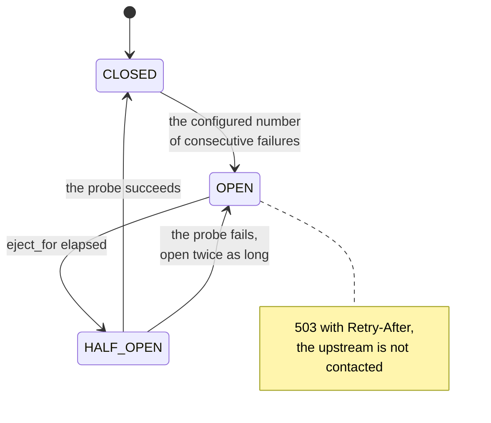

# Design: request routing and reverse proxy

Status: **proposal, for review before merge**. The code on `feat/proxy-routing`
(`sjws_nettask.routing.{Router, RedirectHandler, ProxyHandler}`) is a prototype; this plan
may revise it.

## 1. Goals and non-goals

Goals
- Virtual hosts, path-prefix routes, prefix rewrites, and redirects in front of the static file handler.
- A reverse proxy to HTTP/1.1 upstreams. It adds `X-Forwarded-*` and `Forwarded` headers, applies
  timeouts, and maps upstream failures to 502/504.
- One design that serves both transports (HTTP/1.1 and HTTP/3) through `core.Handler`.
- Zero cost when disabled. When enabled, no per-request allocation spikes and a bounded memory footprint.

Non-goals (for now)
- Load balancing across several upstreams, health checks, retries, circuit breaking.
- Regex or glob path matching, header- or method-based routing, and response rewriting.
- WebSocket / `Upgrade` tunnelling, HTTP/2 or HTTP/3 to upstreams, and caching proxy responses.
- TLS client certificates to upstreams.

## 2. Placement: `core.Handler` and the middleware chain



- `Router`, `RedirectHandler` and `ProxyHandler` are leaf `core.Handler`s. They are not filters.
  The Middleware Chain owns the filters that wrap the whole tree.
- `SjwsServer` (the composition root) builds the `Router` only when `routing.enabled`.
  Otherwise the chain ends directly at `StaticFileHandler`, exactly as today.
- Per-route filters, such as auth on `/admin`, are expressed by wrapping that route's target handler.
  This needs no Router feature. Open question: should the chain API offer `wrap(route)`, or is plain composition enough?
- The router moves no code into transports, and the `core` package does not depend on `routing`.

## 3. Route matching

A route is `{host?, prefix, rewrite?, action}`, where the action is exactly one of `proxy`, `redirect` or `static`.

A route matches when its prefix matches on a segment boundary and its host matches; the first match in
config order wins. A target with a `..` segment is refused in any spelling: either dot may be `%2e`,
segments are also split at `\`, `%2f` and `%5c`, and a segment ends at `;`. A route that sets
`errors: problem` has its handler wrapped in `ProblemErrorHandler`, which renders the error pages this
server generates for the route as RFC 9457 `application/problem+json`; an upstream's own error
responses are relayed unchanged:



- **Host.** The value is an exact name (`example.com`), a wildcard suffix (`*.example.com`, which
  matches sub-domains only), or absent (any host). Matching ignores case and strips the port
  (bracketed IPv6 is handled). The host comes from `RequestHeaders.host` (HTTP/1 `Host` or HTTP/3 `:authority`).
  Host names are lower-cased once, at config load.
- **Prefix.** The prefix must start with `/` and matches on a segment boundary: `/api` matches `/api`, `/api/…` and `/api?…`,
  but not `/apix`. Matching runs on the raw (still percent-encoded) target, so `/%61pi` does **not**
  match `/api`. That is deliberate and documented. The decoded-path resolver remains the static
  handler's job. A dot-segment target (`/api/../secret`) is rejected with 400 before routing.
  The prototype does not do this yet; it is a phase-1 fix.
- **Rewrite.** This replaces the matched prefix. `prefix=/api, rewrite=/` sends `/api/x?q` to `/x?q`. The query is kept.
- **Ordering.** Routes are tried in config order and the first match wins. With no match, the request goes to the static
  handler, or gets 404 when `static` is disabled. At load, config validation warns about routes that an earlier route
  fully shadows.
- **Scale.** Matching is a linear scan, which suits the expected tens of routes. If there are more, phase 3 groups routes
  in a host→routes map, then sorts each group by prefix length (longest first). Order stays the user-visible contract.

A route with `backends` instead of `proxy` goes through `WeightedHandler`, which picks the upstream
before the proxy runs:



## 4. Redirect

`{status: 301|302|303|307|308, location, keep_path}`. With `keep_path`, the rewritten target is
appended to `location`, and the slash is de-duplicated. The location is validated at load (no CR, LF or NUL). The response
has a small text body and honours HEAD.

## 5. Reverse proxy

**Client choice.** Phase 1 used `java.net.http.HttpClient`. Phase 1's benchmarks (§9) put the proxy at
6–7× below direct, so phase 2 replaces it with a Netty HTTP/1.1 client (`routing.UpstreamPool`, see §12).
Netty is already a dependency (h2, h3); it stays inside `routing`, and `core` and `http1` still do not import it
(`SourceGuardTest`).

**Connection pooling.** There is one `UpstreamPool` per upstream, holding idle keep-alive channels in a LIFO deque capped at
256 per upstream. All pools share one daemon event-loop group (`upstream-io-*`, max(2, cores/2) threads), which is
reference-counted: it is created with the first pool and shut down when the last pool closes. With routing off,
nothing is created.

**Timeouts.** There are three:
- `connect_timeout`, default 5 s;
- `response_timeout`, which runs until the response head arrives, default 30 s;
- `idle_read_timeout`, the gap between body chunks while streaming, default 30 s.

The client's own deadlines also stay in force, such as the write timeout via `ConnectionReaper`.

**Request headers sent upstream.**
- *End-to-end request headers, as received:* `Host` handling is configurable. The default is the upstream's host, with the original
  in `X-Forwarded-Host`; `preserve_host: true` forwards the original instead.
- *Hop-by-hop headers removed:* `Connection` (and the fields it names), `Keep-Alive`, `TE`, `Trailer`, `Upgrade`,
  `Proxy-*` and `Transfer-Encoding`.
- *Added:*
  - `X-Forwarded-For`, which appends the client IP to any incoming value only if the peer is in `trusted_proxies`; otherwise it replaces it;
  - `X-Forwarded-Proto` and `X-Forwarded-Host`;
  - RFC 7239 `Forwarded: for=…;proto=…;host="…"`, with values quoted and escaped.
- *Optional:* `Via: 1.1 sjws`.

**Response headers relayed.** All headers are relayed except hop-by-hop ones and the fields the writer owns (`Content-Length`, `Date`,
`Server`, `Alt-Svc`, `Transfer-Encoding`). A header value that cannot be represented drops that one field, not the response.

**Error mapping.**

| Condition | Status |
|---|---|
| connect refused / reset / DNS failure / malformed upstream response | 502 |
| connect or response-head timeout | 504 |
| failure after the head was sent (mid-body) | abort the connection/stream (never a short 200) |
| upstream body exceeds `max_body` (buffered mode only) | 502 |
| target not origin-form, invalid method | 400 (normally caught earlier by the parser) |

Errors are logged once per upstream per interval, rate-limited so log volume stays flat when an upstream is down.

The order in which `ProxyHandler` decides. Each of the first five steps answers with the status shown
when its condition holds, and otherwise passes the request on. Step 5 exists only when `circuit` is set
on the upstream. An upstream with `endpoints` goes through an `EndpointBalancer` first, which picks an
endpoint and then runs steps 1 to 4 on that endpoint's pool, with no step 5 (it skips ejected endpoints
instead, see [endpoint discovery](../ha/discovery.md)):



A pooled connection that fails before the response head is tried once more on a fresh connection when
the request has no body. With `retry` or `circuit` configured, which is per upstream and optional, a
failed attempt goes through this decision:



The circuit breaker of an upstream with a `url` is a small state machine per upstream. An upstream with
`endpoints` keeps the health of each endpoint instead, with an error-rate trip and a panic mode
([endpoint discovery](../ha/discovery.md)):



## 6. Config schema (sent to Config & ACME)

```yaml
routing:
  enabled: false                 # default; false = no Router built, zero cost
  forwarded_proto: auto          # http | https | auto (from the listener)
  trusted_proxies: []            # CIDRs whose X-Forwarded-For we extend
  upstreams:
    api:
      url: "http://127.0.0.1:9000"   # http/https, optional base path
      connect_timeout: 5s
      response_timeout: 30s
      idle_read_timeout: 30s
      max_body: 16m              # buffered-mode cap (phase 1); ignored once streaming lands
      preserve_host: false
  routes:                        # ordered, first match wins
    - host: "example.com"        # optional: exact or "*.suffix"
      prefix: "/api"             # required
      rewrite: "/"               # optional
      proxy: api                 # exactly one of proxy | redirect | static
    - prefix: "/old"
      redirect: { status: 301, location: "https://example.com/new/", keep_path: true }
    - prefix: "/"
      static: true
```

Validation at load:
- unknown upstream names, more than one action on a route, a bad prefix or rewrite, a non-redirect status, or CR/LF in a location are all errors;
- shadowed routes produce a warning.

The command line and environment get **no new flags** (config file only). This keeps `DocsConsistencyTest`'s flag table
unchanged.

## 7. Efficiency

- **Disabled:** no object is built and the chain is identical to today's. There is no branch on the hot path.
- **Router hot path:**
  - Matching scans the target once (`indexOf('?')`), then does `startsWith` and a char check per route, which allocates nothing.
  - A new `Request` is allocated only when a rewrite applies.
  - Host comparison uses `regionMatches(ignoreCase)` on the raw header, with no substring or lower-casing.
    The prototype still allocates via `stripPort` + `toLowerCase`; that is a phase-1 fix.
- **Proxy:**
  - Pooled connections avoid handshakes.
  - Phase 1 buffers up to `max_body`, which is bounded but costs a copy.
  - Phase 2 streams: the upstream body is a `Body.Stream` pulled by the writer. The event loop reads ahead at most
    256 KiB per exchange, then stops reading until the writer has drained half of it, so a request never holds more than
    that window. HTTP/1.1 writes each Netty buffer to the client socket without copying it; h2 and h3 copy each chunk
    into a frame. There is no full-body copy.
- **No per-request client, executor, or header-name normalisation tables.** Static sets are used for the hop-by-hop headers.

## 8. Core contract gaps and proposed changes

Today `Request(method, target, RequestHeaders)` carries only the static handler's six headers, and
`Body` is sealed (`Empty | Bytes | FileBody`). The proxy needs four things:

| Gap | Proposed change (owned with Middleware Chain / core reviewers) |
|---|---|
| Request body | `Request.body(): RequestBody` with `RequestBody.EMPTY` default. It is a pull-style `InputStream`-like source with known/unknown length, produced by the HTTP/1 chunked/length decoder and the h3 stream. The static handler ignores it, but the transport must drain or close it if the handler does not consume it. |
| Client address | `Request.peer(): InetSocketAddress` (nullable in tests), plus `secure(): boolean` for proto. |
| Arbitrary headers | `RequestHeaders.all(): List<Map.Entry<String,String>>`, a lower-cased, ordered view filled by both transports. The existing typed fields stay as they are. |
| Streaming response body | A new `Body.Stream(long lengthOrMinus1, Source)` variant. Writers use chunked encoding (HTTP/1.1, or close-delimited for 1.0) or DATA frames (HTTP/3) when the length is unknown. An abort on source error is never a short response. |

All four are additive, with existing constructors kept, so the static path and existing tests are unchanged. They are
proposed as a separate core PR that lands before proxy phase 2.

## 9. Benchmark plan (wrk + wrk2)

The setup: the box, JDK 25, and the server jar against a local upstream (a second sjws instance, or a minimal
Netty echo server), pinned with `taskset` where possible. Every run gets a 5 s warm-up, then 3 runs of 30 s; we report the median.

1. **Baseline vs disabled:** master and the branch with `routing.enabled=false` on `/index.html`, wrk `-t4 -c64`.
   Accept if the difference is within noise (±3% req/s, p99 within ±5%).
2. **Router overhead:** 1, 10 and 50 routes, with the match on the last route, falling through to static. Target: under 2% req/s loss at 10 routes.
3. **Proxy throughput and latency:** compare a direct hit on the upstream with sjws→upstream, for 1 KB, 64 KB and 4 MB bodies.
   - wrk measures maximum req/s.
   - wrk2 (`-R` at 50% and 80% of the measured max) gives the latency percentiles (p50/p99/p99.9) without coordinated omission.
4. **Pooling check:** compare the upstream's accepted-connection count to the request count. The expected ratio is far below 1.
5. **Failure modes:** with the upstream down and with a slow upstream, measure 502/504 latency and confirm that throughput on the static route is
   unaffected (it is isolated).
6. **Memory:** heap and allocation rate (`-Xlog:gc`, JFR allocation profile) during run 3. Streaming mode must stay flat
   with 4 MB bodies.

Results go into the PR description of each phase, with the commands, so others can reproduce them.

### Phase 1 results (2026-10-12, shared 8 vCPU box, server on CPUs 0-3, wrk on 4-7)

Harness: `bench/proxy-routing/` (`run.sh`, real jar with `--config`). wrk `-t4 -c64`, 3 × 10 s after a 3 s warm-up, median req/s (p99 of that run).
The box is shared, so differences under about 15 % are noise.

| Scenario | req/s (median) | p99 |
|---|---|---|
| master dc5346c, `/index.html` | 225,718 | 2.15 ms |
| branch, routing disabled | 258,865 | 2.01 ms |
| branch, 1 route (match) | 280,318 | 3.57 ms |
| branch, 10 routes (match on last) | 284,710 | 4.04 ms |
| branch, 50 routes (match on last) | 257,274 | 1.96 ms |
| direct upstream, 1 KiB | 257,411 | 1.99 ms |
| proxied, 1 KiB | 37,892 | 4.39 ms |
| direct upstream, 64 KiB | 93,776 | 1.98 ms |
| proxied, 64 KiB | 15,957 | 9.56 ms |

wrk2 at 10k req/s, 1 KiB: direct p50 0.72 ms / p99 1.86 ms / p99.9 2.13 ms; proxied p50 1.11 ms / p99 5.38 ms / p99.9 9.14 ms.
Pooling: 68 upstream connections in total for every proxied request (64 client connections).

Re-run after merging master 0050f4a (routing read from `--config`, `MODE=quick`, two rounds, median of 3 × 10 s):
master 306,588 / 301,406 req/s (p99 1.63 / 1.41 ms); branch with `routing.enabled: false` 304,997 / 308,985 req/s
(p99 1.18 / 1.70 ms). That is within noise.

Reading: with routing disabled, and with the router in front of static files, throughput is within
noise of master. The proxy costs about 6.8× throughput at 1 KiB and 5.9× at 64 KiB compared with
hitting the upstream directly. That points at `HttpClient` (its own selector thread plus buffered
copies), not at routing. This is the trigger in §5/§11 Q6 to evaluate a Netty or blocking-socket
upstream client in phase 2.

## 10. Phased rollout

0. **This document.** It is reviewed and agreed with Middleware Chain and Config & ACME.
1. **Routing + buffered proxy, opt-in.** Revise the prototype (allocation-free host match, dot-segment
   rejection, config wiring in `SjwsServer`), with bodyless requests only. Proxy routes reject methods that carry a body with 501
   until phase 2. Run benchmarks 1–3.
2. **Core contract additions** (§8) as a separate PR, then request-body forwarding, `X-Forwarded-For`/`Forwarded for=`
   with `trusted_proxies`, and streaming responses. Run benchmarks 3–6.
3. **Optional:** host-indexed route table, multiple upstreams per name (round-robin), and passive health checks.

## 11. Open questions

1. Middleware Chain: are filters applied around the Router only, or should routes declare per-route filter lists?
2. Core owners: do they agree with the four additive changes in §8, and with `Body.Stream` living in `core` (writer support in both transports)?
3. Config & ACME: should the format be YAML (as above) or the existing config file format? Durations as `5s`, sizes as `16m`? Should ACME
   HTTP-01 challenges (`/.well-known/acme-challenge/`) bypass routing? The proposal is that they are matched before the Router, always.
4. Should Host default to the upstream host or be preserved? The proposal is upstream host plus `X-Forwarded-Host`, with `preserve_host` to opt in.
5. HTTP/3 clients being proxied to HTTP/1.1 upstreams: should `Alt-Svc` from upstreams always be stripped? The proposal is yes.
6. Should we keep HttpClient or move to the Netty client? **Decided: Netty** (§12). It is 1.5–5× faster than phase 1 depending on size.

## 12. Phase 2: Netty upstream client and streaming (implemented)

**Core additions.** These are additive, and every existing constructor is kept.
- `Body.Stream(long length /* -1 unknown */, Source)` is a pull source. `next()` returns a buffer that stays valid until the next call, or null at the end. The writer closes it exactly once. A known length is honoured exactly; on a mismatch the writer aborts rather than send a short response.
- `RequestBody` (`length()`, `read(byte[],int,int)`, `EMPTY`) is carried by `Request.body()`; `Request.withBody` was added.
- Writers:
  - HTTP/1.1 uses Content-Length when the length is known. When it is unknown it uses chunked on keep-alive, otherwise close-delimited (always close-delimited for an HTTP/1.0 client). `ChannelOutput` takes the `ByteBuffer` directly through `Http1Writer.BufferSink`.
  - h2 waits for writability before each chunk, and ends with an empty DATA frame carrying END_STREAM.
  - h3 shuts down the stream output at the end.
  - The h2 → HTTP/1.1 fallback sets chunked for an unknown length.
- Request bodies: HTTP/1.1 requests with Content-Length are streamed through `Http1Connection.BodyReader`. The reader sends `100 Continue` on its first read, and each read is bounded by the write deadline. A body the handler does not read in full closes the connection. A chunked request body, or any body on h2/h3, is not attached yet; the proxy answers it with 501, as it did in phase 1.

**Client (`routing.UpstreamPool` + `ProxyHandler`).**
- The pipeline is `HttpClientCodec` + `Relay`, with autoRead off.
- A bodyless request costs a single event-loop task: bind the exchange, write, `read()`, and arm the head timer. The request thread then parks on the head future.
- Body chunks go into a per-exchange queue. The event loop keeps reading while fewer than 256 KiB are queued. After that it pauses, and the consumer resumes it once it has drained half. Interim 1xx responses are skipped.
- Timeouts: `connect_timeout` is a Netty connect timeout (504). `response_timeout` is a timer on the event loop for the head (504), and also bounds each write of the request body. `idle_read_timeout` is a timer between body bytes that does not run while the window is paused (the client is the slow side). Mid-body it aborts the client response. Other errors give 502, as before.
- **Memory bound (security finding F5).** In phase 1, responses up to `max_body` (16 MiB) were buffered per request. Now each exchange holds at most its 256 KiB read-ahead window. A slow client stops the writer, the writer stops taking chunks, and the upstream event loop stops reading, since autoRead is off and nothing calls `read()`. TCP then pushes back on the upstream. h2 also waits for stream writability before each chunk. As a global backstop, `routing.ByteBudget` counts the body bytes held by all exchanges. Its default is 64 MiB, set with `-Dsjws.proxy.maxInflightBytes`. While it is exhausted, no exchange reads ahead; an exchange reads again only when its own queue is empty. The overshoot is therefore at most one socket read per active exchange, and requests wait rather than get a 503. `ProxyHandler(Settings, ByteBudget)` and `budget().inFlight()` are the hooks for the Security workstream's slow-client heap-bound regression test.
- A failed **reused** connection is retried once for a bodyless request (stale keep-alive). A request with a body is never retried.
- `preserve_host` forwards the client's Host. Otherwise Host is the upstream authority, with the original in `X-Forwarded-Host`.
- Lifecycle: `Router` and `ConfigSnapshot` are `AutoCloseable`.
  - A reload closes the replaced snapshot after the swap. Idle connections close at once; leased ones close when their exchange ends.
  - A rejected candidate is closed.
  - `SjwsServer.close()` closes the live snapshot after the drain.
  - The shared event-loop group stops when the last pool closes.

**Results** (this box, a shared 8-vCPU VM with load from other agents, so numbers are noisy). The upstream is master's static server; the proxy and the upstream share CPUs 0-3, and wrk runs on 4-7. Interleaved A/B (`bench/proxy-routing/ab.sh`, 2 × 5 s each) against master `d592aaf` (phase 1, HttpClient):

| wrk -t4 -c64, req/s | direct | phase 1 proxied | phase 2 proxied | phase 2 vs phase 1 |
|---|---|---|---|---|
| 1 KiB | 82,741 / 128,220 | 11,239 / 17,265 | 36,543 / 27,177 | 1.6–3.3× |
| 64 KiB | 36,089 / 26,223 | 7,851 / 6,372 | 11,853 / 11,886 | 1.5–1.9× |
| 4 MiB | 1,754 / 1,956 | 140 / 138 | 715 / 656 | ~5× |

The full `run.sh` output (wrk and wrk2, routing disabled vs master) is in the PR description.

## 13. Gateway features

These build on the control-plane review on PR #38 (`UpstreamSet` snapshots swapped by reference). Each one is zero cost when it is not configured: `RoutingCompiler` simply does not wrap the handler.

| Feature | Data-plane design | Needs from the control plane | Needs from Middleware Chain |
|---|---|---|---|
| **Discovery** (implemented in B.4: `routing.discovery` types, `routing.EndpointBalancer`, static `endpoints` lists; the CP watch client feeds `UpstreamRegistry.lookup(service).update(set)`, see `docs/ha/discovery.md`. Differences: an empty update keeps the last non-empty set, a never-populated source gives 503; upstreams are named, not `{service, selector}`) | Routes target `upstream: {service, selector}`. An `UpstreamSource.current()` volatile read gives an immutable `UpstreamSet{endpointsVersion, Endpoint[]}`. There is one `UpstreamPool` per endpoint, reference-counted across sets, so a membership change does not drop warm connections. An empty set gives 503. | An `Endpoints` watch frame per service (signed, its own monotonic `endpointsVersion`, debounced), and `Register` carrying the services. Persisted beside last-good. | Nothing. This lives below the filter chain, in `ProxyHandler`. |
| **Weighted / canary routes** (implemented in B.2: `backends` with `pin` for the match and route-level `sticky`; retry/circuit stay per upstream) | `route.backends: [{upstream, weight}]`, plus optional `match: {header, cookie}` to pin canaries. Selection uses a precomputed alias table (O(1), no allocation); the sticky choice uses a hash of a header or cookie. Weights are part of the compiled snapshot, so a change is a config version. | Shipping the weights as config. A staged rollout (§9 of #38) can push weight steps as versions. | A per-route filter list (open question 1) to run the canary-only filters. |
| **Retries** (implemented in B.1, per upstream: see `docs/user/config-file.md`; per-endpoint selection waits for discovery) | Per-route `retry: {attempts, on: [connect, 502, 503, reset], budget: 10%}`. Only idempotent methods, or bodyless requests, are retried, and only before any response byte has been relayed. The next attempt picks a different endpoint. A token-bucket retry budget per upstream prevents storms. Phase 2 already retries stale keep-alive connections. | Nothing beyond the endpoint sets. | A way for filters to see the attempt count (a request attribute), so that logging and metrics are per try. |
| **Circuit breaking** (B.1: consecutive failures per upstream; B.4: per endpoint with error-rate window and panic mode on multi-endpoint upstreams; `max_pending` is not done) | Per endpoint, a lock-free consecutive-failure / error-rate window (an `AtomicLong` packed state). States are closed, open (eject for `eject_for` with exponential backoff), and half-open (one probe). Ejected endpoints are skipped by load balancing. If more than `max_ejection` would be ejected, fall back to "panic" (use all). A per-upstream `max_pending` / `max_connections` limit gives 503 quickly. | Coarse health only (SUSPECT/DEAD). Local outlier state stays local and is never pushed back. | Nothing. Optionally an observer hook for state changes. |
| **Rate limits** (implemented in B.3: `routing.RateLimitFilter`, GCRA in a fixed `AtomicLongArray`, per route through `RequestFilters.wrapping` plus `routing.rate_limit`; local only) | A filter, not a router feature: `RateLimitFilter{key: peer|header|route, rate, burst}`. It uses a sharded token bucket (striped `AtomicLong`s keyed by a hash, with a fixed table size, so there is no `computeIfAbsent` growth) and answers 429 with `Retry-After`. Local limits only in v1. A global limit would split the quota per node, with the share received from the CP (rate / ready gateway count). | v2 only: the per-node quota share, recomputed when gateway membership changes. | The chain's ordering (run before auth/proxy), per-route attachment, and a short-circuit response API, which `RequestFilters` already has. |
