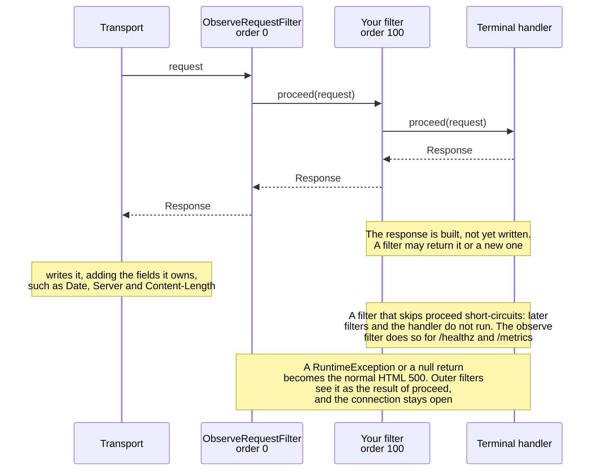
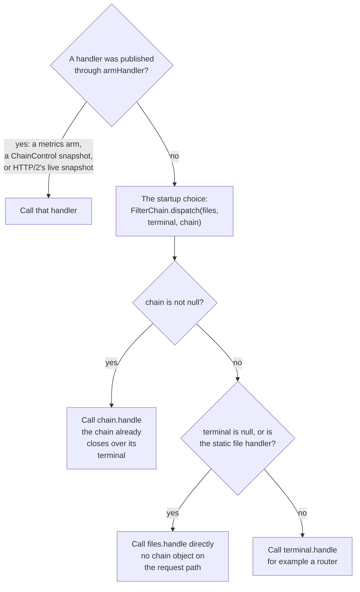
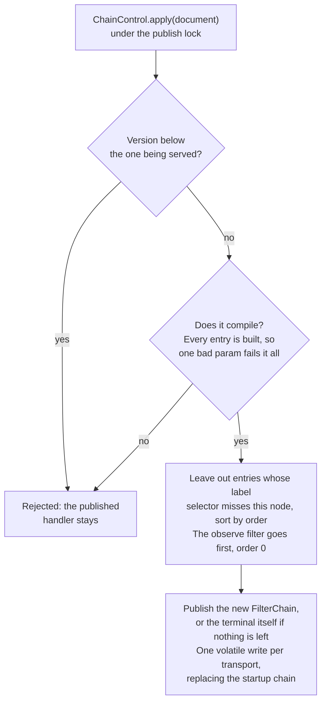

# Request filters

Filters sit between protocol decoding and the terminal `Handler`. That terminal is
`StaticFileHandler` unless a caller installs another one (a router). HTTP/1.1, HTTP/2 and HTTP/3 use
one chain. With nothing registered, and the terminal still the
static file handler, that chain is not built and not called: HTTP/1.1 calls
`StaticFileHandler.handle` directly, and HTTP/2 and HTTP/3 call the live config snapshot's
handler.

Register before start. `SjwsServer.start(config, filters)` compiles the registry once and shares
it. `filterChain()` is null when the registry was null or empty. `handler()` stays the
`StaticFileHandler` either way (the file cache lives there).

One request through a chain with two filters:



## Write a filter

```java
public final class AccessLog implements RequestFilter {
    public static RequestFilter create(MiddlewareSpec spec) {
        return new AccessLog();
    }

    @Override
    public Response filter(Request request, Chain next) {
        long start = System.nanoTime();
        Response response = next.proceed(request); // at most once, same thread
        long nanos = System.nanoTime() - start;
        // status, headers and nanos are the handler's result, before the socket write
        return response;
    }
}
```

`Request` is an immutable record. `Response` is a record too; its `headers()` are a mutable
map, and the chain does not copy them. Pass `request.withMethod`, `request.withTarget` or `request.withHeaders` into
`proceed` to change what the rest of the chain sees. `withMethod` and `withTarget` keep the
peer address, `secure`, headers and body. `withHeaders` keeps the method, target, peer,
`secure`, protocol and body. Return a new `Response` to change the status or body, or mutate
`response.headers()` in place. Skip `proceed` to short-circuit; later filters and the terminal
handler do not run.

`request.peer()` is the client `InetSocketAddress` (one per HTTP/1 connection, one per HTTP/3
stream), or null if the transport could not read it. `request.secure()` is false on plain HTTP/1
and true on HTTP/3. `request.protocol()` is the version token. HTTP/1 copies the parsed version;
a request built without one is `HTTP/1.1`, or `HTTP/3` when `secure` is true. `request.headers().fields()` is the raw field map (lower-case name to values,
first-seen order, pseudo-headers excluded). HTTP/1 stores the parser's map by reference: that map
is built while parsing either way, and `RequestHeaders.of` does not copy it. `reset()` drops the
parser's reference and does not clear the map, so a filter may retain the request. HTTP/3 copies
every regular header only when a filter chain or a non-static terminal is installed (decided once
at startup). With neither, it reads the six typed fields and leaves `fields()` empty, so a static
request allocates no header map. When it does copy, that happens before the HEADERS frame is
released, because the handler runs later on another thread; the copy does not follow later changes
to the frame. `values(name)` does not allocate when the name is absent. `all()` flattens and
allocates; the static file handler does not call it. `:authority` wins over `host` for
`headers().host()`, and a copied `host` field stays in the map.

A filter must be safe for concurrent requests. Call `proceed` synchronously, on the request
thread. The chain rejects a second call on that thread (`IllegalStateException`, and the rest of
the chain does not run again). That failure becomes the normal HTML 500 unless the filter catches
it. The check is thread-local, so it does not treat another request's `proceed` as a duplicate,
and it is not created when no filters are registered. The time around `proceed` stops when the
downstream handler has *built* the response. The transport writes the body after the chain
returns, so this is not time-to-last-byte. `Date`, `Server`, `Connection`, `Content-Length` and
`Alt-Svc` are added by the writers after the chain. `X-Content-Type-Options` and
`Content-Security-Policy` are put on the handler's response, so a filter sees them and can change
them. Protocol failures that never reach the file handler (HTTP/1 parse errors and 408, HTTP/2
refusals, HTTP/3 431 / bad target / unknown method) do not enter the chain either. A runtime exception or a null
return, from a filter or from the terminal handler, becomes the normal HTML 500
(`StaticFileHandler.error`); outer filters see that 500 as the return value of `proceed`, and the
connection stays open. `Error` (including `AssertionError`) is not caught.

## Register

Programmatic, outermost first when the order is equal (lower order runs first on the way in):

```java
var filters = RequestFilters.create()
    .add((request, next) -> next.proceed(request))
    .add(100, "/api/*", (request, next) -> proxy(request));
SjwsServer.start(config, filters);
```

When `--access-log`, `--metrics` (other than `off`) or `--healthz` is set, the server registers
`ObserveRequestFilter` first, at order 0, via `RequestFilters.create().add(0, filter)`, then copies
the caller's filters in. Among order 0 it is the outermost stage. A filter with a negative order
still runs further out. The filter is not installed when observability is off, and the transports
do not call it. `metricsSnapshot()` publishes that same order-0 filter later if startup left it
out, so the next request on an already-accepted connection is counted. The filter's clock stops
when `proceed` returns, before the socket write. Parse errors, 408, HTTP/2 refusals and HTTP/3
refusals do not enter the chain, so they are not logged or counted.

`RoutePattern` is `*` (or omitted) for every request, `/exact`, or `/prefix/*` (the path equals
`/prefix` or starts with `/prefix/`). The query and fragment are ignored. The path is matched
after percent-decoding and dot-segment normalisation, so `/%61dmin`, `//admin` and `/x/../admin`
all match `/admin/*`. Spellings that different readers resolve differently (`%2f`, `%5c`, `\`,
`;` path parameters, a `%` left after decoding, malformed escapes, `..` above the root) match
every route, so a scoped filter fails closed instead of being skipped. Plain paths are matched in
place without allocating.

## Configuration hook

The config file parses a `middleware` list into `MiddlewareSpec` and stores it on the
snapshot. It does not call `addAll` (no factories are bound at startup, so an unknown name
would fail the build). A caller that has bound factories passes the list itself:

```java
var filters = RequestFilters.create()
    .factory("access-log", AccessLog::create)
    .factory("reverse-proxy", ReverseProxy::create)
    .addAll(specs); // List<MiddlewareSpec>, order field re-sorts, list order breaks ties
SjwsServer.start(config, filters);
```

Expected section (global entries and per-route entries in one list; the same name may repeat):

```yaml
middleware:
  - name: access-log          # required, matches factory(name)
    order: 0                  # optional, default 0; lower is further out
    options:                  # optional map of strings, interpreted by that filter
      format: combined
  - name: reverse-proxy
    order: 100
    route: /api/*             # optional; omitted, blank or "*" = every request
    options:
      upstream: http://127.0.0.1:9000
      preserve-host: "true"
```

| Field | Type | Required | Meaning |
|---|---|---|---|
| `name` | string | yes | factory id (`RequestFilters.factory`) |
| `order` | int | no (0) | lower runs first on the way in, last on the way out |
| `route` | string | no (all) | `*`, `/exact`, `/prefix/*` |
| `options` | map of strings | no | filter-defined; numbers and booleans are strings (`"5"`, `"true"`) |

`MiddlewareSpec.of(name, order, route, options)` is that entry. Factories are resolved when the
chain is built, so they can be bound before or after `addAll`. An unknown name, or a factory that
returns null, fails the build. Building snapshots the list: later `add` calls do not change a
chain already started.

## Terminal handler

Filters wrap whatever `Handler` is terminal. The routing workstream installs a router only when
routing is enabled, and leaves the static handler in place otherwise:

```java
SjwsServer.start(config, h3Factory, globalFilters, files -> new Router(routes, files));
```

A null selector, a null return, or returning `files` itself keeps the direct
`StaticFileHandler.handle` call when `globalFilters` is also null or empty. When filters are
registered they wrap the router (or the static handler). `filterChain()` is still null when no
filters were registered, even if a router is installed: HTTP/1.1 then calls the router through
`Handler.handle`, and HTTP/3 uses `FilterChain.dispatch(files, router, null)`, which is
`router::handle`.

## Prefix mounts

An optional module can own a path prefix without a routing entry and without a swarm (or any
other module) type in `core`. It implements `HandlerContributor` and, only at startup, calls
`HandlerMounts.mount`:

```java
public final class SwarmModule implements OptionalModule, HandlerContributor {
    public void contribute(HandlerMounts mounts) {
        Handler api = RequestFilters.create()
                .add(0, (request, next) -> next.proceed(request))
                .wrapping(this::handle);
        mounts.mount("/swarm/v1", api); // also accepts "/swarm/v1/" and "/swarm/v1/*"
    }
}
```

`mount(String, Handler)` is a prefix: the path equals it or sits under it. `mount(RoutePattern, Handler)`
is the exact form (`/only`) or any other accepted pattern. Two mounts that can match the same
well-formed path, including a duplicate, fail startup before the port is bound. `*` overlaps
everything.

The server discovers contributors once, before it accepts: `ServiceLoader` on
`HandlerContributor`, plus an explicit list. `OptionalModules` adds the enabled module when that
module implements `HandlerContributor`. The swarm module is not a service provider, so it stays
unloaded while the swarm is off. `SjwsServer.start(config, filters, terminal, contributors)` is
the same hook for an embedder.

With no contributors, or when every contributor mounts nothing, the terminal is the one startup
already chose: a direct `StaticFileHandler.handle` when that is the leaf and no filters are
registered, or the router when routing is enabled. No mount table is built, and the request path
does not branch on "are there mounts". When at least one prefix is mounted, one dispatcher sits
in front of that terminal (the live router when routing is on, otherwise the live file handler)
and global filters wrap the dispatcher. A miss calls the terminal. Per-mount filters are just
`RequestFilters.wrapping` on the handler passed to `mount`.

Per-route filters do not need a router feature. Wrap that route's target handler. An empty
registry returns the same instance, so a route with no filters allocates nothing:

```java
Handler proxied = RequestFilters.create()
    .add(0, (request, next) -> next.proceed(request))
    .wrapping(proxyHandler);
```

## Streamed bodies: two contracts

`FilterChain` closes proxied response streams that no longer reach the client (see `settle`). Two
rules follow:

* **Rewrapping counts as dropping.** The chain compares bodies by identity. If a filter wraps the
  same source in a new `Body.Stream`, the original stream counts as dropped and the chain closes its
  source, so the new wrapper then reads from a closed source. Pass the response through unchanged,
  or read the source yourself and return a new body that does not share it.
* **A terminal that throws closes its own stream.** If the terminal handler fails after it opened
  a stream but before it returned it, the chain never saw that stream and cannot close it. The
  handler must close it (`Body.discard`) before throwing. Otherwise the upstream connection and its
  byte budget leak.

A filter that answers on its own (for example a 429 from `RateLimitFilter`) without calling
`next` has nothing to close.

## Request body

This record has no body. Do not add a buffered `byte[]`: a proxy that relays a body needs a
streaming read, and the static file handler must keep ignoring bodies.

Recommended later change (additive, so the static path stays as it is), before a proxy phase that
forwards bodies:

* `Request.body()` returns a pull-style `RequestBody`. The default is empty, with a known length
  of 0. HTTP/1 produces it from `Content-Length` or chunked decoding; HTTP/3 produces it from
  DATA frames. The static handler does not read it. If the terminal handler does not consume it,
  the transport drains it or closes the connection. Unknown length is allowed (chunked, or HTTP/3
  until the stream ends).
* Response side: `Body` gains a `Stream` variant, `length` or `-1` when the length is unknown,
  plus a pull source. HTTP/1 writes chunked or close-delimited. HTTP/3 writes DATA frames. A
  source error aborts the connection or stream and must not finish as a short 200.

Proxy phase 1 can stay bodyless (methods that carry a body are rejected) until that core change
lands. The fields above (`peer`, `secure`, `headers().fields()`) are already on `Request`, and
`withMethod` / `withTarget` keep them, so a streaming body can be added beside them later.

## Custom transports

A custom `Transport.Factory` that serves requests must override
`create(config, handler, chain, terminal)`. `SjwsServer` calls
`create(config, handler, chain, terminal, slot)`. That default forwards to the four-argument form
and then `Transport.useSlot(slot)`. The chain already contains the observe filter when observability
was on at startup; the transports do not call the observer themselves. The three-argument filter
default exists so a factory that already overrides it still receives the chain; the four-argument
default forwards to it and drops `terminal`. Dispatch with
`FilterChain.dispatch(handler, terminal, chain)`: a non-null chain is `chain::handle` (the chain
already closes over its terminal); a null chain and a null or static-handler terminal is
`handler::handle`; any other terminal is `terminal::handle`. HTTP/3 does this, and HTTP/2 takes `terminal`
when there is one and `handler` otherwise, so the empty path stays a direct call on the concrete handler.


That is the rule of `FilterChain.dispatch`, which `Http3Server` applies when it is built and a custom
transport can apply. On a `SjwsServer` the transports then follow the request handler: HTTP/1.1 reads
`override` (the chain, the prefix mounts, a replacement terminal or the HA handler) or, when there is none,
the live snapshot handler. HTTP/3 is switched to the same `requestHandler()` at start. HTTP/2 takes
`terminal` when there is one, and otherwise follows the live snapshot.

`Transport.armHandler` is how a listener learns about a filter published by a later
`metricsSnapshot()`. The default ignores it. HTTP/2 and HTTP/3 install that handler for the next
request.

## Declarative chain

A control plane distributes the chain as data. `FilterDocument` is that data: a wire `format`,
a config `version`, and a list of entries. Each entry has a `type` (the factory name), an
`order`, a string `params` map, and a `scope`. The scope is a route pattern
(`RoutePattern`), a node-label selector, or both (the node must match and the request must
match the route). Label selectors are compiled out when the document is applied: the request
path does not look at node labels. An entry that does not match this node's labels is still
constructed, so a bad param fails the whole document, and then left out of the snapshot.

`FilterDocument.toJson()` / `fromJson` is the stable UTF-8 JSON encoding (format 1). The writer
emits one canonical form (no insignificant whitespace, keys in a fixed order, param keys sorted).
`fromJson` of that text equals the document. Numbers and booleans are rejected inside `params`;
use strings. Unknown fields, duplicate keys, and a document larger than 1 MiB are rejected.
The schema:

```json
{
  "format": 1,
  "version": 7,
  "filters": [
    {
      "type": "api-key",
      "order": 10,
      "params": { "header": "x-api-key", "keys": "a,b" },
      "scope": { "route": "/api/*", "labels": "edge,!internal" }
    }
  ]
}
```

`labels` is comma-separated. `!name` means the node must not carry that label. `*` or omitting
the selector matches every node. Omitting `scope` matches every request on every node.

`SjwsServer.chainControl(registry, nodeLabels)` opens a slot and does not change the request
path. The first successful `apply` compiles the snapshot and installs that handler into the
volatile slot each transport already reads (the same slot a metrics arm uses). Until then a
server with no filters still calls `StaticFileHandler.handle` directly, and a server that
already has filters keeps that chain. `apply` validates and compiles on the calling thread, then
publishes with that one write. The request path does not enter `ChainControl`, so it does not
take the publish lock, read the document, or load a second snapshot reference. A request that
has already loaded a handler, including one blocked inside `proceed`, finishes on it. A document
that fails to parse or compile throws, and the published handler stays. A version lower than the
one being served is rejected the same way. An equal version is applied again, which is how a
node picks up a label change without a new generation.

In outline, `apply` does this:



An empty `filters` array is valid and calls the terminal handler directly. When that terminal
is the static file handler, the call is still `StaticFileHandler.handle`. Opening the slot
without applying a document does not install this read.

When observability was on at startup, or counters are armed later, the observe filter is
inserted at order 0 on the compiled snapshot (a negative order still runs further out). Arming
counters after a document is live recompiles that document in place so the next request is
counted. The observe filter is not installed when observability is off.

The gateway filters (`api-key`, `jwt`, `rate-limit`, `cors`, `request-size`, `header-rewrite`)
are factories on this same document. See [API gateway filters](gateway.md).
