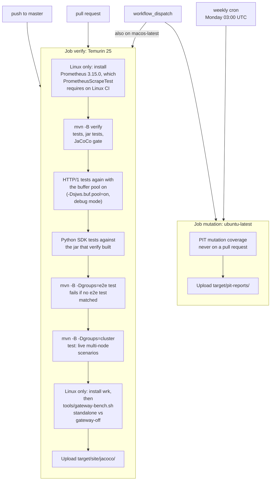

# Integration and end-to-end tests

How `sjws_nettask` is tested, from the suite in `tests/` and the workflow in
`.github/workflows/ci.yml`. The catalog of individual classes is `docs/development/testing.md`.
This file states the layering, the file-serving harness, and what the server does
not implement yet.

## Scope

In scope:

- JUnit 6 tests under `tests/` (Maven `testSourceDirectory`; `test/` is gitignored).
  Surefire's working directory is the repository root.
- The three layers below: unit tests with no listener, in-process tests that open
  real sockets, and process or full-listener checks.
- Protocols the tree actually speaks: HTTP/1.1 on TCP, HTTP/2 (TLS with ALPN, and
  h2c) on its own TCP ports through Netty, and HTTP/3 (QUIC) through Netty when the
  quiche natives load.
- The harness `tests/sjws_nettask/e2e/FileServingEndToEndTest.java`: a real
  `SjwsServer` on port 0, a temporary document root, and `java.net.http.HttpClient`.

Out of scope for the harness (it is HTTP/1.1 only; `h2/*` and `h3/*` cover the other
listeners):

- HTTP/2 (`--h2`, its own TCP port).
- HTTPS. The main TCP port is cleartext; TLS exists on the HTTP/2 port and as QUIC for
  HTTP/3.

`mvn test` runs every test except those tagged `jar`. `mvn verify` also packages
the jar, runs the `jar` tests, and enforces the JaCoCo package gates in `pom.xml`.
Subprocess tests are not in the coverage data.

## Layers

### Unit

No accept loop. Parsers, records, and the static-file handler are called directly.
Temporary directories (`@TempDir`) are normal here; they are fixtures for the
handler, not a listening server. Examples: `http1/Http1ParserTest`,
`http1/ChunkedDecoderTest`, `http1/Http1WriterTest`, `http1/FileServingTest`,
`core/StaticFileHandlerTest`, `core/StaticFileHandlerRangeTest`, `core/FileCacheTest`,
`core/ETagTest`, `core/RenderingTest`, `ServerConfigTest`, `tls/TlsMaterialTest`,
`DocsConsistencyTest`, `SourceGuardTest`.

`core/SafeOpenTest` is the same kind of test plus one case that writes an HTTP/1.1
response through `Http1Writer` on a stream. It does not bind a port.

### Integration

A real listener in the same JVM, and a client on a socket or a UDP/QUIC channel.

HTTP/1.1 today is usually `ClientManager` on a `ServerSocketChannel` bound to
loopback port 0 (`ServerIntegrationTest`, `HardeningIntegrationTest`,
`Http1TransportTest`, `Http1GoldenTest`). `Http1EdgeTest` and `SjwsServerTest`
start `SjwsServer` itself. Clients are mostly raw `Socket`s via `HttpTestSupport`.
`ServerIntegrationTest` also has one `java.net.http.HttpClient` request.
`ServerIntegrationTest` serves the repository `HTML/` tree (Surefire's working
directory is the repo root). `HardeningIntegrationTest`, `Http1TransportTest`,
and `Http1EdgeTest` serve a `@TempDir`.

HTTP/3 tests (`h3/Http3ServerTest`, `h3/SecurityReviewTest`, `h3/VerificationTest`,
`h3/RateGuardTest`, `h3/SjwsServerHttp3Test`) start the real Netty `Http3Server`
on an ephemeral UDP port with a temporary root and `h3/H3TestClient`. They are
tagged `h3` and skip themselves when `Http3Server.isAvailable()` is false.
`SjwsServerTest` stubs that transport; it does not speak QUIC.

### End to end

A full server path, checked with a real client.

- `FileServingEndToEndTest` (tag `e2e`) starts `SjwsServer.start` with
  `ServerConfig.builder(tempRoot).port(0)`. That is the same listener `main`
  starts: TCP accept loop, `StaticFileHandler`, HTTP/1.1 writer. The port is
  whatever the kernel assigned (`tcpPort()`). The document root is a `@TempDir`
  with one file, `hello.txt`. The client is `java.net.http.HttpClient` forced to
  HTTP/1.1, with no proxy. It asserts:
  - `GET /hello.txt` → 200, body equal to the file, `Content-Type:
    text/plain; charset=utf-8` (from `core.Mime` for `.txt`).
  - `GET /no-such-file.txt` → 404.
- Process checks already in the suite, separate from that harness:
  `HardeningIntegrationTest` launches `sjws_nettask.Sjws_nettask` for exit codes
  0, 1, 2, and 64; `ServerIntegrationTest` launches it with `WEB_SERVER_DIR`
  pointed at a `@TempDir`; `h3/JarLaunchTest` (tags `jar` and `h3`) runs
  `java -jar` after `package` and fetches HTTP/3. Those process tests pass a
  concrete TCP port. The command-line and `WEB_SERVER_PORT` accept `0` as
  ephemeral (#397); the child prints `Server started: HTTP/1.1 on tcp/<bound>`.
  Older process tests that probed with `ServerSocket(0)` and rebound can drop
  that race. The harness still prefers in-JVM `SjwsServer.bind` with port 0 and
  reads the bound port after `start` returns.

## Ephemeral port

`ServerConfig` documents TCP port 0 as ephemeral. The CLI positional port and
`WEB_SERVER_PORT` accept `0` the same way (YAML `server.port: 0` already did).
`SjwsServer.bind` opens a
`ServerSocketChannel`, sets `SO_REUSEADDR`, and binds `new InetSocketAddress(port)`
(the wildcard address) with the configured backlog. `tcpPort()` reads the address
after the bind. `start` returns only after that bind has succeeded and the accept
thread has been started. HTTP/3 uses its own UDP port (`h3Port` 0, or the same
number as the TCP port when `h3Port` is -1). The harness sets `h3Enabled(false)`,
so it binds TCP only.

Integration tests that construct `ClientManager` themselves bind loopback port 0
and read `getLocalPort()` the same way. They do not go through `SjwsServer.bind`,
so they do not listen on the wildcard address.

## Temporary document root

`@TempDir` is the fixture. The harness writes `hello.txt` in UTF-8 before
`start`. The server is given that directory as `ServerConfig.root`. Nothing is
read from `./HTML`. JUnit deletes the directory after the test. Process tests
that need a root either pass the temp path as the second argument or set
`WEB_SERVER_DIR`, and they remove `WEB_SERVER_DIR` / `WEB_SERVER_PORT` from the
child environment when the test wants the arguments to win (`HardeningIntegrationTest`).

## Protocol coverage

| Protocol | In the server | In the tests |
|---|---|---|
| HTTP/1.1 | TCP listener. Cleartext. This is what `curl http://` hits. | Unit parser and writer tests; socket integration tests; `FileServingEndToEndTest` via `HttpClient` with `Version.HTTP_1_1`. |
| HTTP/2 | Opt-in (`--h2`). Netty `Http2Server` on its own TCP port: TLS with ALPN `h2` (falling back to `http/1.1`) on `--h2-port`, and optional cleartext h2c on `--h2c-port` (prior knowledge or `Upgrade: h2c`). The main HTTP/1.1 listener still answers a request line `HTTP/2.0` with 505. | `h2/*` (`Http2ServerTest`, `Http2EdgeTest`, `Http2BudgetTest`, `Http2JuryTest`, `H2ConfigAndWiringTest`) start the real `Http2Server` on ephemeral ports with a self-signed certificate, the JDK `HttpClient` and the raw frame client `RawH2`; untagged. The 505 cases stay in `Http1ParserTest`, `Http1GoldenTest`, `HardeningIntegrationTest`. |
| HTTP/3 | Opt-in (`--h3`). Netty `netty-codec-http3` and the bundled quiche natives (Linux x86_64/aarch64, macOS x86_64/aarch64, Windows x86_64). TLS 1.3 is the QUIC handshake (`QuicSslContextBuilder`), with a configured PEM chain or a generated self-signed certificate. | `h3/*` when the natives load; otherwise the tests assume false and skip. JaCoCo gates for `sjws_nettask.h3` and `sjws_nettask.tls` are 0 off those platforms. |
| TLS on TCP | Only on the HTTP/2 listener's own port (`--h2-port`): `Http2Server` builds its Netty `SslContext` from `TlsMaterial` (the same PEM chain or generated self-signed certificate as HTTP/3; TLS 1.3 and 1.2). The main HTTP/1.1 port is cleartext, and `Alt-Svc` is still sent only there. `TlsMaterial.keyManagerFactory()` serves the control-plane mTLS code (`cp.CpTls`, `cp.AdminTls`, `admin.cp.HttpCpClient`). | `h2/*` (HTTPS through the JDK `HttpClient` with a trusting `SSLContext`), `tls/TlsMaterialTest`, `cp/CpServerTlsTest`, `cp/CpPeerTlsTest`, `cp/AdminTlsTest`. |

## Timeouts and flakiness

The harness does not sleep and does not retry. `start` has already bound the
port. Each request has a connect timeout of 2 seconds and a request timeout of
4 seconds. The class carries `@Timeout(10)`. A missed 200 or 404 fails the test.

The rest of the suite:

- Socket reads use `setSoTimeout` (often 2–15 seconds). A hang becomes
  `SocketTimeoutException` instead of waiting for the CI job timeout.
- Readiness is a bounded poll or a blocking read. `HardeningIntegrationTest.waitUntil`
  and `Http1TransportTest.waitFor` check a condition until a deadline (5 seconds,
  or the caller's limit) and sleep 10 milliseconds between checks. Process tests
  block in `readLine` until a `Server started:` line or the child exits
  (`waitForLine`), or they use `Process.waitFor` with a 5–10 second limit.
- Some tests call `Thread.sleep` as the stimulus: they must stay idle longer than
  a configured header, idle, or write deadline, or longer than an HTTP/3 rate
  window. Those sleeps are not a stand-in for "wait until the server is up".
- There is no JUnit retry extension and no Surefire rerun. A failed assertion is
  a failed test. HTTP/3 does not retry a missing native library; it skips.
- Known macOS failures are listed in `docs/development/testing.md`. `.github/workflows/ci.yml`
  runs macOS only on `workflow_dispatch`. Linux is the required platform.

## CI layout

`.github/workflows/ci.yml`:

- Triggers: push to `master`, every pull request, `workflow_dispatch`, and a
  weekly cron (`0 3 * * 1`) for mutation only.
- `permissions: contents: read`. Concurrency group `ci-<workflow>-<ref>`,
  cancel in progress on pull requests.
- Job `verify` (not on the cron): Temurin 25, `ubuntu-latest`. `macos-latest` is
  added only for `workflow_dispatch`. Timeout 45 minutes. Steps: checkout,
  `actions/setup-java` with the Maven cache, then the steps in the diagram below, then
  upload `target/site/jacoco/`.
- `mvn -B verify` is the unit and integration suite, the `jar` tests (Surefire
  execution `jar-tests` on the `integration-test` phase, without the JaCoCo
  agent), and the coverage gate. `FileServingEndToEndTest` is part of that
  default Surefire run (it is not in the `jar` exclude).
- The following step runs the harness on its own and fails if the `e2e` group
  matches nothing:

  `mvn -B -Dgroups=e2e -Dsurefire.failIfNoSpecifiedTests=true test`

- The cluster harness (tag `cluster`) runs the same way. Its cases start data nodes, and the
  control-plane ones add 3 or 5 real `CpStore` voters on an in-process transport, fault scenarios included:

  `mvn -B -Dgroups=cluster -Dsurefire.failIfNoSpecifiedTests=true test`

- `tools/gateway-bench.sh` then runs a short wrk comparison (warm-up 1 s, measure 3 s)
  of standalone vs gateway-off on Linux, after `apt-get install wrk`. It fails if either mode
  reports request errors or zero throughput. The 30 s comparison is local; see
  `bench/README.md`. macOS CI (manual dispatch only) skips that step.

- Job `mutation` (cron or `workflow_dispatch` only): `ubuntu-latest`, timeout
  120 minutes, PIT via `mvn -B -P pitest test-compile org.pitest:pitest-maven:mutationCoverage`.
  Not part of a pull request.



`.github/workflows/release.yml` is a tag workflow. It is not the test matrix.

### CI correctness ([#356](https://github.com/BlivionIaG/sjws_nettask/issues/356))

Two rules that came out of the Ubuntu 26.04 canary work (#265 / #269 / #356):

1. **Do not use `continue-on-error: true` on a job whose failure must fail the
   workflow.** A red job with `continue-on-error` still marks the workflow run
   green, so reviewers reading the Actions list miss the failure. The
   `verify-canary` job did that and masked seven `SwarmBenchCleanupTest`
   failures. Prefer a hard-fail job, or a follow-up job that reads the canary
   result and fails the run. `ci.yml` greps `.github/workflows/` for
   `continue-on-error:` and fails if any remain.

2. **Manual `workflow_dispatch` from Cursor cloud agents.** Those integrations
   often hold only `contents: read`, so `gh workflow run …` returns
   `HTTP 403 Resource not accessible by integration`. A human with
   `actions: write` (or a PAT that has it) must dispatch when a PR needs a
   manual run: the macOS matrix and mutation job on `ci.yml`,
   `cluster-tests.yml` without the `cluster-tests` label, and any other
   `workflow_dispatch`-only path. The Ubuntu 26.04 canary workflow itself was
   deleted in #265 once `ubuntu-latest` became 26.04 and verify stayed green;
   there is nothing left to dispatch for that canary.

Local equivalents, with Java 25:

```
mvn test
mvn verify
mvn -B -Dgroups=e2e -Dsurefire.failIfNoSpecifiedTests=true test
mvn -B -Dgroups=cluster -Dsurefire.failIfNoSpecifiedTests=true test
mvn test -DexcludedGroups=h3
```

## Cluster harness

`tests/sjws_nettask/clusterharness/` starts M data nodes the same way
`FileServingEndToEndTest` does: `SjwsServer.start` with `port(0)`, a `@TempDir`
document root, and `java.net.http.HttpClient` forced to HTTP/1.1 with no proxy.
`start` returns only after the accept loop is bound, so the data nodes need no sleep.
The control-plane side waits with bounded loops (`ControlPlane.awaitConverged`).

Control nodes go through `ControlPlane`. The design is
[PR #38](https://github.com/BlivionIaG/sjws_nettask/pull/38)
(`docs/design/control-plane.md`). `CpStoreControlPlane` implements it on 3 or 5 real
`sjws_nettask.cp.CpStore` voters of `cp-config` that share one in-process `SimTransport`.
Each voter has its own log directory, a `WatchServer` and an admin listener on ephemeral
ports. One driver thread ticks them, and Raft time is the injected `ClusterClock`: after
`start`, only `ClusterClock.advance` moves elections, heartbeats and leases.
`ClusterHarness.open` takes 0, 3 or 5 control nodes. With data role `DATA`, which needs 3
or 5, every data node is a data-mode `SjwsServer` whose `DataWatch` long-polls a voter
through a loopback `WatchRelay`: `partitionDataFromControl` and `delay` act on those relay
sockets, `killLeader` stops the leader voter in-process, and `heal` resumes the relays and
restarts killed voters on their own logs. `STANDALONE` and `GATEWAY_OFF` data nodes join
nothing and construct no control-plane object; `DATA`, or any non-zero control-node count,
starts `CpStoreControlPlane`. `PendingControlPlane` is the null object for a scenario with
no control nodes: `available()` is false and every other call throws
`ControlPlanePendingException`.

`NodeFixtures.pending(dir, "data")` writes the bootstrap files under that temp directory
(`state` is `dir/state`, not the working directory). A process started from that file
reports `connection=pending`. That replaces the copy
[PR #95](https://github.com/BlivionIaG/sjws_nettask/pull/95) inlined in
`RoleClassLoadTest`. `NodeFixtures.connected(dir)` is the data-role variant against a
live control plane: an in-process single-voter `CpStore`, its loopback `WatchServer`, and
one data-role `SjwsServer` whose `ServiceLaunch` hooks open the real data-node watch. It
returns a `ConnectedDataNode` once the node reports `connection=connected`, and
`push(yaml)` waits until the node has applied the activated version. The node's
`NodeEnrollment` is process-wide, so only one connected node exists at a time.

Live (tag `cluster`, run by `mvn verify` and by the CI group step):

- Three gateway-off data nodes on distinct ephemeral ports serve `hello.txt`
  (200, body, `text/plain`) and a missing path (404). Applied version is 0.
  No thread name starts with `cp-`.
- Gateway-off and standalone return the same status, body, and content headers
  for that file. Neither attaches `HaSettings`.
- A control-node count other than 0, 3, or 5 is rejected, and so is data role `DATA`
  with no control nodes.
- Three voters elect exactly one `leaderReady` leader, each on its own admin port.
- `PendingControlPlane.available()` is false and the exception text links PR #38.
- `ConnectedDataNodeTest`: a data node joins over the real watch, reports `connected`,
  and applies a pushed version.
- `CpVoterRestartTest`: a killed voter restarts from its own log on `heal`, catches up,
  and counts toward the majority again.

Fault scenarios (`ClusterScenariosTest`, data role `DATA`, `ClusterClock.Manual`). Each
fetches `hello.txt` from every data node while the operation runs and fails on any
non-200 or changed body:

| Scenario | What it asserts |
|---|---|
| Network partition | After `partitionDataFromControl` and a 5 s clock advance, every data node keeps its version and hash and still serves the file. After `heal`, a later push converges. |
| Control-plane leader kill | Five voters. `killLeader`, then one 1.5 s clock advance. A different voter is `leaderReady` on its own ephemeral admin port, the next push converges, and content stays 200. |
| Slow node | A one-way watch delay of 200 ms on one data node. It stays at version 0 until the manual clock advances 200 ms; then every node, the slow one included, reports the new version. |
| Config rollback | `rollback(v1)` after v2 returns a higher version whose content hash is v1's. Every data node converges on that version and hash, with content 200 throughout. |

No test under `tests/` is `@Disabled`.

## Roadmap

Not implemented. Nothing above depends on these.

- HTTP/2 inside `FileServingEndToEndTest`. The harness stays HTTP/1.1;
  `h2/Http2ServerTest` already drives the real `Http2Server` (ALPN, h2c) with the JDK
  `HttpClient`.
- HTTPS on the main TCP port. The main listener stays cleartext; HTTPS exists only on
  the HTTP/2 listener's own port (`--h2-port`). A TLS accept path on the main port
  would be a new server path.
- ~~Accepting port 0 on the command line and in `WEB_SERVER_PORT`~~ (done in #397):
  parsers keep `0` as ephemeral; startup prints `HTTP/1.1 on tcp/<bound>`. YAML
  `server.port: 0` already worked.
- HTTP/3 inside `FileServingEndToEndTest`. The same temporary root and ephemeral
  port are already covered by `h3/Http3ServerTest` and `h3/JarLaunchTest`.
- Dropping fixed `Thread.sleep` calls that only poll for a condition, in favour
  of the deadline loops the transport tests already use. Sleeps that exist to
  outlast a deadline stay.
