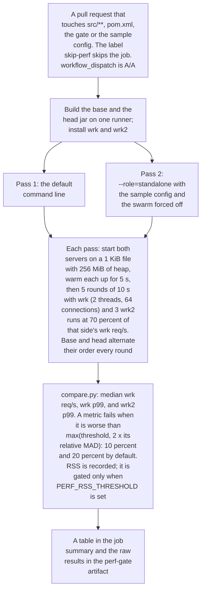

# Perf-regression gate

`.github/workflows/perf-gate.yml` runs on pull requests that touch `src/**`, `pom.xml` or the gate
itself, and on `workflow_dispatch` (an A/A run on the selected ref, used to record baselines). It
builds the PR base and head, starts both jars on the same runner in standalone mode (default flags;
no cluster/gateway mode exists on the CLI yet) serving a 1 KiB file, and benchmarks them with wrk
(`-t2 -c64`, keep-alive) and then wrk2 at a fixed rate:

* 5 s warmup per server, then 5 rounds of 10 s wrk, alternating base/head order each round,
* median requests/s and p99 latency per side,
* three wrk2 runs per side at 70 % of that side's median wrk req/s (`WRK2_FRACTION`, overridable
  with `WRK2_RATE`); the compared metric is median wrk2 p99,
* RSS of each server process after warmup, after wrk, and after wrk2,
* a wrk or wrk2 metric fails when it regresses by more than `max(threshold, 2 x relative MAD)` of
  either side, so a noisy runner widens the band instead of flaking; any wrk/wrk2 errors on the PR
  side fail too,
* RSS is written to the jsonl and the job summary. It fails the gate on magnitude only when
  `PERF_RSS_THRESHOLD` (or `--rss-threshold`) is set from a measured run. Until then the budget is
  measurement-pending: a missing RSS row is still a harness failure.

Defaults: throughput 10 %, p99 20 % (tails are noisier on shared 2-vCPU runners; the same p99
percentage applies to wrk2). Override with the repository variables `PERF_THRESHOLD` /
`PERF_P99_THRESHOLD` / `PERF_RSS_THRESHOLD`. The table goes to the job summary and raw results to
the `perf-gate` artifact. Add the `skip-perf` label to skip a PR.

No absolute wrk2 p99 (microseconds) or RSS (kB) floor is configured. Those numbers have to come
from measured CI or quiet-box runs, not from an invented budget.

The whole run, with the second pass described below:

Run locally (wrk2 is used when it is on `PATH`, or set `WRK2=1` / `REQUIRE_WRK2=1`):

    mvn -B -q -DskipTests package   # in two checkouts
    tools/perf-gate/bench.sh base.jar head.jar /tmp/perf
    python3 tools/perf-gate/compare.py /tmp/perf/base.jsonl /tmp/perf/head.jsonl --threshold 10
    python3 tools/perf-gate/test_compare.py

`tools/perf-gate/install-wrk2.sh` builds a pinned [giltene/wrk2](https://github.com/giltene/wrk2)
into `~/.local/bin/wrk2` (not a Debian package).

The gateway-off mode is only reachable through the bench harness (`bench/GatewayBench.java`), not
the server CLI, so the A/B gate compares standalone builds. Standalone vs gateway-off within one
build is `tools/gateway-bench.sh`, run briefly in CI and at full length by
`.github/workflows/cluster-tests.yml` (nightly, `workflow_dispatch`, or the `cluster-tests` PR label),
together with the cluster harness (`mvn -B -Dgroups=cluster -Dsurefire.failIfNoSpecifiedTests=true test`).
The short PR step records RSS and skips wrk2 (`GATEWAY_BENCH_WRK2=0`). The full-length nightly step
installs wrk2, requires it, and prints fixed-rate p99 plus RSS without failing on an absolute floor.

## Fast PR set vs heavy nightly/manual set

| Set | When | What | Pass / fail |
|---|---|---|---|
| Fast PR | `.github/workflows/ci.yml` on every Linux PR | Short `tools/gateway-bench.sh` (1 s warmup, 3 s wrk, wrk2 off). Prints standalone vs gateway-off req/s and RSS. | Fails on request errors, zero throughput, or a missing RSS reading. The req/s ratio fails only when `GATEWAY_BENCH_MAX_DELTA` is set. RSS magnitude is not gated. |
| PR perf gate | `.github/workflows/perf-gate.yml` on PRs that touch `src/**`, `pom.xml`, the gate, or the sample standalone config (skip with `skip-perf`) | A/B wrk + wrk2 + RSS against the PR base, two passes (default CLI and `--role=standalone` with the sample config, swarm off). | wrk req/s, wrk p99, and wrk2 p99 use the relative thresholds above. RSS is recorded; it is gated only when `PERF_RSS_THRESHOLD` is set. |
| Heavy nightly / manual | `.github/workflows/cluster-tests.yml` (nightly at 02:30 UTC, `workflow_dispatch`, or the `cluster-tests` label); plus `workflow_dispatch` on `perf-gate.yml` for an A/A baseline on a chosen ref | Full-length gateway-bench (5 s / 30 s, wrk2 required) and the cluster harness; or an A/A perf-gate run whose artifact holds wrk2 p99 and RSS. | Same as the short gateway-bench for errors and optional `GATEWAY_BENCH_MAX_DELTA`. wrk2 p99 and RSS are recorded, not failed on an invented floor. The dispatched A/A perf-gate uses the same relative compare as a PR. |

## Soak (optional, manual only)

A multi-hour soak is not part of pull-request CI and is not scheduled. To run one locally or on a
quiet box, keep a server under a fixed wrk2 rate for as long as you need (`WRK2_DURATION=2h` or
a direct `wrk2 -t4 -c128 -d2h -R<rate> -L`) and watch RSS / error counts. Record the figures;
do not promote them to a gate until they come from a valid quiet-window run.

## Second pass: explicit role

The gate runs the A/B twice. The second pass starts both builds with
`--role=standalone --config=contrib/sjws_nettask-standalone.yaml` and `-Dsjws.swarm.enabled=false`
(positional port and root still win over the file), so the role/config path is gated as well.
`--role=data` and `--role=control` are not benchmarked: both require `--bootstrap` with a control-plane
contact, pin and join token, which a single cheap runner pass cannot provide.
