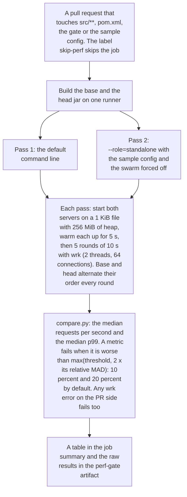

# Perf-regression gate

`.github/workflows/perf-gate.yml` runs on pull requests that touch `src/**`, `pom.xml` or the gate
itself. It builds the PR base and head, starts both jars on the same runner in standalone mode
(default flags; no cluster/gateway mode exists on the CLI yet) serving a 1 KiB file, and benchmarks
them with wrk (`-t2 -c64`, keep-alive):

* 5 s warmup per server, then 5 rounds of 10 s, alternating base/head order each round,
* median requests/s and p99 latency per side,
* a metric fails when it regresses by more than `max(threshold, 2 x relative MAD)` of either side,
  so a noisy runner widens the band instead of flaking; any wrk errors on the PR side fail too.

Defaults: throughput 10 %, p99 20 % (tails are noisier on shared 2-vCPU runners). Override with the
repository variables `PERF_THRESHOLD` / `PERF_P99_THRESHOLD`. The table goes to the job summary and
raw results to the `perf-gate` artifact. Add the `skip-perf` label to skip a PR.

The whole run, with the second pass described below:

Run locally:

    mvn -B -q -DskipTests package   # in two checkouts
    tools/perf-gate/bench.sh base.jar head.jar /tmp/perf
    tools/perf-gate/compare.py /tmp/perf/base.jsonl /tmp/perf/head.jsonl --threshold 10

The gateway-off mode is only reachable through the bench harness (`bench/GatewayBench.java`), not
the server CLI, so the A/B gate compares standalone builds. Standalone vs gateway-off within one
build is `tools/gateway-bench.sh`, run briefly in CI and at full length by
`.github/workflows/cluster-tests.yml` (nightly, `workflow_dispatch`, or the `cluster-tests` PR label),
together with the cluster harness (`mvn -B -Dgroups=cluster -Dsurefire.failIfNoSpecifiedTests=true test`).

## Second pass: explicit role

The gate runs the A/B twice. The second pass starts both builds with
`--role=standalone --config=contrib/sjws_nettask-standalone.yaml` and `-Dsjws.swarm.enabled=false`
(positional port and root still win over the file), so the role/config path is gated as well.
`--role=data` and `--role=control` are not benchmarked: both require `--bootstrap` with a control-plane
contact, pin and join token, which a single cheap runner pass cannot provide.
