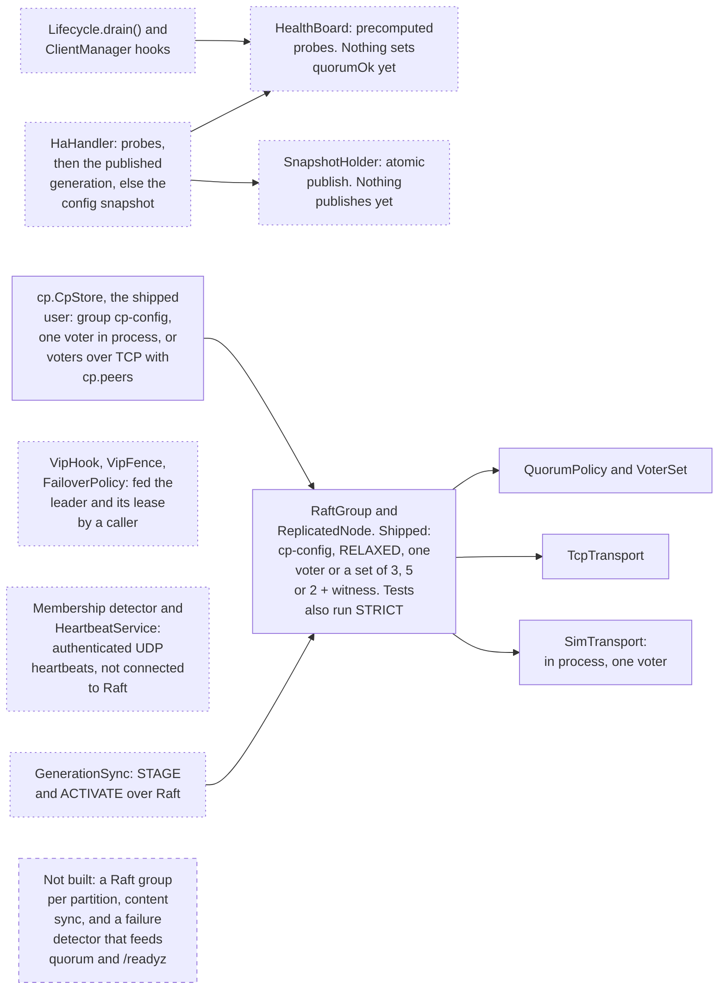
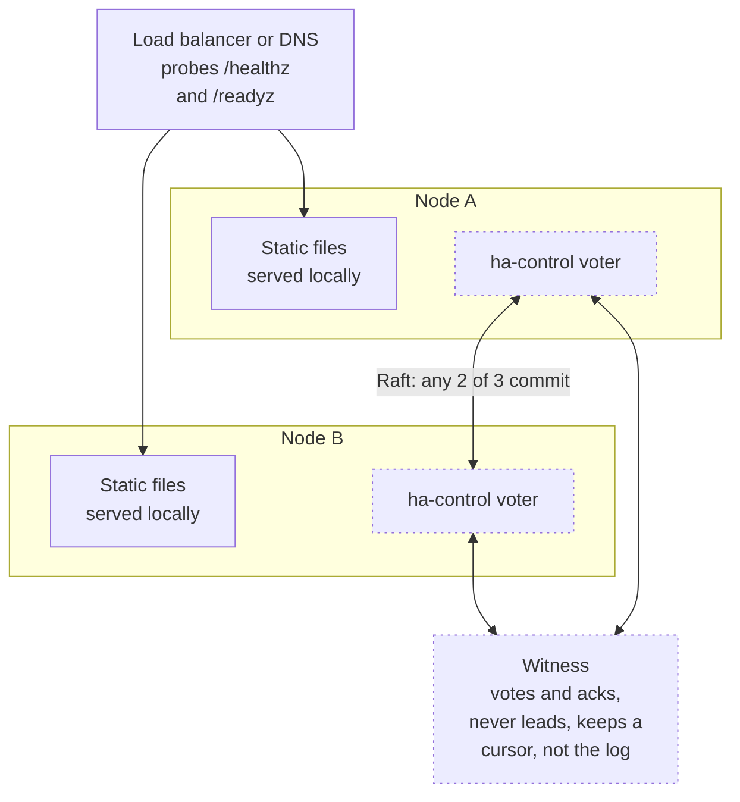
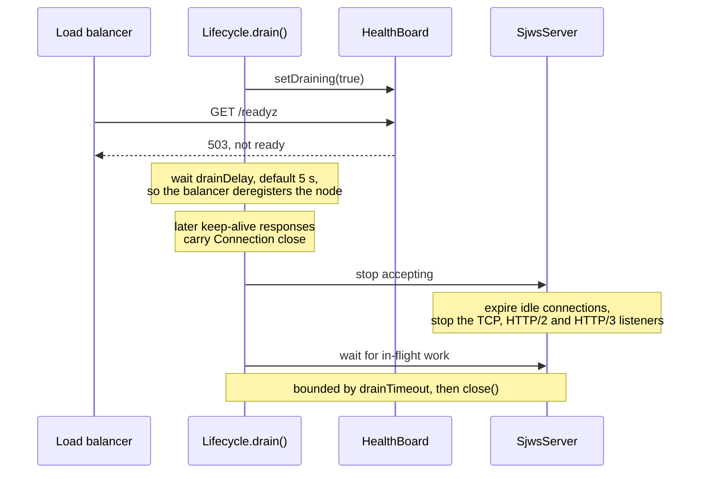
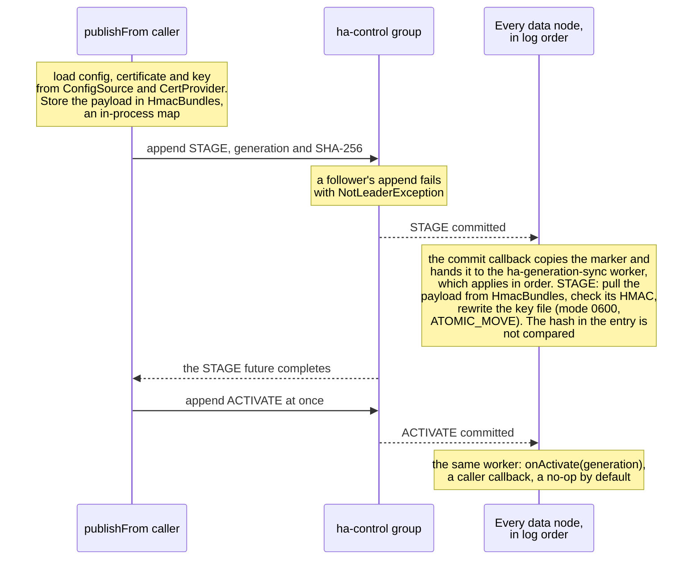

# High Availability Design — sjws_nettask

Status: Draft · Scope: HA only (2-node, 3-node; N-node/multi-site roadmap)
Base: master `b8055fe` (Java 25)

> **Normative for shipped behaviour:** [high-availability.md](../design/high-availability.md)
> (as implemented: per-group Raft, HMAC heartbeats, HA messaging / `msgrepl`, failover matrix).
> This file keeps design rationale, the serving-tier sketch, and **planned** §13 items
> (N-node gossip / multi-site / GSLB). Where the two disagree, trust the as-implemented doc
> and the code on master.
>
> Operator entry points: [cluster-mode.md](../user/cluster-mode.md),
> [control-plane-service.md](../operations/control-plane-service.md).

## 1. Context

sjws_nettask (**SJWS**, Swarm Java Web Services) is a Java 25 message-oriented middleware and web server; the HA design below starts from the HTTP serve path. `Sjws_nettask.serve(ServerConfig)` checks the
document root and calls `SjwsServer.start`, which binds a `ServerSocketChannel` (`SO_REUSEADDR`,
configurable backlog) and runs `ClientManager` on the `accept-loop` platform thread. The accept
loop is bounded by a `Semaphore` of `maxConnections` (further clients sit in the kernel backlog)
and a per-address `PerIpLimit`. Each accepted connection is a virtual thread running
`Http1Connection`: `Http1Parser` → `Http1Requests.toCore` → `core.Handler` → `Http1Writer`.
Production installs `StaticFileHandler`, which owns the small-file `FileCache` (`cacheBytes`).
Optional HTTP/3 is a `Transport` beside TCP and calls the same `Handler`. Deadlines are one
`ConnectionReaper`, not per-socket timeouts.

Content is read-only from the request path, so HA is about *availability of the serving tier*
and *consistency of content/config/certs*, not replicated request state. A request never waits
on another node.

Out of scope (owned by other workstreams, consumed here as interfaces this workstream defines):
config file format and ACME (`ConfigSource`, `CertProvider`), reverse proxy, the observability
backend (`MetricsSink`), daemon/service mode (signals, PID), and the CI workflow. `HaSettings`
is attached in code (`SjwsServer.start(config, ha)`). This workstream does not add flags to
`ServerConfig` — that parser, `--help`, and the docs option tables stay with the config
workstream. The process shutdown hook calls `SjwsServer.drain()`, which is `close()` when HA
is detached, and otherwise `Lifecycle.drain()` followed by `close()`.

What the code has today. Solid boxes run in a shipped process (`java -jar`). Dotted boxes are built, but a shipped
process never reaches them. `HaSettings` (UDP membership / VIP / drain wiring for the HTTP serve path) is attached
only by tests, embedders and the HA bench; `GenerationSync` and `VipFence` have no caller in `src` at all.
Shipped Raft users on master: (1) control role `cp.CpStore` (`cp-config`, `SJWS_CP_RAFT_KEY` over `TcpTransport`
when `cp.peers` is set); (2) **HA messaging** via YAML `ha.messaging` / `ha.members` (`HaMessagingStart` →
`msgrepl`, HMAC under `ha.cluster_key`). Those two keys **must differ** — see
[control-plane-hosting](../design/control-plane-hosting.md). Heartbeats for `ha.enabled` use the same cluster key
family (`WEB_SERVER_HA_CLUSTER_KEY`). The dashed box lists what is still only designed for the *HTTP HA* attach path:



## 2. Design principles

1. **Near-zero hot-path overhead.** No per-request coordination, locks, RPCs or quorum reads.
   A request touches only node-local state. With HA off, `ClientManager` and `Http1Connection`
   keep today's path (the new hooks are null). With HA on, cluster role is one `volatile` read
   at accept time, and only when a passive gate is installed — active/active installs none.
   The request path adds one `volatile` snapshot read inside `HaHandler` (the `Handler` seam),
   not in the parser or the cache. Target: ≤1% throughput loss, ≤2% p99 delta vs single-node.
2. **Cheap heartbeats.** Fixed-size UDP datagrams (64-byte membership body plus version,
   key id, timestamp, sequence, boot epoch, destination wire id, and a 32-byte HMAC-SHA256;
   124 B on the wire, one send per caller-supplied interval), one dedicated virtual thread, no allocation
   per beat beyond a reused buffer and a reused `DatagramPacket`. The MAC input is a domain
   label (`sjws-ha-hb`), the version, the key id, the body, the timestamp, the sequence, the
   boot epoch, and the destination. The HMAC key is HKDF-SHA256 of the cluster key
   (`sjws-ha-heartbeat-v1`), not the raw secret. Key id 0 selects the current key and key id 1
   the previous key; one packet is not checked against both. A newer boot epoch from a member
   resets that sender's sequence high-water mark, so a restart is not a missed heartbeat.
   The epoch is a boot time: it must be no later than the packet's own timestamp, and no
   later than the receiver's now, beyond the same ±5 second skew window. A later epoch is
   dropped and does not change replay state, so a forged far-future epoch cannot lock the
   real member out after the attacker stops. A lower epoch is accepted only when that sender
   has been silent for at least {@code max(deadAfter, 5s)} (the receiver already treats the
   member as dead, and a captured packet has left the skew window). That is a clock step
   backwards across a restart, not a live rewind.
   A timestamp older than the receiver's boot is dropped. A destination other than this node,
   and a sender that is not a member, are dropped; the replay map only holds members.
   Drops are counted by reason. A missing key with HA enabled refuses to start. Rotation is
   two steps: deploy the new secret as the current key and the key still in use as the
   previous key (`ha.cluster_key` / `ha.cluster_key_file` and `ha.cluster_key_previous` /
   `ha.cluster_key_previous_file`), then remove the previous key once every node is sending
   with the new one. The key file must be mode 0600 or 0400 and owned by this process.
   Only the parent directory is resolved with `toRealPath`. The leaf is opened with
   `NOFOLLOW_LINKS` and is never followed, so a symlink in that name is refused.
   Owner and mode are taken from that opened file. Every resolved parent up to `/` must
   be owned by root or this process. A group- or world-writable parent is refused unless
   it is sticky and owned by root or this process (`/tmp`). On Linux those attributes are
   `fstat` of `/proc/self/fd`, and that descriptor is used only when its device and inode
   match the opened file. Without `/proc`, attributes are an `lstat` of the path with
   `NOFOLLOW_LINKS` while the channel is open (a replace in that window can still change
   the inode), and owner checks compare the owner name with `root` or `user.name`.
   Whoever starts the JVM can set `user.name`; they already control the process.
   Control-plane key files use the same helper, `sjws_nettask.config.SecureKeyFile`.
   Nodes need NTP: the authentication window is ±5 seconds of wall-clock time. Monotonic
   clocks are not comparable across hosts: the packet carries `leaseRemainingMs`, and the
   receiver sets its own expiry from `System.nanoTime()`. The authentication timestamp is
   wall-clock milliseconds and is only a replay window.
3. **Sync off the hot path.** Content/config/cert sync runs in background threads and is
   applied by atomic swap (new snapshot → single reference publish); readers never block.
   `HaHandler` loads the `Snapshot` once at the start of `handle`, so an in-flight call keeps
   that `Handler` (and its `FileCache`) even if a newer generation is published underneath.
4. **N-node-ready abstractions.** 2 and 3 nodes are configurations of one model
   (membership + quorum policy + failover policy), not special cases.
5. **Fail static.** On partition or lost quorum, a node keeps serving its last good snapshot
   unless policy explicitly requires fencing (VIP owner in active/passive).

## 3. Core abstractions (generalise to N nodes / sites)

These live in `sjws_nettask.cluster`, except `FailoverPolicy` and `SnapshotHolder` (in `sjws_nettask.ha`). The
cluster package does not import HTTP, Netty, or `sjws_nettask` server types, so Messaging Core can depend on it
without the file server.

- `NodeId`, `SiteId`, `Member{id, site, addr, incarnation, state}`; states
  ALIVE → SUSPECT → DEAD (SWIM-style, incarnation numbers refute stale suspicion).
- `Membership`: static seed list now; pluggable gossip dissemination for N>3.
- `QuorumPolicy`: `majority()`, `witness(NodeId)` (2 data nodes + a tie-breaker that votes but
  does not store the log), and later `perSite(local majority) + global(majority of sites)`.
  Pure function over a voter set and an ack set — not over a live RPC.
- Lease: the Raft term plus a lease expiry on the monotonic clock, one per replication
  group (`ReplicationGroup.leaseExpiresAt()`); there is no separate `LeaderElection` type.
  The `ha-control` leader coordinates sync rollouts and VIP ownership and never sees
  requests. Message partitions elect separately (§13a, Decisions for PR #16).
- `FailoverPolicy`: `ACTIVE_PASSIVE` (VIP hook), `ACTIVE_ACTIVE` (external LB/DNS using
  `/healthz` and `/readyz`), later `GeoDns` / `Anycast` / `GSLB`.
- `SnapshotHolder` (in `sjws_nettask.ha`): versioned (monotonic `generation` + content hash)
  bundles. The value is the `Handler` for that generation, so the cache is generation-scoped
  without a change to `FileCache`. Nodes converge by pulling from the leader or any peer with
  a higher generation.

`Transport.stopAccepting()` already exists for HTTP/3. Drain uses it at the same moment it
closes the TCP `ServerSocketChannel`, which is the rule the HTTP/3 transport already documents.

## 4. Modes

Preferred messaging topology on master is **2 data nodes + 1 witness** (or 3+ data nodes). A bare
pair of voters is refused for `ha.messaging` — see [high-availability.md](../design/high-availability.md)
and [config-file.md](../user/config-file.md#ha).

Static HTTP is active on every node that has a snapshot, in both modes below. Raft
leadership does not gate file serving. A node in a minority partition keeps serving the
last generation (fail static). Messaging endpoints, when Messaging Core adds them, follow
the partition leader; that redirect is not part of the static path.

### 4.1 Two nodes

The two-node choice (witness versus async primary/standby), the failure matrix, and what the current classes still lack are in [two-node HA](../design/two-node-ha-decision.md). This section is the serving-mode sketch; that document is the decision.

- **Active/active (recommended):** both serve; upstream LB/DNS uses `/healthz` / `/readyz`.
  No split-brain risk for serving because content is read-only; the only contested action is
  publishing a new generation, which requires a lease from the leader and a witness ack.
- **Active/passive:** VIP owned by the lease holder. Split-brain avoidance needs a **witness**
  (lightweight 3rd process, or an external arbiter plugged in behind the same `QuorumPolicy`).
  Without a witness, the configured `preferred` node wins ties by campaigning sooner, and the
  other demotes on peer loss only if it can still reach the witness ("no witness → no
  promotion": `QuorumPolicy.witness(NodeId)` is false unless the witness is in the ack set and at least one
  data node is too). A data node alone does not become leader and does not claim the VIP.
- Fencing: the losing node releases the VIP before lease expiry (lease shorter than the
  failure-detection margin). Fencing is the VIP hook, not a closed accept loop: `/healthz`
  is on the same listener as content, so a passive node still accepts on its own address.
  The accept loop's one volatile role read (passive mode only) feeds that hook and the
  `ha_role` gauge; it does not run per request.

Two data nodes and a witness. The Raft side of this topology, an `ha-control` group of two data nodes and a
witness, is built in `cluster` and runs only in tests: no shipped process runs an `ha-control` voter beside the
content listener (dotted boxes, as above):



### 4.2 Three nodes

- Majority quorum (2/3) for the leader lease and for generation publish. A minority partition
  keeps serving its last snapshot but cannot publish; readiness may optionally drop
  (`HaSettings` minority mode `serve` or `drain`, the knob the config workstream can later
  surface as `--ha-minority`).

## 5. Health checks

Shipped peer liveness (when `ha.enabled: true` and a cluster key is set) is **UDP HMAC heartbeats**
(`info` `sjws-ha-heartbeat-v1` under HKDF of `ha.cluster_key` / `WEB_SERVER_HA_CLUSTER_KEY`), not a
generic unauthenticated health protocol. Details and rotation:
[high-availability.md](../design/high-availability.md) and [config-file.md](../user/config-file.md#ha).
The membership / `HealthBoard` wiring below is still mostly the design sketch for the HTTP HA attach path.

- `/healthz` (liveness: process up and the accept loop still inside `ClientManager.run`),
  `/readyz` (a snapshot is published, not draining, quorum OK if policy demands it).
  `HealthBoard` precomputes the `Response` objects (plain text, 200 or 503) and `HaHandler`
  returns one of them. No allocation and no file I/O on the probe path.
- The accept loop clears liveness in its `finally`, off the request path.

  ```mermaid
  flowchart TD
      r["Request, with HA attached"] --> p1{"Path is /healthz?"}
      p1 -->|yes| h["200 ok while the accept<br/>loop is alive, else 503<br/>precomputed, no allocation"]
      p1 -->|no| p2{"Path is /readyz?"}
      p2 -->|yes| rd["200 only when a snapshot<br/>is loaded, the node is<br/>not draining, and quorum<br/>is ok if the policy<br/>requires it, else 503"]
      p2 -->|no| g{"A generation has<br/>been published?"}
      g -->|yes| gh["Its handler, loaded once<br/>at the start of the call"]
      g -->|no| ch["The config snapshot<br/>handler"]
  ```

- Peer failure detection: UDP heartbeat plus an indirect probe (k=2 via other members when
  N≥3). Defaults: interval 500 ms, suspect after 3 misses, dead after 5 s.

  Member states, as `cluster.Membership` implements them. Only the HA bench and tests run it, and nothing
  connects it to Raft or `/readyz` yet:

  ```mermaid
  stateDiagram-v2
      [*] --> ALIVE
      ALIVE --> SUSPECT: silent for 3 intervals
      ALIVE --> DEAD: silent for deadAfter
      SUSPECT --> DEAD: silent for deadAfter
      SUSPECT --> ALIVE: a heartbeat or an indirect ack
      DEAD --> ALIVE: a heartbeat
      note right of SUSPECT
          deadAfter counts from the
          last time it was heard, 5 s
          by default. A heartbeat
          counts when its incarnation
          is the same or higher.
          A suspect is also probed
          through up to 2 other alive
          members, when 3 or more
          are listed
      end note
  ```

## 6. Failover

- Detection → SUSPECT → DEAD → quorum recompute → new lease. Expected failover:
  active/active ≈ LB check interval; active/passive ≈ 2–6 s (3 missed beats, then lease
  expiry, then election).
- Failback is disabled by default (avoid flapping). Raft does not preempt a healthy leader,
  so a preferred node that returns stays a follower until the current leader is actually gone.
  An extra hysteresis delay applies before a demoted node may campaign again.

## 7. Graceful shutdown / drain

Load balancers and rolling restart (`ha.RollingRestart`) treat **`GET /readyz`** as the readiness
gate: drain flips the node to not-ready (503) before `drainDelay`, so peers/LB stop sending traffic.
See also [control-plane-service.md](../operations/control-plane-service.md) (`TimeoutStopSec` /
`--drain-budget`).

- `Lifecycle.drain()`: mark not-ready → wait LB deregistration (`drainDelay`, default 5 s) →
  set `Connection: close` on later keep-alive responses → expire *idle* keep-alives through
  the existing reaper (`shutdownOutput` / `shutdownInput`, the same non-blocking path as a
  deadline) → stop accepting (close the `ServerSocketChannel`, `Transport.stopAccepting()`
  for HTTP/3) → wait until in-flight `Http1Connection`s finish, bounded by `drainTimeout` →
  return. `ClientManager` only takes this path when `prepareGracefulDrain` was called;
  `close()` stays the current interrupt-immediately behaviour.
- Signal wiring belongs to the daemon-mode workstream. HA exposes `Lifecycle.drain()`.

The drain as implemented by `Lifecycle.drain()` and `SjwsServer.drain()`:



## 8. Zero-downtime reload

- Config/cert/content: a new snapshot is built off-path, validated, and published with
  `SnapshotHolder.publish` (`AtomicReference` compare-and-set; a lower generation is
  rejected). In-flight requests keep the handler reference they already loaded. The new
  `StaticFileHandler` has a new `FileCache`, so the cache is keyed by generation without
  touching cache lookup.
- Binary upgrade: `SO_REUSEPORT` hand-over where the process can set it (`setsockopt` on the
  channel fd; the JDK has no `StandardSocketOptions` constant for it, so this needs the
  `java.base` packages opened and native access — the same native-access need HTTP/3 already
  has). Otherwise rolling restart, one node at a time, gated on `/readyz` of the others.

## 9. Config / cert / content sync

- Source of truth via `ConfigSource` / `CertProvider` (interfaces here; implementations,
  including ACME, belong to the other workstream). The leader pulls, computes a generation
  and a content hash, and announces `(generation, hash)` in heartbeats (8 B + 8 B). Peers
  that lag pull the bundle (HMAC-SHA256 with the shared secret, checked on pull) on a
  background thread. Today the bundle store is an in-process map (`HmacBundles`); a network
  transport for it, with mTLS in place of the HMAC, is not built.
- Private keys are never copied into heartbeats. The bundle is transferred with the HMAC,
  and the key file is written mode `0600` via a temp file and `ATOMIC_MOVE`.
- Two-phase rollout on the `ha-control` replication group (one `groupId` on the shared
  transport, not a private socket): STAGE on the quorum → pull to reachable nodes →
  ACTIVATE with quorum. Apply of ACTIVATE is what publishes the snapshot. `ha-control`
  uses the default ack mode: followers ack once the batch is in memory, and fsync
  follows. A completed publish can be lost if a majority crashes at the same time.
  Quorum commit plus fsync (`Durability.STRICT`) is opt-in for a group that must
  survive that. A witness ack counts toward the quorum without storing the log. If the leader dies before
  a peer has the bytes, the peer keeps the last activated snapshot (fail static) and the new
  leader publishes again from `ConfigSource`. The log coordinates activation; it is not the
  only copy of the bytes.

The rollout, as `ha.GenerationSync` implements it. It runs only in tests, inside one JVM: the bundle store is an
in-process map, heartbeats do not announce generations, and nothing publishes a `SnapshotHolder` from ACTIVATE yet:



## 10. Shared state

None required on the request path. Cluster state is the membership view, the leader lease,
and the current generation, all in memory, rebuilt on start from `LogStorage` plus the last
snapshot directory. Optional persistence of the last generation is that directory
(`HaSettings.stateDir`), so restart can mark itself ready before the first sync.

## 11. Observability hooks

`HaEvents` (role change, member state, generation applied, drain start/stop) and
`MetricsSink` (the observability workstream implements export; `MetricsSink.NONE` is the
default):

- `ha_role`
- `ha_members{state}`
- `ha_heartbeat_rtt_ms`
- `ha_generation`
- `ha_failovers_total`

Calls happen on the heartbeat, Raft, and drain threads, never inside `HaHandler.handle`
for a content request. Probes only read the precomputed board.

## 12. Test plan

- Unit: `QuorumPolicy` tables (n=1..7, witness), membership state machine (including
  incarnation refute and indirect probe), lease timing with a fake clock, snapshot
  compare-and-set, heartbeat codec (exactly 64 bytes, round-trip, checksum failure).
- Raft, per `groupId`: election, `NotLeaderException` hint, ordered apply inside one
  group only (two groups do not share a commit index), batched `append` completing at
  quorum commit, strict mode fsync-before-ack vs relaxed mode, read barrier / lease read,
  joint-consensus membership change, leadership transfer, snapshot install then truncate
  past an acked index, compaction hook, witness ack without a stored log, minority
  partition cannot commit. Frames for two groups on one sim transport stay ordered per
  group when interleaved.
- Integration (in-JVM, loopback): `/healthz` and `/readyz` through a real
  `ServerSocketChannel`, 2-node failover, witness tie-break, 3-node partition (drop
  injection on the sim transport), drain with an in-flight request and `Connection: close`,
  reload that does not change a request already inside `handle`, cert file mode `0600`.
- Chaos, scripted rather than as a required CI step: `kill -9`, pause, asymmetric
  partition. The in-JVM drop injection covers the partition case the unit suite can assert.
- **Performance gate (every implementation PR):** `wrk` / `wrk2` on the same host and the
  same settings, single-node (HA not attached) vs cluster mode (HA attached, active/active,
  heartbeats running once they exist). Shape: `wrk -t4 -c128 -d30s --latency` and
  `wrk2 -t4 -c128 -d30s -R<fixed> -L`. Report req/s and p50/p90/p99/p99.9 and the overhead
  % in the PR body. The harness is `tools/ha-bench.sh` plus `sjws_nettask.ha.BenchServer`.

`mvn verify` stays the CI command (workflow file not edited). New packages get JaCoCo
`PACKAGE` rules because `DocsConsistencyTest` requires one per directory under `src/`.

## 13a. Cluster layer API (Raft groups) — messaging consumer

> **Not the Broker API.** README Status still lists a separate `Broker` API / admin endpoint and
> `ReplicatedLedger` as **planned**. Shipped messaging HTTP remains produce/fetch at
> `/messaging/v1`. This section is the **cluster** module API (`openGroup` / per-group Raft) that
> HA messaging (`ha.messaging` / `msgrepl`) and the control plane consume. Do not read it as a
> user-facing broker wire protocol.

The cluster layer is a standalone module (`sjws_nettask.cluster`, no HTTP dependency).
HTTP failover (§4–§9) is one consumer; Messaging Core log replication is another.
There is no single global replication group. Total order holds **inside one `groupId`**
(one partition, or the metadata/control group) and nowhere else. Every group is a Raft
group. They share membership and **one** transport: frames carry `groupId`, and AppendEntries
batches for many partitions are pipelined on the same connection. Opening a group does not
open a socket.

Leases in §3 are the Raft term and lease of the `ha-control` group. Messaging partitions
elect their own leaders on their own groups. Static file bytes are not log entries.

```java
interface ClusterNode extends AutoCloseable {
  NodeId self();
  MembershipView membership();
  void onMembershipChange(Consumer<MembershipView> listener);

  /** Idempotent. Wires the per-group callback and snapshot hooks. One transport, many groups. */
  ReplicationGroup openGroup(GroupId groupId, GroupOptions options, GroupListener listener);

  /**
   * Leader of {@code groupId} only; otherwise the future completes with NotLeaderException(hint).
   * The future completes with the committed index after a majority has the batch.
   * Default (majority in memory): fsync follows on the group's timer and does not gate
   * the future. Opt-in quorum commit plus fsync: that majority has also fsynced the batch.
   * One batch is one ordered span of indexes. When the group's delivery queue is at its limit,
   * the future fails at once with ApplyLagException and nothing is appended.
   */
  CompletableFuture<CommittedIndex> append(GroupId groupId, List<ByteBuffer> batch);

  /** Leadership of this group only. Fires on the Raft thread, not on a request thread. */
  void onLeaderChange(GroupId groupId, BiConsumer<Long /*term*/, Optional<NodeId>> listener);

  SnapshotControl snapshots(GroupId groupId);
}

interface ReplicationGroup {
  GroupId groupId();
  long term();
  Optional<NodeId> leader();
  boolean isLeader();
  long leaseExpiresAt(); // monotonic nanos; 0 when this node is not leader
  long commitIndex();
  long lastApplied();
  CompletableFuture<Void> readBarrier(); // linearizable read; lease read when the lease is valid
  CompletableFuture<Void> changeMembership(Set<NodeId> voters, Set<NodeId> learners); // joint consensus
  void transferLeadership(NodeId target);
}

/** Per-group committed-entry stream. Equivalent to a state-machine callback; both are in order. */
interface GroupListener {
  void onCommitted(CommittedEntry entry); // single thread per group, index order
}

interface SnapshotControl {
  /** Build a snapshot covering every committed entry through lastIncludedIndex. Off the hot path. */
  LogSnapshot take(long lastIncludedIndex);
  void install(LogSnapshot snapshot);
  /**
   * Drop the log prefix at or below an index that is both snapshotted and acked
   * (commit index, or a consumer offset Messaging Core passes in). Then compact.
   */
  CompletableFuture<Void> truncateAndCompact(long ackedThrough, Compactor compactor);
}

interface Compactor {
  /** Latest value per key for compacted groups (offsets, metadata). Null keeps the snapshot as taken. */
  byte[] compact(LogSnapshot snapshot);
}

record GroupId(String value) {}
record CommittedIndex(GroupId groupId, long term, long index) {}
record CommittedEntry(GroupId groupId, long term, long index, ByteBuffer entry) {}
record LogSnapshot(GroupId groupId, long lastIncludedIndex, long lastIncludedTerm, byte[] data) {}
record GroupOptions(Durability durability, int maxBatchBytes, Duration electionTimeout,
                    Duration heartbeat, long snapshotEveryEntries,
                    boolean preferred, Duration failbackHysteresis) {
  /** Log options with the default ack mode: majority in memory. */
  GroupOptions(int maxBatchBytes, Duration electionTimeout, Duration heartbeat, long snapshotEveryEntries) {
    this(Durability.RELAXED, maxBatchBytes, electionTimeout, heartbeat, snapshotEveryEntries);
  }
}
enum Durability {
  /** Opt-in. Followers fsync the batch, then ack. The append future waits for that quorum. */
  STRICT,
  /** Default. Quorum ack from memory. Fsync is batched afterwards and does not delay the future. */
  RELAXED
}
```

`GroupOptions` is the cluster API's per-group log options. The constructor that omits
durability is the default: `Durability.RELAXED` (majority in memory). `ha-control` is
`openGroup(new GroupId("ha-control"), defaultLogOptions, listener)` with that default.
Messaging Core calls `openGroup` once per partition and `append(groupId, batch)` on the
broker's single writer for that partition. The HTTP request path never calls `append`.
Callers pass `Durability.STRICT` only when they opt into quorum commit plus fsync.

### Default ack mode

Blivion has decided. The questions were
[PR #16](https://github.com/BlivionIaG/sjws_nettask/pull/16) (HA open question 4, T3 `replicated`)
and [PR #17](https://github.com/BlivionIaG/sjws_nettask/pull/17) (§6 requirement 2 and §10 answer 4).

1. **Majority in-memory — the default.** `Durability.RELAXED`. `append` completes once a
   majority holds the batch in memory. Fsync runs afterwards and does not gate the ack.
   This is the `GroupOptions` / log-options default: `ha-control` is opened this way, and
   Messaging Core passes it unless a partition opts out. A committed entry in this mode
   can be lost if a majority crashes at the same time. One fsync per batch still happens
   later (group commit), not per record, and it does not gate the future.
2. **Quorum commit plus fsync — opt-in.** `Durability.STRICT`. Followers fsync the batch,
   then ack. `append` completes only after a majority has done that. RPO 0 in the
   decisions below applies only to a group opened in this mode.

The choice is one argument on `GroupOptions`. The API does not change.

Pluggable SPIs: `ClusterRpc` (in-JVM for tests; one TCP connection per peer, length-prefixed
frames demuxed by `groupId`, append batches pipelined), `LogStorage` (`FileLogStorage`: one
append-only segment file per group with an in-memory index, `FileChannel.force` on the strict ack path), `Clock`,
`QuorumPolicy` (majority; witness voter-without-log for the metadata group when running
2 data nodes; per-site hierarchical later). Learners (non-voting) are read replicas and
cross-site async followers. A witness votes in the metadata group and does not store
partition logs.

Latency target: batched append, p99 under 10 ms on a quiet LAN, including the fsync
opt-in when the quorum fsyncs the batch once (not once per record). Per-record fsync is
not a target. The default in-memory ack does not wait for that fsync.
The architecture bench (PR #16, group commit, p50 about 1.1 ms at 64 producers) is the
local-disk input to that budget; the network hop has to stay inside the same single-digit
milliseconds. Low-latency mechanics: one Raft thread per node, one delivery thread per group, batching, pipelining,
`ByteBuffer` payloads copied once into the log, apply/commit callback single-threaded per
group.

### Decisions for PR #16

Answers to the High Availability questions in
[PR #16](https://github.com/BlivionIaG/sjws_nettask/pull/16) (`docs/design/architecture.md` §A).
PR #16's T4 asks for a choice; this section is that choice.

1. **Witness for 2-node mode: yes.** Dual-node HA includes a third lightweight witness.
   It votes and stores no log. Two data nodes alone are not a mode we fail over
   automatically: after one dies, the survivor cannot form a majority, and promoting it
   would be a split brain. `QuorumPolicy.witness(NodeId)` is false unless the witness is in the ack set
   and at least one data node is too ("no witness → no promotion"). The witness is a
   normal member of the metadata/control Raft group, not a special TCP service. Option (b)
   in T4 (manual or STONITH failover) and option (c) (async primary/standby that drops the
   unreplicated tail) are not the default and are not implemented here.

2. **Raft covers metadata and each message partition, not static files.** Recommended
   shape, and the one this module implements:
   - **Metadata / control:** one Raft group (`ha-control`): membership, partition
     assignment, leader epochs, VIP ownership, static-generation STAGE/ACTIVATE.
   - **Message log:** one Raft group per partition, multiplexed by `groupId` on the same
     transport. Total order is per partition only. This is Raft for the data log, not a
     second replication protocol.
   - **Static content:** not in any log. Nodes serve local files and converge by pulling
     a content-addressed snapshot. Leadership does not decide who may serve a file.

   That declines T4's ISR-style pull replication for data (Kafka/KRaft). A second
   protocol would split fencing, epochs, and acks. It also declines one global Raft group
   for every byte (a single NATS-style data group): a slow partition would stall the
   others, and static files do not need a log. Per-partition Raft keeps the commit rule,
   the epoch, and the ack identical to metadata, at partition granularity.

3. **RPO and RTO.**
   - **RPO 0 only in fsync mode.** An `append` future that has completed in
     `Durability.STRICT` (opt-in: followers fsync the batch before ack) will not be lost,
     including across power loss of a minority. The unacked tail is not covered; producers
     retry it.
   - **The default mode is not RPO 0.** `Durability.RELAXED` completes once a majority
     holds the entry in memory. Those committed entries can be lost if a majority crashes
     at the same time, before the later fsync. A crash of a minority still keeps the entry
     while a surviving peer holds it. `ha-control` and each Messaging Core partition use
     this default unless that group is opened with `Durability.STRICT`.
   - **Static content:** RPO is the last activated generation that survived. A committed
     ACTIVATE is RPO 0 only when `ha-control` was opened in fsync mode. In the default
     mode it can be lost with a simultaneous majority crash. Bytes already swapped into
     the snapshot stay served if a later publish is lost (fail static).
   - **RTO, crash:** a new group leader is elected within one election timeout after the
     lease expires. Design timings (not code defaults; `cp-config` runs a 40 ms heartbeat, 80 ms lease and
     100 ms election timeout): heartbeat 500 ms, lease 1 s, election timeout 1.5 s, so a
     crashed leader is replaced in about 2.5 s and inside the 2–6 s active/passive window.
     Crash RTO target is **≤ election timeout + lease** (≤ 2.5 s with those timings).
   - **RTO, planned restart:** **election timeout + `drainDelay`**. The leaving node drains
     first (default `drainDelay` 5 s) so the LB drops it before the lease moves. With those
     timings that is ≤ 6.5 s.
   - **RTO, static active/active:** the upstream health-check interval. No election is on
     the request path. These timeouts are what the heartbeat and election timings are
     sized to; changing them moves the RTO on purpose.

4. **Ack mode: decided.** See **Default ack mode** above. The default is majority
   in-memory (`Durability.RELAXED`): the quorum ack is receipt in memory, and fsync does
   not gate the future. Quorum commit plus fsync (`Durability.STRICT`) is opt-in. This
   closes [PR #16](https://github.com/BlivionIaG/sjws_nettask/pull/16) question 4 and
   [PR #17](https://github.com/BlivionIaG/sjws_nettask/pull/17) §6.2 and §10.4.
   `ha-control` and every group this workstream opens use the in-memory default unless
   the caller passes `Durability.STRICT`.

5. **Static HTTP is active on all nodes.** Every node with a published snapshot serves
   `GET`/`HEAD` whether or not it leads any Raft group. `/healthz` and `/readyz` are how
   an external LB tells the nodes apart. Active/passive is only the VIP hook for a
   deployment that has no LB; the passive node still serves on its own address, and it
   does not stop the accept loop. Messaging requests that must hit a partition leader are
   Messaging Core's concern (redirect or proxy); they are not how static files work.

## 13. N-node and multi-site roadmap

**Planned** (not shipped). Do not confuse with today’s `ha.members` list or static `cp.peers`.

1. **N nodes (single site):** gossip dissemination (SWIM) replaces all-to-all heartbeats
   (O(N) per node → O(1)); quorum stays majority; sync via peer-to-peer pull (fan-out tree).
   `Membership` is the seam: today it applies a static seed list, later a gossip pluggable.
2. **Multi-site:** `SiteId` is already on `Member`. Failure-detector timeouts become per link
   class (intra-site milliseconds, inter-site tens of milliseconds). Hierarchical quorum:
   per-site majority for local decisions, majority-of-sites (odd site count or a witness
   site) for a global generation publish. An inter-site partition leaves each site serving
   its last snapshot (fail static).
3. **Traffic steering:** GeoDNS/GSLB with `/readyz`, or anycast with BGP withdraw on drain
   (another `FailoverPolicy`). Site-local VIP inside each site, the same `VipHook`.
4. **Sync across sites:** one leader per site pulls from the global leader; content-addressed
   bundles (the hash is already in the heartbeat) dedupe WAN transfer.

## 14. Implementation plan (follow-up PRs)

Each PR is stacked on the previous one, keeps `mvn verify` green, and does not merge.
Benchmarks use `tools/ha-bench.sh` (single-node vs cluster mode) and the numbers go in
the PR body.

1. **Lifecycle.** `sjws_nettask.ha`: `Snapshot` / `SnapshotHolder`, `HealthBoard`,
   `HaHandler`, `Lifecycle.drain()`, `HaEvents`, `MetricsSink`, `BenchServer`. Nullable
   hooks on `SjwsServer`, `ClientManager`, and `Http1Connection` so HA-off is the current
   path. Idle expire goes through `ConnectionReaper`. Tests: atomic publish, probe
   responses, drain with an in-flight handler, `Connection: close`, accept continues
   during `drainDelay`.
2. **Membership.** `sjws_nettask.cluster`: `NodeId`, `SiteId`, `Member`, `Membership`,
   `QuorumPolicy` (majority and witness), 64-byte heartbeat codec, UDP heartbeat thread,
   indirect probe, `ClusterNode` membership view. Fake-clock tests. No HTTP imports.
   Cluster-mode benchmark runs a second node and the heartbeat thread.
3. **Lease and sync.** The §13a API: `append(groupId, batch)` → committed-index future,
   per-group committed-entry callback, leadership events, snapshot take/install,
   `truncateAndCompact`. One transport demuxed by `groupId`. The default ack is majority
   in memory. Opt-in strict durability fsyncs on the follower before ack. Leader lease on
   `ha-control`. `ConfigSource` / `CertProvider`, HMAC bundle pull, two-phase generation
   publish, atomic cert rename. HTTP calls `append` only from the sync thread.
4. **Failover tooling.** `VipHook` driven by the lease (claim on grant, release before
   expiry), preferred-node campaign delay, failback left off, `RollingRestart` gated on
   `/readyz`, and `SO_REUSEPORT` hand-over when the JVM opens the nio packages.

## HA messaging witness (msgrepl)

Messaging replication (phase A: one Raft group `msg/<topic>` per `ha.topics` entry plus `msg/__offsets`) is
wired by `HaMessaging`. The witness must **not** run messaging; it calls
`RaftReplicator.openForWitness` with the **same** `ha.topics` and election/heartbeat timings as the data nodes,
so every `msg/*` group has the tie-breaker (#217). `openForWitness` refuses a non-witness node and refuses
topic names starting with `__` (internal; `__offsets` is opened by the helper itself). Full bootstrap,
migration and known limits: [high-availability.md](../design/high-availability.md#ha-messaging-bootstrap).
