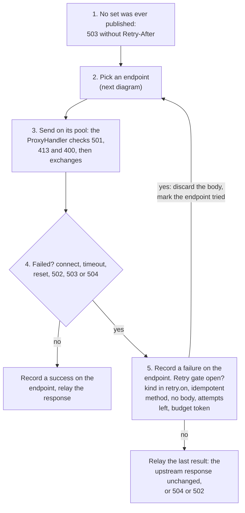
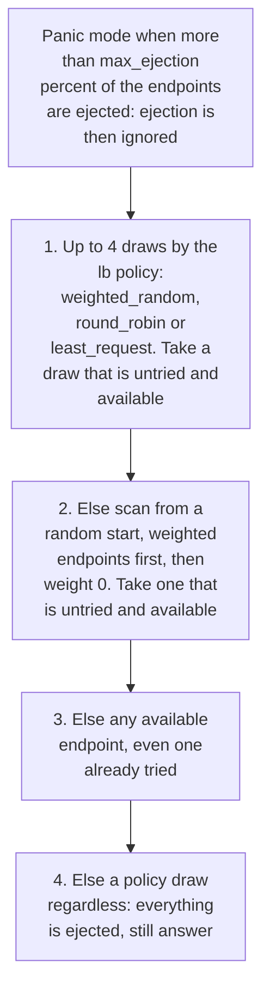
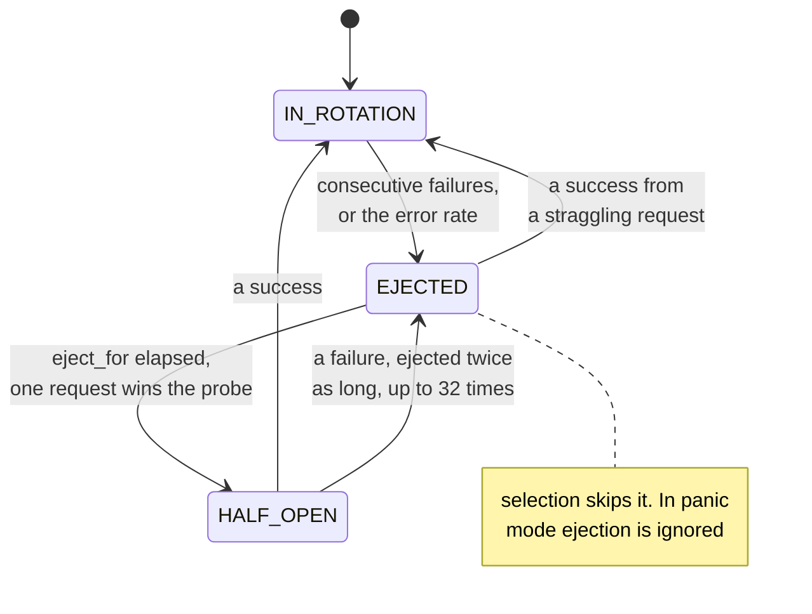

# Endpoint discovery: interface for the control-plane watch client

Status: data plane implemented (B.4). The watch client (HA) is the producer; until it lands, sources
are fed from config (`routing.upstreams.<name>.endpoints`) or by tests.

## Types (`sjws_nettask.routing.discovery`)

| Type | Shape |
|---|---|
| `Endpoint` | `record Endpoint(String id, String address, int port, int weight, Map<String,String> labels, Health health, String zone)`. `Health` is `READY`, `SUSPECT`, `DEAD`. Port 1..65535, weight 0..1 000 000. A null `id` defaults to `host:port` (IPv6 bracketed). `Endpoint.of(address, port)` is READY, weight 1. |
| `UpstreamSet` | `record UpstreamSet(String service, long version, Endpoint[] ready, LbPolicy policy)`. A full snapshot, never a delta. The array is copied; a null policy means `WEIGHTED_RANDOM`. |
| `LbPolicy` | `WEIGHTED_RANDOM` (default, alias table), `ROUND_ROBIN`, `LEAST_REQUEST` (two random choices). `wireName()` is the lower-case name; `parse(String)` returns null for an unknown name, `parseOrDefault` falls back to `WEIGHTED_RANDOM`. New values may be added: a producer must send a wire name and a consumer that does not know it uses the default. |
| `UpstreamSource` | `current()` (null until populated), `subscribe(Consumer<UpstreamSet>)` returning `AutoCloseable`, `update(UpstreamSet)` returning whether it was applied. |
| `UpstreamRegistry` | `lookup(service)` returns the live source for a configured upstream, or null if no upstream of that name has endpoints. |

## Feeding a source

```java
var source = UpstreamRegistry.lookup("api");      // null: this node does not route to "api"
if (source != null) {
    source.update(new UpstreamSet("api", version, endpoints, LbPolicy.parseOrDefault(wireName)));
}
```

Call `update` from the watch thread. It is synchronized, cheap (it builds an immutable view and
swaps a reference), and listeners run on the caller's thread.

Rules:

1. **Versions are monotonic per service.** An update whose version is not greater than the last one
   seen is ignored (`update` returns false). Config sets use version 0, so **CP versions start at 1**.
2. **Full snapshots.** Each update replaces the whole list.
3. **Health:** `READY` serves at its weight; `SUSPECT` is weight 0 (used only when no weighted
   endpoint is available); `DEAD` is removed. Sending DEAD or leaving the endpoint out is the same.
4. **Empty update** (nothing left after removing DEAD): the version is recorded but the last
   non-empty set keeps serving. A source that has never had a non-empty set answers 503.
5. **The CP is authoritative once it has fed a source.** A config reload recompiles routes and
   reuses the same source; it does not overwrite a set the CP has published. Before the first CP
   update, a reload replaces the config set.
6. Outlier state (ejection, error rate) is local and is never reported back.

## Data-plane behaviour

- One connection pool per endpoint, keyed by `host:port`, reference-counted across sets: an endpoint
  that stays in the next set keeps its warm connections and its health. A removed endpoint is closed
  after a 10 s grace so in-flight requests finish.
- A retry (per the upstream's `retry`) goes to an endpoint not yet tried while one exists.
- Per-endpoint circuit: consecutive failures and an error-rate window, ejection with doubling
  backoff and one probe, panic mode above `max_ejection` (see `docs/user/config-file.md`).
- An upstream with a single `url` does not go through any of this.

One request through an upstream with `endpoints` (`routing.EndpointBalancer`). An endpoint upstream never
runs the `ProxyHandler`'s own retry or circuit breaker: the balancer owns both, per endpoint.



How an endpoint is picked. An endpoint is available when it is in rotation, or is the one request that wins
the half-open probe after `eject_for`. `SUSPECT` endpoints have weight 0, so the weighted pass leaves them for last:



Passive health of one endpoint. It is ejected after `failures` consecutive failures (default 5), or when the
error rate over `window` (default 10 s, in two buckets) reaches `error_rate` (default 50 %) with at least
`min_requests` (default 20) requests. It stays out for `eject_for` (default 10 s). Only connect, timeout, reset
and 502, 503 or 504 count as failures:


