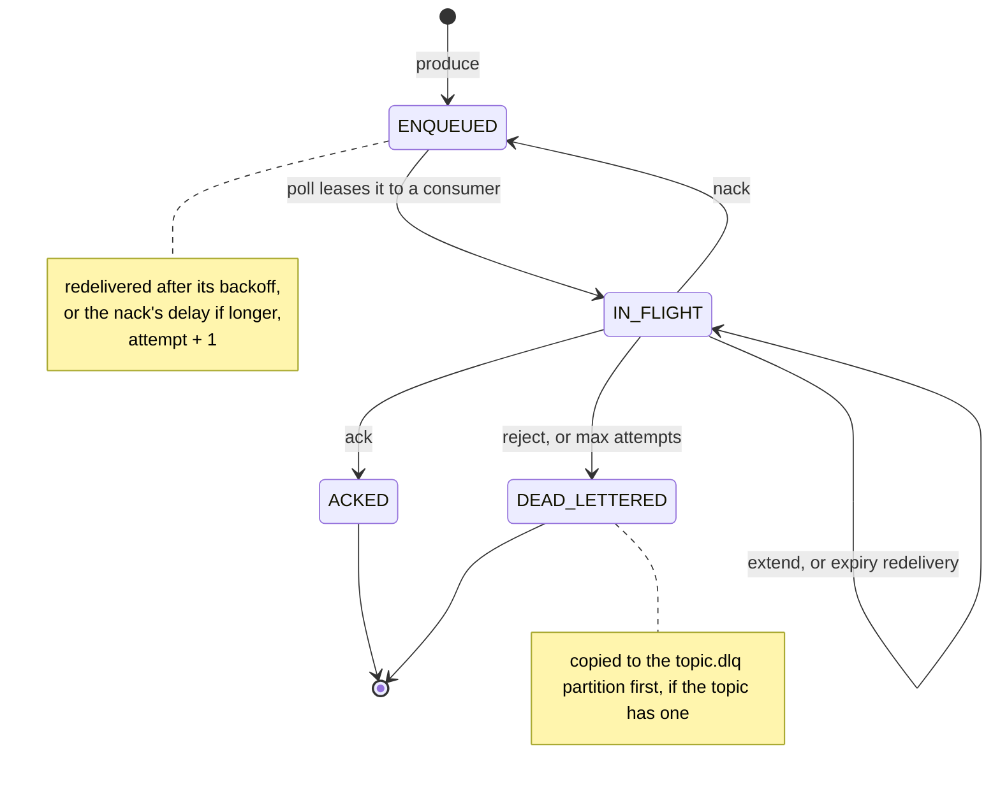
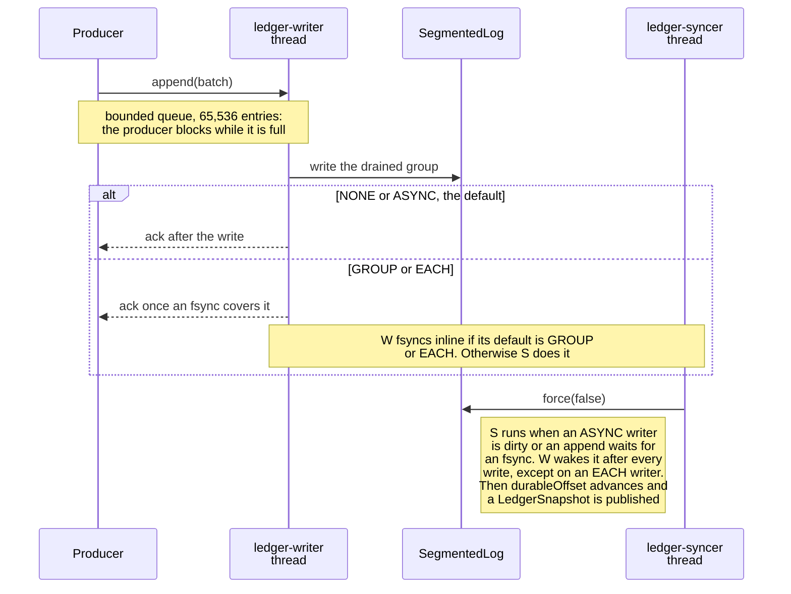
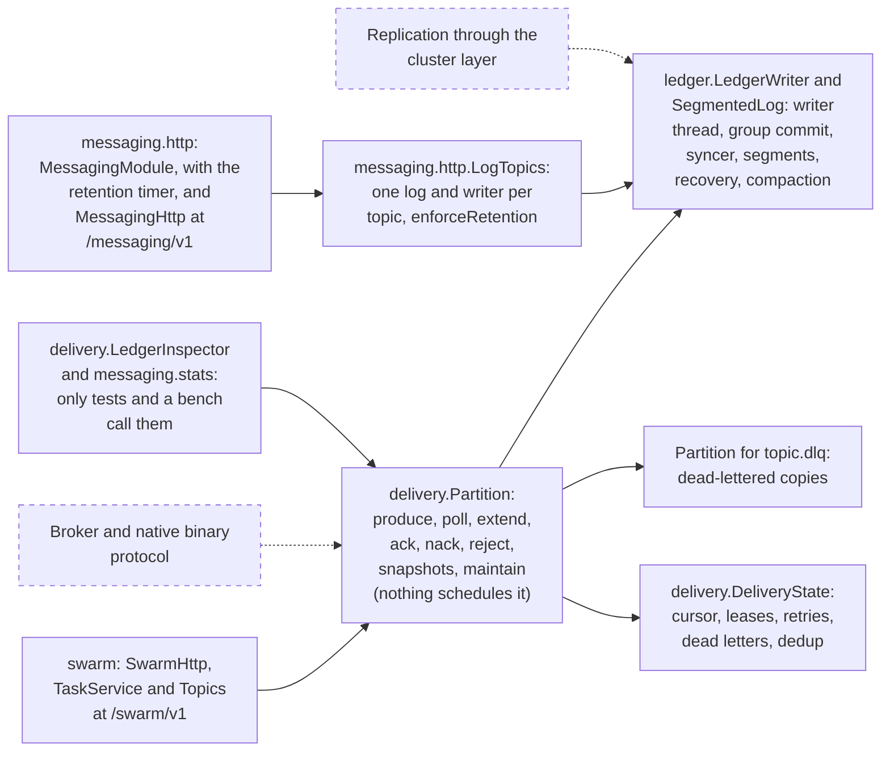

# Messaging Core Design — sjws_nettask

Status: Draft · Base: master b8055fe · Owner: Messaging Core workstream
Aligned with: docs/design/architecture.md "Target: message-oriented middleware" (PR #16, T0–T6, §B, §A). Where this doc is more
specific it refines PR #16; it does not contradict it. Benchmark numbers quoted from PR #16 §B2.

## 0. Scope
sjws is heading toward reliable, low-latency message-oriented middleware. **Messaging Core =
the message queue/broker core**: partitions, a durable ledger, producers/consumers,
acknowledgement, redelivery, dead-lettering, inspection, and replication through the
cluster layer designed by the HA workstream (`docs/ha/design.md`).
Out of scope: the wire protocol for clients (it sits on the existing HTTP/1.1 and HTTP/3
transports behind `core.Handler`; it gets its own doc), the admin TUI itself, and the metrics backend.

## 1. Concepts
- **Topic → partitions**. Each partition is the unit of order, durability and replication
  (one replication group per partition).
- **Message**: `{partition, offset, key?, headers, payload, enqueuedAt, attempts}`;
  `offset` = a monotonic per-partition sequence number assigned at append.
- **Consumer group**: named, with a **per-consumer-group offset** per partition (the committed
  low watermark). Exclusive per-partition assignment within a group, so order is preserved.
- **Message states** (per group): `ENQUEUED → IN_FLIGHT → ACKED`, with
  `IN_FLIGHT → ENQUEUED` on nack/visibility timeout (attempts+1) and
  `→ DEAD_LETTERED` once it has been delivered `maxAttempts` times and is nacked or its lease expires, or on an explicit reject.



This is what `messaging.delivery.Partition` implements today. A settle (ack, nack, reject, extend) carries
the attempt it was leased under, and an older attempt is refused as `STALE_ATTEMPT` (`NOT_IN_FLIGHT` once the
message is no longer in flight). `extend` keeps the
attempt and moves the lease deadline. A lease expires lazily: nothing fires at the deadline, and the next
poll of the group redelivers it as attempt + 1 once the deadline plus the backoff has passed, or
dead-letters it when it has used `maxAttempts`.

## 2. Durable ledger
Every non-acked message and each of its state transitions is durable before it is
acknowledged to the caller.

### 2.1 Layout (per partition directory)
```
<topic>/
  00000000000000000000.log   # append-only segment (<baseOffset:020d>.log, 1 GiB default, per PR #16 T3)
  00000000000000000000.index # sparse relative offset -> file position (every 4 KiB), written when a segment is sealed
  state-00000000000000000000.snap  # snapshot of the delivery state, named by offset; the newest two are kept
  retain-from.pins           # only while a retain-from pin is set
```
Record types: `ENQUEUE(producerId,seq,ts,origin…,payload)`, `SUBSCRIBE(group,fromOffset)`,
`DELIVER(group,offset,consumer,deadline,attempt)`, `EXTEND(group,deadline,offsets,attempts)`,
`ACK(group,offset)`, `NACK(group,offset,notBefore)`, `DLQ(group,offset,reason)`. Messages and their state transitions share one ordered log, so the
log defines the state exactly. Framing follows PR #16 T3: records are grouped in batches
`[len:int][crc32c:int][baseOffset:long][count:int][timestampMs:long] count×([recLen:int][bytes])`;
the CRC32C covers the batch. Batches are the unit of write, fsync, replication and fetch
(disk format = wire format, see §10.5). Segments roll at 1 GiB (configurable); they are not preallocated.

### 2.2 Group commit / fsync
- One dedicated **platform thread** per partition writer (PR #16 T1: blocking file I/O must not pin
  virtual-thread carriers), fed by a bounded queue (65 536 entries, also the backpressure signal), drains pending
  appends and writes them with one positional write. A **background syncer** thread issues
  `force(false)` (fdatasync) continuously, off the ack path, and advances `durableOffset`. The ledger
  therefore records **every** enqueued and undelivered message durably (lagging at most one fsync behind
  the ack), without fsync latency on the default ack (decision by Blivion, 2026-10-12).
- A group closes at `maxGroupBytes` (4 MiB), after `lingerNanos` (0 by default) or on an idle queue, whichever comes first.
  Under load this amortizes fsync across thousands of records; when idle, latency is about one fsync.
  Measured in PR #16 §B2: one fsync ≈ 0.5 ms, so per-record fsync (`each`) caps at ~1.7k rec/s,
  while `group` reaches 48.6k rec/s at p50 1.12 ms / p99 4.95 ms with 64 producers. The linger
  (`lingerNanos`, set only in benchmarks and tests) is PR #16's proposed "later option", which addresses the 1-producer case (1.7k rec/s).
- Local durability modes (implemented in PR #21 `messaging.ledger.Durability`), selectable **per topic
  and per append (producer)**:
  - `async` (**default**): ack after write(2); background group fsync. PR #21 bench: 288k rec/s, p50 171 µs at 64 producers.
  - `group` (opt-in): ack after the fsync covering the record. 48.6k rec/s (PR #16) / 57.6k (PR #21) at 64 producers.
  - `each` (opt-in, compliance): one fsync per batch, ~1.2–1.7k rec/s.
  - `none`: no fsync on the path at all (tests and caches only).
- Cluster default: `replicated` = **ack on majority in-memory receipt** (as in PR #16 T3), with each
  replica fsyncing in the background. **Quorum + fsync (`strict`) is opt-in per topic or per producer**
  (§6, req. 2). See §2.6 for what each mode can lose.

The local write path, as `messaging.ledger.LedgerWriter` implements it:



### 2.3 In-memory state machine
Per partition and group: `nextOffset`, `committedOffset`, an in-flight map with a deadline-ordered
set, a retry map, and per-state counters. Payloads are kept only for recent messages (a ring bounded by
`payloadCacheBytes`, 64 MiB by default, trimmed once every group has settled them); older ones are read back from
segments (page cache) via the index.

### 2.4 Crash recovery (exact replay)
1. Open the segments; this truncates the tail at the first bad length or CRC (torn write).
2. Load the newest valid `state-<offset>.snap` (falling back to an older one).
3. Replay records after the snapshot deterministically. In replicated mode,
   reconcile with the group's committed index (§6).
4. Leases in flight keep their deadlines; the next poll redelivers the expired ones (at-least-once).
Invariant: `state(replay(log)) == pre-crash state` for every fsynced prefix (process crashes keep the
page cache, so after SIGKILL that means every write; PR #21's crash test checks it). This is
tested by cutting the log at every byte, random tail corruption, and kill -9 of a child JVM.

### 2.5 Retention, truncation, compaction
- Partition low watermark = min(oldest retained snapshot, oldest message not yet resolved by every group (a dead letter counts), lowest retain-from pin).
  A segment entirely below it *and* covered by a snapshot is deleted.
- `Partition.maintain()` rewrites sealed segments that a snapshot covers but a few live messages pin, keeping only those records, and swaps them in through a `.cmp` file and a `.compacted` marker. Nothing schedules it yet.
- The DLQ is a topic (`<topic>.dlq`) with the original offset, reason and attempts in the origin fields of its ENQUEUE record.

### 2.6 Crash-loss window
What an **acked** message can lose, by mode. "Unsynced window" W = records written but not yet fsynced
on a node. With the background syncer, W ≤ the records written during one fsync plus `fsyncInterval`
(default 0): ≈0.5–1 ms of traffic on the PR #16 VM, plus linger (≤200 µs) when enabled. It is exposed live as
`LedgerSnapshot.unsyncedRecords()` and in the inspection API (§4).

| Mode | Process crash (SIGKILL/OOM), any number of nodes | Power/kernel loss of a minority | Power/kernel loss of a majority at once |
|---|---|---|---|
| single-node `async` (default) | nothing (page cache survives) | n/a | last W on that node |
| single-node `group` / `each` | nothing | n/a | nothing |
| cluster `replicated` (default, majority in-memory) | nothing as long as a majority comes back with its page cache, otherwise as the next column | nothing (the survivors have it; laggards re-fetch) | acked entries that were not yet fsynced on any surviving member of the new majority: at most W per node, i.e. ≈ one fsync interval + linger + replication batch delay |
| cluster `strict` (opt-in, quorum + fsync) | nothing | nothing | nothing (unless a majority of disks is destroyed) |

Notes:
- Loss needs a correlated failure: a majority losing power (not just the process) inside the same ~1 ms window.
  Single-rack or single-PDU deployments should use `strict` for critical topics.
- Loss is always a **suffix**: recovery truncates to the longest durable prefix, so no holes and no
  reordering. Raft then elects among the survivors and the new leader's log wins. Consumers may have
  seen a lost message (at-least-once does not protect against that), and the producer's idempotent sequence
  allows a retry to re-append it.
- Ledger state records (DELIVER/ACK/DLQ) follow the same mode as the topic. A lost ACK leads to a
  redelivery (safe under at-least-once). A lost ENQUEUE is the only real loss.
- Unacked messages are never "lost": the producer never got the ack and retries.

## 3. Delivery, redelivery, DLQ
- `poll(group, consumer, max, visibilityTimeout)` writes `DELIVER` records;
  `ack(group, offsets)`, `nack(group, offset, delay?)`, `reject(group, offset)`.
- A lease expires lazily: the next poll redelivers it once its deadline plus the backoff `min(base·2^(attempt-1), max)` (`RetryPolicy.backoffMs`) has passed.
- `orderedByKey` is not built (the ledger entry has no key).
- At-least-once; producer idempotency `(producerId, seq)` dedups retried appends within a window.
- **Topics without a DLQ.** `Partition.open(..., deadLetterQueue = false)` opens a
  topic with no `<topic>.dlq` partition (the control plane's `dlq.enabled: false` is meant to map to it): no directory and no writer, syncer or snapshotter threads for it. A message
  that reaches `maxAttempts` (nacked, or its lease expired) or is explicitly rejected is then **dropped in place**:
  the topic's own log records `DLQ(group, offset, reason)` exactly as with a DLQ, so the message is terminal for that
  group, counted in `deadLettered`, listed (with its reason) by inspection and never delivered again, and its payload
  becomes reclaimable by retention, but no copy is kept anywhere. Use it for traffic where a failed message has no
  value later (request/reply, telemetry). Replay is unchanged (the same records), and an existing `<topic>.dlq`
  directory is left untouched, so turning the DLQ back on later still finds earlier copies.

## 4. Inspection / query API (admin TUI, metrics)
Read-only, served from in-memory state and segments, with no locks on the hot path:
- `stats(topic?, partition?, group?)`: counts per state, oldest pending age, lag,
  redelivery rate, DLQ size, fsync and batch-size histograms.
- `pending(topic, partition, group, state, fromOffset, limit)`: paginated
  `{offset, state, attempts, consumer, deadline, enqueuedAt, size, headers}`.
- `get(topic, partition, offset)`: the message and its full state history.
- Audited admin mutations, written to the ledger: requeue from the DLQ, purge, reset offset.
Exposed as Java `messaging.delivery.LedgerInspector` (counts and paged items) and
`messaging.stats.PartitionStatsRegistry` (Prometheus text). The JSON admin endpoint, `get`, the histograms and the
audited mutations are not built. Proposed series names
(produce and fetch latency, log-end / durable / unsynced / high-watermark gauges, replication
status) and the cardinality caps are in
[docs/design/messaging-metrics.md](../design/messaging-metrics.md). Those names are not stable.
sjws Messaging Core's offset, path, and label notes are folded into that proposal.
The lag gauges already rendered by `PartitionStatsRegistry` are listed there as shipped.

## 5. Package layout
`sjws_nettask.messaging`: `Broker`, `Partition`, `Ledger`, `Segment`, `SegmentIndex`,
`GroupCommitWriter`, `LedgerStateMachine`, `Snapshotter`, `RedeliveryTimer`, `Inspector`,
`ReplicatedLedger` (cluster adapter; a `LocalOnly` implementation until the cluster layer lands).

The list above is the original plan. Some names changed when the code was written. This is what exists
(solid) and what the rest of the design still needs (dashed). Two modules reach it, both opt-in and off by
default: the messaging HTTP module (`sjws.messaging.enabled`), which logs plain topics without a `Partition`,
and the swarm (`sjws.swarm.enabled`), the only production user of `Partition`:



## 6. Replication via the cluster layer
One replication group per partition. PR #16 T4 proposes Raft for metadata plus Kafka-style
follower fetch (ISR) for data, and leaves "Raft for data too" as HA open question 2. This doc depends only on the
interface below, which either shape can implement; leader epochs (PR #16) are the `term` here. The leader proposes ledger record batches via `append`;
every replica applies committed entries to `LedgerStateMachine` in index order; only the
leader serves `poll`/`ack`. Offsets and in-flight state therefore fail over with the partition. The cluster
log and the ledger may share segments (log index == ledger position), so each entry is fsynced once.

### Requirements for the cluster layer
1. **Per-partition total order**: one replicated log per group; entries are applied in index order everywhere.
2. **Durability modes, per group and per append**: the default (`RELAXED` in PR #29) completes `append` on majority
   **in-memory** receipt, with followers and the leader fsyncing in the background (as PR #16 T3). `STRICT` completes after a
   majority has fsynced. It is opt-in per topic (group option) **and per producer, which needs a per-append override**
   (`append(g, batch, durability)`). The cluster must also expose a per-group **durable index** (highest index fsynced on a
   majority) so the inspection API can report the crash-loss window (§2.6).
   *Resolved conflict:* an earlier draft made quorum+fsync the default, which contradicted PR #16. Blivion decided
   (2026-10-12) on majority in-memory as the default, matching PR #16, with strict as opt-in. This also answers HA open question 4.
3. **Latency**: single-digit-ms p99 replication on a LAN, with batching and pipelined appends.
4. **Multiplexing**: per-partition groups share one transport per node pair (shared heartbeats,
   batched cross-group frames), scaling to thousands of groups per node.
5. **Snapshot + log truncation** past acked/snapshotted indexes; snapshot install for
   lagging or new replicas; compaction-aware snapshots.
6. **API** (as in `cluster.ClusterNode`):
   ```java
   CompletableFuture<CommittedIndex> append(GroupId g, List<ByteBuffer> batch);           // group default durability
   ReplicationGroup openGroup(GroupId g, GroupOptions options, GroupListener listener); // in-order onCommitted
   void onLeaderChange(GroupId g, BiConsumer<Long, Optional<NodeId>> listener);          // term + leader
   SnapshotControl snapshots(GroupId g);                       // take / install / truncateAndCompact
   ```
   Still missing for requirement 2: a per-append durability override (`append(g, batch, durability)`) and a per-group
   durable index. Membership and quorum come from HA (`Membership`, `QuorumPolicy`). Fencing: a deposed leader
   fails pending futures and stops serving before the new term's lease starts.

## 7. Benchmark plan
Plain Java harnesses in `bench/` (no JMH) plus a load generator, run on NVMe and on a cloud volume, with results kept as CSV.
- Raw fsync cost (`force(false)`) for 4 KiB–1 MiB writes, preallocated vs not.
- Group commit: throughput and p50/p99/p999 vs `lingerNanos` {0, 50, 200, 1000 µs} ×
  producers {1, 8, 64} × size {100 B, 1 KiB, 16 KiB}.
- End-to-end produce→consume→ack latency and redelivery overhead.
- Recovery time vs log size and snapshot interval.
- Replicated: 3 nodes on a LAN, commit p99 vs batch size.
Baselines: PR #16 §B2 on the shared VM (virtio disk), which this harness must reproduce first. Ledger overhead target:
within 10 % of `LogBench` `group` (PR #16 phase 2 exit criterion), i.e. ≥ ~44k rec/s at 64 producers
for 256 B payloads with p99 ≤ ~5.5 ms on that VM. NVMe targets are set after measuring. Recovery ≤ 1 s per GiB of un-snapshotted log.

## 8. Implementation plan (separate PRs)
1. (done) Segments, `GroupCommitWriter` (as `LedgerWriter`), torn-write recovery; fault-injection tests.
2. (done) `LedgerStateMachine` (states, offsets, redelivery, DLQ) and snapshots; property tests.
3. (partial: the inspection API only) `Broker` API, `Inspector` and the admin endpoint; benchmarks.
4. (done; `maintain()` is not scheduled) Retention, truncation and compaction.
5. (open) `ReplicatedLedger` on the HA cluster layer.


## 9. Remaining open questions
- Per-key log compaction for user topics in v1: assumed no (internal topics only, as in PR #16 T3).

## 10. Answers to architecture open questions (PR #16 §A, Messaging Core)
**Proposals pending Blivion's decision.**

1. **Protocol: custom binary vs Kafka/AMQP/MQTT compatibility.** *Recommendation: custom binary
   protocol plus HTTP bindings, with compatibility adapters later.* The native framing mirrors the
   on-disk batch (§2.1), so produce goes straight to append and fetch uses sendfile. Our state model
   (per-message ack, DLQ, inspection) doesn't map cleanly onto the Kafka protocol, and implementing
   Kafka's wire protocol faithfully (versioned APIs, group coordinator, transactions) is a multi-quarter
   effort. AMQP 1.0 and MQTT 5 suit queue-style and IoT clients and can be thin gateways over the broker API
   (phase 4+). Keep the framing versioned so adapters stay possible.
2. **Exactly-once.** *Recommendation: not in v1.* Use at-least-once by default plus idempotent producers
   (dedup by `(producerId, seq)` at the leader), giving effectively-once appends; consumers dedup
   by `(partition, offset)` or use idempotent handlers. Exactly-once transactions add a coordinator
   and markers to every read and cost latency, against our low-latency goal. Revisit if a concrete
   consume-transform-produce use case appears.
3. **Queues as consumer groups vs a separate store.** *Recommendation: a hybrid inside the same log.* A
   queue is a topic with one shared consumer group (PR #16 T2), but per-message state
   (DELIVER/ACK/NACK/DLQ records, §2.1) goes into the partition's own ledger, not a separate store.
   This gives per-message ack, redelivery, DLQ and inspection (Blivion's hard requirements, which a
   single committed offset cannot express) while keeping one ordered, replicated, crash-recoverable log.
   The committed offset is then the low watermark of fully acked messages. A separate store would need its own
   durability and replication path. Per-message TTL and priority are deferred; priority would
   use multiple partitions or topics.
4. **Group fsync as default.** *Original recommendation: yes,* `group` is the single-node default, with a
   linger of 0 by default and configurable up to ~200 µs. PR #16 §B2 data: 48.6k rec/s at p50 1.1 ms
   with 64 producers vs 1.7k rec/s for `each`; `none` is unsafe as a default for a "reliable" MOM.
   **Superseded by Blivion's decision (2026-10-12):** group fsync still runs on every node, but **in the background**.
   The default ack is `async` locally and majority in-memory (`replicated`) in a cluster; `group`/`strict` are opt-in per topic or
   producer. The crash-loss window is documented in §2.6.
5. **On-disk format = wire format.** *Recommendation: yes,* at batch granularity. Batches are
   stored exactly as produced on the wire (after the leader assigns the base offset and
   validates the CRC32C), which enables sendfile fetch for consumers and followers (PR #16 T1) and one
   fsync per batch. State records (DELIVER/ACK…) use the same batch framing with a record-type field.
   A batch version byte is not in the format yet.
