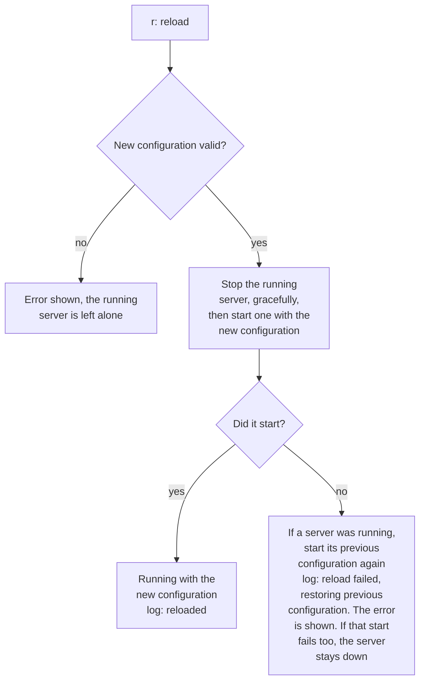

# Admin console

A small terminal console (plain ANSI, no extra dependency) runs the server in-process and lets an
admin see its status and configuration, tail logs, and start, stop or reload it:

    java -cp "target/sjws_nettask-0.2-SNAPSHOT.jar:target/lib/*" sjws_nettask.admin.AdminMain [server arguments]

It takes the server's option flags and `WEB_SERVER_*` variables (not a `--config` file, and not the daemon, role and bootstrap options), plus its own: `--log-file=PATH` (a file
shown in the logs view, e.g. redirected output), `--no-color`, `--no-autostart`. Commands (letter +
Enter): `s` start, `x` stop, `r` reload (re-reads arguments and environment; an invalid config
leaves the server running, a config that fails to bind restores the previous one), `v`/`c`/`l`/`g`
status/config/logs/metrics views, Enter refresh, `h` help, `q` quit (stops the server). The console talks to
the server only through `sjws_nettask.admin.ServerControl`, so another implementation (e.g. one
controlling a daemon) can be plugged in. `clusterStatus()` is null until a control plane attaches
a `ClusterBoard`; the status view then shows cluster requests per second, p99, errors, drifted
nodes, and per-route totals.

## Metrics view

`g` (or `5`) opens the Metrics view (#366). It reads Observability's metrics snapshots, which are
copies, so the view takes no hot-path locks. It shows one block per node: requests, bytes,
connections, responses by status class and by protocol, and latency p50, p99 and max. With more
than one node there is also an aggregate block. Counters and connection gauges are summed, latency
histograms are merged bucket by bucket on Observability's fixed log2 layout, and p50 and p99 come
from the merged buckets, never from averaging per-node percentiles. `Nodes reporting n/m` shows how
many known nodes answered, and missing nodes are not in the totals. `EmbeddedServerControl` reports
the local node. Fetching remote node snapshots is not wired yet.

`r` restarts the server with the re-evaluated configuration and rolls back if that cannot start. The
new server fails to start when, for example, its port cannot be bound:

