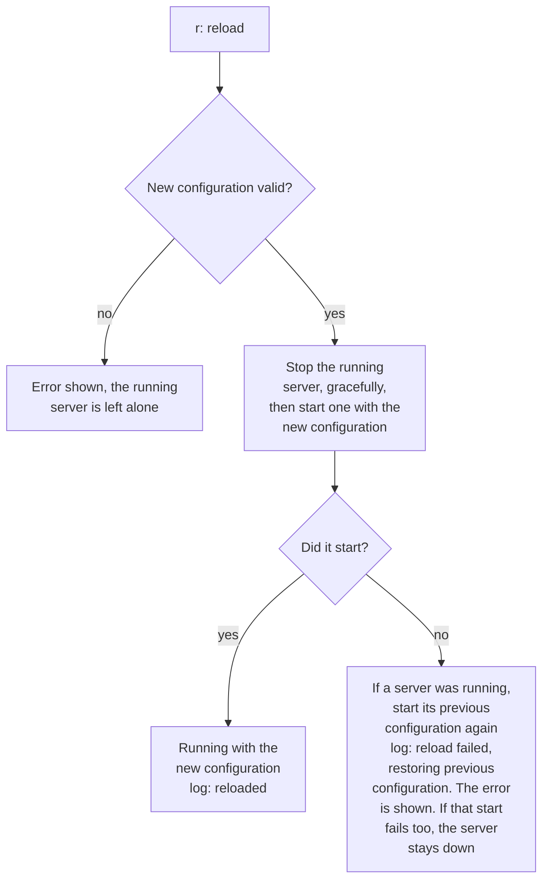

# Admin console

A small terminal console (plain ANSI, no extra dependency) runs the server in-process and lets an
admin see its status and configuration, tail logs, and start, stop or reload it:

    java -cp "target/sjws_nettask-0.2-SNAPSHOT.jar:target/lib/*" sjws_nettask.admin.AdminMain [server arguments]

It takes the server's option flags and `WEB_SERVER_*` variables (not a `--config` file, and not the daemon, role and bootstrap options), plus its own: `--log-file=PATH` (a file
shown in the logs view, e.g. redirected output), `--no-color`, `--no-autostart`. Commands (letter +
Enter): `s` start, `x` stop, `r` reload (re-reads arguments and environment; an invalid config
leaves the server running, a config that fails to bind restores the previous one), `v`/`c`/`l`/`m`
status/config/logs/queues views, Enter refresh, `h` help, `q` quit (stops the server). The console talks to
the server only through `sjws_nettask.admin.ServerControl`, so another implementation (e.g. one
controlling a daemon) can be plugged in. `clusterStatus()` is null until a control plane attaches
a `ClusterBoard`; the status view then shows cluster requests per second, p99, errors, drifted
nodes, and per-route totals.

## Queues view

`m` (or `4`) opens the Queues view (#384). For each topic and consumer group it shows pending,
in-flight and dead-lettered counts and the age of the oldest pending message. `d <topic> <group>
[fromOffset]` lists up to 20 dead-lettered entries from that offset: offset, attempts, size,
consumer and reason. When a page is full the console prints the command for the next page. The view
reads Messaging Core's `LedgerInspector` snapshots, the same rate-limited view the messaging API
uses, and does not take partition locks for the admin call. Payloads are never read or shown, and
control characters, bidi formatting characters and the U+2028/U+2029 separators in topic, group,
consumer, reason and error text are shown as `?`. A failure while reading dead letters is shown as
an error and leaves the console and the server running. The view is empty until messaging topics
are attached with `EmbeddedServerControl.attachQueues`. The server's start path holds no
`LedgerInspector` sources today (delivery partitions live inside the optional swarm layer), so
nothing attaches them automatically yet.

The view is read-only. DLQ requeue and purge wait for a Messaging Core API, and in-flight entries
stay read-only from the console.

`r` restarts the server with the re-evaluated configuration and rolls back if that cannot start. The
new server fails to start when, for example, its port cannot be bound:

