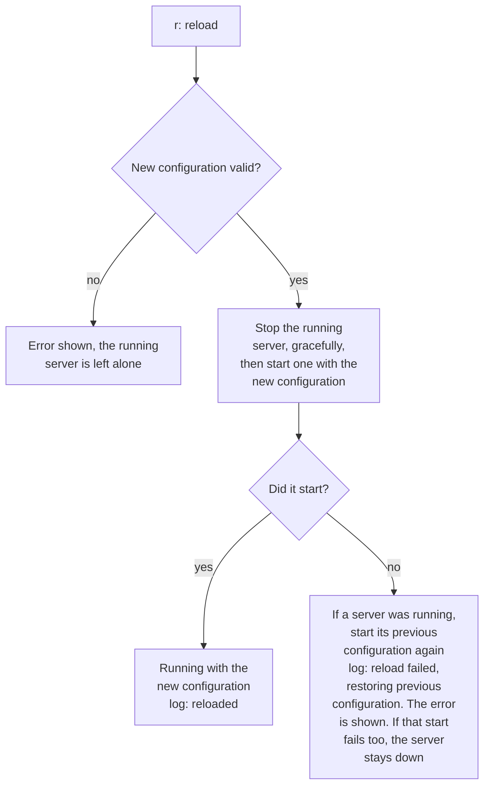

# Admin console

A small terminal console (plain ANSI, no extra dependency) runs the server in-process and lets an
admin see its status and configuration, tail logs, and start, stop or reload it:

    java -cp "target/sjws_nettask-0.2-SNAPSHOT.jar:target/lib/*" sjws_nettask.admin.AdminMain [server arguments]

It takes the server's option flags and `WEB_SERVER_*` variables (not a `--config` file, and not the daemon, role and bootstrap options), plus its own: `--log-file=PATH` (a file
shown in the logs view, e.g. redirected output), `--no-color`, `--no-autostart`. Commands (letter +
Enter): `s` start, `x` stop, `n` drain, `r` reload (re-reads arguments and environment; an invalid config
leaves the server running, a config that fails to bind restores the previous one), `v`/`c`/`l`/`m`/`g`/`k`
status/config/logs/queues/metrics/cluster views, Enter refresh, `h` help, `q` quit (stops the server). The console talks to
the server only through `sjws_nettask.admin.ServerControl`, so another implementation (e.g. one
controlling a daemon) can be plugged in. `clusterStatus()` is null until a control plane attaches
a `ClusterBoard`; the status view then shows cluster requests per second, p99, errors, drifted
nodes, and per-route totals.

Text that comes from outside the console (node ids, drain error text, unknown-command input, and
lines in the logs and recent-events panes) goes through the same printable policy as the Queues
view: control characters, bidi formatting characters and the U+2028/U+2029 separators are shown
as `?`.

## Queues view

`m` (or `4`) opens the Queues view (#384). For each topic and consumer group it shows pending,
in-flight and dead-lettered counts and the age of the oldest pending message. `d <topic> <group>
[fromOffset]` lists up to 20 dead-lettered entries from that offset: offset, attempts, size,
consumer and reason. When a page is full the console prints the command for the next page. The view
reads Messaging Core's `LedgerInspector` snapshots, the same rate-limited view the messaging API
uses, and does not take partition locks for the admin call. Payloads are never read or shown, and
control characters, bidi formatting characters and the U+2028/U+2029 separators in topic, group,
consumer, reason and error text are shown as `?`. A failure while reading dead letters is shown as
an error and leaves the console and the server running. The view is empty until messaging topics
are attached with `EmbeddedServerControl.attachQueues`. The server's start path holds no
`LedgerInspector` sources today (delivery partitions live inside the optional swarm layer), so
nothing attaches them automatically yet.

The view is read-only. DLQ requeue and purge wait for a Messaging Core API, and in-flight entries
stay read-only from the console.

`k` (or `6`) opens the Cluster view (#363). It lists every node in `clusterStatus()` with a
rolled-up health and named checks: `alive` (DOWN when unreachable), `ready`, `serving` (fails while
draining) and `config` (fails when the applied version drifts from the desired one). A live node
that fails any check is DEGRADED. `node <id>` opens one node's checks, and `node` alone clears the
selection. The view reads the cluster status on a virtual thread and waits at most 2 seconds, so a
slow status source shows as unavailable instead of stalling the console. Membership and the health
flags come from the control plane's `ClusterBoard` (HA owns discovery). Opening a remote node's
start/stop/reload controls needs a remote `ServerControl`, which does not exist yet.

## Drain

`n` explains what a drain does. Typing `drain confirm` starts one (#381): the server stops
accepting, in-flight work finishes up to the HA drain timeout, and then the server closes. With HA
detached, a drain is a graceful close. The drain runs in the background, so the console stays
responsive. The status view shows the operation id (`drain-N`) as `DRAINING`, `DRAINED`, or
`FAILED` with the reason. A second `drain confirm` while one runs returns the same operation.
`s` and `r` are refused until it ends. `x` still stops the server at once and ends the drain as
`FAILED` (`stopped during drain`), so `s` and `r` work again right away. A drain cannot be
cancelled, because HA's drain lifecycle has no cancel. Failover is not available from this
console: it stays behind HA's fencing path.

## Metrics view

`g` (or `5`) opens the Metrics view (#366). It reads Observability's metrics snapshots, which are
copies, so the view takes no hot-path locks. It shows one block per node: requests, bytes,
connections, responses by status class and by protocol, and latency p50, p99 and max. With more
than one node there is also an aggregate block. Counters and connection gauges are summed, latency
histograms are merged bucket by bucket on Observability's fixed log2 layout, and p50 and p99 come
from the merged buckets, never from averaging per-node percentiles. `Nodes reporting n/m` shows how
many known nodes answered, and missing nodes are not in the totals. `EmbeddedServerControl` reports
the local node. Fetching remote node snapshots is not wired yet.

`r` restarts the server with the re-evaluated configuration and rolls back if that cannot start. The
new server fails to start when, for example, its port cannot be bound:

