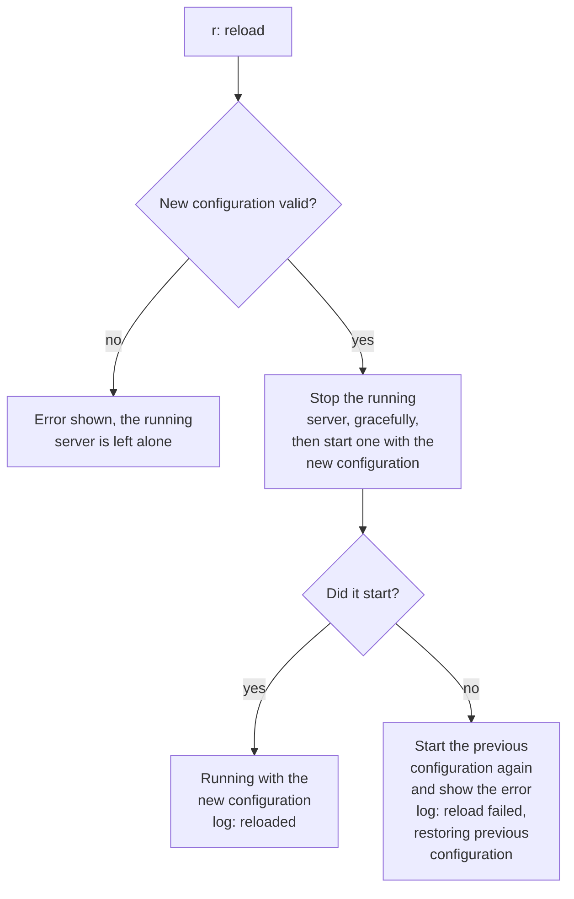

# Admin console

A small terminal console (plain ANSI, no extra dependency) runs the server in-process and lets an
admin see its status and configuration, tail logs, and start, stop or reload it:

    java -cp "target/sjws_nettask-0.2-SNAPSHOT.jar:target/lib/*" sjws_nettask.admin.AdminMain [server arguments]

It takes the same arguments and environment as the server, plus its own: `--log-file=PATH` (a file
shown in the logs view, e.g. redirected output), `--no-color`, `--no-autostart`. Commands (letter +
Enter): `s` start, `x` stop, `r` reload (re-reads arguments and environment; an invalid config
leaves the server running, a config that fails to bind restores the previous one), `v`/`c`/`l`
status/config/logs views, Enter refresh, `h` help, `q` quit (stops the server). The console talks to
the server only through `sjws_nettask.admin.ServerControl`, so another implementation (e.g. one
controlling a daemon) can be plugged in. `clusterStatus()` is null until a control plane attaches
a `ClusterBoard`; the status view then shows cluster requests per second, p99, errors, drifted
nodes, and per-route totals.

`r` restarts the server with the re-evaluated configuration and rolls back if that cannot start. The
new server fails to start when, for example, its port cannot be bound:

