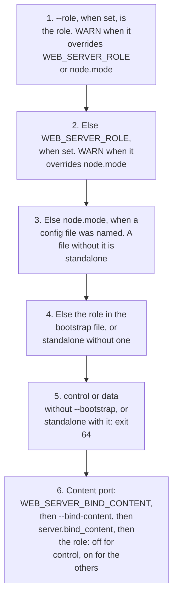

# Control-plane and data-node service

How a `control` or `data` process is started, how it learns its control plane, and how
`--stop` drains it. The design this follows is
[control plane](../design/control-plane.md)
(PR #38) and the HA drain in [high availability](../ha/design.md). Role `standalone` does
not read this file and does not load `sjws_nettask.service`.

## Units

| Unit | Role |
|---|---|
| `contrib/sjws_nettask.service` | standalone, unchanged |
| `contrib/sjws_nettask-control@.service` | `systemctl enable --now sjws_nettask-control@1` |
| `contrib/sjws_nettask-data@.service` | `systemctl enable --now sjws_nettask-data@edge1` |

Both role units are `Type=forking`. `--daemon` writes the pid file and the parent exits. Their `ExecStart` lines pass `--add-opens=jdk.httpserver/sun.net.httpserver=ALL-UNNAMED` (also in the jar `Add-Opens` manifest) so admin TLS can close keep-alive connections after a reload.
`User=sjws` must exist (`useradd --system --home /var/lib/sjws_nettask --shell /usr/sbin/nologin sjws`).
`UMask=0077`, `-XX:-HeapDumpOnOutOfMemoryError`, and `LimitCORE=0` keep a join token out of
files the process creates and out of crash dumps. Those JVM flags are not on the standalone unit.

`TimeoutStopSec=45` on every unit, including standalone. `--stop` waits for the drain
budget (default 30 s, `drain-ms` in the status file) plus a 5 s margin, then SIGKILL.
The extra 10 s is for the `ExecStop` JVM to start. `--shutdown-timeout` only bounds
responses already in flight inside the process; it is not added to that wait. Raising
`--drain-budget` requires raising `TimeoutStopSec` by the same amount.

`systemd` `active` means the main process is up (`Type=forking` and the pid file). These
units do not call `sd_notify`. Readiness is `GET /readyz` when high availability serves
that probe, and `--status`. Do not treat `systemctl is-active` as leader-ready or as
"config applied".

`ExecReload=/bin/kill -HUP $MAINPID` on the standalone unit and both role units. The
daemon child handles `SIGHUP` by `ReloadHook.run()`. It is started in a new session
(`setsid` when `/usr/bin/setsid` exists), so closing the terminal does not deliver
`SIGHUP`. A foreground process is not given that handler and still dies on hangup.
On a data node that has accepted a pushed config, reload refreshes local bootstrap
settings (listen, peers, labels, contact, pin) and does not replace that config.
Before any push, reload re-reads the local YAML. `systemctl restart` is still a full
stop and start; `ExecReload` does not re-read the join token.

Data nodes do not `Requires=` a control unit. A same-host ordering drop-in that still lets
the data node start when control is down is `contrib/sjws_nettask-data-same-host.conf`.

## Sample configs

The schema field is `node.mode`. There is no `node.role` key. These paths are stable so a
release package can install them as-is:

| Packaged file | Installed path the unit passes to `--config` |
|---|---|
| `contrib/sjws_nettask-standalone.yaml` | `/etc/sjws_nettask/sjws_nettask-standalone.yaml` |
| `contrib/sjws_nettask-control.yaml` | `/etc/sjws_nettask/control-%i/sjws_nettask-control.yaml` |
| `contrib/sjws_nettask-data.yaml` | `/etc/sjws_nettask/data-%i/sjws_nettask-data.yaml` |

`data-role`, the control-plane contact, the pin, and the join token stay in the bootstrap
file. The YAML samples only set `schema`, `version`, `node.mode`, `node.labels`, and the
content listener.

Precedence for the role is `--role`, then `WEB_SERVER_ROLE`, then `node.mode`. Each
override is logged at startup (`WARN: --role=control overrides WEB_SERVER_ROLE=data`,
`WARN: --role=control overrides node.mode=data`, or
`WARN: WEB_SERVER_ROLE=data overrides node.mode=standalone`). Other settings keep the
config-file rule: defaults, then the file, then arguments, then the environment.
No flag, no variable, and no config file leaves the role to the bootstrap file.
`control` or `data` requires `--bootstrap`. A config file whose mode is `standalone`
(including a file that omits `node`) rejects `--bootstrap`.

A control process does not bind the content port unless `--bind-content` /
`WEB_SERVER_BIND_CONTENT` or `server.bind_content: true` says so. Data and standalone
bind it unless that flag or key turns it off. The sample control file sets
`bind_content: false`. The document root in the file must still exist: the process
builds the content snapshot even when it does not listen. The admin and watch listeners
come from the `cp:` block (`cp.admin.listen`, `cp.watch.listen`, mTLS from `cp.tls`; see
[control-plane hosting](../design/control-plane-hosting.md)). A control role with no cp
settings exits 64 before any listener, so the sample control file needs a `cp:` block.

In order, the process settles its role, checks it against `--bootstrap`, and then decides on the
content port:



## Bootstrap

`--bootstrap=PATH` (`WEB_SERVER_BOOTSTRAP`) is a mode `0600` or `0640` file. The role that
wins above must match the file. The secret is not a flag and not an
environment variable. Paths inside the file are absolute. The pin and the join token sit
outside `state-dir`.

```
role=data
data-role=gateway
node-id=gw-1
control-plane=10.0.0.2:9443
pin=/etc/sjws_nettask/data-edge1/root.pub
join-token=/etc/sjws_nettask/data-edge1/join.token
state-dir=/var/lib/sjws_nettask/data-edge1
label.track=canary
capabilities=http1,proxy
```

A control file uses `role=control`, omits `data-role` and `control-plane`, and may set
`peers=` and `listen=`; both are stored and not used. The voter set is `cp.peers` in the YAML
`cp:` block, and an empty `cp.peers` is the one-voter development control plane.

The join-token file is mode `0600` or `0400`, not a symlink:

```
token-id=edge1-2026
secret=<16 to 512 printable ASCII characters>
```

On first start the token file is required (unless the bootstrap names `cp-tls-cert`,
`cp-tls-key` and `cp-tls-ca`, where the node certificate is the enrollment) and the pinned
root public key must exist. A missing pin refuses to start. The process holds the secret in
a `byte[]` and does not log it. A data node then dials its `control-plane=` contact (the
watch client, `cp.DataWatch`), and `--status` shows `connection=pending` and
`config-version=0` until the first answer.

`NodeEnrollment.tokenConsumed()` is the call meant to run after the consume commits. It
writes `state-dir/node.id` (mode `0600`) and then deletes the token file. No code calls it
yet, so the token file stays. A later start may omit the token file once it has run. Until
that call, a restart reads the same file again.
Join tokens are idempotent per node identity for 10 minutes after use: the control plane
(`CpStore.presentJoin` and `JoinTokens`, not this process) gives a repeat of the same token
from the same node the join it already recorded.
This process does not implement that check. It holds the file until `tokenConsumed()`.
`NodeEnrollment.attach(ControlPlaneBinding)` updates connection state and config version.
`NodeEnrollment.current()` is null when this process is standalone. A pending or
disconnected connection does not drain the process.

Admin mutations with an `Idempotency-Key` are deduplicated for 100 000 applied `cp-config` log indexes (cap 100 000 keys). After eviction a retry is applied again; there is no `KeyExpired`. Details: [control-plane design §12.8.1](../design/control-plane.md).


A control process with `cp` settings hosts the control plane (`sjws_nettask.cp.CpHost`: a
Raft voter, the mTLS watch and admin listeners, a voter set over `cp.peers`); a data
process starts the watch client. `SjwsServer.drain()` remains the only drain.

## Status

```
running pid=123 role=data data-role=gateway connection=pending config-version=0
```

The sidecar is `<pid-file>.status`. It is trusted only when `pid` and `start` match the pid
file, so a recycled pid does not keep the previous node's version. Connection values outside
`pending`, `connecting`, `connected`, `disconnected`, `leader`, and `follower` are stored as
`disconnected` and are not echoed. Standalone `--status` stays `running pid=<n>`.

## Decided lifecycle

These are the project-manager decisions for start, reload, drain, join, and control-plane
failure. Items that belong to the control plane or its client are named here and are
implemented outside this daemon slice, in `sjws_nettask.cp`.

1. **One drain.** The shutdown hook calls `SjwsServer.drain()`. With HA attached that is
   `Lifecycle.drain()` (not-ready, deregistration delay, `Connection: close`, then the
   existing close). With HA absent it is `close()`. There is no second drain API on
   `ControlPlaneBinding`. Losing the control plane does not call drain.

2. **The drain budget is authoritative.** Default 30 s (`--drain-budget`,
   `WEB_SERVER_DRAIN_BUDGET`), recorded as `drain-ms` for control and data. `--stop` waits
   that budget plus 5 s, then SIGKILL, capped at 10 minutes. A missing status budget uses
   the same 30 s default. The units set `TimeoutStopSec=45`. The budget is not computed
   from `drainDelay` plus `drainTimeout`. `ConfigLoader` still does not build
   `HaSettings`. An embedder's HA drain of 30 s or more (`drainDelay + drainTimeout + 1 s`) is
   refused at startup, and `--drain-budget` does not lift that check.

3. **systemd active is the process, not `leaderReady()`.** The pid file is written when
   the process is up, including a control process that has not bound a content port.
   There is no `sd_notify`. Readiness is `/readyz` and `--status` (`role`, `connection`,
   `config-version`). `--status` stays `connection=pending` until something calls
   `attach`. Do not treat "service started" as "config applied".

4. **Data node, control plane down.** Decided behaviour, implemented by the control-plane
   and HA workstream: boot from last-good when that
   snapshot is present; otherwise not-ready (`503` on `/readyz`, content port not bound)
   and retry with backoff. Past max-staleness, readiness is false and the process keeps
   serving. There is no automatic drain. For role data this daemon starts the watch client
   (`cp.DataWatch`, a long poll), which moves `connection` between `pending`, `connected`
   and `disconnected`. A missing config file on a data
   node already boots from `<stateDir>/config/last-good.json` when the envelope hash
   matches and `node.mode` is `data`. A leftover sibling `<file>.last-good` is read
   once when that JSON file is absent (`LastGoodStore`). `Requires=` stays off the data unit.

5. **SIGHUP is reload.** The daemon child installs `ReloadHook`. `ExecReload` is
   `kill -HUP`. A data node reloads local bootstrap settings only after
   `SjwsServer.applyRemote` has applied a document, and does not put the local YAML back
   over that document. Control and standalone reload the local file. A hosted control plane's own key ring and
   listener TLS (`CpHost.reload()`) are not reloaded by SIGHUP yet; restart to pick up new
   key or TLS files. `setsid` still detaches the session.

6. **The token is idempotent per node identity for 10 minutes after use.** `CpStore.presentJoin` implements that on
   the control plane. This process checks the pin file and the token file's mode and
   holds the bytes. `copySecret()` returns a clone the caller must `Arrays.fill`.
   `tokenConsumed()` deletes the file only after the caller says the consume committed.
   A `Restart=on-failure` before that presents the same token again. For role data this
   process presents the token on the watch (`DataWatch`), so it does open the network.

7. **Control does not bind the content port by default.** Opt in with `--bind-content`
   or `server.bind_content: true`. The admin and watch listeners are bound from
   `cp.admin.listen` and `cp.watch.listen`. `listen=` in the bootstrap is stored and not bound. A control
   process with the content port off still writes the pid file, so the unit can be
   active.

8. **Role precedence is CLI, then environment, then `node.mode`.** Logged at startup.
   The schema key is `node.mode`. There is no `node.role` key.

9. **Restart is drain, then a new process.** `--restart` is `--stop` followed by
   `--daemon`. It does not transfer Raft leadership and it does not mint a new token.
   If `tokenConsumed()` has run, the new process starts without the token file. If it
   has not, the token file is required again.

10. **Standalone stays off the control-plane path.** No bootstrap means
    `sjws_nettask.service` is not loaded, no `state-dir` is created, `--status` text is
    unchanged, and the accept loop does not read a role. SIGHUP reload and the 30 s
    drain budget do apply, because those are daemon behaviour rather than a control-plane
    client. The signal hook's `drain()` is `close()` when `ha()` is null.
