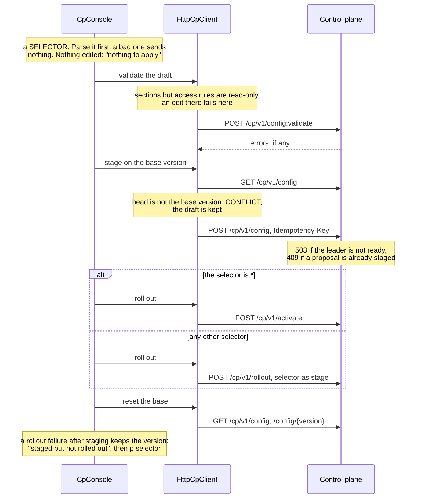

# Control-plane console (mockup)

The console talks to the control plane's mTLS admin API (`/cp/v1`, see
[control-plane design](../design/control-plane.md)) through `HttpCpClient`, spread over several
control nodes by `FailoverCpClient`:

    java -cp "target/sjws_nettask-0.2-SNAPSHOT.jar:target/lib/*" sjws_nettask.admin.cp.CpConsoleMain \
        --endpoints=cp-1:9443,cp-2:9443 --cert=operator.pem --key=operator-key.pem --trust=cp-ca.pem \
        [--key-password-file=FILE] [--no-color]

`--cert`/`--key` are the operator's PEM certificate and key (its URI SAN, e.g.
`urn:sjws:admin:root`, is the identity the CP maps to a role); `--trust` holds the CA or pinned
certificate the control node must present. `--demo` runs the same screens against an in-memory
control plane (`FakeCpClient`).

### Live mode: what is wired and what is not
Wired: `GET /cp/v1/health`, `GET /cp/v1/nodes` (labels, health, applied version, lag),
`GET /cp/v1/config`, `GET /cp/v1/config/{version}` (history), `POST /cp/v1/config:validate`
(server dry run), `POST /cp/v1/config` (propose), `POST /cp/v1/rollout` (selector other than `*`),
`POST /cp/v1/activate` (selector `*`), `GET /cp/v1/rollout`, `POST /cp/v1/rollback`, and
`GET /cp/v1/audit`. Every mutation carries an `Idempotency-Key`. HTTP 503 (leader not ready) and
connection failures move to the next endpoint.

Authentication is the client certificate only (#89): the CP requires one (`needClientAuth`), trusts
exactly the admin CA bundle, and maps the certificate's `urn:` SAN to viewer, operator or admin. An
`Authorization` header is ignored. The console's `--cert/--key` must be issued by that CA and
`--trust` must hold the CA that issued the CP's certificate.

Still not on the server, so handled in the console: structured edits other than `access.rules`
(the API takes a whole document; other sections are read-only), and per-node rollout acks
(`GET /cp/v1/rollout` gives the stage, not which nodes applied it).

It is a separate entry point: the server never loads `sjws_nettask.admin.cp` (a test enforces
this), so the console costs nothing when it is not used.

## What it does
- **Nodes** (`n`): leader, term, head version; per node role, health, applied version, lag, labels.
- **Edit** a local draft (`e <section>`, `+ <section> <entry>`, `- <section> <n>`, `^ <section> <n>`
  to move up). Sections: routes, filters (ordered), access, certs, topics.
- **Diff** (`d`) against the base version; **validate** (`v`) on the control plane (dry run).
- **Apply** (`a <selector>`): validate, stage against the base version (CONFLICT if someone
  else published meanwhile), roll out to nodes matching a label selector (`canary=true`,
  `zone=a,tier!=edge`, `*`). **Promote** (`p <selector>`) widens the rollout of the head version.
- **Rollback** (`b <version>`): a new version with the old content, rolled out everywhere.
- **Audit** (`l`): who did what, plus the endpoint switches of the failover client.
- **Failover**: `FailoverCpClient` sticks to one endpoint, moves on when it is unreachable, follows
  `NOT_LEADER` hints, and retries writes safely because every write carries an idempotency key.

Apply (`a <selector>`) as the live console runs it. Every call goes through `FailoverCpClient`: a 503 or a
connection failure moves to the next endpoint, and a retried write keeps its `Idempotency-Key`:

