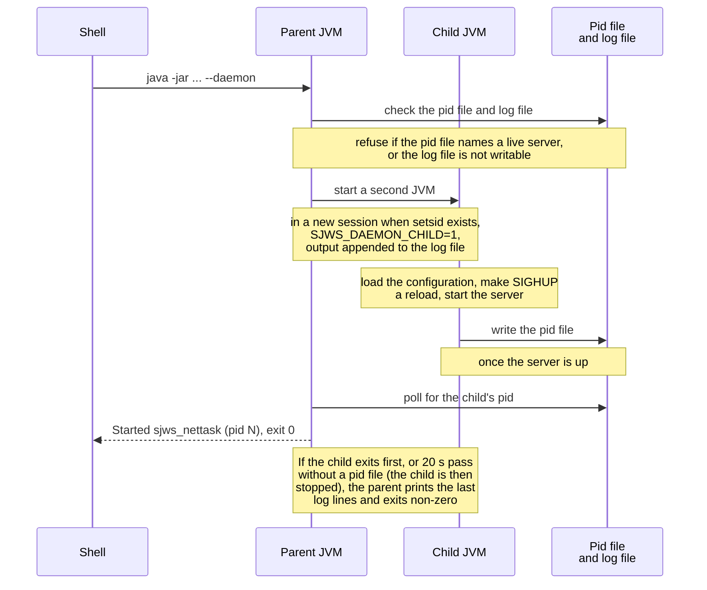
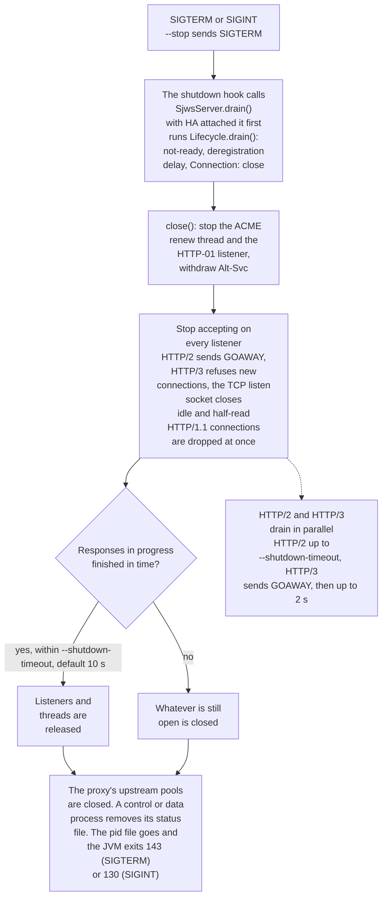

# Running in the background

`--daemon` starts a second JVM and exits once that process is up (the pid file exists). The child
runs in a new session when `setsid` is available (`/usr/bin/setsid`), so a terminal hangup is not
delivered. The child handles `SIGHUP` as reload (`ReloadHook`). It writes the pid file and
appends stdout and stderr to the log file (default `sjws_nettask.log` in the working directory).
JVM flags placed before `-jar` or the main class, such as `-Xmx`, are kept. Paths in `--pid-file`
and `--log-file` are relative to the working directory; a service should use absolute paths.

```
java -jar target/sjws_nettask-0.2-SNAPSHOT.jar --daemon --pid-file=/run/sjws_nettask.pid \
    --log-file=/var/log/sjws_nettask.log 8080 /var/www/html
java -jar target/sjws_nettask-0.2-SNAPSHOT.jar --status --pid-file=/run/sjws_nettask.pid
java -jar target/sjws_nettask-0.2-SNAPSHOT.jar --stop --pid-file=/run/sjws_nettask.pid
java -jar target/sjws_nettask-0.2-SNAPSHOT.jar --restart --pid-file=/run/sjws_nettask.pid \
    --log-file=/var/log/sjws_nettask.log 8080 /var/www/html
```



`--stop` sends SIGTERM and waits for the drain budget (default 30 seconds, or `drain-ms` from the
status file) plus 5 seconds, then SIGKILL. `--shutdown-timeout` is not added to that wait.
`--status` prints `running pid=<n>`, `stopped`, or `stopped stale pid=<n>`. A control or data
process adds `role`, `connection`, and `config-version` when the status file beside the pid file
names that same process (see [Control-plane service](control-plane-service.md)). Standalone does
not write that file, so its line does not change. A pid file whose
process is gone, or whose pid was reused (the start time no longer matches), is stale: `--stop`
removes it and does not signal the new process. A file a live server has locked is left in place,
so a restart cannot delete the pid file the new process just claimed. `--restart` is `--stop`
followed by `--daemon`.

SIGTERM and SIGINT (the shutdown hook) call `SjwsServer.drain()`. With high availability
attached, that is `Lifecycle.drain()`: not-ready, the deregistration delay, `Connection: close`,
then the same close as below. Without it, `drain()` is that close and the wait does not change.
Close stops accepting on every listener, drops idle and half-read HTTP/1 connections immediately,
and lets responses already in progress finish until `--shutdown-timeout` (default 10 seconds).
Whatever is still open is then closed. HTTP/3 sends GOAWAY and drains for up to 2 seconds in
parallel with that wait. `--stop` waits for the HA budget recorded in the status file when one
is present, then the same 5 second margin as before. A foreground process with
`--pid-file` writes the same file, so `--stop` works for it too; without `--log-file` it keeps
logging to the console.



`contrib/sjws` is a small start/stop/status/restart wrapper (`SJWS_JAR`, `SJWS_PID_FILE`,
`SJWS_LOG_FILE`, `JAVA`). `contrib/sjws_nettask.service` is a systemd `Type=forking` example
(`PIDFile` plus `--daemon`). Role units and their schema-1 samples live beside it:
`contrib/sjws_nettask-control@.service`, `contrib/sjws_nettask-data@.service`,
`contrib/sjws_nettask-standalone.yaml`, `contrib/sjws_nettask-control.yaml`, and
`contrib/sjws_nettask-data.yaml`. Copy `target/lib/` next to the jar: `java -jar` loads Netty from the
manifest `Class-Path`. On Windows, `--stop` ends the process without a POSIX SIGTERM, so the
drain hook does not run; use a service manager that can signal the JVM there.
The daemon child handles `SIGHUP` by calling `ReloadHook.run()`. `contrib/sjws_nettask.service`
and the role units set `ExecReload=/bin/kill -HUP $MAINPID`. systemd `active` is the process
being up; readiness is `/readyz` and `--status`. The units do not call `sd_notify`.
