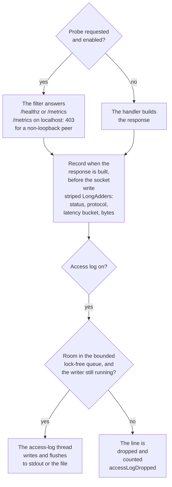

# Observability

Off by default, and off means the request path does not install an observe filter. A request then
does not call `System.nanoTime`, does not update a `LongAdder`, does not compare-and-set a latency
sample, and does not inspect the path for `/healthz` or `/metrics`. HTTP/1.1 calls the static file
handler directly. HTTP/2 and HTTP/3 do the same after one volatile read of a handler slot that stays
null until `metricsSnapshot()` arms it. A file at either path is served from the document root, the
same as a build without this feature.

Counters, the access log and the probes turn on only when something asks for them:

| Option | Environment | Default | |
|---|---|---|---|
| `--access-log=PATH` | `WEB_SERVER_ACCESS_LOG` | off | `-` writes to stdout; any other value appends to that file. Unset leaves logging off. Setting it also turns counters on |
| `--access-log-format=FMT` | `WEB_SERVER_ACCESS_LOG_FORMAT` | combined | `common`, `combined` or `json` |
| `--metrics=MODE` | `WEB_SERVER_METRICS` | off | `/metrics` in Prometheus text. `MODE` is `off`, `localhost` or `on`. A bare `--metrics` means `localhost`. Any mode other than `off` also turns counters on |
| `--no-metrics` | | | leave `/metrics` disabled |
| `--healthz` | `WEB_SERVER_HEALTHZ` | off | GET and HEAD `/healthz` answer `ok` (and counters turn on). Off: a document-root file at `/healthz` is served |
| `--no-healthz` | | | leave `/healthz` to the document root |

The admin TUI is the other switch. `EmbeddedServerControl.status()` calls `server.metricsSnapshot()`,
which is `armMetrics().snapshot()`. The first call replaces `NONE` with a recording observer and, when
the observe filter was not installed at startup, publishes that filter. The next request on each
transport enters it and starts sampling the clock and updating counters. That snapshot does not
enable `/healthz` or `/metrics` — those stay at the flags above — so a document-root `/healthz` file
is still served after the TUI has armed the counters. Reading `server.metrics()` without
`metricsSnapshot()` does not arm anything; it returns the empty `NONE` registry.

```java
Snapshot snap = server.metricsSnapshot(); // arms on the first call, then reads
snap.requests();
```

Request threads never write the log and never take a lock for it. Each response updates striped `LongAdder`s (status, protocol, a latency bucket, bytes). When logging is on, the thread formats one `byte[]` and enqueues it on a bounded lock-free queue; a single `access-log` thread writes and flushes. A full queue drops the line and counts it (`accessLogDropped` / `sjws_access_log_dropped_total`) instead of blocking the request.

The observe filter is installed by `--access-log`, `--metrics` or `--healthz` at startup, or when the
admin console arms the counters. Until then the handler is called directly: no clock, no counters, no
path check. With the filter installed, each request goes through this:



**Credential query parameters.** When an `api-key` filter is configured with a `query` option, the access log replaces that parameter's value with `***` in the logged request-target (every format). Other query parameters are left unchanged. With no such filter configured, the logged target is unchanged and the hot path does not parse the query string. Names are taken from the live filter document (or the config `middleware` list) at load and on each apply or reload.

**Log file mode.** A newly created access-log file is mode `0640`. A directory the server creates for that file is `0750`. An existing file keeps its mode; if it is world-accessible the server logs a WARN and still appends.

**Access line.** Common and combined are the NCSA formats, with the duration in microseconds appended. A zero body is `-`. Combined adds the quoted Referer and User-Agent. JSON is one object per line: `time` (UTC), `remote`, `method`, `path` (the request-target), `protocol`, `status`, `bytes`, `duration_us`, `referer`, `user_agent`. Quotes and controls in a CLF field are replaced with `?`. The client address is the numeric IP captured at accept (no reverse DNS).

**Metrics API** (what an admin TUI reads; also rendered at `/metrics` when that endpoint is enabled):

```java
ServerMetrics metrics = server.metrics();
Snapshot snap = metrics.snapshot();
snap.requests();                  // responses so far
snap.status(200);                 // by status code
snap.protocol("HTTP/1.1");        // HTTP/1.0, HTTP/1.1, HTTP/2, HTTP/3, or other
snap.bytesSent();                 // response body bytes (not headers)
snap.activeConnections();         // HTTP/1.1 being served + established HTTP/3
snap.http1Connections();
snap.http3Connections();
snap.accessLogDropped();
snap.latency().count();
snap.latency().sumNanos();
snap.latency().maxNanos();
snap.latency().meanNanos();
snap.latency().upperBoundNanos(); // inclusive; the last bound is Long.MAX_VALUE
snap.latency().counts();          // one bucket, not cumulative
snap.latency().cumulative(i);     // Prometheus-style, through bucket i
metrics.prometheus();             // text exposition 0.0.4
```

Status and protocol are counted separately (not as a cross product) so the hot path stays a pair of array increments. `bytes` is the body size the handler committed to, recorded when the filter returns, before the socket write. `/healthz` and `/metrics` are counted like any other response once those probes are enabled. A request that never enters the chain (an HTTP/1 parse error or 408, an HTTP/2 refusal, an HTTP/3 refusal) is not counted. With observability off, nothing is counted.

**Latency histogram contract.** `sjws_http_request_duration_seconds` is a fixed log2 scale so a cluster can merge nodes by adding bucket `i` to bucket `i` (do not re-bin). The value is the time until the handler returns the response, which is before the transport writes the body. Bounds are inclusive and stable: 1, 2, 4, 8, 16, 32, 64, 128, 256, 512, 1024, 2048, 4096, 8192 and 16384 ms, then everything above. `Snapshot.latency().counts()` is not cumulative; index `i` is `(previous bound, upperBoundNanos()[i]]`. `upperBoundNanos()` is `ServerMetrics.LATENCY_BOUNDS_NANOS` (the last entry is `Long.MAX_VALUE`). `ServerMetrics.LATENCY_LE_LABELS` is the Prometheus `le` for that same index: `0.001`, `0.002`, `0.004`, `0.008`, `0.016`, `0.032`, `0.064`, `0.128`, `0.256`, `0.512`, `1.024`, `2.048`, `4.096`, `8.192`, `16.384`, `+Inf`. The `/metrics` histogram is cumulative at those labels; adding two nodes' series with the same `le` is the merged cumulative. Changing a bound or a label is a breaking change for that merge.

`/metrics` on `localhost` answers only a loopback peer (403 otherwise), so it stays safe on a public bind. `on` answers every client. Behind a proxy that connects from 127.0.0.1, `localhost` is the proxy, not the browser. The endpoint is not a document-root file: when it is off, a file named `metrics` is served normally.

The hook is `ObserveRequestFilter`, registered at order 0 through `RequestFilters.create().add(0, filter)` when `--access-log`, `--metrics` or `--healthz` is on. It is added before any caller filter, so among order 0 it is the outermost stage (a negative order still runs further out). The filter calls `intercept` only when `/healthz` or `/metrics` is enabled, then `complete` when `proceed` returns. While observability is off, that filter is not installed and the transports do not read the clock, update a counter, or check the path. `metricsSnapshot()` publishes the same filter on a server that started off. HTTP/1.1 sees it on the next request of an already-accepted connection; HTTP/2 and HTTP/3 install it through `Transport.armHandler`.

**Control heartbeat.** HA's membership payload stays the fixed 64-byte body (generation and content hash, default 500 ms). The UDP datagram adds a version, a key id, a timestamp, a per-sender sequence, a boot epoch, the destination wire id, and an HMAC-SHA256 tag over a domain-separated HKDF key. Rejected datagrams are counted by reason (tag, time, sequence, epoch, destination, membership, body). Histograms do not fit in that payload, and this package does not open a socket. The control payload is a separate `NodeReport`, taken by `NodeReporter` on the heartbeat thread. The default cadence is 5 s (`NodeReporter.INTERVAL_NANOS`). A faster membership loop reuses the previous report; the sequence number advances only when a new snapshot is copied. There is no per-request call.

`NodeReport` is cumulative from process start: requests, 5xx (`errors`), 4xx (`clientErrors`), body bytes, latency sum, and the same non-cumulative log2 histogram (`ServerMetrics.LATENCY_BOUNDS_NANOS`). Health (`alive`, `ready`, `draining`) and the applied config generation plus content hash are suppliers the heartbeat thread reads at take time. `appliedVersion` 0 means no generation has been published. Per-route and per-API-key series are optional (`LabelSource`); the default is empty, so a node without gateway metrics sends no label tables. Names are configured ids, never secrets.

A control plane merges latency by index with `HistogramMerge.sum`. `HistogramMerge.percentileUpperNanos(counts, 99)` is the inclusive upper bound of the first bucket whose cumulative rank reaches 99%. It is not an interpolated quantile. Changing a bound breaks that merge. Rate is the receiver's job: the difference of two cumulative `requests` values divided by the difference of `wallMillis`. This node does not emit per-request events.

**Cluster aggregate.** `ClusterBoard` lives on the control-plane process. It keeps the latest `NodeReport` per node id (no expiry; `remove` drops a member). `status()` sums requests per second across nodes, adds the log2 histograms and reports p99 as that bucket's upper bound, and sums 5xx by node and by route (and by API-key id, when the report carries those series). A node whose `appliedVersion` differs from `desiredVersion` is drifted. Desired version 0 means nothing has been published, so nothing is drifted. A counter that goes backwards is treated as a restart: that interval's rate is 0 and the new snapshot becomes the baseline. One sample, or two samples with no positive wall-clock gap, does not invent a rate. Merged label names are capped at 65; further names fold into `other`. The admin TUI reads this through `ServerControl.clusterStatus()`, which is null until a board is attached. The same snapshot is appended to `/metrics` when that board is attached (`EmbeddedServerControl.attachCluster`, including a board attached before start or restored by a reload, or `SjwsServer.attachClusterMetrics`).

**Prometheus scrape.** `/metrics` is Prometheus text exposition 0.0.4. The response `Content-Type` is `text/plain; version=0.0.4; charset=utf-8`, with `cache-control: no-store`. Each family has a `HELP` line and a `TYPE` line before its samples. Names and label names match the Prometheus grammar. Label values escape `\`, a double quote, and a newline. `sjws_http_request_duration_seconds` is a histogram: cumulative `_bucket` samples whose `le` labels are `ServerMetrics.LATENCY_LE_LABELS` (`0.001` through `16.384`, then `+Inf`), then `_sum` in seconds and `_count`. `_count` equals the `+Inf` bucket. A counter that has not seen a sample yet still publishes `HELP` and `TYPE`.

The process series are in every scrape: `sjws_http_requests_total` (label `status`), `sjws_http_protocol_requests_total` (label `protocol`), `sjws_http_response_bytes_total`, the duration histogram, `sjws_connections_active` (label `protocol`), and `sjws_access_log_dropped_total`. `server.metrics().prometheus()` is those series only.

Cluster and gateway families are appended only when a source is attached. Attaching does not install the observe filter, does not read the clock, and does not turn counters on. With `/metrics` off, a document-root file at that path is still what is served. The supplier or `LabelSource` is read while the scrape is rendered, not on a content request.

Cluster series are gauges. A node restart can move a summed counter backwards, so they are not counters. Node ids and route names that repeat in one snapshot are merged (the later node report wins; route requests and errors add, and the p99 keeps the wider bucket). `+Inf` is the open latency bucket. `0` on a p99 gauge means that series has no samples.

| Series | Labels | |
|---|---|---|
| `sjws_cluster_desired_version` | | desired config generation, or 0 |
| `sjws_cluster_requests_per_second` | | sum of per-node rates |
| `sjws_cluster_request_p99_seconds` | | merged p99 bucket upper bound, or 0 |
| `sjws_cluster_requests` | | summed responses |
| `sjws_cluster_errors` | | summed 5xx |
| `sjws_cluster_config_drifted_nodes` | | drifted members |
| `sjws_cluster_node_alive` | `node` | 1 or 0 |
| `sjws_cluster_node_ready` | `node` | 1 or 0 |
| `sjws_cluster_node_draining` | `node` | 1 or 0 |
| `sjws_cluster_node_drifted` | `node` | 1 or 0 |
| `sjws_cluster_node_applied_version` | `node` | applied generation |
| `sjws_cluster_node_requests` | `node` | responses in the latest report |
| `sjws_cluster_node_errors` | `node` | 5xx in the latest report |
| `sjws_cluster_node_requests_per_second` | `node` | rate since the previous report |
| `sjws_cluster_node_request_p99_seconds` | `node` | node p99 bucket upper bound |
| `sjws_cluster_route_requests` | `route` | merged route responses |
| `sjws_cluster_route_errors` | `route` | merged route 5xx |
| `sjws_cluster_route_request_p99_seconds` | `route` | merged route p99 |
| `sjws_cluster_api_key_requests` | `api_key` | merged API-key id responses |
| `sjws_cluster_api_key_errors` | `api_key` | merged API-key id 5xx |
| `sjws_cluster_api_key_request_p99_seconds` | `api_key` | merged API-key id p99 |

Per-node, per-route, and per-API-key families are omitted when the board has none of them. Route and API-key names are configured ids. The cluster board already caps a merge at 65 names and folds the rest into `other`.

`SjwsServer.attachGatewayMetrics` reads a `LabelSource` (the same cumulative route and API-key tables a heartbeat copies). `LabelSource.NONE`, a null source, and empty tables add no lines. These counts are monotonic for one process, so the totals are counters:

| Series | Labels | |
|---|---|---|
| `sjws_gateway_route_requests_total` | `route` | responses on this node |
| `sjws_gateway_route_errors_total` | `route` | 5xx on this node |
| `sjws_gateway_route_request_p99_seconds` | `route` | p99 bucket upper bound on this node |
| `sjws_gateway_api_key_requests_total` | `api_key` | responses on this node |
| `sjws_gateway_api_key_errors_total` | `api_key` | 5xx on this node |
| `sjws_gateway_api_key_request_p99_seconds` | `api_key` | p99 bucket upper bound on this node |

Names past 65 fold into `other`, matching the cluster cap. `LabelSeries` stores the log2 bucket counts and not a latency sum, so these are not histograms: a histogram needs a real `_sum`. `histogram_quantile` stays on `sjws_http_request_duration_seconds`. The route p99 gauge is the same bucket upper bound the TUI shows.

An example Grafana dashboard, the PromQL behind it, and a sample `prometheus.yml` are in `contrib/grafana/`. `--metrics=localhost` answers only a loopback peer, so Prometheus has to scrape from this host. `on` answers every client.
