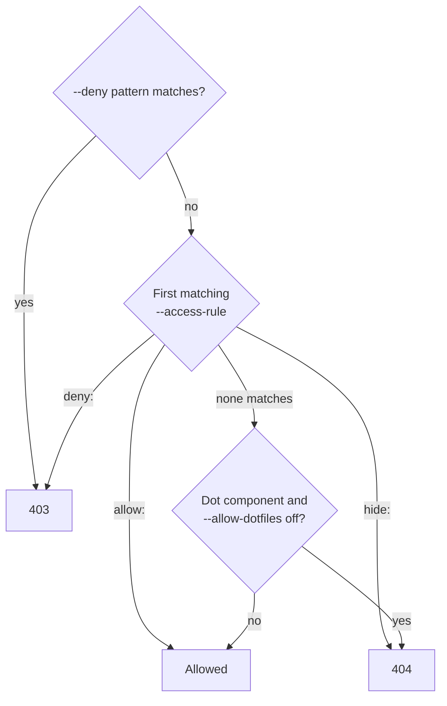

# Access rules

Which paths may be served is decided by `core.AccessRules` (behind the `core.AccessPolicy` seam)
before any file is opened, on the normalized URL path and again on the real path once symlinks are
resolved (so a link can't reach a refused path under another name, and on case-insensitive file
systems the on-disk case is checked):

1. `--deny` patterns: 403. They always win.
2. `--access-rule` rules in order, first match wins: `allow:` serves, `deny:` answers 403, `hide:` 404.
3. A path with a component starting with `.` answers 404 unless `--allow-dotfiles`.
4. Everything else is served.

The rules are applied to the decoded, normalized path, and again to the real path once symlinks are
resolved, so a link cannot reach a refused path under another name:

Patterns are `/`-separated globs: `*` matches within one component, `?` one character, `**` any number of
components. A pattern starting with `/` is anchored at the document root; one without matches at any
depth (`*.bak` = `/**/*.bak`). A pattern also covers everything below what it matches (`/private` covers
`/private/a/b`). As in a shell, wildcards in an `allow:` rule never match a name starting with `.`, so
`allow:/**` can't expose `/.git`, while a literal name can: `--access-rule=allow:/.well-known/acme-challenge`
serves ACME HTTP-01 tokens and keeps every other dotfile hidden. Denied and hidden entries are left out of
directory listings, and a symlink whose target is a dotfile or a denied path is refused.

    --deny='*.bak,*~,/private' --access-rule=hide:/drafts --access-rule=allow:/.well-known/acme-challenge

The same settings can live in the YAML `access:` section ([config-file.md](config-file.md#access)).
They are merged with the flags, not replaced: deny lists are united, flag rules come before YAML rules
(first match wins), `allow_dotfiles` and `require_world_readable` are on if either source sets them, and
a `--require-owner` flag wins over the YAML value. A reload re-applies the YAML rules on HTTP/1.1, HTTP/2
and HTTP/3.

`--require-owner` and `--require-world-readable` check the file being served (POSIX file systems only;
elsewhere such files answer 403). A change of owner or mode changes the file's ctime, so the
small-file cache drops the entry and the check runs again (with a revalidation window, only after it).
An invalid pattern or unknown user stops startup (exit code 64). Matching costs tens of nanoseconds per
request (see [measured performance](../design/implementation-and-performance.md)).
