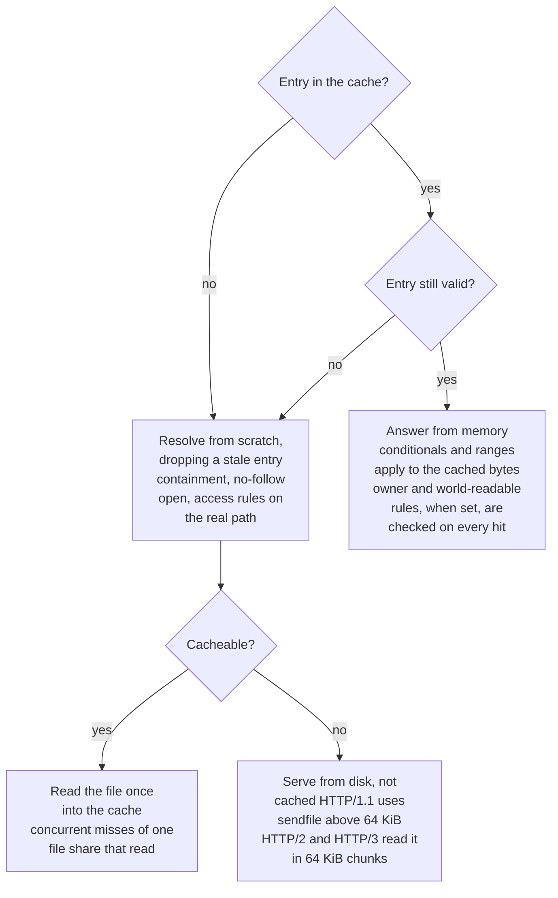
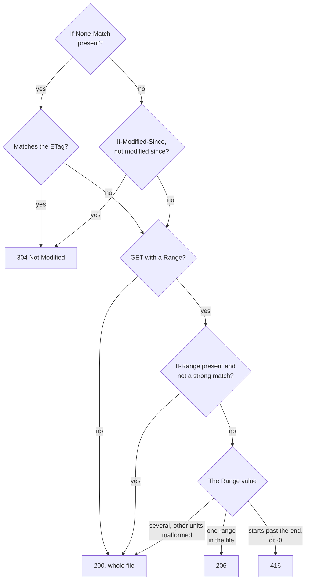

# Caching, validators and ranges

How a request for a file is answered. First the small-file cache, which decides where the bytes come
from. The path is already decoded, normalized and checked against the access rules:

*Still valid* means a `stat` shows the same inode, mtime in ns, size and ctime, and (unless
`--allow-unlistable-dirs` is set) every directory down to the file is still readable. *Cacheable* means a GET that will send the body (not HEAD, not a
304), for a file of 256 KiB or less, with room in the cache budget.

Then the validators and the byte range decide the status, for a cached and an uncached file alike.
`If-None-Match` takes lists and `*` and uses weak comparison; an `If-Range` validator must match strongly:

* **Small-file cache.** Files up to 256 KiB are kept in memory (both protocols), up to
  `--cache-bytes` in total (body + key + ~256 bytes per entry) and 4096 entries; eviction is CLOCK
  (second chance: an approximation of least recently used, O(1) amortized, hits take no lock). The key is the decoded, normalized path without the query, so `?v=1`, `%68ello`, `./`
  spellings share one entry and can't push others out; 404s are never cached. **Every hit stats the
  file** and compares file key (inode), mtime in ns, size and ctime; any change drops the entry and
  the request is resolved again from scratch (containment, no-follow open). Unless
  `--allow-unlistable-dirs` is set, a hit also checks (`access(2)`) that the document root and every
  directory down to the file are still readable, so a directory made search-only after the file was
  cached answers `403` at once, as it would uncached; that is one more syscall per directory level on
  every hit (measured below). A file is read through the
  same no-follow open as when it is sent, and is cached only if it did not change while being read.
  At most `min(--cache-bytes, 4 MiB)` of files are being read into memory at once; a miss that finds no
  room is served from disk without caching (streamed), and concurrent misses of one file share a
  single read.
  Limits: on a platform without file keys and ctime (Windows) an edit that keeps both size and mtime
  is not noticed; on Linux, file timestamps tick every few ms, so a same-size rewrite that also
  restores the mtime within one tick of the previous change is not noticed either. Directory listings
  are not cached. Files below unreadable (`--x`) directories, HEAD requests and 304s never load an
  entry (they don't open the file), so they behave as without a cache.
* **ETag** is `"<inode hash>-<mtime ns>-<size>"` (hex). A file version first seen less than 1 s after its
  mtime gets a weak tag (`W/"..."`) and keeps it while unchanged: on file systems with a coarse mtime a
  second write within that second could otherwise keep the tag. Up to 4096 such young versions are
  remembered; when that memory is reset, versions that are old by then get their strong tag, on the
  cached and the uncached path alike. `If-None-Match` (lists, `*`, weak
  comparison) takes precedence over `If-Modified-Since`; a 304 carries `ETag`, `Last-Modified` and
  `Date` only.
* **Ranges** (both protocols, decided in core after the 304 conditionals). One `bytes=` range
  (`a-b`, `a-`, `-n`) gets `206` with `Content-Range` (from the cache: a slice; otherwise the file region,
  with `sendfile` above 64 KiB). Several ranges (no multipart), other units, malformed or > 18-digit
  positions are ignored (`200`, whole file); a range starting at or past the end, or `-0`, gets `416` with
  `Content-Range: bytes */<size>`. `If-Range` needs a strong match: the exact current ETag, or a date
  equal to `Last-Modified` while the ETag is strong (a version under 1 s old has a weak ETag, so a resume
  of it restarts with `200`); anything else serves the whole file. Only GET has range semantics
  (RFC 9110 §14.2): HEAD with `Range` answers the plain `200` head; listings, redirects and errors ignore
  `Range` and say `Accept-Ranges: none`. Dates are parsed in IMF-fixdate form only (an RFC 850/asctime
  `If-Range` or `If-Modified-Since` is treated as not matching). Empty files ignore `Range`.
