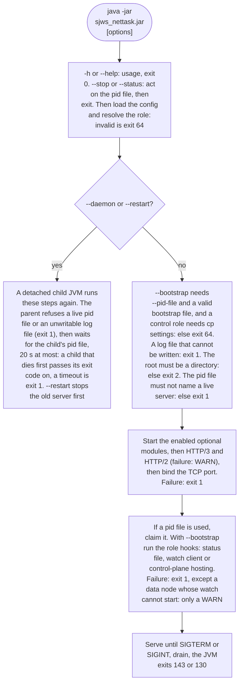

# Command line and environment

Run:

    java -jar target/sjws_nettask-0.2-SNAPSHOT.jar [port] [html folder] [options]

| Option | Environment | Default | |
|---|---|---|---|
| `[port]` | `WEB_SERVER_PORT` | 8080 | TCP port |
| `[html folder]` | `WEB_SERVER_DIR` | `./HTML` | document root (must exist) |
| `--max-connections=N` | `WEB_SERVER_MAX_CONNECTIONS` | 2048 | concurrent connections; extra ones wait in the backlog |
| `--backlog=N` | `WEB_SERVER_BACKLOG` | 1024 | TCP accept backlog (connections queued by the kernel before they are accepted); the OS caps it (Linux: `net.core.somaxconn`, 4096 by default since 5.4) |
| `--idle-timeout=S` | `WEB_SERVER_IDLE_TIMEOUT` | 30 | keep-alive idle timeout (seconds) |
| `--header-timeout=S` | `WEB_SERVER_HEADER_TIMEOUT` | 10 | time to receive a complete request head (seconds) |
| `--max-connections-per-ip=N` | `WEB_SERVER_MAX_CONNECTIONS_PER_IP` | 256 | HTTP/1.1 connections from one client address (IPv6: one /64); extra ones are closed at once without a response |
| `--allow-unlistable-dirs` | `WEB_SERVER_ALLOW_UNLISTABLE_DIRS` | off | serve files below directories the server can't read (mode `--x`) through a weaker path-based open; see [Platform notes](platform-notes.md) |
| `--deny=PAT[,PAT...]` | `WEB_SERVER_DENY` | none | answer 403 for paths matching these patterns; checked before every other rule (see [Access rules](access-rules.md)) |
| `--access-rule=ACTION:PAT` | `WEB_SERVER_ACCESS_RULES` (comma-separated) | none | `allow:`, `deny:` (403) or `hide:` (404) a path pattern; repeatable, first match wins |
| `--allow-dotfiles` | `WEB_SERVER_ALLOW_DOTFILES` | off | serve names starting with `.`; off: they answer 404 and are never listed |
| `--require-owner=USER` | `WEB_SERVER_REQUIRE_OWNER` | off | serve only files owned by this user (name or numeric uid); others answer 403 |
| `--require-world-readable` | `WEB_SERVER_REQUIRE_WORLD_READABLE` | off | serve only files with mode `o+r`; others answer 403 |
| `--cache-bytes=N[k\|m\|g]` | `WEB_SERVER_CACHE_BYTES` | 64m | small-file cache size (see [Caching](caching-and-ranges.md)); `0` disables it |
| `--write-timeout=S` | `WEB_SERVER_WRITE_TIMEOUT` | 30 | a response that makes no progress for this long is closed (HTTP/1.1) or reset (HTTP/3); for HTTP/3 also the window of the minimum send rate |
| `--config=PATH` | `WEB_SERVER_CONFIG` | | YAML configuration file (see [docs/user/config-file.md](config-file.md)); the environment wins |
| | `WEB_SERVER_HA_CLUSTER_KEY` | | HMAC key for HA UDP heartbeats when `ha.enabled` is true. Not a command-line flag. Prefer `ha.cluster_key_file` (mode 0600 or 0400, owned by this process, not a symlink; every parent must be owned by root or this process; a group- or world-writable parent is refused unless that directory is sticky and owned by root or this process). `ha.cluster_key` is the inline form. `base64:` and `hex:` prefixes are decoded; other text is trimmed UTF-8. `WEB_SERVER_HA_CLUSTER_KEY_PREVIOUS` is the previous key during rotation. The daemon child does not inherit either variable |
| `--state-dir=PATH` | `WEB_SERVER_STATE_DIR` | the working directory | data directory for a data node's last-good config (`config/last-good.json`); the environment wins over `--state-dir`, which wins over `node.state_dir` |
| `-h`, `--help` | | | print usage and exit |
| `--daemon` | | | detach and run in the background; the parent exits once the child is up |
| `--pid-file=PATH` | `WEB_SERVER_PID_FILE` | sjws_nettask.pid | process-id file; written by `--daemon`, and whenever this option is set |
| `--log-file=PATH` | `WEB_SERVER_LOG_FILE` | sjws_nettask.log | log file for `--daemon`, and for a foreground process when this option is set |
| `--shutdown-timeout=S` | `WEB_SERVER_SHUTDOWN_TIMEOUT` | 10 | seconds to finish in-flight responses after SIGTERM/SIGINT (`0` closes them at once). Not added to the `--stop` wait |
| `--drain-budget=S` | `WEB_SERVER_DRAIN_BUDGET` | 30 | seconds `--stop` waits for drain before the 5s SIGKILL margin (`0` waits only that margin). The status file's `drain-ms` wins when present. Capped at 600 |
| `--stop` | | | stop the server recorded in the pid file (SIGTERM, then the drain budget plus 5s, then SIGKILL) |
| `--status` | | | print whether that server is running. Readiness is this line and `/readyz`, not systemd `active` |
| `--restart` | | | `--stop`, then start in the background |
| `--role=ROLE` | `WEB_SERVER_ROLE` | standalone | `standalone` (default), `control`, or `data`. Same values as `node.mode`. Precedence is `--role`, then `WEB_SERVER_ROLE`, then `node.mode`. A difference is logged at startup. `control` and `data` require `--bootstrap` and `--pid-file` |
| `--bootstrap=PATH` | `WEB_SERVER_BOOTSTRAP` | | absolute or relative path of the control/data bootstrap file. Names the pin and the join-token file; the token secret is not a flag or a variable. See [Control-plane service](../operations/control-plane-service.md) |
| `--bind-content=BOOL` | `WEB_SERVER_BIND_CONTENT` | on, except control | bind the content port. Control leaves it unbound unless this is true or `server.bind_content` is true |

Defaults, then the config file, then arguments, then environment variables.
The role is the exception: `--role`, then `WEB_SERVER_ROLE`, then `node.mode`.
A bad value in the file is an error (exit 64). Invalid values of the server flags
above are still replaced by the default with a `WARN:` line; unknown options warn too.
Exit codes: 0 = normal / `--help`, 1 = cannot listen on the port (also: already running,
pid file or log file not writable, background start failed), 2 = document root missing,
64 = configuration error (e.g. `--cert` without `--key`, a bad config file, unreadable
key password file, `--stop` combined with `--daemon`). Routing, middleware and
access rules are file-only and are validated into the snapshot. The file's middleware
list is `core.MiddlewareSpec` and is not passed to `RequestFilters`, so it does not
build a chain; a caller that has bound factories can still pass `RequestFilters` to
`SjwsServer.start`. This server does not proxy or enforce the access list. ACME HTTP-01
on the main listener is answered before the file handler hides dotfiles. Reload re-reads
the file through `ReloadHook` (see docs/user/config-file.md, including the ConfigStore notes).
ACME HTTP-01 issuance uses the staging CA unless you select production.
`--status` uses 0 = running, 1 = pid file is stale, 3 = not running.

What happens at startup, and where each exit code comes from. `--daemon` and `--restart` run the
parent's steps first, then the detached child runs the whole sequence again, without the detach step:

