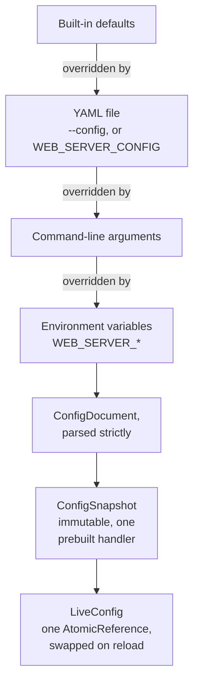
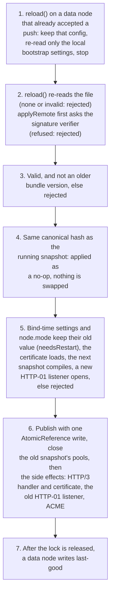
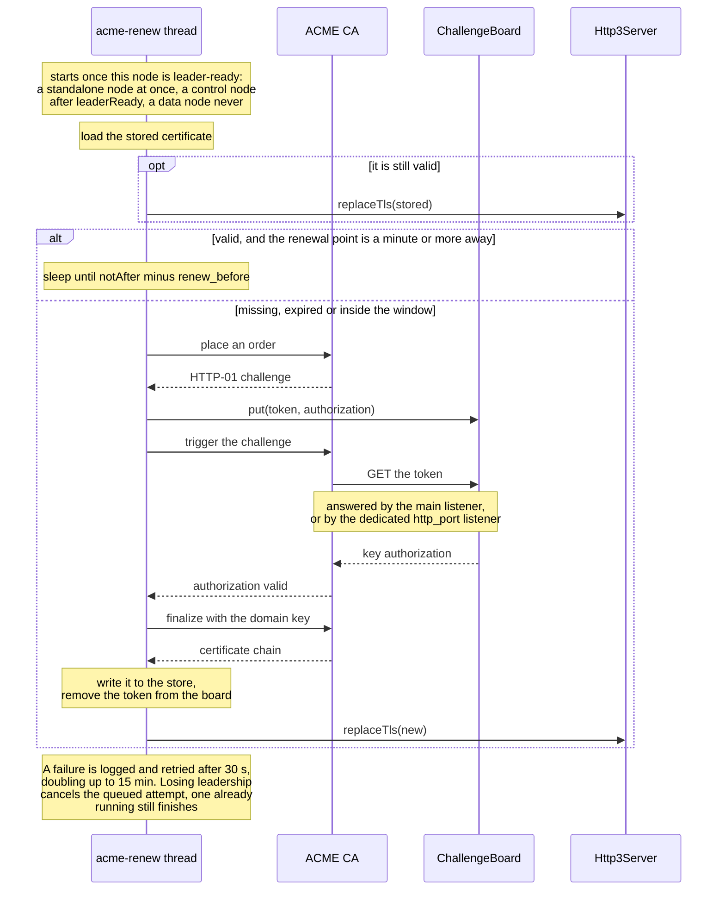

# Configuration

The server reads one YAML file. YAML, rather than another syntax, because the proxy
workstream's routing schema is YAML and has to paste in unchanged. Parsing uses
SnakeYAML's `SafeConstructor` only: no arbitrary types, duplicate keys are errors,
and the document is capped at 1 MB.

```
java -jar sjws_nettask.jar --config=sjws.yaml
```

`WEB_SERVER_CONFIG` names the same file and wins over `--config`.

## Precedence

Defaults, then the file, then arguments, then environment variables.



Two settings do not follow this chain: the role (`--role`, then `WEB_SERVER_ROLE`, then `node.mode`, see
[Node](#node)) and the access rules, which are merged with the flags
(see [Precedence with the command line](#precedence-with-the-command-line)).

The file is strict: an unknown key or a bad value is an error and the process exits
64. The existing server flags stay lenient (a bad number warns and falls back).
There is no `--key-password` and no `key_password` key; a password lives in
`tls.key_password_file` or `WEB_SERVER_TLS_KEY_PASSWORD`.
The HA cluster key is the same kind of secret: `ha.cluster_key` or
`WEB_SERVER_HA_CLUSTER_KEY`, never a command-line flag.

Paths in the file are resolved against the file's directory. Paths on the command
line and in the environment stay relative to the working directory.

`--help` wins before a missing file is an error. A missing document root is exit
code 2, including when the root comes from the file.

`routing`, `middleware`, `access` and `node` are file-only. They do not add command-line flags.

## Node

Omitted, the process is `standalone`. The request path does not read the mode.

```yaml
schema: 1
version: 0          # control-plane bundle version; 0 means unset
node:
  mode: standalone  # standalone (default), control, or data
  labels: {}        # up to 64 keys; each key and value is 1..63 of [A-Za-z0-9_.:-]
  state_dir: /var/lib/sjws_nettask   # optional; local, not part of the canonical hash
```

`schema` must be 1 when it is present. A reload or a remote apply rejects a non-zero
`version` that is lower than the one already running. `node.mode` is kept until
restart; `labels` apply on the next successful apply.

There is no `node.role` key. `--role` and `WEB_SERVER_ROLE` are the command-line
form of `node.mode`. Precedence is `--role`, then `WEB_SERVER_ROLE`, then
`node.mode`. A difference is logged at startup
(`WARN: --role=<flag> overrides node.mode=<file>`, or the same with
`WEB_SERVER_ROLE` when the flag was absent). With no flag, no variable, and no
config file, `--bootstrap` may still name the role. `control` or `data` still
requires `--bootstrap`. Sample files: `contrib/sjws_nettask-standalone.yaml`,
`contrib/sjws_nettask-control.yaml`, `contrib/sjws_nettask-data.yaml`.

A data-plane process whose config file is missing boots from
`<stateDir>/config/last-good.json` when that file exists, the hash in the envelope
matches the embedded document, and `node.mode` is `data`. `stateDir` is
`node.state_dir`, or `--state-dir` / `WEB_SERVER_STATE_DIR` (those win over the
file), and otherwise the daemon's data directory: the working directory, where the
default pid and log files are written. The `config` directory is mode `0700` and
the file is mode `0600`. The bytes are a JSON envelope around the canonical
document, so they do not contain a key password. The temp file and its directory
are fsynced before the atomic rename, and the write runs after the reload lock is
released. Standalone and control do not write this file and do not boot from it.
A file left by an older build at `<file>.last-good` is still read once when the
JSON file is absent. A failed apply leaves both the running config and this file
as they were.

In a duration, a bare integer is seconds and `1m` is one minute (`ms`, `s`, `m`,
`h`, `d`). In a size, a bare integer is bytes and `1m` is one mebibyte (`k`, `m`,
`g`, 1024-based). Server timeouts are whole seconds, 1..86400, matching the flags.

## HA

Omitted, HA heartbeats stay off and the authenticator is not loaded. `ha.enabled: true`
without a key refuses to start (exit 64). The key is at least 16 bytes; 32 random bytes is the
useful size (`openssl rand -base64 32`). It is not part of the canonical document, so a last-good
copy does not store it and startup logs do not print it. Java keeps the characters in a
`String` and inside `Mac`; the process cannot wipe them.

```yaml
ha:
  enabled: true
  cluster_key_file: /etc/sjws/cluster.key   # preferred; mode 0600 or 0400, owned by this process, not a symlink
  # cluster_key: "base64:...."              # inline alternative; not together with the file
  # cluster_key_previous_file: /etc/sjws/cluster.key.prev
```

A value is trimmed. `base64:` and `hex:` select those encodings; anything else is the UTF-8 of
the trimmed text. A trailing newline from a file is not part of the key.

`WEB_SERVER_HA_CLUSTER_KEY` overrides `ha.cluster_key` and `ha.cluster_key_file`.
`WEB_SERVER_HA_CLUSTER_KEY_PREVIOUS` overrides the previous key. An empty variable is an error
when HA is enabled; it does not fall back to the file. The daemon child does not inherit either
variable (`/proc/pid/environ`); use the key file there. A config file that contains an inline
key and is readable by group or others produces a warning.

Packets are HMAC-SHA256 under a key derived with HKDF-SHA256 (`info` `sjws-ha-heartbeat-v1`),
so the same secret is not a tag for any other protocol. The MAC covers a domain label, a
version, a key id, the 64-byte body, the timestamp, the sequence, a boot epoch, and the
destination wire id. Key id 0 is the current key and key id 1 is the previous key; a packet is
checked against that one key. Each sender's sequence starts over when its boot epoch is newer
than the last one accepted, which is how a restarted node stays reachable. The epoch must not
lead the packet timestamp, or the receiver's clock, by more than the ±5 second window; a
later epoch is dropped and does not stick. A lower epoch is accepted only after that sender
has been silent for at least `max(deadAfter, 5s)`. A timestamp older
than the receiver's own boot is dropped. Clocks must stay within ±5 seconds (NTP). A larger
step drops heartbeats until they agree, and a rate-limited warning names the skew.

Key rotation: put the new secret in `ha.cluster_key` or `ha.cluster_key_file` and the key
that is still in use in `ha.cluster_key_previous` or `ha.cluster_key_previous_file`. Roll
that config to every node, wait until heartbeats are using the new key, then remove the
previous key. Only the parent directory of a key file is resolved with `toRealPath`.
The leaf is opened with `NOFOLLOW_LINKS` and is never followed. Owner and mode (0600 or
0400, owned by this process) are checked on that opened file. Every resolved parent up
to `/` must be owned by root or this process. A group- or world-writable parent is
refused, unless it is sticky and owned by root or this process, as `/tmp` is. On Linux
the descriptor in `/proc/self/fd` is used only when its device and inode match that
file. Without `/proc`, the check is an `lstat` of the path while the channel is open,
and the owner name is compared with `root` or `user.name`. Control-plane key files use
the same helper (`sjws_nettask.config.SecureKeyFile`).

## Server

```yaml
server:
  port: 8080
  root: ./HTML
  max_connections: 2048
  max_connections_per_ip: 256
  backlog: 1024
  idle_timeout: 30
  header_timeout: 10
  write_timeout: 30
  cache_bytes: 64m          # up to 16g; 0 disables the cache
  allow_unlistable_dirs: false
  access_log: off           # opened at startup; a reload does not reopen the writer
  bind_content: true        # startup only; control defaults to false. Not in the canonical document

http3:
  enabled: false
  port: same                # or a UDP port; 0 = ephemeral
  host: 0.0.0.0
  max_connections: 1024
  max_connections_per_ip: 16
  min_rate: 2048
  alt_svc: false
  alt_svc_max_age: 86400

tls:
  cert: cert.pem
  key: key.pem
  key_password_file: key.pass
```

`tls.cert` and `tls.key` are set together. `tls.cert` together with `acme.enabled`
is an error: ACME owns the certificate.

## Reload

`ReloadHook.register(Runnable)` returns a handle that removes that hook.
`ReloadHook.run()` runs every hook. A hook that throws is logged (`ERROR: reload
hook failed:`) and the others still run.

The server registers itself at the end of `start` and removes the hook at the
start of `close`. The hook re-reads the file, reapplies the original arguments
and the environment captured at startup, and on success compiles a new immutable
snapshot and publishes it with one `AtomicReference` write. A validation error,
a missing root, or an unreadable certificate keeps the previous snapshot.
`SjwsServer.applyRemote` checks the injected signature verifier, then validates and
publishes a pushed document through that same swap. A data or control process
that was not given a verifier rejects the push. Standalone uses a no-op verifier.
A bad signature, a canonical hash that is not the SHA-256 of the canonical
document, or a lower non-zero `version` is rejected before the swap. An incoming
canonical hash equal to the running snapshot's is a no-op: the file cache and
upstream pools are left in place. It does not re-read the file and it does not
replace the file: the user's YAML stays put. A data node writes last-good only
after the swap, and only after the reload lock is released. HTTP/1 and HTTP/3
can observe the new snapshot a moment apart: the publish updates the live
reference, then the HTTP/3 handler and certificate.

The request path is that one volatile read and then the handler that was built
with the snapshot. It does not parse YAML, match routes, or take the reload lock.

Applied on the next request: document root, cache budget, unlistable-directory
policy, the routing table, the middleware list and the access settings (stored,
not dispatched), ACME settings (the renewal task is rescheduled), and a file
certificate (`TlsMaterial.fromPem` into `Http3Server.replaceTls`). HTTP/1
timeouts are applied when HTTP/3 is not running. The access-log writer, metrics
exposure and `/healthz` probe stay as they were opened at startup.

Left as they were, and reported as `needsRestart`: `port`, `backlog`, connection
caps, HTTP/3 bind settings, `alt_svc`, `alt_svc_max_age`, and (while HTTP/3 is
running) the idle, header and write timeouts. HTTP/3's QUIC idle timeout and
stream limits are fixed at start.

No config file means reload reports `no config file` and changes nothing.

`reload()` re-reads the file with the original arguments and environment; `applyRemote` takes a
document that a control plane pushed instead. *Valid* means it parses, `ConfigValidator` accepts it
(schema version, document root is a directory, certificate and key files, no `tls.cert` together with
ACME, node labels), the certificate loads, and a new HTTP-01 port can be opened. A pushed document is
also refused when its non-zero `version` is lower than the running one. The steps, in order, with
every rejection leaving the previous snapshot in place:



HTTP/2 reads the live snapshot on every request, as HTTP/1.1 does, so a reload reaches it with
the publish. Its TLS certificate is read when it starts: a reload or an ACME renewal replaces
the certificate on HTTP/3 only (`Http3Server.replaceTls`). See
[Handler composition](../design/architecture.md#handler-composition).

`installSighup()` points `SIGHUP` at `ReloadHook.run()` and returns false when
the JDK does not expose `sun.misc.Signal`, and when this process already ignores
`SIGHUP`. An ignored `SIGHUP` stays ignored: the VM does not install a Java
handler over it. `main` calls it only for the daemon child. A foreground process
must still die on `SIGHUP`. The child is also detached with `setsid` when that
binary exists, so a terminal hangup is not delivered. On a data node that has
accepted a pushed config, the hook reloads bootstrap local settings and leaves
the pushed document in place. Control and standalone re-read the local file.

## ACME

HTTP-01 (RFC 8555) via acme4j. The default directory is Let's Encrypt **staging**
(`https://acme-staging-v02.api.letsencrypt.org/directory`). `production` is the
production directory. An `https://`, `http://` or `acme://` URL is used as given.

```yaml
acme:
  enabled: false
  directory: staging
  email: ops@example.com
  domains: [example.com]   # no wildcards; HTTP-01 cannot prove one
  storage: ./acme
  http_port: 0              # 0, or the server port: challenges on the main listener
  accept_terms: false       # must be true when enabled
  renew_before: 30d         # at most 89 days
```

When enabled, email, at least one domain and `accept_terms: true` are required.
A standalone process issues as before. A control node issues only after
`ControlLeadership.leaderReady(term, appliedIndex)`, which fires once that term's
election NOOP is applied, and stops issuing when the term changes.
`isLeader()` alone does not start an order. A data node does not start ACME;
its certificate arrives with the pushed config. Logs drop a message that contains
a private key or a certificate PEM.
The same checks on shape (directory, domain spelling, durations) run when it is
off, so a typo is still an error. CLI and environment overrides use `--acme`,
`--no-acme`, `--acme-directory`, `--acme-email`, `--acme-domain` (repeatable),
`--acme-storage`, `--acme-http-port`, `--acme-accept-terms`, `--acme-renew-before`
and the `WEB_SERVER_ACME*` variables in `--help`. A bad ACME flag is an error,
not a warning.

`http_port` other than 0 and other than the server port opens a small extra
HTTP/1.1 listener that only serves challenges. `/.well-known/acme-challenge/` is
matched before the static handler whenever ACME is on the main listener. An
unknown token is 404 and is not served as a file.

Storage (created on first issue): `account.key`, `domain.key` (PKCS#8 `PRIVATE KEY`,
mode 0600 where the filesystem allows it), `cert.pem`, `account.url`, `directory`.
If the directory URL changes, the account URL is ignored and the account key is kept.
An integration test issues a certificate against Pebble on linux/amd64.

Issuance and renewal run on a daemon thread, never on a request. A certificate
already on disk is published immediately when it is still valid. Renewal is
scheduled for `notAfter - renew_before`. A delay under one minute after a
successful issue is stretched to one hour. Failures back off from 30 seconds,
doubling up to 15 minutes.



The published chain is installed with `Http3Server.replaceTls`. BoringSSL asks
the key manager on every handshake, so new connections use the new certificate
and connections that already shook hands keep the old one.

## Routing

With `enabled: true` each snapshot (startup and every reload) compiles the section
into a `routing.Router` in front of the static handler (`config.RoutingCompiler`):
`proxy` routes share one `ProxyHandler` (one connection pool) per upstream,
`redirect` routes answer directly, `static` and unmatched requests go to the
document root, and a path with a `..` segment is 400. ACME challenges are
answered before any route. With `enabled: false` (the default) no router is built
and the request path is unchanged. The records map onto `Route(host, prefix, rewrite,
handler)` and `ProxyHandler.Settings(url, connectTimeout, responseTimeout,
idleReadTimeout, maxBody, proto, trustedProxies, preserveHost, maxIdle)`. The proxy is a Netty
HTTP/1.1 client with up to 256 idle keep-alive connections per upstream, and it streams
response bodies with backpressure. HTTP/1.1 request bodies with a `Content-Length` are
streamed upstream (over `max_body` is 413). A chunked request body, or a body on HTTP/2 or
HTTP/3, is 501 for now; see `docs/design/proxy-routing.md` §12. `proto` is `routing.forwarded_proto` (`auto` is `http` on plain
TCP and `https` on HTTP/3). `idle_read_timeout` (default 30s) bounds the gap between upstream body
bytes. Proxied body bytes held in memory are bounded per request (a 256 KiB read-ahead window)
and in total (`-Dsjws.proxy.maxInflightBytes`, default 64 MiB); slow clients wait instead of
growing the heap (security finding F5). `preserve_host: true` forwards the client's `Host` instead of the upstream's. A reload or stop
closes the replaced pools.

Rate limits are local to this server and off unless configured. A route takes `rate_limit:`, and
`routing.rate_limit:` is a global limit checked before any route:

```yaml
routing:
  rate_limit: { by: peer, rate: 1000/s, burst: 2000 }            # global, optional
  routes:
    - prefix: /api
      proxy: api
      rate_limit: { by: header, header: X-Api-Key, rate: 600/m, burst: 20, buckets: 4096 }
    - prefix: /login
      static: true
      rate_limit: { by: route, rate: 50/s }                       # one bucket for the whole route
```

`by` is `peer` (client address, the default), `header` (that header's first value) or `route`
(route-level only). `rate` is `N/s`, `N/m` or `N/h` (a bare number is per second). `burst` is the
number of requests a full bucket admits at once; the default is one second's worth for `/s` and 1
for `/m` and `/h`. Requests over the limit get 429 with `Retry-After` (seconds until the next
token), rendered like the route's other errors. Buckets live in a fixed table of `buckets` stripes
(a power of two, default 4096; `by: route` uses one). Memory never grows with the number of
clients. Two clients that hash to the same stripe share its budget, which is stricter, never looser.
A request without the key (no address, or no header) shares one extra bucket. The control-plane
`rate-limit` filter type uses this same table. Its `capacity` is the burst and
`refill-per-second` is the steady rate; `max-keys` only sizes the table.

Weighted and canary routes list `backends` instead of `proxy` (a plain `proxy:` route is unchanged):

```yaml
routes:
  - prefix: /api
    backends:
      - { upstream: stable, weight: 95 }
      - { upstream: canary, weight: 5, pin: { header: X-Canary, value: "1" } }
      - { upstream: canary, weight: 0, pin: { cookie: beta } }   # pinned clients only
    sticky: { cookie: session }                                  # optional
```

`weight` (default 1, 0 needs a `pin`) is a relative share, picked through a precomputed alias table:
O(1) per request, no allocation, exact to the configured ratio. A `pin` (`header` or `cookie`, with an
optional exact `value`; without one, presence is enough) sends a matching request to that backend
whatever the weights; pins are checked in order. `sticky` hashes that header or cookie value so a
client keeps its backend while the weights are unchanged; requests without it are picked at random.
Each upstream keeps one pool and its own `retry` and `circuit`, however many routes or backends name it.
Up to 64 backends per route.

Retries and circuit breaking are per upstream and off unless configured (no cost when absent):

```yaml
upstreams:
  api:
    url: "http://127.0.0.1:9000"
    retry: { attempts: 2, on: [connect, reset, 503], budget: 20% }   # defaults shown
    circuit: { failures: 5, eject_for: 10s }                         # defaults shown
```

`retry.attempts` (1..5) is the number of extra tries. `on` picks the failures that are retried:
`connect` (refused or connect timeout), `timeout` (response timeout), `reset` (the upstream closed
before a response head), `502`, `503`, `504`. Only idempotent methods (GET, HEAD, OPTIONS, TRACE,
PUT, DELETE) without a request body are retried, and only before anything reached the client (a
retried 5xx body is discarded). `budget` caps retries at that share of requests: a token bucket per
upstream earns `budget` of a token per request, holds at most 10, and each retry spends one.
`circuit` opens after `failures` consecutive failures (connect, timeout, reset, 502/503/504) and
then answers 503 with `Retry-After` without contacting the upstream. After `eject_for` one probe
request is let through: success closes the circuit, failure opens it again for twice as long (up
to 32×). Each request gives one verdict, after its retries, so a retry that recovers counts as a
success. An upstream is a single endpoint, so an open circuit is an outage of that upstream: it suits
a dead or overloaded upstream, not a flaky one. At 20% random 503s and 5000 req/s, `failures: 5`
trips about once a second (see `bench/proxy-routing/resilience.sh`). Pair it with `retry`, or raise
`failures`, when the upstream has a steady error rate.

An upstream can list several endpoints instead of one `url` (exactly one of the two). It then
balances over them, with one pool per endpoint and a circuit per endpoint:

```yaml
upstreams:
  api:
    endpoints:
      - "http://10.0.0.1:9000"
      - { url: "http://10.0.0.2:9000", weight: 3, zone: b, id: api-2, labels: { tier: canary } }
    lb: weighted_random            # default; round_robin | least_request
    retry: { attempts: 2 }         # a retry goes to a different endpoint
    circuit: { failures: 5, eject_for: 10s, error_rate: 50%, min_requests: 20, window: 10s, max_ejection: 50% }  # defaults
```

All endpoints share one scheme and path (no query, fragment or userinfo); up to 1024, default
weight 1 (0..1000000, 0 = only used when nothing weighted is left). `weighted_random` draws from an
alias table (O(1)); `round_robin` cycles; `least_request` takes the less busy of two random
endpoints (requests waiting for response headers). On a multi-endpoint upstream the circuit is
always on with the defaults above, per endpoint, per attempt: an endpoint is ejected after
`failures` consecutive failures, or when at least `min_requests` in the last `window` fail at
`error_rate` or more. It comes back after `eject_for` through one probe, doubling on each repeat
(up to 32×). If more than `max_ejection` of the endpoints are ejected, the balancer ignores ejection
("panic") and spreads over all of them. When every endpoint is ejected or tried, the request still
goes somewhere rather than failing fast. The endpoint list can be replaced at run time by the
control plane (see `docs/ha/discovery.md`); a reload keeps a list the control plane has set.
A plain `url` upstream is unchanged and pays nothing for this.

`trusted_proxies` is a list of IP or CIDR literals (no DNS).

```yaml
routing:
  enabled: false
  upstreams:
    api: { url: "http://127.0.0.1:9000", connect_timeout: 5s, response_timeout: 30s, max_body: 16m }
  routes:   # ordered, first match wins
    - host: "example.com"  # optional; exact, "*.suffix" or "[ipv6]"
      prefix: "/api"       # required, segment-boundary match
      rewrite: "/"         # optional
      proxy: api           # exactly one of proxy | backends | redirect | static
    - prefix: "/old"
      redirect: { status: 301, location: "https://example.com/new/", keep_path: true }
    - prefix: "/"
      static: true
  forwarded_proto: auto   # http|https|auto
```

`prefix` matches on a segment boundary (`/api` matches `/api`, `/api/…` and
`/api?…`, not `/apix`) against the raw percent-encoded target. `host` is
case-insensitive; a port in the request's Host header is ignored; `*.example.com`
matches a subdomain and not the apex. An IPv6 address is written bracketed, as in a
Host header (`host: "[::1]"` or `"[2001:db8::1]"`); it must be a real IPv6 literal (no
zone id, checked without DNS) and is compared lower-case. A bare `::1` or a `host:port`
is rejected. A route that an earlier route completely
covers is a warning. The sample above does not shadow itself.

### Per-route error format and listings

These settings are part of the route records (`RouteSpec`), so they travel with the
rest of the routing section to every node that loads it. Defaults keep today's behaviour.

```yaml
  routes:
    - prefix: "/api"
      proxy: api
      errors: problem                               # html (default) | problem
      problem_type: "https://errors.example.com/"   # optional, absolute URI; needs errors: problem
    - prefix: "/files"
      static: true
      listing: false                                # static routes only; default true
```

`errors: problem` renders the error pages this server generates for the route as
RFC 9457 `application/problem+json` with `type`, `title`, `status`, `detail` and
`instance`, for 400, 401, 403, 404, 405, 408, 413, 429, 500, 501, 502, 503 and
504. Other statuses keep the HTML page. A response relayed from an upstream (for
example the upstream's own 503) is never rewritten. `type` is `about:blank`, or
`problem_type` followed by the status code (`https://errors.example.com/503`).
`instance` is the request path as the client sent it (before `rewrite`, without
the query). The body carries `Cache-Control: no-store`, and semantic fields of the
page such as `Allow`, `Content-Range` or `Retry-After` are kept. Routes without
`errors: problem` get no wrapper and run exactly as before.

`listing: false` answers a directory without `index.html` with 404, as if it did
not exist. The route still shares the document root, access policy and file cache.

## Middleware

A list, stored and not applied. An empty list (or a missing key) is no chain and
does not warn. A non-empty list warns. The same `name` may appear more than once.
File order is kept; a lower `order` is further out, and ties stay in that order
when a filter chain sorts them. Each entry is
`sjws_nettask.core.MiddlewareSpec.of(name, order, route, options)`, and `route`
is checked with `RoutePattern.parse`. The snapshot holds that list. Startup does
not call `RequestFilters.addAll`: no factories are bound, and an unknown name
would fail the build. A caller that has bound factories can still pass
`RequestFilters` to `SjwsServer.start`.

```yaml
middleware:
  - name: access-log          # required
    order: 0                  # optional, default 0; lower is further out
    options:                  # optional; numbers and booleans become strings
      format: combined
  - name: reverse-proxy
    order: 100
    route: /api/*             # optional; omitted, blank or "*" = every request
    options:
      upstream: http://127.0.0.1:9000
      preserve-host: "true"
```

`route` is `*`, `/exact`, or `/prefix/*` (and `/*` for every path that starts
with `/`). Any other `*` is an error.

## Access

Enforced by the file handler over HTTP/1.1, HTTP/2 and HTTP/3, and re-applied
on every reload (add a rule and reload: it is enforced on the next request; remove
it and reload: it is lifted). A malformed rule or an unknown `require_owner` is an
error, and a reload that fails keeps the previous rules. Each field has a flag and
an environment variable:

| YAML | Flag | Environment |
|---|---|---|
| `deny` | `--deny=PAT[,PAT...]` | `WEB_SERVER_DENY` |
| `rules` | `--access-rule=ACT:PAT` | `WEB_SERVER_ACCESS_RULES` |
| `allow_dotfiles` | `--allow-dotfiles` | `WEB_SERVER_ALLOW_DOTFILES` |
| `require_owner` | `--require-owner=USER` | `WEB_SERVER_REQUIRE_OWNER` |
| `require_world_readable` | `--require-world-readable` | `WEB_SERVER_REQUIRE_WORLD_READABLE` |

```yaml
access:
  deny: ["*.bak", "*~", "/private"]   # or one comma-separated string
  rules:                               # allow:, deny: or hide:; first match wins there
    - hide:/drafts
    - allow:/.well-known/acme-challenge
  allow_dotfiles: false
  require_owner: www-data              # name or numeric uid; omit to leave it off
  require_world_readable: false
```

### Precedence with the command line

The YAML section and the flags / environment are **merged**, never one replacing
the other, so nothing configured in either place is silently dropped:

| Field | Effective value |
|---|---|
| `deny` | union: flag/environment patterns, then YAML patterns (all answer 403, before any rule) |
| `rules` | flag/environment rules first, then YAML rules; first match wins, so a flag rule overrides a YAML rule for the same path |
| `allow_dotfiles` | on if either source turns it on (each is an explicit opt-in) |
| `require_world_readable` | on if either source turns it on |
| `require_owner` | the flag/environment value when set, otherwise the YAML value |

With no `access:` section (or a default one) the flag policy is used as is, with
no extra cost per request.

`/.well-known/acme-challenge/` is answered by the ACME handler before the file
handler, including its dotfile check, whenever ACME is on the main listener. An
unknown token is 404 and is not a file. When ACME is enabled the stored rules
also gain `allow:/.well-known/acme-challenge` if it is not already there: a
wildcard allow does not match a dot component, and that literal is the form the
access-rule list needs. A dedicated HTTP-01 port never consults the file handler.

## Swarm

```yaml
swarm:
  enabled: false   # default
```

`swarm.enabled: true` starts the optional agent-swarm module (`docs/design/agent-swarm.md`)
before the listener accepts. The module mounts `/swarm/v1/*`; those requests answer 501 until
the task API lands, and every other path stays on the terminal the server already had. It is
node-local, like `server.bind_content`: it is not part of the
canonical document, so the control plane does not distribute it and a config recovered from
last-good starts with the swarm off. The JVM property `-Dsjws.swarm.enabled` and then the
environment variable `SJWS_SWARM_ENABLED` win over the key when set. With the swarm off no
`sjws_nettask.swarm` class is loaded. `swarm` accepts no other key yet.
The key is read once, at startup: changing it takes effect on restart, not on reload.

## Buffers

```yaml
buffers:
  pool: false   # default
```

`buffers.pool: true` turns on the shared pool of direct buffers (`docs/design/buffer-pool.md`). HTTP/1
then reads requests into pooled buffers (an idle connection keeps only a 256-byte one) and sends
in-memory bodies and files up to 64 KiB with one gathering write instead of copying them into a new
array; larger files still go through sendfile. The key sets the JVM property `sjws.buf.pool`; a
`-Dsjws.buf.pool=on|off` given on the command line wins. Node-local like `swarm.enabled`, and read
once, at startup: changing it takes effect on restart, not on reload. The other pool settings
(`sjws.buf.maxBytes`, `sjws.buf.budgets`) are JVM properties only.

## Request path

`LiveConfig` holds an `AtomicReference` of `ConfigSnapshot`. The snapshot carries
the static-file handler with the merged access rules (and, only when ACME challenges are on the main listener,
the challenge handler in front of it), the route table, the middleware list and
the access settings. Building that snapshot is the only time the file is parsed.

## ConfigStore rollout

The bundle is this YAML file. `canonicalHash()` is the lowercase SHA-256 of the
canonical YAML of the effective document (fixed key order, sorted maps, no key
password, and not the hash itself). Reordering keys in the file leaves it
unchanged. A signature covers that hash, the bundle `version`, and `schema`:
the bytes are `schema`, a newline, `version`, a newline, and the hex hash.
Distribution sends the full signed document. `ConfigDiff` reports which keys
were added, removed, or changed in each section. It is not a patch and it cannot
rebuild a document. `version` (`bundleVersion()`) is the control-plane bundle
version. Each apply that actually changes the snapshot bumps a generation counter;
that counter is how many times this process has swapped, not the bundle version.
A repeated push of the same canonical hash does not bump it. Bind-time fields
that are clamped back to the running value are reflected in the canonical hash of
the snapshot that was published, so that hash can differ from the hash of the
bundle that was pushed. The canonical text is rendered once for that hash and
reused for the last-good envelope.

Applied live, on the next request, with no drain: document root, cache budget,
unlistable directories, HTTP/1 timeouts when HTTP/3 is not running, the stored
routing table, middleware list and access settings, and ACME's renewal schedule.
A file certificate is loaded and passed to `Http3Server.replaceTls`.

Needs a restart (the previous value is kept and named in the reload result):
`server.port`, `server.backlog`, both connection caps, whether HTTP/3 is enabled,
its port, host, connection caps, minimum rate, Alt-Svc and its max-age, and the
idle, header and write timeouts while HTTP/3 is running. QUIC's idle timeout and
stream limits are fixed when the UDP socket is opened. Removing `tls.cert` leaves
the certificate that is already installed until restart. The access-log writer,
the metrics exposure and the `/healthz` probe are opened at startup and are not
replaced on reload.

TLS. HTTP/1.1 on this server is plain TCP; there is no certificate on that
listener, so ACME renewal does not drain HTTP/1 connections. HTTP/3 uses a key
manager that BoringSSL asks on every handshake. `replaceTls` publishes the new
chain for the next handshake. Connections that already finished a handshake keep
the previous certificate until they close. Renewal does not restart the process
and does not drain the UDP listener.

Secrets. The file is not scanned for `${env:NAME}` or `${file:path}` placeholders.
The one secret is the TLS key password. It is never a YAML value and never a
command-line argument. `tls.key_password_file` is read when HTTP/3 stays enabled
and neither `WEB_SERVER_TLS_KEY_PASSWORD` nor `WEB_SERVER_TLS_KEY_PASSWORD_FILE`
nor `--key-password-file` was set. The environment variable wins over the file.
