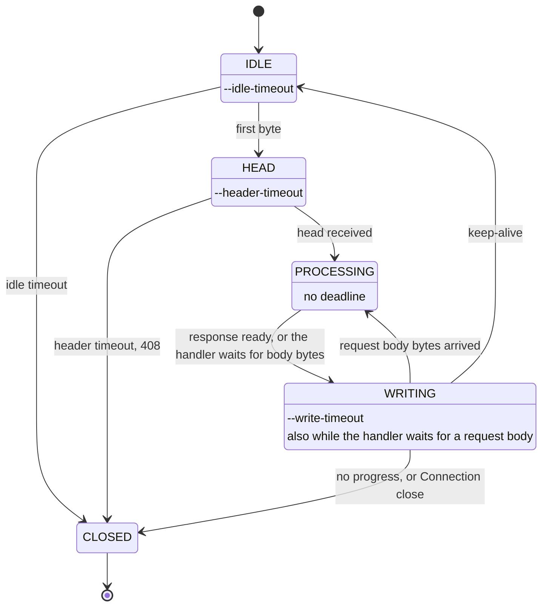
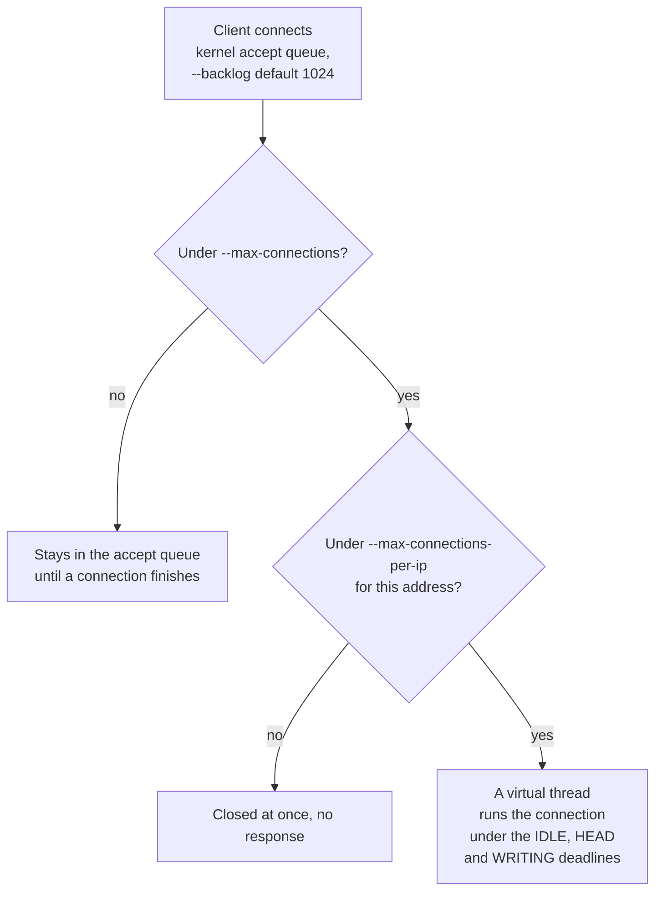

# HTTP/1.x

Serves GET and HEAD, and OPTIONS (`200` with `Allow: GET, HEAD, OPTIONS`, also for `OPTIONS *`); other
known methods get 405, unknown ones 501. HTTP/1.0 and 1.1 with keep-alive and pipelining; request bodies
(`Content-Length` or `chunked`) are read and discarded, `ETag` / `If-None-Match` / `If-Modified-Since`, single byte ranges
(`Range` / `If-Range`), directory listings, and `index.html`.
Responses carry the RFC 9110 reason phrase for every registered status code (plus 429); an unregistered
code gets an empty phrase (`HTTP/1.1 599 `) and an error page titled with the bare code. File types come
from the extension (`core.Mime`; unknown: `application/octet-stream`), with `charset=utf-8` on `text/*`,
JavaScript, JSON, SVG, XML and web manifests. Dotfiles and symlinks leading outside the root are never served.

**HTTP/1.1 connections** run on blocking `SocketChannel`s, one virtual thread each. One timer thread
enforces every deadline (no per-socket timeouts): `--idle-timeout` between requests,
`--header-timeout` from the first byte of a request until its head (and any small body to discard,
also after a `100 Continue`) has arrived (then `408` and close: slowloris), and `--write-timeout` without progress while a response
is being written (a client that stops reading is closed; a slow download that keeps moving is not).
Files larger than 64 KiB that are not in the cache go out with `sendfile` (`FileChannel.transferTo`);
a file that shrinks during the transfer ends the connection (the response can't be completed).
An idle keep-alive connection holds a 256 B input buffer (2 KiB only while a request needs it) and no output buffer.

Each connection moves through four states, and the timer thread applies the deadline of the state it is in:

**Admission.** The connection cap is applied before `accept`, so clients over it wait in the kernel's
accept queue (`--backlog`); the per-address cap is applied after it.

**Per-address caps behind a reverse proxy or NAT.** The caps count connections per client address
(IPv4: the full address; IPv6: its /64 prefix, since one host can use any address of its /64). Behind a
reverse proxy, load balancer or a shared NAT every client arrives from the same address, so the whole
server is then limited to the per-address cap (256 HTTP/1.1 connections, 16 QUIC connections): raise
`--max-connections-per-ip` / `--h3-max-connections-per-ip` there (e.g. to `--max-connections` /
`--h3-max-connections`).
