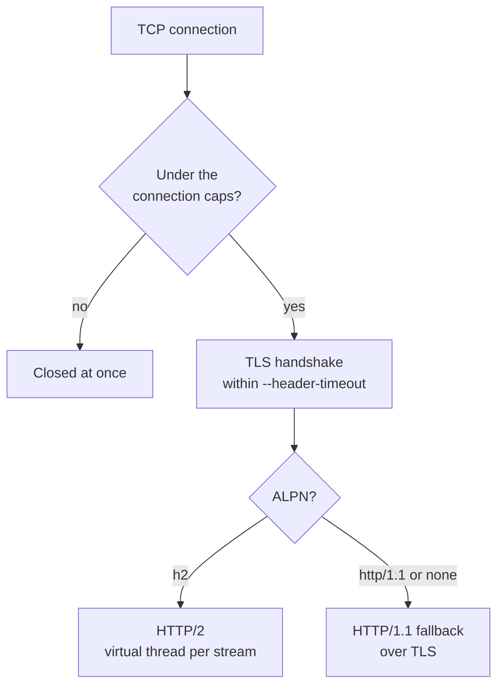
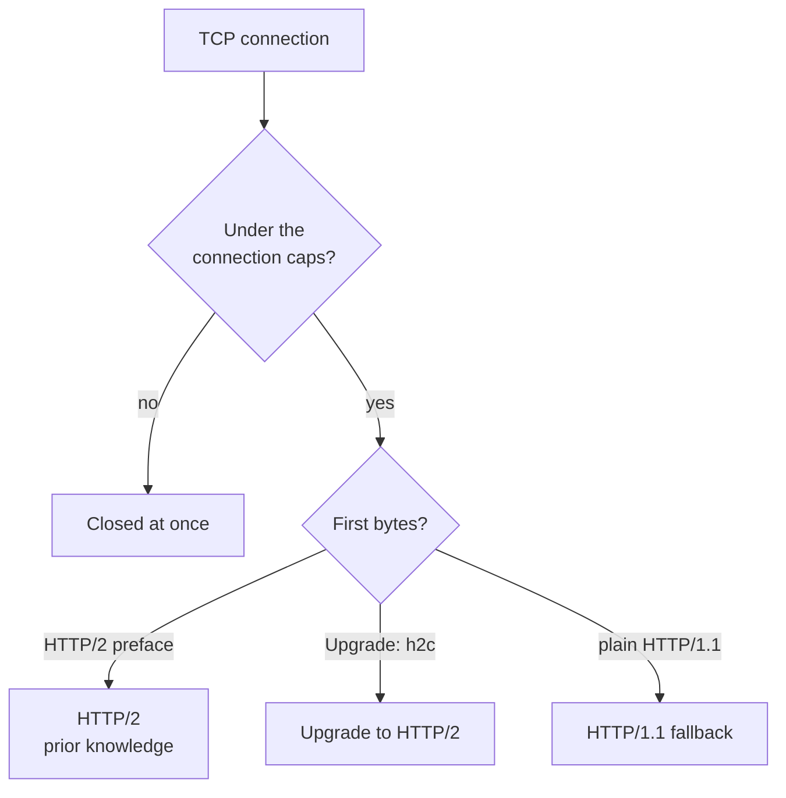

# HTTP/2

HTTP/2 is opt-in and runs on its **own TCP port**, next to HTTP/1.1 (whose listener and connection
handling are unchanged by it), serving the same files through the same handler.

What a connection speaks depends on the listener it arrived on. Both listeners first apply the
connection caps (`--max-connections`, and per client address the lower of `--max-connections-per-ip` and 16). The TLS listener (`--h2-port`):

The cleartext listener (`--h2c-port`, optional):

| Option | Environment | Default | |
|---|---|---|---|
| `--h2` / `--no-h2` | `WEB_SERVER_H2` (`true/false/1/0/yes/no/on/off`) | off | enable HTTP/2 over TLS (ALPN `h2`, falling back to `http/1.1` for clients that don't offer it) |
| `--h2-port=N` | `WEB_SERVER_H2_PORT` | 8443 | TCP port of the TLS listener; `0` = ephemeral |
| `--h2c-port=N` | `WEB_SERVER_H2C_PORT` | off | cleartext HTTP/2 port: prior knowledge or `Upgrade: h2c`, otherwise HTTP/1.1; needs `--h2` |

* The certificate options (`--cert`, `--key`, `--key-password-file`, below) are shared with HTTP/3;
  without them a self-signed `localhost` certificate is generated.
* Limits (`sjws_nettask.h2.Http2Server.Limits`): 100 concurrent streams per connection
  (`SETTINGS_MAX_CONCURRENT_STREAMS`, extra streams get `REFUSED_STREAM`), 16 KiB header list
  (`SETTINGS_MAX_HEADER_LIST_SIZE`), at most 100 `RST_STREAM` per 10 s from a client (rapid reset,
  CVE-2023-44487: `GOAWAY ENHANCE_YOUR_CALM` and close), at most 16 consecutive small `CONTINUATION`
  frames (CONTINUATION flood: `GOAWAY` and close), 4096 requests in flight and 512 file responses
  streaming server-wide, `--max-connections`, 16 connections per client address (or `--max-connections-per-ip` when lower), the TLS handshake within
  `--header-timeout`, idle connections closed after `--idle-timeout`, a stream whose peer window stays closed for 5 s is cancelled, and a write that makes no
  progress for `--write-timeout` is reset. File bodies are sent at the pace of the peer's
  flow-control windows, one 64 KiB chunk per stream in memory at most.
* Connection receive window: after the peer SETTINGS exchange the server raises the
  connection window to **1 MiB** (from the HTTP/2 default 64 KiB). That caps unconsumed
  request `DATA` across all streams on one connection, so one paused unread body cannot
  head-of-line-block siblings. Per-stream app buffering for a paused body stays about the
  `Http2RequestBody` HIGH watermark (16 KiB) plus in-flight; with the default
  `SETTINGS_MAX_CONCURRENT_STREAMS` of 100, a worst-case sketch is on the order of ~1 MiB
  unconsumed + ≤100×HIGH app queues (~1.6 MiB) per connection — finite, not unbounded.
* Quick check: `curl -k --http2 https://127.0.0.1:8443/` (h2), `curl --http2-prior-knowledge
  http://127.0.0.1:<h2c-port>/` (h2c).

## Config reload and the 30 s generation drain

On reload, HTTP/2 publishes a new handler generation and keeps the previous one alive until
in-flight stream Tasks (and HTTP/1.1 fallback Tasks on the same listeners) leave. If those Tasks
do not finish within **30 seconds**, the previous config snapshot is force-closed — in-flight
proxy work on that generation can be cut. Errors from that path must not include secret material
(API keys, upstream credentials). Rapid reloads can retain several replaced generations (and their
upstream pools) concurrently for up to 30 s each; prefer spacing reloads when many long proxy
requests are in flight.

